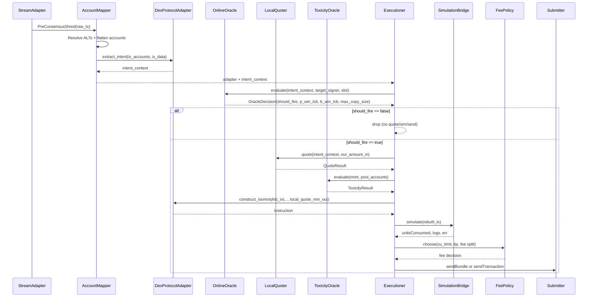

# PROJECT SHADOW ENGINE V3.6

**Engineer Handoff Specification (Locked)**

- Status: Implementation specification for simulation-driven testing phase
- Supersedes: V3.5 spec and all prior addenda
- Target ecosystem: Solana Mainnet
- Primary venues: Raydium V4 first; Pump/PumpSwap only through versioned adapters
- Execution model: Pre-consensus ingestion, local protocol reconstruction, local quote, simulation-driven compute budgeting, Jito-aware fee policy


---#### V3.6 Runtime Addendum (Hybrid Architecture, Shared Memory IPC, and Fault Domains)

This addendum is **mandatory** and supersedes any conflicting implementation details elsewhere in the spec.

**Decision:** The system is implemented as a **hybrid** architecture with hard fault-domain separation:

- **Cold Path (Python):** Oracle batch/nearline pipelines (Module 1) + Risk Oracle (mint risk profiling) only.
- **Hot Path (Rust):** Entry execution engine (Modules 2–8) and Online Oracle gate evaluation (cache-only).
- **Lifeboat (Rust):** Autonomous Position Manager (Module 11) as a **separate OS process / binary** with an independent failure domain.
- **On-chain (Rust/Anchor):** Optional in Phase 1, **mandatory in Phase 2 war mode**: MEV Router program for atomic on-chain assertions (Module 12).

Rationale (engineering constraints, not ideology):
- Python runtime jitter (GIL scheduling + allocation/GC pauses + FFI overhead) is unacceptable on the pre-consensus hot path.
- Exits must survive entry-engine crashes.
- Redis socket IPC is acceptable for low-frequency control-plane updates, but not as the hot-path truth source at the moment of decision.

### 0.1 Process topology

**Process A — `shadow-entry-engine` (Rust)**
- Consumes the low-latency feed (Yellowstone/Jito-class).
- Maintains ALT cache, fork-aware state synchronizer, protocol adapters, quoting, sizing, risk gates (cache-only), simulation, fee planning, and submission routing.
- Evaluates the Online Oracle gate via **hot-cache reads only** (no Python calls, no network fetches for gating).

**Process B — `shadow-position-manager` (Rust)**
- Maintains the live inventory book and enforces autonomous exits.
- Runs continuously regardless of Entry Engine health.
- Uses the same submission stack (simulation/fees/submitter) but with stricter caps and retry limits.

**Process C — `shadow-oracle` (Python)**
- Runs batch/nearline workloads: entity resolution, crowdedness, conviction baselines, conservative EV estimates.
- Runs mint-risk profiling (holder clustering, CEX destination lists, known staking/locker allowlists) asynchronously.
- Publishes *only* lightweight artifacts (targets + mint risk decisions) to shared memory.

### 0.2 Inter-process contracts (shared memory is canonical for production)

**Production rule:** The Entry Engine must not block on network-socket IPC (e.g., Redis reads) on the hot path.

**Canonical bridge:** versioned payloads published via `mmap` in `/dev/shm` (Linux tmpfs), using a lock-free, atomic-commit pattern.

Required shared-memory segments (paths are configurable):
- `/dev/shm/shadow_oracle_watchlist` → wallet→entity mapping for subscription updates
- `/dev/shm/shadow_oracle_entities` → entity registry (gating + EV fields)
- `/dev/shm/shadow_mint_risk` → mint risk registry (APPROVE/REJECT/UNKNOWN with cached metrics)
- `/dev/shm/shadow_heartbeats` → process health + kill switch

**Atomic update rule (seqlock pattern):**
- Writer increments `seq` to an odd value (write-in-progress).
- Writer writes `payload_len`, `crc32`, `version`, and payload bytes.
- Writer increments `seq` to the next even value (commit).
- Reader accepts a snapshot only when:
  - `seq` is even, and
  - the `seq` before/after read matches, and
  - `crc32(payload)` matches header.

**Phase 1 (Validation) allowance:**
- Redis may be used as an upstream transport between the warehouse/Python and the execution host **only if** a local writer process continuously mirrors Redis→shared-memory.
- The hot path still reads shared memory only.

### 0.3 Safety gating between processes

- The Entry Engine must not open new positions unless:
  - it can read a fresh Position Manager heartbeat inside a small TTL (configurable), and
  - the Position Manager reports `healthy=true`.
- If the Position Manager is unhealthy/unreachable, the Entry Engine enters **OBSERVE-ONLY** mode (no entries).

### 0.4 Repo layout (recommended)

- `rust/` as a Cargo workspace:
  - `crates/entry_engine`
  - `crates/position_manager`
  - `crates/protocols` (Raydium/Pump adapters)
  - `crates/feed` (Yellowstone/Jito stream adapters)
  - `crates/state_sync` (fork-aware in-memory state)
  - `crates/submitter` (Jito + leader-aware + staked fallback)
  - `crates/shared_mem` (seqlock mmap readers/writers + schemas)
  - `crates/types` (shared structs + schema versions)

- `python/` as a separate package:
  - `shadow_oracle/` (Module 1)
  - publishes to shared memory using the schema in `crates/types` (or `crates/shared_mem`)

- `programs/` as an Anchor workspace (Module 12):
  - `shadow_mev_router` (MEV Router contract)

### 0.5 Infrastructure phasing policy (cost control)

This spec supports a two-stage deployment strategy:

- **Phase 1 (Validation / Dry-Run):** Shared Yellowstone-capable provider + dry-run persistence until simulated PnL and stability criteria are met.
- **Phase 2 (War / Live Capital):** Dedicated bare-metal / colocated deployment only after Phase 1 gates pass.

(Infra provisioning details remain out of scope for this repo; only the runtime contracts and toggles are specified.)
--

---

## V3.6 Master Vulnerability Matrix Mandate (17 Items, Final)

This addendum is **mandatory** and supersedes any conflicting details elsewhere in the spec.

This project must be engineered to explicitly mitigate **all** items below. They are grouped by domain and each item maps to one or more modules.

### Domain 1 — State & Latency (Microsecond correctness)

1. **Micro-fork “ghost state” corruption** → fork-aware state synchronizer with rollbacks (Module 4B / `state_sync`).
2. **IPC latency ceiling** → shared-memory (`mmap`/`/dev/shm`) canonical contracts; Redis allowed only as upstream mirroring in Phase 1 (Runtime Addendum).
3. **Hot-path RPC trap** → no blocking network I/O for gating/risk on the hot path; mint-risk and holder checks must be asynchronous and cached (Modules 1 + shared `mint_risk` cache).
4. **Event-loop contention / shred dropper** → OS-level process isolation; ingestion thread does nothing except ingest + enqueue (Modules 2/8/11).

### Domain 2 — MEV Defense & Execution (PvP robustness)

5. **Deterministic slippage / sandwich magnet** → dynamic slippage policy derived per trade (pool depth, price impact, conviction) with optional deterministic jitter (Module 6).
6. **Lack of on-chain atomic verification** → MEV Router smart contract to assert post-target state and abort if invariants fail (Module 12 + Module 6 integration).
7. **T+1 backrun pricing paradox** → forward-simulate target impact and quote on post-target virtual curve (Module 4B).
8. **Stake-weighted QUIC drops** → non-Jito fallback must use staked delivery path by default (Module 7).

### Domain 3 — Asset mechanics & sizing (Micro-structure correctness)

9. **Whale-in-a-puddle sizing trap** → proportional sizing relative to target size plus pool-depth caps (Module 6).
10. **Contract-level honeypots (FreezeAuthority / TransferHook)** → in-memory mint assertions; hard reject if present (Module 4B state cache + Module 5 gate).
11. **Token-2022 transfer tax trap** → transfer-fee math applied before slippage (Module 4B).
12. **Pump.fun curve completion revert** → adapter computes completion risk and aborts near completion (Module 10.4 / Pump adapter).

### Domain 4 — Survival & capital preservation (Drain traps)

13. **WSOL vs native SOL fee starvation** → enforce native SOL reserve floor + reserve repair (Module 11 + Module 6 sizing).
14. **Position Manager amnesia (cold start desync)** → boot-time hydration aligns DB with on-chain balances (Module 11).
15. **Zombie exit death spiral** → max exit retries then `DEAD_ASSET` terminal state (Module 11).
16. **ATA rent bleed** → CloseAccount on full exit when safe (Module 11).
17. **Transfer Bypass false positives** → destination classification: CEX/fresh wallet = dump; staking/locker/vault = hold (Module 11).


 V3.4 Operational Addendum (Risk & Time-to-Market Guardrails)

This addendum is **mandatory** and supersedes any conflicting details elsewhere in the spec.

The V3.3 architecture is approved for low-latency entry, but five operational guardrails are required to prevent capital bleed and avoid data-engineering scope traps:

1. **Module 11 (Position Manager / Exits):** The system must include an autonomous Position Manager that can exit positions **without relying on target-wallet sells**. Required exit mechanisms:
   - Hard stop-loss (default: -25% from entry)
   - Take-profit ratchet / trailing stop (configurable)
   - Time-based max hold (configurable)
   - **Transfer Bypass rule:** if the target entity’s token balance decreases without an observed DEX sell intent, trigger an emergency exit of our entire position.

2. **Module 4B (State Synchronizer for Local Quoter):** The Local Quoter may not perform blocking RPC reads of pool reserves on the hot path. Maintain a background, in-memory replica of required AMM pool accounts and relevant mint metadata (including Token-2022 extensions) fed by account-update streams. The hot path may only read from this in-memory state.

3. **Module 1A (Data Sourcing Policy):** Do **not** build a historical Solana indexer as part of this project. The Oracle’s heavy historical ingestion must be sourced from managed datasets (BigQuery/Dune/Bitquery/etc.). This repo’s “1A ingestion” exists for **fixture-driven correctness tests** and local development only; production Oracle runs are executed in the data warehouse and publish only a lightweight JSON registry/watchlist to the execution server.

4. **Token-2022 transfer fee/tax math:** The Local Quoter must detect Token-2022 mints and adjust `expected_out` and `min_out` for transfer fees (TransferFeeConfig) before applying slippage guardrails. Otherwise bundles will fail systematically on taxed tokens.

5. **Leader-aware submission (Non-Jito fallback):** The Submitter must maintain an in-memory leader schedule. When the current slot leader is not reachable through the Jito path, the engine must fall back to direct leader TPU submission (QUIC) with bounded retries and strict rate limits.

Engineering note: this addendum is an **append**, not a rewrite. Implement these guardrails as additional modules/components with clear interfaces.

---


---

## V3.4.1 Developer Notes (Deep Dark Forest Edge Cases)

This addendum is **mandatory** and supersedes any conflicting details elsewhere in the spec.

V3.4 closes the major architectural risks. The remaining threats are micro-structural execution edge cases. Implement the following five developer notes as hard requirements:

1. **T+1 State Quoting (Backrun Forward Simulation)**  
   When the engine backruns a target trade (bundle placement immediately behind the target), the Local Quoter must **not** quote against the pre-trade pool state.  
   **Requirement:** Quote against the **post-impact** pool state by forward-simulating the target’s swap into the AMM curve, then quoting our trade on the updated virtual reserves.  
   - Inputs: in-memory pool state snapshot (pre-trade), target `amount_in` and swap direction (from `intent_context`), pool fee parameters (from pool config or adapter).  
   - Output: `QuoteResult` computed on the virtual post-target reserves.  
   - Fail-closed: if pool fee parameters or required reserve accounts are missing, reject the trade (do not widen slippage to “make it pass”).  
   - Testing: a unit test must demonstrate that (for the same pre-state) `expected_out_post_target <= expected_out_pre_target`, and that `min_out` derived from the post-target quote does not exceed the pre-target quote.

2. **Stake-Weighted QoS for Non‑Jito Fallback**  
   Leader-aware fallback must not assume that raw QUIC sends from an arbitrary host will land reliably under congestion. Solana supports stake-weighted QoS for trusted/staked connections.  
   **Requirement:** Non‑Jito fallback must route through a **staked transaction path** (staked RPC / TPU relayer / provider “staked transaction” API).  
   - Implement `TpuFallbackSubmitter` with two modes:
     - `staked_provider` (required default): send via a provider’s staked/relayed transaction bandwidth path.
     - `raw_quic` (optional): allowed only in environments where you control a trusted stake-weighted peering configuration.
   - Testing: route selection must choose the staked-provider path when the current leader is non‑Jito and `staked_provider` is enabled.

3. **Position Manager Exit Retry Limit (“Zombie Exit” Prevention)**  
   Stop-loss and emergency exits must not loop indefinitely when liquidity is gone (hard rug) or swaps become unfillable.  
   **Requirement:** Enforce a per-position **max exit retry limit** (default 3). After N failed exit attempts, mark the asset as `DEAD_ASSET` and permanently stop attempting exits for that mint until manual intervention.  
   - Persist: record retry count, last error, and the terminal `DEAD_ASSET` state transition.
   - Testing: a unit test must show exit attempts stop after N failures and no further transactions are built for that mint.

4. **ATA Rent Recovery (Close Empty Token Accounts)**  
   Creating ATAs for new tokens accumulates rent costs.  
   **Requirement:** On a full exit (position size becomes zero), the exit transaction must include a `CloseAccount` instruction for the token ATA to reclaim rent **when safe** (token balance is zero).  
   - Token program correctness: use the correct token program (SPL Token vs Token‑2022) when closing.
   - Testing: a unit test must confirm the exit transaction builder appends `CloseAccount` after a successful full exit plan.

5. **Transfer Bypass Destination Classification (Reduce False Positives)**  
   The Transfer Bypass rule must not treat all target balance decreases as dumps.  
   **Requirement:** When target balance decreases without an observed DEX sell, classify the token transfer destination(s) before triggering emergency liquidation:  
   - **DUMP:** destination is a known CEX deposit address, a fresh/new wallet, or otherwise a non-recognized EOA sink.  
   - **HOLD / NO EMERGENCY EXIT:** destination is a recognized staking program, liquidity locker, or LP vault / program-controlled vault address.  
   - Implementation: add a `DestinationClassifier` component with allowlists/denylists (config-driven) and cached account-owner inspection for unknown destinations.  
   - Testing: fixtures must cover at least one “CEX-like destination” (dump) and one “staking/LP vault destination” (hold).

Engineering note: this addendum is an **append**, not a rewrite. Implement these as incremental requirements on Modules 4B (Local Quoter), 7 (Submitter), and 11 (Position Manager).

---


## V3.4.2 Final Developer Notes (Micro-Structural Physics Traps)

This addendum is **mandatory** and supersedes any conflicting details elsewhere in the spec.

V3.4.1 resolves the major architectural and data risks. The remaining failure modes are micro-structural “physics” traps that surface during high-volatility launches and market panics. Implement the following four requirements as hard constraints.

1. **Backrun pricing paradox (T+1 state)**  
   This is a restatement and reinforcement of the V3.4.1 forward-simulation requirement.  
   **Requirement:** when placing our transaction directly behind the target (bundle backrun or near-slot follow), the Local Quoter must quote against the **post-target virtual pool state** (forward-simulate the target swap into the curve, then quote our trade).  
   - Do not “solve” this by widening slippage. Fail closed if required pool params are missing.

2. **`WSOL` vs native SOL fee starvation (native SOL reserve floor)**  
   Swaps use WSOL, but base fees, priority fees, and Jito tips require **native SOL**.  
   **Requirement:** enforce an untouchable native SOL reserve floor at all times.  
   - Add `native_sol_reserve_floor_lamports` (default example: `250_000_000` = 0.25 SOL).  
   - Entry sizing and wrapping must never reduce native SOL below the reserve floor.  
   - If native SOL drops below the floor (due to rent, fees, tips, or other ops), the Position Manager must trigger a **reserve repair** action:
     - unwrap WSOL back to native SOL (for example by closing a WSOL token account), and/or
     - reduce/disable new entries until reserve is restored.
   - Any exit plan must verify native SOL sufficiency for worst-case exit fees/tips before attempting the exit.

3. **Event-loop contention (the shred dropper)**  
   Python `asyncio` runs on one interpreter thread (GIL). A heavy Position Manager loop can introduce jitter and cause silent packet drops on the ingestion side.  
   **Requirement:** run the Position Manager in an isolated execution context (separate process recommended) and communicate with the hot path via bounded queues.  
   - The ingestion + execution pipeline must remain non-blocking and must never run inventory loops on the same event loop.  
   - If using `multiprocessing`, the Position Manager must not hold shared locks that block ingestion. Prefer one-way signal queues and idempotent commands.

4. **Pump.fun curve completion revert (when Pump adapter is implemented)**  
   Pump.fun uses a virtual bonding curve and can reject buys once the curve completes / migrates.  
   **Requirement:** the Pump adapter must compute curve completion risk locally and **abort** entries likely to land after completion.  
   - Extract required curve state in `extract_intent(...)` (or from the state synchronizer) to compute remaining capacity.  
   - Add `abort_if_completion_within_pct` (default example: `0.05`).  
   - If `completion_after_target >= 1 - abort_if_completion_within_pct`, the adapter must return a non-copyable decision (do not pay tips for a guaranteed revert).

Engineering note: this addendum is an **append**, not a rewrite. Implement these as incremental requirements on Modules 4B (Local Quoter), 8 (Orchestration), 11 (Position Manager), and the Pump protocol adapter.

---


## 1. Executive summary

Project Shadow Engine is a low-latency Solana execution system that observes a curated set of target wallets, reconstructs their DEX intent locally, and decides whether to build and send a corresponding transaction through Jito or standard RPC.

This project does **not** use generic quote aggregators on the hot path for token entry. Instead, it relies on:

1. A **Predictive Alpha Oracle** that:
   - ingests full-history swaps/transfers (including rugs),
   - clusters wallets into entities (burner rotation aware),
   - scores *copy-adjusted* alpha (net of lag/fees/tips),
   - filters “burned” (crowded) entities,
   - and gates live trades using conviction anomaly detection.
2. A pre-consensus ingestion feed (Yellowstone gRPC deshred stream or Jito ShredStream-class feed).
3. Deterministic account resolution for v0 transactions and Address Lookup Tables (ALTs).
4. Protocol-specific adapters that decode intent and reconstruct a new instruction for our signer and ATAs.
5. Local pool-state quoting.
6. Owner-clustered concentration filtering.
7. Local simulation to derive `unitsConsumed` and set compute budget.
8. A fee policy that distinguishes Jito bundles from Jito `sendTransaction`.

This spec is written to be implementable by an engineer without referring back to prior memos.

---

## 2. Non-negotiable design decisions

### 2.0 Oracle targeting

Target selection is a first-class component of the architecture.

- The system must **not** rely on winner-only heuristics such as “tokens that reached X market cap” for target discovery.
- The Oracle must score **copy-adjusted** outcomes (net of lag/fees/tips), not raw target ROI.
- The Oracle must track **entities** (wallet clusters), not isolated wallets, to handle burner rotation.
- The Oracle must model **crowdedness** and mark burned entities, and it must gate live trades using **conviction anomaly** detection.
- The Online Oracle gate must be **hot-cache only** and must run before quoting/simulation/send.

### 2.1 Primary feed

The primary ingestion feed is **not** standard Solana PubSub WebSocket. Official Solana WebSocket methods are standard PubSub endpoints such as `logsSubscribe`, `accountSubscribe`, and `blockSubscribe`; they are retained only as fallback and reconciliation surfaces. `logsSubscribe` also supports only a single Pubkey in `mentions` per call. [R1][R2]

The primary feed must be one of:

- Yellowstone gRPC `SubscribeDeshred`
- A Jito ShredStream-based integration that normalizes into the same internal contract

Yellowstone's current proto explicitly documents deshred transactions as transactions received **before execution**, with no `TransactionStatusMeta`, and says address lookup tables are resolved so both static and loaded addresses are available for filtering. [R3]

### 2.2 Protocol reconstruction

We do **not** scale another wallet's `minimum_amount_out` and treat it as a quote. That was removed. `minimum_amount_out` is only a guardrail. Our `min_out` must come from a local, protocol-accurate quote built from current pool state.

### 2.3 Compute budgeting

We do **not** hardcode a 35k CU limit. We simulate locally, read `unitsConsumed`, then set the final compute-unit limit with margin. Solana's `simulateTransaction` response exposes `unitsConsumed`, `replacementBlockhash`, and logs. [R4]

### 2.4 Fee policy

Jito bundle bidding and Jito `sendTransaction` are treated differently:

- For `sendBundle`, only the Jito tip matters. [R5]
- For `sendTransaction`, Jito recommends a 70/30 split between priority fee and Jito tip. [R5]

### 2.5 Safety and filtering

The concentration filter is an **early rejector**, not proof that a token is safe. It can only reject obvious concentration or clustering patterns quickly.

### 2.6 Versioned transactions

The engine must treat Solana v0 transactions and ALTs as first-class. RPC readers that fetch versioned transactions for fallback/reconciliation must set `maxSupportedTransactionVersion=0` where applicable. [R6]

---

## 3. Scope

### 3.1 In scope

- Offline Predictive Alpha Oracle (entity scoring, entity resolution, crowdedness, conviction) and target registry management
- Pre-consensus ingestion
- ALT-aware transaction decompilation
- Raydium V4 buy/sell reconstruction
- Local quote integration
- Owner-clustered concentration filter
- Simulation-driven compute and fee selection
- Jito single-tx and bundle submission
- Dry-run mode and paper trading
- Benchmarks against fallback WebSocket logs
- SQLite or Postgres persistence for telemetry and replay

### 3.2 Out of scope for first production candidate

- Generic aggregator routing on the hot path
- Static byte decoders for Pump without an adapter pinned to current docs/IDL
- Multi-hop aggregator routing
- Fully generalized DEX support across all AMMs
- Live-capital deployment before dry-run acceptance criteria pass

---

## 4. Target architecture


### 4.1 Modules

1. **Predictive Alpha Oracle**
   - Ingests full-history swaps and transfers (including rugs).
   - Clusters wallets into human-level entities (burner rotation aware).
   - Scores *copy-adjusted* alpha (net of lag, fees, and tips), not target-wallet ROI.
   - Computes crowdedness (alpha decay) and conviction thresholds.
   - Publishes:
     - **Wallet watchlist** for the feed adapter
     - **Entity registry** with conservative EV inputs (`p_win_lcb`, `b_win_lcb`) and policy caps
     - A hot-cache **Online Oracle** gate used before quoting/simulation

2. **Ingestion**
   - Maintains low-latency stream connection.
   - Normalizes vendor-specific feed data into a single internal object.

3. **Mapping and protocol routing**
   - Resolves ALTs.
   - Flattens account keys.
   - Finds relevant AMM instruction.
   - Routes to the correct protocol adapter.

4. **Oracle gating**
   - Evaluates whether the observed trade is worth copying now:
     - entity active vs burned/retired
     - crowdedness threshold
     - conviction anomaly threshold
     - per-entity max copy-size cap

5. **Quoting and filtering**
   - Fetches local pool state.
   - Produces protocol-accurate expected out and min out.
   - Applies owner-clustered concentration checks.

6. **Execution**
   - Reconstructs a new instruction using our signer and ATAs.
   - Adds compute budget instructions.
   - Simulates locally.
   - Calculates fee/tip.
   - Submits to Jito or RPC.

7. **Position Manager (Module 11)**
   - Tracks our live inventory and entry prices.
   - Enforces autonomous exits (stop-loss, take-profit ratchet, timeouts).
   - Detects target "transfer bypass" exits (target balance decreases without DEX sell) and triggers emergency liquidation.

8. **Observability**
   - Persists every step.
   - Benchmarks feed arrival delta.
   - Supports replay and dry-run analysis.

---

## 5. Data model

### 5.1 Core runtime object

```python
from dataclasses import dataclass
from solders.transaction import VersionedTransaction
from solders.pubkey import Pubkey

@dataclass
class PreConsensusShred:
    signature: str
    target_signer: Pubkey
    raw_tx: VersionedTransaction
    slot: int
    is_jitodontfront: bool
```

### 5.2 Oracle registry records

The Oracle publishes **entity-level** targets (for scoring and gating) and a **wallet watchlist** (for the feed filter).

```python
from dataclasses import dataclass
from typing import List, Optional

@dataclass
class WalletWatch:
    wallet: str
    entity_id: str
    enabled: bool

@dataclass
class ActiveEntityTarget:
    entity_id: str
    wallets: List[str]
    confidence: float
    state: str  # candidate | active | burned | retired

    # Conservative, copy-adjusted EV inputs (use lower confidence bounds)
    p_win_lcb: float
    b_win_lcb: float
    trade_count: int

    # Alpha quality / decay features used for selection
    profit_factor_5m: float
    sortino_5m: float
    crowdedness_percentile: float

    # Conviction baseline for anomaly detection (log-size robust stats)
    conviction_log_size_median: float
    conviction_log_size_mad: float

    # Safety / sizing policy
    max_copy_size_sol: float

@dataclass
class OracleDecision:
    entity_id: str
    observed_wallet: str
    should_fire: bool
    reason: Optional[str]

    # Passed through to downstream sizing/fee logic
    p_win_lcb: float
    b_win_lcb: float
    max_copy_size_sol: float

    # Diagnostics
    conviction_score: float
    crowdedness_score: float
```

The execution engine uses:

- `WalletWatch.wallet` to update `StreamAdapter.update_subscriptions()`
- `OracleDecision.should_fire` to decide whether to proceed past intent extraction
- `OracleDecision.p_win_lcb` and `OracleDecision.b_win_lcb` as conservative Kelly inputs


### 5.3 Intent context returned by a DEX adapter

```python
{
  "protocol": "raydium_v4",
  "variant": "swap_base_in",
  "swap_side": "buy",
  "target_amount_in": 250000000,
  "target_min_amount_out": 123456789,
  "instruction_index": 0,
  "program_id": Pubkey(...),
  "instruction_accounts": [...],
  "flat_accounts": [...],
  "amm": Pubkey(...),
  "market": Pubkey(...),
  ...
}
```

### 5.4 Quote result

```python
@dataclass
class QuoteResult:
    expected_out: int
    min_out: int
    price_impact_bps: int
    slot: int
    source: str
```

### 5.5 Toxicity result

```python
@dataclass
class ToxicityResult:
    passed: bool
    entropy_bits: float
    effective_holders: float
    gini: float
    top1_share: float
    top5_share: float
    owner_count: int
    reason: str | None
```

---

## 6. End-to-end execution flow



### 6.1 Fast-path rules

The executioner must drop early when any of the following is true:

- `PreConsensusShred.is_jitodontfront == True`
- ALT resolution fails and no hot cache entry is available
- DEX adapter cannot decode the instruction deterministically
- Online Oracle gate denies the trade (inactive/burned entity, insufficient conviction, or policy cap)
- Local quote is stale beyond configured slot age
- Toxicity filter fails
- Local simulation returns an error
- Blockhash cannot be refreshed in time

---

## 7. Predictive Alpha Oracle (Module 1)

### 7.1 Why the Oracle was redesigned

The V3 execution engine can only be as good as the target selection feeding it.

The original “market-cap scraper + wallet win rate” approach is explicitly **deprecated** because it fails under three well-known statistical/operational traps:

1. **Survivorship bias**: starting from tokens that already “made it” selects lucky outcomes and hides all rugs and failures.
2. **Wallet rotation**: elite actors do not reuse a single wallet 50+ times; scoring isolated public keys overweights influencers and underweights burner-based entities.
3. **Alpha decay / crowdedness**: profitable wallets become “burned” once widely monitored; copy execution becomes negatively convex under crowding.

The redesigned Oracle scores **copyable alpha**, not target ROI, and tracks **entities**, not single wallets.

### 7.2 Oracle architecture

The Oracle is implemented as three layers:

1. **Offline pipeline (batch)**
   - Ingest full-history swaps + transfers (including rugs).
   - Normalize swap events into trade records.
   - Label copy-adjusted forward returns at multiple horizons.
   - Build wallet-graph edges and cluster wallets into entities.
   - Compute crowdedness and conviction baselines.
   - Score entities using risk-adjusted, conservative metrics.
   - Publish the Entity Target Registry + Wallet Watchlist.

2. **Nearline updater (continuous, not hot path)**
   - Refresh entity membership when new burner wallets are discovered.
   - Update crowdedness decay and recency features.
   - Update rolling conviction baselines.

3. **Online Oracle gate (hot path)**
   - Performs only **hot-cache lookups** + lightweight arithmetic.
   - Given a decoded trade intent (amount in, mints, slot), decides whether the engine should proceed.

### 7.3 Four pillars (required capabilities)

The Oracle must implement these capabilities before it is considered production-ready.

#### Pillar 1 — Global ledger EV (copy-adjusted) and risk-adjusted scoring

Do not use raw wallet win-rate as the primary score.

Required metrics are computed on **copy-adjusted outcomes** (net of lag, fees, and tip assumptions), at a primary horizon (default 5 minutes) plus auxiliary horizons (30s, 30m).

Minimum required metrics per entity:

- **Profit Factor**: gross winning PnL / gross losing PnL (copy-adjusted)
- **Sortino Ratio**: mean return / downside semideviation (copy-adjusted)
- **Hit rate** and return distribution diagnostics (copy-adjusted)

These metrics must include *all trades*, including rugs, to avoid survivorship bias.

#### Pillar 2 — Sybil graphing and entity resolution

The Oracle tracks **entities** (clusters of wallets), not isolated pubkeys.

Entity resolution must be **probabilistic and explainable**:

- Build weighted edges from:
  - direct SOL funding transfers
  - sweep transfers (profits consolidated)
  - shared funder timing clusters
  - execution fingerprint similarity (secondary reinforcement only)
- Cluster wallets into entities conservatively (fail closed on weak-only links).
- Persist edge evidence so merges can be audited.

#### Pillar 3 — Crowdedness score (alpha decay)

Before an entity is activated, the Oracle must estimate whether it is already widely surveilled.

For each historical buy trade:

- Count distinct “follower” buys of the same token in the same slot and T+1 slot.
- Exclude wallets belonging to the same entity.
- Normalize by token-level baseline activity in a local window.

Entities whose recent trades consistently show high abnormal follower activity are marked **burned** and must be excluded from the active registry.

#### Pillar 4 — Conviction anomaly detection

The online gate must avoid spending tips on test trades.

Each entity maintains a rolling baseline of trade sizes (use log-size robust stats):

- median(log(size))
- MAD(log(size))

The online gate computes a robust anomaly score for the current observed buy.
Only when conviction exceeds threshold (and the entity is not burned) does the execution engine proceed.

### 7.4 Conservative `p_win` / `b_win` for Kelly bidding

The execution engine consumes `p_win` and `b_win` as inputs to fee weighting, but they must be conservative.

Required policy:

- Compute `p_win` and `b_win` on **copy-adjusted** returns at the primary horizon.
- Apply **empirical Bayes shrinkage** to reduce small-sample overconfidence.
- Prefer **lower confidence bounds** (`p_win_lcb`, `b_win_lcb`) over naive means.

Definitions:

- `p_win_lcb`: conservative probability that copy-adjusted ROI exceeds configured win threshold.
- `b_win_lcb`: conservative win multiple on winning copy-adjusted trades (shrunken toward global prior).

### 7.5 Required outputs (contracts)

The Oracle must publish two artifacts:

1. **Wallet watchlist** (for feed filtering)
   - List of wallet pubkeys to subscribe to.
   - Each wallet maps to an `entity_id`.

2. **Entity registry** (for online gating + fee sizing)
   - Entity state: `candidate | active | burned | retired`
   - `p_win_lcb`, `b_win_lcb`, `trade_count`
   - crowdedness percentile
   - conviction baseline stats
   - max copy-size cap

Example (shape only):

```json
{
  "entity_id": "ent_4f…",
  "wallets": ["A…", "B…"],
  "state": "active",
  "confidence": 0.92,
  "p_win_lcb": 0.58,
  "b_win_lcb": 1.34,
  "profit_factor_5m": 2.7,
  "sortino_5m": 1.9,
  "crowdedness_percentile": 0.12,
  "conviction_log_size_median": -0.41,
  "conviction_log_size_mad": 0.37,
  "max_copy_size_sol": 1.5
}
```

### 7.6 Integration into the execution path

The Online Oracle gate is evaluated **after** intent extraction and **before** local quoting/simulation.

Required behavior:

- If Oracle returns `should_fire == False`, abort immediately (no quote, no simulation, no send).
- If Oracle returns `should_fire == True`, pass `p_win_lcb` / `b_win_lcb` into the fee policy as the EV weight.

### 7.7 Oracle acceptance criteria (done-when)

The Oracle is considered “implemented” when:

- Historical trades are labeled with copy-adjusted outcomes at the configured horizons.
- Entity clustering produces stable outputs on fixture replays and stores merge evidence.
- Crowdedness scores correctly flag “burned” entities on labeled fixtures.
- Conviction anomaly detection gates small test trades and triggers on large anomalies.
- The Online Oracle gate can evaluate a live intent without cold historical scans (cache-only).

---

## 8. Feed adapter contract

### 8.1 Required interface

```python
import asyncio
from abc import ABC, abstractmethod
from typing import AsyncGenerator, List
from dataclasses import dataclass
from solders.transaction import VersionedTransaction
from solders.pubkey import Pubkey

@dataclass
class PreConsensusShred:
    signature: str
    target_signer: Pubkey
    raw_tx: VersionedTransaction
    slot: int
    is_jitodontfront: bool

class StreamAdapter(ABC):
    @abstractmethod
    async def connect(self) -> None:
        pass

    @abstractmethod
    async def update_subscriptions(self, pubkeys: List[Pubkey]) -> None:
        pass

    @abstractmethod
    async def stream(self) -> AsyncGenerator[PreConsensusShred, None]:
        pass
```

### 8.2 Primary implementation: YellowstoneGrpcAdapter

The first implementation must target Yellowstone gRPC.

#### Requirements

- Prefer `SubscribeDeshred` over ordinary transaction subscription.
- Inject generated protobuf modules at the edge.
- Hide vendor-specific protobuf details from the core engine.
- Maintain automatic reconnect with bounded exponential backoff.
- Maintain a heartbeat/ping loop.
- Support dynamic resubscription without process restart.
- Deduplicate signatures locally.
- Mark `is_jitodontfront` if any static or loaded account begins with `jitodontfront`.

#### Why this is the primary feed

The Yellowstone proto currently defines `SubscribeDeshred` for transactions received before execution and states that address lookup tables are resolved so both static and loaded addresses are available for filtering. [R3]

### 8.3 Fallback feed

Fallback is standard Solana RPC WebSocket for reconciliation and benchmark comparison only.

#### Requirements

- Use `logsSubscribe` for target-wallet mentions when needed.
- Maintain one subscription per target if using `mentions`, because `mentions` supports only one Pubkey per call. [R2]
- Use fallback for correlation and arrival-delta measurement, not primary execution.

### 8.4 Benchmark requirement

The engine must include a harness that correlates the same signature seen on:

- pre-consensus feed
- fallback WebSocket feed

The benchmark must report:

- sample count
- median arrival delta in ms
- p95 arrival delta in ms
- slot deltas where available

---

## 9. Account mapper and ALT handling

### 9.1 Required interfaces

```python
from abc import ABC, abstractmethod
from typing import List, Dict, Optional
from solders.pubkey import Pubkey
from solders.message import MessageV0
from solders.instruction import Instruction
from solders.address_lookup_table_account import AddressLookupTableAccount

class AltCacheManager(ABC):
    @abstractmethod
    async def resolve_lookups(self, lookups: List[any]) -> Dict[str, AddressLookupTableAccount]:
        pass

class DexProtocolAdapter(ABC):
    @property
    @abstractmethod
    def program_ids(self) -> List[Pubkey]:
        pass

    @abstractmethod
    def extract_intent(self, resolved_accounts: List[Pubkey], ix_data: bytes) -> dict:
        pass

    @abstractmethod
    def construct_isomorphic_ix(
        self,
        intent_context: dict,
        our_signer: Pubkey,
        our_wsol_ata: Pubkey,
        our_token_ata: Pubkey,
        our_amount_in: int,
        local_quote_min_out: int,
    ) -> Instruction:
        pass
```

### 9.2 Flattening rule

ALT flattening must match Solana runtime account ordering exactly:

```text
flat_accounts = static_account_keys
              + loaded_writable_alt_addresses
              + loaded_readonly_alt_addresses
```

That ordering matches the loaded-account model used by the Solana runtime for v0 messages. [R7]

### 9.3 ALT cache behavior

`AltCacheManager` must be local-cache first.

#### Required behavior

- First attempt: memory or Redis cache
- Cache key: lookup table pubkey string
- Cache value: full `AddressLookupTableAccount`
- Positive TTL: configurable, default 300s
- On miss: fetch from RPC or a local indexer
- On miss during hot path: if fetch cannot complete inside budget, abort the trade
- Cache metrics:
  - hit count
  - miss count
  - stale hit count
  - average resolve time

### 9.4 AccountMapper behavior

The mapper must:

1. Read the `VersionedTransaction.message`.
2. Resolve `address_table_lookups` if present.
3. Flatten full account list.
4. Walk compiled instructions.
5. Identify the first supported program id.
6. Pass the **instruction-resolved account slice** into `DexProtocolAdapter.extract_intent()`.
7. Return `(adapter, intent_context)`.

Important: `extract_intent()` must receive the instruction-specific account list, not the entire flattened transaction account list.

---

## 10. DEX protocol adapters

### 10.1 Design goals

Protocol adapters exist to keep protocol-specific decoding and reconstruction isolated from the executioner.

Each adapter must be:

- versioned
- unit tested against real transactions
- pinned to official source, IDL, or current public docs
- replaceable without changing the executioner

### 10.2 Required adapter methods

#### `extract_intent(resolved_accounts, ix_data)`
Returns a normalized context containing at minimum:

- protocol name
- variant name
- direction (`buy` or `sell`)
- target amount in
- target min out
- protocol accounts used by the instruction

#### `construct_isomorphic_ix(...)`
Builds a new instruction for:

- our signer
- our WSOL ATA
- our token ATA
- our chosen amount in
- our locally quoted `min_out`

### 10.3 Initial adapter: Raydium V4

#### Program IDs

- Mainnet: `675kPX9MHTjS2zt1qfr1NYHuzeLXfQM9H24wFSUt1Mp8`
- Devnet: `DRaya7Kj3aMWQSy19kSjvmuwq9docCHofyP9kanQGaav`

#### Verified instruction layout

Raydium's current public source defines `SwapInstructionBaseIn` as:

- `amount_in: u64`
- `minimum_amount_out: u64`

and the `swap_base_in(...)` helper packs `AmmInstruction::SwapBaseIn(SwapInstructionBaseIn { amount_in, minimum_amount_out })`. The discriminator for `SwapBaseIn` is `9`, making the packed layout effectively `<BQQ>` for the variant used by current decoders. [R8]

#### Verified account order for `swap_base_in`

Raydium's public source shows the `swap_base_in(...)` helper constructing accounts in this order: [R8]

1. SPL Token program
2. AMM account
3. AMM authority
4. AMM open orders
5. AMM coin vault
6. AMM pc vault
7. Market program
8. Market
9. Market bids
10. Market asks
11. Market event queue
12. Market coin vault
13. Market pc vault
14. Market vault signer
15. User source token account
16. User destination token account
17. User wallet signer

Some observed transactions may include an extra target-orders account depending on program path. The adapter must validate actual account count and layout before reconstruction.

#### Adapter rules

- Decode exact instruction bytes.
- Reject unsupported discriminator or byte length.
- Infer swap side from source/destination accounts and mint context.
- Never derive `min_out` from the target's `minimum_amount_out`.
- Rebuild accounts using our signer and ATAs.
- Keep protocol-owned pool and market accounts unchanged.
- Return a new `Instruction` only if all required accounts are mapped deterministically.

### 10.4 Pump and PumpSwap adapters

Pump and PumpSwap must be implemented only as versioned adapters pinned to the current official public docs / IDL repository. No static byte assumptions are allowed. [R9]

#### Pump.fun curve completion guard (mandatory when Pump adapter is implemented)

Pump.fun is not a constant-product AMM. It is a bonding curve that can **stop accepting buys** when the curve completes and liquidity migrates.

- The Pump adapter must extract enough curve state (from the instruction accounts and/or the in-memory state synchronizer) to estimate completion risk.
- Compute completion both **before** and **after** the target’s `amount_in`:
  - `completion_after_target = f(curve_state, target_amount_in)`
- If `completion_after_target >= 1 - abort_if_completion_within_pct`, then **ABORT** (do not build or submit our backrun entry).
- This is a deterministic abort condition: do not compensate by widening slippage or paying higher fees.

Testing requirement: a fixture must demonstrate that when `completion_after_target` exceeds the threshold (default 95%), the adapter returns a non-copyable decision.


---

## 11. Local quoter

### 11.1 Contract

```python
class LocalQuoter(ABC):
    @abstractmethod
    async def quote(self, intent_context: dict, our_amount_in: int) -> QuoteResult:
        pass
```

### 11.2 Requirements

- Must operate from local pool-state snapshots.
- Must report the slot used for the quote.
- Must produce `expected_out` and `min_out`.
- Must reject if snapshot is too stale.
- Must be protocol accurate for the adapter in use.
- Must not do network routing to a generic aggregator on the hot path.

### 11.2A Background state synchronizer (mandatory)

The Local Quoter must be backed by a background state synchronizer that maintains an in-memory replica of:

- Active Raydium pool reserve accounts required for quoting (vault balances and any additional accounts needed for the protocol math).
- Mint metadata required to quote accurately (decimals and Token-2022 extensions where relevant).

#### Hot-path rule

- The Quoter must not perform blocking RPC reads to fetch pool reserves or mint metadata when a trade signal arrives.
- All required state must be served from the in-memory cache.
- If required state is missing or stale beyond the configured budget, the trade must be rejected (fail closed).

#### Cache freshness

- Each cached account record must include `slot_updated`.
- Quoting must reject if `current_slot - slot_updated > quote_max_slot_staleness` (default 2 slots).

#### Update sources

The state synchronizer may be fed from:

- an account-update stream from the same low-latency provider (preferred), and/or
- a dedicated background RPC fetcher that preloads and refreshes *known* pool accounts and mints outside the hot path.

#### 11.2A.1 Fork-aware rollbacks (mandatory)

Yellowstone/Geyser feeds are pre-consensus and Solana can micro-fork. The in-memory state cache must never become “ghost state.”

**Requirements:**
- Subscribe to slot-status/root updates from the same provider (or a secondary source) and track:
  - `processed`, `confirmed`, and `rooted` slots (or provider-equivalent statuses).
- Maintain a bounded **state-history buffer** (ring) of per-slot deltas:
  - for each account update, record `(slot, pubkey, previous_value_hash, previous_bytes)` before overwriting.
- On fork switch / dropped block signal:
  - roll back account states by replaying deltas in reverse for all non-rooted slots that are being abandoned.
- Only “commit” state as final once the slot is rooted; prune history <= rooted slot.

**Fail-closed rule:** if fork status cannot be determined reliably, do not quote from state for backrun entries (reject trade).

#### 11.2A.2 Mint invariant cache (mandatory)

The state cache must include mint-level invariants used for hard rejects without network I/O:
- Token program (SPL Token vs Token-2022)
- decimals
- **FreezeAuthority present?** (reject if present)
- **TransferHook present?** (Token-2022; reject if present)
- TransferFeeConfig (Token-2022; required for quote adjustment)

If mint metadata is missing for a mint involved in an entry decision, **reject** (do not fetch on hot path).


Engineering constraint: update ingestion must be asynchronous and must never block the Executioner hot path.


### 11.2B Backrun forward-simulation (mandatory for backrun mode)

When the engine places our entry directly behind the target trade in the same block (bundle backrun semantics), the Local Quoter must account for the target’s price impact.

**Requirement:** quote against a **virtual post-target pool state**:

1. Load the pool snapshot from in-memory state (`reserve_in`, `reserve_out`, fee parameters, and any protocol-specific state required for accurate math).
2. Forward-simulate the **target** swap using the same protocol math used for quoting.
3. Quote **our** swap against the updated virtual reserves/state.
4. Apply Token-2022 transfer-fee adjustments (if applicable) and then apply the configured slippage margin to derive `min_out`.

Fail-closed rule: if any required inputs (reserves, fee params, or protocol state) are missing from the in-memory cache, reject the trade.

**Raydium V4 constant-product sketch (base-in):** if using a constant-product vault-balance model, and the pool charges a trade fee:

```text
amount_in_eff = amount_in * (1 - trade_fee_bps / 10000)

target_out = floor(reserve_out * amount_in_eff / (reserve_in + amount_in_eff))

reserve_in_post  = reserve_in  + amount_in_eff
reserve_out_post = reserve_out - target_out
```

Then quote our trade against `(reserve_in_post, reserve_out_post)` (or the protocol’s more accurate model if implemented). The forward-simulation model and the quote model must match.

Implementation note: expose a quoter mode (e.g., `spot` vs `backrun`). Use `backrun` for entry; use `spot` for position marking and exit logic.


### 11.3 `min_out` policy (dynamic slippage)

`min_out` is derived from the local expected output and a **dynamic** slippage budget. It is **not** taken from the target’s `minimum_amount_out`.

Baseline form:

```text
min_out = floor(expected_out * (1 - slippage_bps / 10000))
```

#### 11.3.1 Dynamic slippage (mandatory)

Static slippage thresholds are predictable and can be adversarially targeted. The engine must compute `slippage_bps` per trade using only local, cached inputs:

Minimum required inputs:
- `price_impact_bps` from the local quote model
- pool depth / reserves
- `conviction_score` from the Online Oracle gate (cache-only)
- route mode (`backrun` vs `spot`) and protocol

Reference policy shape (example; calibrate with data):

```text
slippage_bps =
  clamp(min_slip, max_slip,
        a * price_impact_bps
      + b * sqrt(target_size_ratio_bps)
      + c * conviction_weight)
```

Optional (recommended) **deterministic jitter**:
- Add `±jitter_bps` derived from a hash of (signature, slot, mint) so the threshold is not constant across trades.
- Jitter must be bounded and must never exceed configured caps.

Fail-closed rule: if required inputs are missing (e.g., no price impact available), reject the trade (do not widen slippage blindly).


### 11.3A Token-2022 transfer fee/tax adjustments (mandatory)

A large fraction of new mints use the Token-2022 program, which can encode transfer fees directly in mint state.

Quoting must adjust the expected output for transfer fees **before** applying slippage margins:

1. Determine mint program:
   - SPL Token (Tokenkeg…)
   - Token-2022

2. If Token-2022 and TransferFeeConfig is present:
   - Compute fee on the expected transfer amount (subject to max fee if configured in mint state).
   - Reduce `expected_out` by the computed fee.
   - Then compute `min_out` from the reduced `expected_out`.

Fail-closed rule: if mint program/fee config cannot be resolved from local cache in time, reject the trade.


### 11.4 Freshness policy

- Quote snapshot slot age must be configurable.
- Default hard reject if quote slot is older than 2 slots from current decision slot.
- Quote result must include source name and slot.

---

## 12. Mint Risk Registry (Async) and Fast Reject Checks (Hot Path)

### 12.1 Goal

Prevent hot-path network I/O while still enforcing conservative safety gates.

**Production rule:** no blocking RPC calls (e.g., `getTokenLargestAccounts`) may occur on the entry hot path.

### 12.2 Split responsibilities

#### 12.2.1 Asynchronous mint risk profiling (Cold Path)

A **Mint Risk Oracle** (Python, nearline) maintains a `mint_risk` registry for mints that appear in candidate trades.

It may perform network calls and heavy analysis outside the hot path, including:
- `getTokenLargestAccounts`
- token-account owner resolution
- owner-clustered concentration metrics (top shares, gini, entropy/effective holders)
- known CEX deposit address detection
- known staking/locker/vault allowlists

It publishes to shared memory:

- `APPROVE` / `REJECT` / `UNKNOWN`
- cached metrics and reject reasons
- a freshness timestamp/slot

#### 12.2.2 Hot-path fast reject checks (Entry Engine)

The Entry Engine may only use **cached** state:
- fork-aware pool reserves snapshot
- cached mint invariants (FreezeAuthority/TransferHook/Token-2022 fees)
- cached `mint_risk` registry entry

Hot-path rule:
- if `mint_risk == REJECT` → reject immediately
- if `mint_risk == UNKNOWN` → default behavior is configurable; recommended default is **reject** (fail closed) in war mode and **probe-size** only in validation mode.

### 12.3 Honeypot invariants (mandatory)

Before any entry is attempted, the engine must assert from cached mint state:

- `FreezeAuthority == None` (reject if present)
- `TransferHook == None` (Token-2022; reject if present)

### 12.4 Performance requirement

Hot-path gating must be O(1) cache reads and complete well inside the decision budget (< 0.1 ms typical).

---


## 13. Simulation bridge and compute budgeting

### 13.1 Contract

```python
@dataclass(frozen=True)
class SimulationOutcome:
    units_consumed: int
    err: Any
    logs: tuple[str, ...]
    raw: Any
```

### 13.2 Requirements

- Simulate every candidate transaction locally before final send.
- Extract `unitsConsumed`, `err`, and logs from the `simulateTransaction` response.
- If the response includes `replacementBlockhash`, use it to refresh the final built transaction where appropriate. [R4]
- Abort if simulation returns an error.

### 13.3 Compute unit limit

The compute-unit limit must be derived from simulated consumption plus margin:

```text
cu_limit = ceil(units_consumed * (1 + margin_bps / 10000))
```

Initial default: `margin_bps = 1000` (10%).

Clamp to cluster-safe maximum via config.

### 13.4 Why simulation is mandatory

- Solana `simulateTransaction` exposes `unitsConsumed`. [R4]
- Jito's `sendTransaction` path sets `skip_preflight=true`, so the transaction is not simulated in the RPC before it is sent to the leader. Therefore the client must simulate before submission. [R11]

---

## 14. Fee policy

### 14.1 Design

The fee policy consumes:

- target EV metrics (`p_win`, `b_win`)
- simulated compute limit
- recent priority-fee floor
- Jito tip floor
- route type (`bundle` or `sendTransaction`)

### 14.2 Kelly fraction

```text
p = clamp(p_win, 0, 1)
q = 1 - p
b = max(b_win, epsilon)
kelly = max(0, (p * b - q) / b)
```

Kelly is used as a bounded internal weighting factor, not as a promise.

### 14.3 Bundle route

For bundles:

- Only the Jito tip matters. [R5]
- Jito enforces a minimum bundle tip of 1000 lamports. [R11]
- Choose total Jito tip as the max of:
  - base EV-derived bid
  - current Jito floor
  - configured minimum

### 14.4 Single transaction route

For Jito `sendTransaction`:

- Use a 70/30 priority-fee/Jito-tip split unless strategy overrides with explicit justification. [R5]
- Convert the priority-fee side into compute-unit price from `cu_limit`.

```text
priority_fee_lamports = ceil(total_fee * 0.70)
jito_tip_lamports    = total_fee - priority_fee_lamports
cu_price_micro_lamports = ceil(priority_fee_lamports * 1_000_000 / cu_limit)
```

### 14.5 Tip account rules

If a separate tip transaction or instruction is used, do not place Jito tip accounts behind ALTs. Jito explicitly warns not to use ALTs for tip accounts. [R12]

### 14.6 Encoding rules

For Jito submission:

- Use base64 encoding.
- Do not use base58 except where absolutely required for legacy tooling; Jito marks base58 as slow and deprecated. [R11]

---

## 15. Executioner

### 15.1 Responsibilities

The executioner orchestrates the hot path.

#### Required steps

1. Receive `PreConsensusShred`.
2. Drop immediately if `is_jitodontfront` is true.
3. Call `AccountMapper.decompile_and_route(raw_tx)`.
3A. Apply `Sizer` + `BalanceGuard` to select `our_amount_in`:
    - proportional sizing vs the target (`our_size = min(max_cap, target_size * multiplier)`)
    - pool-depth and max price-impact caps
    - native SOL reserve floor enforcement so fees/tips/exits remain fundable.
4. Fetch local quote for chosen trade size.
5. Run toxicity filter.
6. Derive our WSOL ATA and token ATA.
7. Ask adapter to build the isomorphic instruction.
8. Build a candidate transaction with current blockhash.
9. Simulate locally.
10. Set compute-unit limit and price.
11. Rebuild final transaction if blockhash or fee fields changed.
12. Submit via Jito `sendTransaction` or `sendBundle` according to strategy.
13. Persist attempt, simulation result, fees, and final outcome.

### 15.2 Blockhash tracking

A background blockhash tracker is required.

#### Sources

- Preferred: Yellowstone `GetLatestBlockhash` if available in the deployed client
- Fallback: standard Solana `getLatestBlockhash`

#### Rules

- Refresh on a fixed interval and on demand for a final pre-send build.
- Track `lastValidBlockHeight`.
- Drop send attempts if the build uses an expired or near-expiry blockhash.

### 15.3 Submission choices

#### Bundle path

Use when:

- strategy explicitly needs all-or-nothing behavior
- separate tip instruction / tx is preferred
- latency path favors block-engine bundle semantics

Jito documents bundles as atomically processed in order, maximum 5 transactions. [R11]

#### `sendTransaction` path

Use when:

- single transaction is sufficient
- revert protection with `bundleOnly=true` is desired
- route has lower overhead than constructing a multi-tx bundle


### 15.3A Leader-aware submission (Non-Jito fallback)

Jito submission is not sufficient on its own. The Submitter must maintain a current leader schedule and choose the submission route:

- If the current/next leader is reachable through the Jito path, use Jito submission.
- Otherwise, fall back to direct TPU submission to the leader (QUIC) with:
  - bounded retries,
  - strict rate limits,
  - and fee bumping according to policy.

This routing is a submission concern only; it must not affect intent decoding or quoting logic.


### 15.3B Stake-weighted transaction delivery for non‑Jito fallback (mandatory default)

Solana supports stake-weighted QoS for trusted/staked connections. Under congestion, naive raw QUIC submission from an arbitrary host may be deprioritized or dropped.

**Requirement:** the non‑Jito fallback path must use a **staked transaction delivery channel** by default (staked RPC, TPU relayer, or provider “staked transaction” API). [R13]

Implementation guidance:

- Implement `TpuFallbackSubmitter` with two modes:
  - `staked_provider` (**default**): submit through a staked/relayed provider path (recommended for production).
  - `raw_quic` (optional): allowed only when operating a trusted stake-weighted peering configuration (for example, validator-adjacent infrastructure where trust and stake are explicitly arranged). [R13]

A separate `LeaderAwareRouter` chooses:

- Jito path if current/next leader is reachable through Jito
- otherwise the `TpuFallbackSubmitter` path

Testing requirement: route selection must be deterministic, and a unit test must confirm `staked_provider` is chosen for non‑Jito leaders when enabled.


### 15.4 `jitodontfront` handling

Jito documents that any bundle containing a transaction with a `jitodontfront...` account is rejected unless that transaction appears first. This engine must treat such observed target transactions as non-copyable on the standard route and skip them immediately. [R12]

### 15.5 Position Manager (Module 11) — Autonomous exits

The entry engine is not sufficient to protect capital. The system must include an autonomous Position Manager that operates independently from target-wallet actions.

#### Responsibilities

- Maintain an in-memory inventory of open positions:
  - mint
  - amount
  - entry slot/time
  - entry cost basis (including fees/tips)
  - last marked price and mark slot

- Continuously evaluate exit rules and, when triggered, construct and submit an exit transaction using the same planning/simulation/fee pipeline (subject to separate risk limits).

#### Cold-Start Hydration (mandatory)

On startup (or after any crash/restart), the Position Manager must reconcile the persisted position book against the **actual on-chain balances** for the controlled signer(s).

Requirements:
- Query token account balances and WSOL/native SOL balances for the signer(s).
- For any mint where DB says OPEN but on-chain balance is zero → mark CLOSED with reason `HYDRATED_CLOSED`.
- For any mint where DB says CLOSED but on-chain balance is non-zero → create/restore an OPEN position with unknown cost-basis and mark `NEEDS_REVIEW` (configurable behavior).
- Persist a hydration report event with counts and discrepancies.

This hydration occurs outside the hot path; it is a boot-time safety gate.


#### Exit rules (minimum required)

1. **Hard stop-loss**  
   - Default threshold: `-25%` from entry (configurable).
   - Must trigger regardless of target behavior.

2. **Take-profit ratchet / trailing stop**  
   - When unrealized PnL exceeds configured profit step, raise the trailing stop floor.
   - Example policy: once +50% is reached, set trailing stop at +20%; once +100% is reached, set trailing stop at +50% (configurable).

3. **Time-based maximum hold**  
   - If a position is open longer than `max_hold_seconds`, exit at market (configurable).

4. **Transfer Bypass (target exit detection)**  
   - If the target entity’s token balance decreases materially while:
     - we do not observe a DEX sell intent from the target entity in the same window, and
     - the token is still liquid on the DEX,
   - then assume the target is exiting via transfer/CEX/private route and trigger an **immediate emergency liquidation** of our entire position.

#### Price marking requirement

The Position Manager must mark prices from the same local pool-state snapshots used by the Local Quoter. It must not depend on external price APIs.

#### Safety limits (must be enforced)

- Per-position max loss cap (stop-loss is minimum)
- Daily loss limit (global kill switch)
- Max open positions
- Max notional exposure per mint
- Emergency disable switch

#### Native SOL reserve floor (mandatory)

Swaps use WSOL, but **fees/tips/exits require native SOL**. The engine must never strand itself without enough native SOL to exit.

- Enforce `native_sol_reserve_floor_lamports` as untouchable native SOL.
- Entry sizing must compute `spendable_lamports = max(0, native_lamports - native_sol_reserve_floor_lamports)` and either:
  - clamp `our_amount_in` to `spendable_lamports`, or
  - reject the entry if the strategy requires a minimum size.
- The Position Manager must continuously verify `native_lamports >= native_sol_reserve_floor_lamports`.
  - If reserve is below the floor, trigger a **reserve repair** plan:
    - unwrap WSOL to native SOL (for example by closing a WSOL token account), and/or
    - suspend new entries until the floor is restored.
- Before building any exit transaction, verify native SOL is sufficient for worst-case configured fees/tips. If not, perform reserve repair first.

#### Exit retry policy (mandatory)

Exit logic must never loop indefinitely on broken liquidity (hard rugs) or unfillable swaps.

- Track `exit_attempt_count` per position and classify failures by simulation error / on-chain error.
- Enforce `max_exit_retries` (default 3) per position per exit reason.
- After `max_exit_retries`, mark the mint as `DEAD_ASSET` and stop attempting further exits until manual intervention.
- Persist retry count, last error, and the terminal `DEAD_ASSET` transition.

#### ATA cleanup / rent recovery (mandatory)

Opening a new ATA for each new token costs rent. When a position is fully exited (token amount reaches zero), the exit transaction should reclaim rent:

- Append a `CloseAccount` instruction to close the emptied token ATA and return rent lamports to the owner.
- Use the correct token program for the account being closed (SPL Token vs Token‑2022).
- Never close an ATA that still holds a non-zero balance.

#### Transfer Bypass destination classification (mandatory)

The Transfer Bypass rule must classify the destination of the target’s token balance reduction before triggering emergency liquidation:

- **DUMP:** destination is a known CEX deposit address, a fresh/new wallet sink, or otherwise a non-recognized EOA transfer-out.
- **HOLD / NO EMERGENCY EXIT:** destination is a recognized staking program, liquidity locker, or LP vault / program-controlled vault address.

Implementation requirements:

- Add a `DestinationClassifier` component:
  - allowlist/denylist maintained via config and updated out-of-band
  - cached account-owner inspection for unknown destinations (program owner / executable flag / known vault patterns)
- If classification is unknown, default behavior must be explicitly configured (recommended default: DUMP unless destination is positively recognized as “bullish hold”).


#### Persistence

All position state transitions must be persisted:

- OPENED
- STOP_LOSS_EXIT
- TAKE_PROFIT_EXIT
- TIMEOUT_EXIT
- TRANSFER_BYPASS_EXIT
- FAILED_EXIT
- DEAD_ASSET
- ATA_CLOSED

---


### 15.6 Concurrency and process isolation (mandatory)

Low-latency ingestion must be protected from Python event-loop jitter. Inventory/exit evaluation must not block the ingestion loop.

**Requirements:**

- The ingestion + hot-path execution pipeline (StreamAdapter → mapper → gate → quoter → simulation → submit) must run on a dedicated `asyncio` event loop and must not execute periodic inventory scans inline.
- The Position Manager must run in an **isolated execution context**:
  - preferred: a separate `multiprocessing` process with its own event loop
  - acceptable: a dedicated thread, only if all heavy work is moved off-loop and CPU usage is bounded
  - forbidden in production: running the Position Manager loop in the same event loop as the ingestion stream

**Communication pattern:**

- The Executioner remains the only component that signs and submits transactions.
- The Position Manager sends idempotent commands (for example `EmergencyExit(mint, reason)`) to the Executioner via bounded queues.
- Queue writes from the hot path must be non-blocking (`put_nowait`); on overflow, the system must fail closed and emit an error (do not block ingestion).

Testing requirement: add a synthetic load test that runs the Position Manager loop against N open positions while replaying a high-rate feed fixture, and verify that ingestion throughput remains stable and no queue overruns occur in the hot-path stage queues.

---


## 16. Persistence and observability

### 16.1 Required tables

At minimum, persist the following (append-only preferred for replay/debug):

#### `oracle_entity_targets`
- `entity_id`
- `state` (candidate|active|burned|retired)
- `confidence`
- `p_win_lcb`
- `b_win_lcb`
- `trade_count`
- `profit_factor_5m`
- `sortino_5m`
- `crowdedness_percentile`
- `conviction_log_size_median`
- `conviction_log_size_mad`
- `max_copy_size_sol`
- `updated_at`

#### `oracle_wallet_watchlist`
- `wallet`
- `entity_id`
- `enabled`
- `updated_at`

#### `signals`
- `signature`
- `observed_wallet`
- `entity_id` (nullable until mapped)
- `slot`
- `ingest_source`
- `received_at_ns`
- `jitodontfront`

#### `mapped_intents`
- `signature`
- `entity_id`
- `protocol`
- `variant`
- `swap_side`
- `target_amount_in`
- `target_min_amount_out`
- `mapper_latency_us`
- `quote_slot`

#### `oracle_decisions`
- `signature`
- `entity_id`
- `should_fire`
- `reason`
- `p_win_lcb`
- `b_win_lcb`
- `max_copy_size_sol`
- `conviction_score`
- `crowdedness_score`
- `latency_ms`

#### `toxicity_checks`
- `signature`
- `mint`
- `owner_count`
- `entropy_bits`
- `effective_holders`
- `gini`
- `top1_share`
- `top5_share`
- `passed`
- `reason`
- `latency_ms`

#### `simulations`
- `signature`
- `units_consumed`
- `cu_limit`
- `simulation_err`
- `logs_json`
- `latency_ms`

#### `executions`
- `signature`
- `send_route`
- `jito_tip_lamports`
- `priority_fee_lamports`
- `cu_price_micro_lamports`
- `bundle_id`
- `tx_signature`
- `status`
- `submitted_at_ns`
- `landed_slot`
- `pnl_estimate`

#### `positions`
- `mint`
- `amount_raw`
- `entry_slot`
- `entry_cost_basis_sol`
- `last_mark_price`
- `last_mark_slot`
- `state` (OPEN|CLOSED|DEAD_ASSET)
- `exit_attempt_count`
- `last_exit_error`
- `updated_at`

#### `position_events`
- `mint`
- `event_type` (OPENED|STOP_LOSS_EXIT|TAKE_PROFIT_EXIT|TIMEOUT_EXIT|TRANSFER_BYPASS_EXIT|FAILED_EXIT|DEAD_ASSET|ATA_CLOSED)
- `slot`
- `signature` (nullable for internal events)
- `details_json`
- `created_at`


### 16.2 Metrics

Export metrics for:

- feed reconnect count
- feed queue depth
- ALT cache hit ratio
- mapper latency
- Oracle gate latency and reject reasons
- quote latency
- toxicity latency
- simulation latency
- execution attempts
- landed transactions
- failed simulations
- dry-run hit rate
- median/p95 arrival delta against fallback feed

### 16.3 Structured logging

Every hot-path log line must include:

- `entity_id` (if known)
- `observed_wallet`
- observed signature
- slot
- protocol (if known)
- decision outcome and reason
- latency budget consumed

---

## 17. Recommended package layout

```text
shadow_engine/
  adapters/
    yellowstone_grpc_adapter.py
    raydium_v4.py
    pump_v2.py

  interfaces/
    feed_adapter.py
    account_mapper.py
    quoter.py

  execution/
    executioner.py
    simulation_bridge.py
    blockhash_tracker.py
    fee_policy.py
    submitter.py

  oracle/
    ingestion/
      jsonl_loaders.py
      run_ingestion.py
    normalization/
      swap_normalizer.py
      price_series.py
      trade_outcomes.py
    entity/
      edge_rules.py
      graph_builder.py
      clustering.py
    features/
      crowdedness.py
      conviction.py
    scoring/
      alpha_score.py
      empirical_bayes.py
      target_selector.py
    registry/
      target_registry.py
      watchlist_publisher.py
    online/
      oracle_service.py
      signal_enricher.py
    persistence/
      oracle_schema.sql
      oracle_repo.py

  risk/
    toxicity_oracle.py

  persistence/
    models.py
    store.py

  benchmarks/
    slot_delta_benchmark.py

  tests/
    oracle/
      test_1a_ingestion.py
      test_1b_labeling.py
      test_1c_entity_resolution.py
      test_1d_crowdedness.py
      test_1e_conviction.py
      test_1f_scoring.py
    test_account_mapper.py
    test_raydium_v4.py
    test_toxicity_oracle.py
    test_simulation_bridge.py
    test_fee_policy.py
```

---

## 18. Configuration

```yaml
cluster: mainnet

# Oracle publishes an entity registry + wallet watchlist.
# The feed adapter subscribes to the watchlist wallets.
oracle:
  horizons_seconds: [30, 300, 1800]      # 30s, 5m, 30m
  primary_horizon_seconds: 300

  copy_model:
    lag_slots: 1                         # assumed delay from target to our entry
    entry_slippage_bps: 150              # copy slippage assumption for labeling
    fees_sol: 0.000005
    tip_sol_assumption: 0.0005

  entity_resolution:
    min_funding_lamports: 100000000      # 0.1 SOL
    max_funding_to_first_buy_seconds: 3600
    min_edge_weight: 0.8                 # conservative clustering

  crowdedness:
    follower_slots: [0, 1]               # same-slot + next-slot
    baseline_window_slots: 50
    burned_percentile: 0.85

  conviction:
    method: log_median_mad
    threshold: 3.0                       # robust anomaly score
    min_trade_size_sol: 0.25             # optional floor to ignore micro-tests

  scoring:
    min_trades: 10
    min_profit_factor_5m: 3.0
    min_sortino_5m: 1.0
    bayes_alpha: 2.0
    bayes_beta: 2.0
    recency_half_life_hours: 24

targets:
  refresh_interval_seconds: 300          # how often watchlist updates are applied
  max_wallets: 5000

stream:
  provider: yellowstone
  endpoint: your-yellowstone-endpoint:443
  use_deshred: true
  ping_interval_seconds: 5
  reconnect_base_seconds: 0.5
  max_queue: 4096

fallback_ws:
  enabled: true
  endpoint: wss://your-rpc-pubsub-endpoint

alt_cache:
  backend: memory
  ttl_seconds: 300
  rpc_fallback_timeout_ms: 25

execution:
  dry_run: true
  send_route: auto
  trade_size_lamports: 250000000
  native_sol_reserve_floor_lamports: 250000000   # 0.25 SOL reserved for fees/tips/exits

  quote_max_slot_staleness: 2
  blockhash_refresh_ms: 250
  abort_if_jitodontfront: true

quoter:
  mode: backrun                 # spot | backrun
  forward_simulate_target: true
  slippage_bps: 1500

pump:
  abort_if_completion_within_pct: 0.05     # abort Pump buys if target trade brings curve >= 95% complete

# Maintains in-memory pool and mint state for the Local Quoter.
state_sync:
  enabled: true
  source: geyser_account_updates   # preferred; may be implemented by the same provider
  max_slot_staleness: 2
  preload_known_raydium_pools: true
  preload_seen_mints: true

# Autonomous exits (Module 11).
position_manager:
  enabled: true
  run_mode: process                # process | thread | inline (inline forbidden in production)
  unwrap_wsol_if_below_floor: true

  stop_loss_pct: 0.25
  max_hold_seconds: 1800
  take_profit_enabled: true
  transfer_bypass_enabled: true
  poll_interval_ms: 200
  max_exit_retries: 3
  close_ata_on_full_exit: true
  transfer_bypass:
    default_action: dump         # dump | hold | tighten_stop
    cex_denylist_path: ./data/cex_addresses.json
    bullish_allow_program_owners: ["STAKE_PROGRAM", "RAYDIUM", "LOCKER_PROGRAM"]

# Leader-aware submitter routing (Jito + direct TPU).
submitter:
  leader_aware: true
  direct_tpu_enabled: true
  direct_tpu_mode: staked_provider   # staked_provider | raw_quic
  max_direct_tpu_retries: 3
  direct_tpu_backoff_ms: 10
  global_send_rate_limit_qps: 200

slippage:
  default_bps: 1500

simulation:
  margin_bps: 1000
  max_cu_limit: 1400000

fees:
  min_total_sol: 0.0005
  max_total_sol: 0.0050
  send_tx_priority_share: 0.70
  send_tx_jito_share: 0.30
  min_bundle_tip_lamports: 1000

risk:
  min_owner_count: 5
  min_entropy_bits: 1.5
  max_gini: 0.85
  max_top1_share: 0.50
  max_top5_share: 0.90

benchmarks:
  correlation_ttl_seconds: 10
```

---

## 19. Hot-path latency budget

These are engineering targets, not guarantees.

| Stage | Target p50 | Target p95 |
|---|---:|---:|
| Feed normalization | < 2 ms | < 5 ms |
| ALT resolution from hot cache | < 1 ms | < 3 ms |
| Mapper + adapter decode | < 1 ms | < 3 ms |
| Local quote | < 5 ms | < 15 ms |
| Toxicity filter with warm owner cache | < 15 ms | < 80 ms |
| Local simulation request/parse | environment-dependent | environment-dependent |
| Final build + send | as low as deployment allows | as low as deployment allows |

The main benchmark that matters is observed feed-arrival delta against fallback logs plus end-to-end decision latency.

---

## 20. Tests and acceptance criteria

### 20.1 Unit tests

#### Oracle Module 1 (Predictive Alpha Oracle)

- **1A ingestion**
  - Ingest canonical swap/transfer fixtures into the historical store.
  - Verify table creation, deterministic dedupe (PK), and idempotency.

- **1B trade normalization + copy-adjusted labeling**
  - Normalize swaps into trade records.
  - Build a token/base price series from swaps.
  - Label forward returns at configured horizons.
  - Verify copy-adjusted returns include lag + fee + tip assumptions.

- **1C entity resolution**
  - Validate direct funding + timing edges merge wallets into an entity.
  - Validate weak-only behavioral similarity does **not** merge entities.
  - Persist merge evidence for audit.

- **1D crowdedness**
  - Verify follower counts in same-slot and T+1 slot.
  - Verify self-entity wallets are excluded.
  - Verify normalization against baseline token activity.

- **1E conviction**
  - Verify robust anomaly scoring on log-size series.
  - Verify micro-test trades are gated if configured.

- **1F scoring**
  - Verify Profit Factor / Sortino computation on copy-adjusted outcomes.
  - Verify empirical Bayes shrinkage produces conservative `p_win_lcb` / `b_win_lcb`.

- **1G online oracle**
  - Verify cache-only evaluation returns deterministic `OracleDecision`.
  - Verify burned entities and low-conviction trades are rejected.

#### Raydium V4 decode/rebuild

- Feed a historical Raydium V4 `SwapBaseIn` instruction into the adapter.
- Verify discriminator, `amount_in`, and `minimum_amount_out` decode correctly.
- Rebuild with our signer and locally chosen `min_out`.
- Verify output bytes are correct for the new values.

#### Pump adapter (when implemented)

- Verify the Pump adapter extracts curve state needed to compute completion.
- Verify the adapter aborts (non-copyable decision) when the target swap would bring the curve within the configured completion threshold (default 95%).

#### ALT flattening

- Construct a v0 message with static keys plus writable and readonly ALT addresses.
- Verify the mapper produces:
  - static keys first
  - loaded writable next
  - loaded readonly last

#### Toxicity filter

- Feed owner-clustered distributions representing:
  - concentrated ownership
  - diffuse ownership
  - misleading even splits across token accounts of the same owner
- Verify reject/accept logic behaves as configured.

#### Local quoter (backrun forward-simulation)

- Feed a synthetic pool snapshot plus a target `amount_in` and verify the quoter produces a post-target expected output for our trade (and the derived `min_out`) that is consistent with forward-simulated reserves.
- Verify Token-2022 transfer-fee adjustments apply after forward-simulation and before slippage.


#### Simulation extraction

- Feed mocked `simulateTransaction` responses.
- Verify `unitsConsumed`, logs, and `err` are extracted correctly.
- Verify compute limit margin logic.

#### Position Manager safety guards

- Verify max exit retry behavior: after `max_exit_retries` failures the mint is marked `DEAD_ASSET` and no further exit attempts occur.
- Verify exit builder appends `CloseAccount` for the token ATA when the position is fully exited.
- Verify Transfer Bypass destination classification chooses HOLD for allowlisted staking/LP vault destinations and DUMP for denylisted CEX destinations.
- Verify native SOL reserve floor is enforced: entry sizing never wraps into the reserve, and reserve-repair (unwrap) is triggered when native SOL drops below the floor.


#### Fee policy

- Verify bundle and single-transaction outputs diverge correctly.
- Verify 70/30 split on `sendTransaction` path.
- Verify tip floor clamping and max cap logic.

### 20.2 Integration tests

#### Oracle end-to-end (offline)

- Run: ingest → normalize → label → cluster → crowdedness → scoring → registry.
- Verify the watchlist output is produced and stable on replay.

#### Yellowstone stream test

- Connect to a real endpoint.
- Subscribe to a small target set.
- Confirm deshred updates normalize into `PreConsensusShred`.
- Confirm reconnect and resubscribe behavior.

#### ALT cache integration

- Force a cache miss.
- Fetch a live ALT.
- Confirm subsequent cache hits resolve without RPC.

#### Local quote integration

- Read live Raydium pool state.
- Quote several sizes.
- Compare quote sanity against observed swaps.

#### Submission integration

- Dry-run build through the full stack.
- Run a synthetic high-rate feed replay while Position Manager evaluates N positions in its isolated process; verify ingestion does not stall or drop below target throughput.
- Simulate and compute fee decisions.
- Do not broadcast in dry-run.

### 20.3 Benchmarks

#### Feed benchmark

Compare:

- Yellowstone deshred or equivalent pre-consensus feed
- standard fallback WebSocket logs

Success metrics:

- median arrival delta
- p95 arrival delta
- correlation success rate

#### Dry-run benchmark

Run for at least 48 hours with `dry_run=true`.

Persist:

- observed target transactions
- local reconstruction attempts
- Oracle gate decisions
- toxicity decisions
- simulation results
- chosen fees
- would-send timestamps

Success criteria:

- system remains stable for 48h
- no unbounded queue growth
- no hot-path RPC dependency for ALT resolution except misses
- deterministic mapper results on replayed transactions

---

## 21. Rollout gates

### Gate 0 - code correctness

Required before any live feed testing:

- all unit tests green
- lints green
- type checks green

### Gate 1 - feed correctness

Required before any dry-run strategy testing:

- live deshred feed stable
- dynamic subscription updates working
- signature dedupe working
- fallback feed benchmark operational

### Gate 2 - protocol correctness

Required before any economic evaluation:

- Raydium adapter validated on historical tx corpus
- local quoter validated on sample swaps
- ALT flattening validated on real v0 transactions

### Gate 3 - dry run

Required before any broadcast:

- 48h dry run complete
- no hot-path crashes
- acceptable benchmark deltas
- simulation failure rate within configured bounds

### Gate 4 - limited live capital

Required before capital increase:

- explicit manual approval
- per-trade cap enabled
- daily loss cap enabled
- rollback switch tested

---

## 22. Open implementation notes

1. The feed adapter must remain protobuf-vendor-agnostic at the engine boundary.
2. The `tx_factory` converting protobuf transactions into `VersionedTransaction` is an injected dependency and must be tested per runtime stack.
3. Owner clustering requires token-account owner resolution, not just largest token account balances.
4. Raydium quoting must use protocol-accurate pool math or an approved SDK implementation; a linear scale of the target trade is explicitly forbidden.
5. Pump and PumpSwap must be added only through new adapters pinned to current official docs/IDLs.
6. Fallback RPC code paths that read transactions must be explicit about transaction version support. [R6]
7. Because Jito `sendTransaction` uses `skip_preflight=true`, simulation cannot be optional in the client path. [R11]

---

## 23. Initial engineering task list

### 23.1 Oracle (Module 1) — minimum viable “Predictive Alpha” path

1. Implement **1A** fixture-driven historical ingestion into canonical tables (swaps + transfers + mint meta) for correctness tests, and implement a production Oracle data-source adapter that consumes managed datasets (BigQuery/Dune/Bitquery/etc.). Do not build a historical Solana indexer as part of this project.
2. Implement **1B** trade normalization + token/base price series + copy-adjusted outcome labeling (30s/5m/30m).
3. Implement **1C** entity resolution (weighted funding/sweep/timing edges) + confidence scoring.
4. Implement **1D** crowdedness scoring and “burned” classification.
5. Implement **1E** conviction baselines + robust anomaly scoring.
6. Implement **1F** scoring (Profit Factor, Sortino) + empirical Bayes shrinkage for `p_win_lcb` / `b_win_lcb`.
7. Implement **1G** entity registry + wallet watchlist publisher + Online Oracle cache gate.

### 23.2 Execution engine (Modules 2–7) — low-latency path

8. Implement `YellowstoneGrpcAdapter(StreamAdapter)` with `SubscribeDeshred` as the preferred path.
9. Implement the background **State Synchronizer** (account-update stream) to maintain in-memory Raydium pool reserves and mint metadata (Token-2022 extensions) for the Local Quoter.
    - Must be **fork-aware**: maintain slot-status tracking + rollback buffer and revert state on dropped forks.
10. Implement `LocalAltCacheManager` with cache-first lookup and bounded fallback.
11. Implement `AccountMapper._flatten_v0_keys()` exactly as specified.
12. Implement `RaydiumV4Adapter` with exact decode and local-quote reconstruction.
13. Implement a `LocalQuoter` for Raydium V4 (protocol-accurate) including:
    - backrun forward-simulation against post-target virtual pool state
    - Token-2022 transfer-fee adjustment before slippage
14. Implement hot-path Mint Risk gating (cache-only) and a Python nearline Mint Risk Oracle that computes holder concentration asynchronously and publishes to shared memory (no hot-path `getTokenLargestAccounts`).
15. Implement `SimulationBridge` and compute budget estimation from `unitsConsumed`.
16. Implement `FeePolicy` with separate bundle and single-tx logic.
16A. Implement `Sizer` (dynamic proportional sizing) and `DynamicSlippagePolicy` (non-static slippage) used by planning/quoter.
17. Implement `BalanceGuard` (native SOL reserve floor): entry sizing and exit planning must preserve native SOL for fees/tips, and trigger reserve-repair (unwrap) when below floor.
18. Implement leader-aware submission routing and non‑Jito fallback submission through a staked transaction delivery path (stake-weighted QoS aware) rather than naive raw QUIC.
19. Implement `Executioner` wiring all components together, including the Online Oracle gate, BalanceGuard, simulation, fee policy, and submission.
19A. Implement Module 12 MEV Router program (Anchor) and wire entry swaps through it in Phase 2 war mode.
20. Implement Position Manager command integration and process isolation:
    - run Position Manager out-of-process by default
    - communicate via bounded queues with non-blocking hot-path writes

### 23.3 Validation

17. Run the slot-delta benchmark against fallback WebSocket logs.
18. Run a 48-hour dry run with persistence enabled.

---

## 25. MEV Router Program (Module 12) — Atomic On-Chain Assertions (Phase 2 War Mode)

### 25.1 Goal

Prevent paying for (or landing) trades when critical on-chain assumptions are false, by enforcing atomic assertions **on-chain**.

This mitigates:
- “target trade reverted but we still buy”
- “pool state changed mid-block beyond our modeled bounds”
- “mint has honeypot controls we failed to detect off-chain”

### 25.2 Design

Implement a custom Solana program (Rust/Anchor recommended) that acts as a guarded CPI router:

**Instruction:** `guarded_swap`
- Inputs (example; exact layout is implementation-defined but must be deterministic):
  - `expected_vault_in: u64`
  - `expected_vault_out: u64`
  - `tolerance_bps: u16`
  - `min_out: u64`
  - `route: enum { RaydiumV4SwapBaseIn, ... }`
  - `inner_swap_data: bytes` (optional; only if adapter passes raw protocol data for CPI)

**Accounts (superset, depends on route):**
- token program (Tokenkeg or Token-2022)
- Raydium program id
- pool/vault accounts required for reserve checks
- user source/dest token accounts
- user wallet signer
- any additional DEX accounts required for the CPI

**On-chain checks (minimum required):**
1. Verify vault balances are within tolerance of the **expected post-target** state:
   - `abs(actual - expected) <= expected * tolerance_bps / 10000`
2. Verify mint invariants:
   - FreezeAuthority absent
   - TransferHook absent (Token-2022)
3. If checks pass, CPI into the target DEX swap instruction.
4. If any check fails, intentionally return an error so the transaction reverts.

### 25.3 Integration

- In Phase 2 war mode, all entry swaps must be routed through `guarded_swap`.
- The Entry Engine must compute `expected_vault_in/out` using the **same forward-simulation model** used by the Local Quoter.
- The MEV Router is not used for generic routing; it is used for atomic verification + CPI.

### 25.4 Testing (mandatory)

- Unit test the program with local validator:
  - pass case: vaults match expected → CPI succeeds
  - fail case: vault mismatch → router aborts
  - fail case: FreezeAuthority present → router aborts
  - fail case: TransferHook present → router aborts

- Integration test from the Entry Engine:
  - build a transaction using the router and verify simulation success/failure matches the router’s invariants.

---

## 26. References

[R1] Solana Foundation. "Solana RPC Websocket Methods." https://solana.com/docs/rpc/websocket

[R2] Solana Foundation. "logsSubscribe RPC Method." https://solana.com/docs/rpc/websocket/logssubscribe

[R3] Triton One / rpcpool. "yellowstone-grpc geyser.proto." https://raw.githubusercontent.com/rpcpool/yellowstone-grpc/master/yellowstone-grpc-proto/proto/geyser.proto

[R4] Solana Foundation. "simulateTransaction RPC Method." https://solana.com/docs/rpc/http/simulatetransaction

[R5] Jito Labs. "Low Latency Transaction Send - Tip Amount." https://docs.jito.wtf/lowlatencytxnsend/

[R6] Solana Foundation. "Versioned Transactions." https://solana.com/developers/guides/advanced/versions

[R7] Anza / Solana SDK. "message/src/versions/v0/loaded.rs." https://raw.githubusercontent.com/anza-xyz/solana-sdk/master/message/src/versions/v0/loaded.rs

[R8] Raydium. "raydium-amm program/src/instruction.rs." https://raw.githubusercontent.com/raydium-io/raydium-amm/master/program/src/instruction.rs

[R9] pump-fun. "pump-public-docs." https://github.com/pump-fun/pump-public-docs

[R10] Solana Foundation. "getTokenLargestAccounts RPC Method." https://solana.com/docs/rpc/http/gettokenlargestaccounts

[R11] Jito Labs. "Low Latency Transaction Send - Transactions and Bundles." https://docs.jito.wtf/lowlatencytxnsend/

[R12] Jito Labs. "Low Latency Transaction Send - Sandwich Mitigation and Tips." https://docs.jito.wtf/lowlatencytxnsend/

[R13] Solana Foundation. "Stake-weighted Quality of Service on Solana." https://solana.com/developers/guides/advanced/stake-weighted-qos

[R14] Triton One Docs. "Providing Transaction Bandwidth (SWQoS, Jito auctions, public ports)." https://docs.triton.one/chains/solana/cascade/providing-transaction-bandwidth