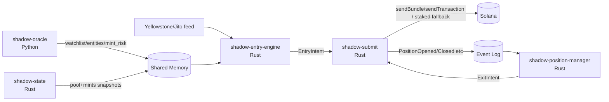

# PROJECT SHADOW ENGINE V3.6

**Engineer Handoff Specification (Locked)**

- Status: Final implementation specification for simulation-driven testing phase
- Supersedes: V3.5 and all prior addenda/spec drafts
- Target ecosystem: Solana Mainnet
- Primary venue: Raydium V4 (first); Pump/PumpSwap only via versioned adapters
- Execution model: pre-consensus ingestion → local intent reconstruction → local quote → simulation-driven compute budgeting → leader-aware submission

This document incorporates the **Grand Unified Vulnerability Matrix (22 items)** as an explicit architectural mandate.

---

## 0. Non-negotiable decisions

1. **Cold path vs hot path split**
   - **Python** is permitted only for the **Oracle / Nearline risk profiling**.
   - **Rust** is required for **pre-consensus hot path execution**.

2. **No socket IPC on the hot-path decision boundary**
   - Redis is allowed for **control-plane / event log** use.
   - The hot path reads **shared memory** only.

3. **Single signer authority**
   - Exactly **one** process holds signing authority and owns network submission.
   - All other processes emit **idempotent intents**.

4. **State is a first-class service**
   - Pool/mint state replication is not a library detail; it is a **standalone daemon** with fork-aware rollbacks.

5. **Exits are autonomous and must survive entry failures**
   - Exit evaluation runs in an isolated fault domain and can trigger liquidation independent of target behavior.

6. **No hot-path RPC**
   - No blocking HTTP/RPC calls for risk/toxicity/holders during entry.
   - Heavy checks happen nearline and publish cached decisions.

7. **War mode requires atomic on-chain verification**
   - Phase 2 entries route through an on-chain MEV Router program that can revert the trade if assumptions are false.

---

## 1. Runtime topology

The system is a multi-process architecture with strict fault-domain boundaries.

### 1.1 Processes

**Process A — `shadow-oracle` (Python, cold path)**
- Offline/nearline Oracle: entity resolution, crowdedness, conviction baselines, conservative EV estimates.
- Nearline Mint Risk Oracle: holder clustering + honeypot metadata evaluation.
- Publishes only lightweight artifacts to shared memory:
  - watchlist (wallet → entity)
  - entity registry (entity_id → gating + EV)
  - mint risk registry (mint → APPROVE/REJECT/UNKNOWN + freshness)

**Process B — `shadow-state` (Rust, standalone state daemon)**
- Ingests account updates and slot status from the low-latency provider.
- Maintains fork-aware in-memory replicas of:
  - Raydium pool reserve accounts required for quoting
  - mint metadata required for hard invariants and Token-2022 fee math
- Implements **fork-aware rollbacks**.
- Publishes fork-safe state snapshots to shared memory for consumers.

**Process C — `shadow-entry-engine` (Rust, pre-consensus ingestion + decision)**
- Consumes the low-latency feed (Yellowstone/Jito-class).
- Performs: dedupe → ALT resolution → instruction selection → adapter intent extraction.
- Performs the **Online Oracle gate** via shared-memory lookups.
- Reads pool/mint state from `shadow-state` shared-memory snapshots.
- Produces **EntryIntent** objects (idempotent commands) and submits them to the Submitter.

**Process D — `shadow-position-manager` (Rust, lifeboat evaluator)**
- Runs continuously regardless of Entry Engine health.
- Maintains an in-memory position book (hydrated at boot from chain).
- Evaluates stop-loss / take-profit / timeout / transfer-bypass.
- Reads prices from `shadow-state` snapshots.
- Produces **ExitIntent** objects (idempotent commands) and submits them to the Submitter.

**Process E — `shadow-submit` (Rust, single signer authority)**
- **Only signer authority** (holds the private key).
- Owns:
  - blockhash tracking
  - leader schedule tracking
  - simulation RPC
  - fee policy execution
  - Jito + leader-aware sending
- Consumes EntryIntent and ExitIntent streams.
- Enforces **exit preemption**: exits are always prioritized over entries.
- Emits canonical execution events to an append-only event log.

**On-chain — `shadow_mev_router` (Rust/Anchor)**
- Phase 1 optional; Phase 2 mandatory for entry swaps.
- Performs atomic assertions before CPI into the DEX swap.

### 1.2 High-level flow



---

## 2. Inter-process contracts

### 2.1 Shared memory is canonical for hot reads

All latency-critical reads use `/dev/shm` (tmpfs) with a lock-free atomic-commit pattern.

Required segments (configurable paths):

- `/dev/shm/shadow_oracle_watchlist` — wallet → entity mapping
- `/dev/shm/shadow_oracle_entities` — entity registry (gating + EV inputs)
- `/dev/shm/shadow_mint_risk` — mint risk registry (APPROVE/REJECT/UNKNOWN + freshness)
- `/dev/shm/shadow_state_pools` — pool reserve snapshots (fork-aware)
- `/dev/shm/shadow_state_mints` — mint invariant cache (fork-aware)
- `/dev/shm/shadow_heartbeats` — process heartbeats + kill switch

**Atomic update rule (seqlock + CRC):**
- Writer increments `seq` to odd (write-in-progress)
- Writes header `{version, payload_len, crc32, updated_at_slot}` then payload
- Writer increments `seq` to even (commit)
- Reader accepts only if seq is even, stable across read, and CRC matches

### 2.2 Intent queue: idempotent commands only

Entry Engine and Position Manager do **not** sign. They emit intents:

- `EntryIntent` — request to open/increase a position
- `ExitIntent` — request to reduce/close a position

Intents must be:
- idempotent (`intent_id` derived deterministically, e.g., hash(signature, mint, side, slot))
- bounded (size capped)
- rejectable (Submitter can drop intents without blocking producers)

Transport:
- shared-memory ring buffer (preferred) or unix-domain socket
- Redis is **not** allowed for hot-path intent transport

### 2.3 Canonical event log (guaranteed delivery)

To prevent position handoff loss (entry executed but PM never learns about it), the system uses an append-only event log.

**Required properties:**
- append-only
- durable
- replayable from offset
- consumer-group / at-least-once delivery semantics

**Allowed implementations:**
- Redis Streams (recommended for Phase 1)
- local WAL file backend (Phase 2, or as Redis outage fallback)

**Events (minimum):**
- `PositionOpened`
- `PositionIncreased`
- `PositionReduced`
- `PositionClosed`
- `ExecutionSent`
- `ExecutionLanded`
- `ExecutionFailed`
- `ExitIntentAccepted`
- `EntryIntentAccepted`

The Position Manager must be able to reconstruct its position book by replaying this log.

### 2.4 Canonical data models and interfaces

The project may add additional fields, but the following boundaries must exist and be stable.

#### 2.4.1 Feed boundary

The feed adapter yields a normalized object to the Entry Engine.

```python
# rust equivalent struct is the source of truth; shown in python-style for readability
@dataclass(frozen=True)
class PreConsensusTx:
    signature: str
    slot: int
    target_signer: bytes  # 32 bytes
    raw_versioned_tx: bytes  # wire bytes or bincode
    is_jitodontfront: bool
```

**Rule:** if `is_jitodontfront` is true → drop immediately.

#### 2.4.2 Adapter intent boundary

Protocol adapters must extract a minimal intent context used for:
- strict copyable-shape gating
- forward-simulation quoting
- instruction reconstruction

```text
IntentContext (minimum)
- program_id: Pubkey
- side: BUY|SELL
- mint_in: Pubkey
- mint_out: Pubkey
- amount_in: u64
- min_out: u64 (if present in target ix)
- pool_keys: { pool, vault_a, vault_b, ... }  # protocol-specific
- target_ix_index: u8
- target_signature: Signature
- target_slot: u64
```

#### 2.4.3 Quote boundary

```text
Quote
- expected_out: u64
- expected_out_after_token2022_fees: u64
- min_out: u64
- price_impact_bps: u32
- slippage_bps: u32
- used_forward_sim: bool
- used_token2022_fee_math: bool
```

#### 2.4.4 Intent boundary

Entry and exit commands must be idempotent and self-describing.

```text
EntryIntent
- intent_id: [32]  # hash(signature, slot, mint_out, amount_in, strategy_version)
- entity_id: u64
- target_signature: Signature
- target_slot: u64
- protocol: enum
- intent: IntentContext
- sizing: { our_amount_in: u64, max_amount_in: u64, sizing_mode: enum }
- quote: Quote
- constraints: { native_sol_reserve_floor_lamports: u64, max_tip_lamports: u64 }

ExitIntent
- intent_id: [32]  # hash(position_id, reason, slot)
- position_id: [32]
- reason: STOP_LOSS|TAKE_PROFIT|TIMEOUT|TRANSFER_BYPASS|MANUAL
- exit_mode: MARKET_DUMP|LIMIT_GUARDED
- max_retries: u8
```

**Rule:** only the Submitter signs and sends.

#### 2.4.5 Shared memory framing (seqlock)

```text
SharedMemHeader
- seq: u64
- version: u32
- payload_len: u32
- crc32: u32
- updated_at_slot: u64
```

#### 2.4.6 Event log envelope

```text
Event
- event_id: [16]  # stream offset / monotonic id
- ts_unix_ms: u64
- kind: enum
- intent_id / position_id: optional
- payload: bytes (versioned)
```

### 2.5 Quoting math requirements

All quoting must be computed from cached state and must support **forward-simulation** for backruns.

#### 2.5.1 Constant-product base-in quote (Raydium V4)

Let reserves be `(x, y)` and trade fee be `fee_bps`.

1. Fee-adjusted input:

`amount_in_eff = amount_in * (1 - fee_bps / 10_000)`

2. Invariant:

`k = x * y`

3. Output:

`x' = x + amount_in_eff`

`amount_out = y - (k / x')`

#### 2.5.2 Forward simulation (T+1 backrun)

If we intend to land behind the target:

1. Apply target trade to `(x, y)` to get virtual reserves `(x1, y1)`.
2. Quote our trade against `(x1, y1)`.

This is mandatory.

#### 2.5.3 Token-2022 transfer fee adjustment

If the output mint is Token-2022 with `TransferFeeConfig`:

`fee = min(amount_out * fee_bps / 10_000, max_fee)`

`amount_out_after_tax = amount_out - fee`

Use `amount_out_after_tax` when computing `min_out`.

#### 2.5.4 Min-out

`min_out = floor(amount_out_after_tax * (1 - slippage_bps / 10_000))`

### 2.6 Fee policy requirements

Priority fee (compute unit price) and Jito tip (bundle tip) are separate knobs.

Minimum behavior:
- Use `simulateTransaction` in Phase 1 to obtain `unitsConsumed`.
- Choose CU limit and CU price from observed usage + safety margin.
- Choose Jito tip via a policy function of Oracle EV/conviction, capped by config.
- Enforce the Native SOL reserve floor before wrapping WSOL.

---

## 3. GRAND UNIFIED VULNERABILITY MATRIX (22 items, final mandate)

This section is **mandatory** and supersedes any conflicting implementation detail.

### Pillar 1: Distributed topology & IPC (Split-brain war)

1. **Submitter authority paradox**
   - Fix: **single signer authority** in `shadow-submit`. PM and Entry emit intents only. Exits preempt entries.

2. **Position state handoff drops**
   - Fix: **canonical event log** (Redis Streams or WAL). PM reconstructs state by replay.

3. **IPC latency & SPOF trap**
   - Fix: shared memory is canonical for hot reads; local RAM fallback; payload hashes/CRC; Redis optional for control-plane only.

4. **Lifeboat state sync dependency**
   - Fix: **standalone state daemon** (`shadow-state`) broadcasts snapshots to both entry and PM.

### Pillar 2: State reality & latency (Physics war)

5. **Micro-fork ghost state corruption**
   - Fix: fork-aware rollbacks (slot root tracking + rollback buffer) inside `shadow-state`.

6. **Hot-path RPC trap**
   - Fix: zero hot-path network I/O for gating/risk; all heavy risk is nearline and cached.

7. **Position Manager cold-start amnesia**
   - Fix: boot-time on-chain hydration overwrites local DB/book with true balances.

### Pillar 3: Adversarial MEV (PvP war)

8. **Pre-consensus ghost trades**
   - Fix: **target liveness guard** in Phase 1 (compute/fee sanity check); Phase 2 uses MEV Router atomic verification.

9. **Lack of on-chain atomic verification**
   - Fix: MEV Router (Phase 2 mandatory) verifies post-target assumptions and reverts if false.

10. **Deterministic slippage sandwiching**
   - Fix: dynamic slippage derived per trade from pool depth/impact/conviction with bounded deterministic jitter.

11. **T+1 backrun pricing paradox**
   - Fix: forward-simulate target impact and quote on post-target virtual reserves.

12. **Stake-weighted QUIC drops**
   - Fix: non-Jito fallback routes via staked provider/relayer; raw QUIC optional only for trusted stake-weighted peering.

### Pillar 4: SVM asset mechanics (Smart contract war)

13. **Incomplete ATA/WSOL lifecycle**
   - Fix: idempotent planners always include ATA create (SPL vs Token-2022) + explicit WSOL wrap/unwrap lifecycle.

14. **Naive instruction selection**
   - Fix: strict copyable profile gate (single base-in swap only). Drop multi-hop/aggregated/complex tx shapes.

15. **Contract-level honeypots (FreezeAuthority / TransferHook)**
   - Fix: cached mint-invariant assertions; hard reject if present.

16. **Token-2022 tax trap**
   - Fix: apply TransferFeeConfig (and max fee) to expected_out before slippage/min_out.

17. **Pump.fun curve completion revert**
   - Fix: compute curve capacity; abort if target trade approaches completion threshold.

18. **Whale in a puddle sizing**
   - Fix: proportional sizing relative to target size plus pool-depth caps.

### Pillar 5: Capital preservation (Bleed war)

19. **Native SOL fee starvation**
   - Fix: strict native SOL reserve floor; reserve repair via WSOL unwrap; entry sizing cannot touch reserve.

20. **Zombie exit death spiral**
   - Fix: max exit retries then `DEAD_ASSET` terminal state.

21. **ATA rent bleed**
   - Fix: close empty token ATA on full exit (token-program correct) to recover rent.

22. **Transfer bypass false positive**
   - Fix: destination classification (CEX/fresh wallet = dump; staking/locker/LP vault = hold).

---

## 4. Modules (final responsibilities)

This section maps the above mandates to concrete engineering modules.

### Module 1 — Predictive Alpha Oracle (Python)

**Purpose:** publish the watchlist, entity registry, and mint-risk decisions.

**Hard rules:**
- Do not build a historical indexer in this repo.
- Managed datasets only (BigQuery/Dune/Bitquery/etc.).
- Publish artifacts to shared memory; do not participate in hot path.

**Outputs:**
- watchlist (wallet → entity_id)
- entity registry (entity state, conservative EV, caps)
- mint risk registry (APPROVE/REJECT/UNKNOWN + freshness)

### Module 2 — Feed ingestion and normalization (Rust, Entry Engine)

**Purpose:** ingest transactions pre-consensus and normalize into internal events.

**Primary feed:** Yellowstone gRPC deshred stream (or equivalent), vendor-agnostic at boundary.

### Module 3 — ALT cache and account mapping (Rust, Entry Engine)

**Purpose:** resolve v0 account keys deterministically and route to the correct adapter.

**Rules:**
- cache-first ALT resolution
- fail closed on unresolved ALTs

### Module 4 — Protocol adapters and quoting (Rust)

#### 4A Protocol adapters (Entry Engine)
- Raydium V4 first
- adapters must support strict tx-shape gate

#### 4B State daemon + local quoter (State daemon produces; Entry/PM consume)

**State daemon responsibilities (`shadow-state`):**
- subscribe to account updates for required pool accounts + mint accounts
- maintain in-memory replicas
- fork-aware rollback
- publish snapshots to shared memory

**Quoter responsibilities (library used by Entry/PM):**
- quote strictly from cached state
- no hot-path RPC
- backrun forward-simulation mandatory
- Token-2022 fee math mandatory
- dynamic slippage policy uses cache-only inputs

### Module 5 — Risk engine and trade gating (Rust hot path + Python nearline)

**Purpose:** reject trades fast using cache-only gates.

**Hot path gates:**
- Oracle decision (entity state, conviction, caps)
- mint invariants (FreezeAuthority/TransferHook)
- mint risk registry decision
- strict copyable profile

**Nearline:** owner-clustered holder concentration and destination lists publish to mint-risk.

### Module 6 — Planning, simulation, and fee policy (Submitter)

**Purpose:** convert intents into signed transactions.

**Rules:**
- proportional sizing
- dynamic slippage
- native SOL reserve floor
- simulateTransaction required in Phase 1; may be selectively templated only after gates

### Module 7 — Dispatch, leader routing, and receipts (Submitter)

**Purpose:** send via Jito or non-Jito fallback.

**Rules:**
- leader-aware routing
- staked fallback default
- exit intents preempt

### Module 8 — Orchestration (Entry Engine + Submitter)

**Purpose:** bounded pipelines; never block feed ingestion.

### Module 9 — Persistence, observability, benchmarks (Submitter + PM)

**Purpose:** append-only event log + DB snapshots.

- canonical event log (replayable)
- SQLite/Postgres for queries/debug
- slot-delta benchmark

### Module 10 — Dry-run validation gates

- 48h dry run with persistence
- replay determinism
- stability under load

### Module 11 — Position Manager (lifeboat evaluator)

**Purpose:** manage exits and preserve capital.

**Hard rules:**
- does not sign
- uses on-chain hydration at boot
- max exit retries
- ATA cleanup
- native SOL reserve floor monitoring + reserve repair requests

### Module 12 — MEV Router on-chain program (Phase 2)

**Purpose:** atomic verification (target success + reserve bounds + mint invariants) before CPI.

---

## 5. Critical implementation requirements (selected)

This section spells out the few places engineers most often “interpret loosely.”

### 5.1 Strict copyable profile gate (mandatory)

Only copy transactions that match an explicit allowlist shape.

Default allowlist for Raydium:
- single Raydium V4 `swap_base_in`
- no aggregator programs
- no multi-hop
- no additional swap instructions

If not matched: drop.

### 5.2 Backrun forward-simulation (mandatory)

For backrun entries, quote against post-target virtual reserves:

1. Read pool snapshot from `shadow-state`.
2. Apply target trade to virtual reserves using the same math the adapter/quoter uses.
3. Quote our trade against updated reserves.

Do not “solve” by widening slippage.

### 5.3 Dynamic slippage (mandatory)

Slippage is derived per-trade from cache-only inputs:
- price impact bps
- pool depth
- conviction score

Add bounded deterministic jitter derived from (signature, slot, mint) to avoid a constant threshold.

### 5.4 Target liveness guard (Phase 1)

Before paying any fees/tips in Phase 1, compute a fast liveness heuristic:
- abort if target’s priority/compute parameters imply it is likely to fail

This is a Phase 1 mitigation; Phase 2 uses MEV Router atomic verification.

### 5.5 Single signer authority and preemption

Only `shadow-submit` signs.
- it must reject duplicate intent_ids
- it must always process exit intents before entry intents

### 5.6 Fork-aware rollbacks

`shadow-state` maintains a rollback buffer per non-rooted slot.
On fork switch / dropped block signals:
- revert all updates from abandoned slots
- only commit rooted slots

Fail-closed if root status cannot be trusted.

### 5.7 Native SOL reserve floor

- entry sizing may not wrap into the reserve
- if reserve drops below floor, request reserve repair (unwrap WSOL) and suspend entries

### 5.8 Zombie exit protection

- exit attempts are capped (default 3)
- after cap, mark `DEAD_ASSET` and stop

### 5.9 ATA rent recovery

- on full exit, include CloseAccount for empty ATA

### 5.10 Transfer bypass destination classification

Transfer-bypass liquidation triggers only when the destination is classified as:
- known CEX deposit, or
- unknown EOA sink

If destination is recognized staking/locker/vault program: hold.

---

## 6. Acceptance criteria (engineering)

### 6.1 Correctness
- Raydium V4 intent extraction and reconstruction passes fixture tests
- ALT flattening passes fixture tests
- Token-2022 fee math is applied (fixture-based)
- Pump completion abort works (when Pump adapter exists)

### 6.2 Safety
- no hot-path RPC calls for risk/toxicity
- native SOL reserve floor enforced
- max exit retries enforced
- entry is disabled if Position Manager heartbeat is stale

### 6.3 Distributed robustness
- Submitter is the only signer
- Position Manager reconstructs state by replaying event log
- State daemon continues providing pricing data even if entry engine crashes

### 6.4 Performance
- bounded queues prevent ingestion stalls
- load test shows no throughput collapse when PM evaluates N positions

---

## 7. Reference implementations and docs

The implementation is expected to use the Solana/Jito/Raydium docs and source as the pinned truth for adapter layouts and submission behavior.

(Engineers should keep pinned commits/versions for any protocol layout assumptions.)
