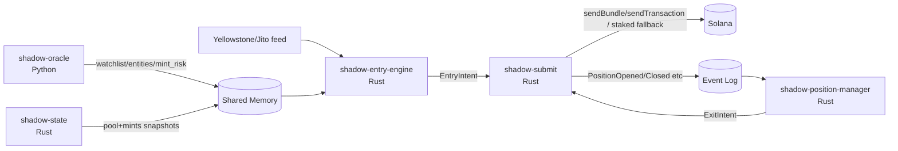
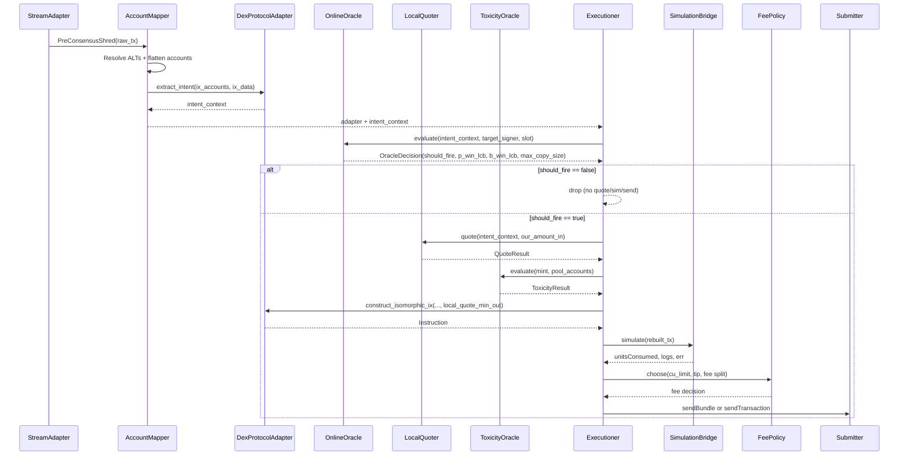

# PROJECT SHADOW ENGINE V4.5
**Engineer Handoff Specification (Locked)**

- Status: Final implementation specification for simulation-driven testing phase
- Supersedes: V3.5 and all prior addenda/spec drafts
- Target ecosystem: Solana Mainnet
- Primary venue: Raydium V4 (first); Pump/PumpSwap only via versioned adapters
- Execution model: pre-consensus ingestion → local intent reconstruction → local quote → simulation-driven compute budgeting → leader-aware submission

This document incorporates the **Grand Unified Vulnerability Matrix (22 items)** as an explicit architectural mandate.

> **ARCHITECTURE_PATCHES_V3.7.md (practitioner patches) is mandatory and fully incorporated.** Conflict resolution is governed by **V4.5 merge control** (Appendix G > Appendix F > Appendix E > Appendix D > Appendix C > Appendix A > main spec). The patch set includes 11 practitioner-level upgrades (local embedded simulation, blockhash caching, parallel signing, net-intent extraction, bare-metal MEV router, RCU state buffers, cross-language IPC alignment, fork DAG confirmation gating, expanded Token-2022 invariants, immortal WSOL ATA, whitelist-driven transfer bypass).


## V4.5 merge control

**This file is a unified, engineering-ready merge of the following source specifications:**

1. `PROJECT_SHADOW_ENGINE_V3_6_ENGINEER_SPEC (1).md` (V3.6 original, long form)
2. `PROJECT_SHADOW_ENGINE_V3_6_ENGINEER_SPEC.md` (V3.6 duplicate/compact; identical content)
3. `PROJECT_SHADOW_ENGINE_V3_6_1_ENGINEER_SPEC.md` (V3.6.1 canonical architecture)
4. `ARCHITECTURE_PATCHES_V3_7.md` (V3.7 practitioner patches)

**Conflict resolution precedence (newest wins):**

1. V4.5 CRO/CEO Interventions (Appendix G)
2. V4.4 Dynamic Decoupling Addendum (Appendix F)
3. V4.3 Day‑1 Operational Realities (Appendix E)
4. V4.2 Developer Notes (Appendix D)
5. V4.2 Strategy Update (Appendix C)
6. V3.7 Patches (Appendix A)
7. V3.6.1 canonical spec (Sections 0–7)
8. V3.6 spec content in Appendix B


**Legacy addenda cleanup:** Redundant inline addenda sections from older specs (V3.4 / V3.4.1 / V3.4.2) are removed. Their requirements are incorporated into the V3.6.1 mandates, the 22‑item matrix, and the V3.7 patches.

---
---

## 0. Non-negotiable decisions

1. **Cold path vs hot path split**
   - **Python** is permitted only for the **Oracle / Nearline risk profiling**.
   - **Rust** is required for **pre-consensus hot path execution**.

2. **No socket IPC on the hot-path decision boundary**
   - Redis is allowed for **control-plane / event log** use.
   - The hot path reads **shared memory** only.

3. **Single signer authority**
   - Exactly **one** process holds signing authority and owns network submission.
   - All other processes emit **idempotent intents**.

4. **State is a first-class service**
   - Pool/mint state replication is not a library detail; it is a **standalone daemon** with fork-aware rollbacks.

5. **Exits are autonomous and must survive entry failures**
   - Exit evaluation runs in an isolated fault domain and can trigger liquidation independent of target behavior.

6. **No hot-path RPC**
   - No blocking HTTP/RPC calls for risk/toxicity/holders during entry.
   - Heavy checks happen nearline and publish cached decisions.

7. **War mode requires atomic on-chain verification**
   - Phase 2 entries route through an on-chain MEV Router program that can revert the trade if assumptions are false.

---

## 1. Runtime topology

The system is a multi-process architecture with strict fault-domain boundaries.

### 1.1 Processes

**Process A — `shadow-oracle` (Python, cold path)**
- Offline/nearline Oracle: entity resolution, crowdedness, conviction baselines, conservative EV estimates.
- Nearline Mint Risk Oracle: holder clustering + honeypot metadata evaluation.
- Publishes only lightweight artifacts to shared memory:
  - watchlist (wallet → entity)
  - entity registry (entity_id → gating + EV)
  - mint risk registry (mint → APPROVE/REJECT/UNKNOWN + freshness)

**Process B — `shadow-state` (Rust, standalone state daemon)**
- Ingests account updates and slot status from the low-latency provider.
- Maintains fork-aware in-memory replicas of:
  - Raydium pool reserve accounts required for quoting
  - mint metadata required for hard invariants and Token-2022 fee math
- Implements **fork-aware rollbacks**.
- Publishes fork-safe state snapshots to shared memory for consumers.

**Process C — `shadow-entry-engine` (Rust, pre-consensus ingestion + decision)**
- Consumes the low-latency feed (Yellowstone/Jito-class).
- Performs: dedupe → ALT resolution → instruction selection → adapter intent extraction.
- Performs the **Online Oracle gate** via shared-memory lookups.
- Reads pool/mint state from `shadow-state` shared-memory snapshots.
- Produces **EntryIntent** objects (idempotent commands) and submits them to the Submitter.

**Process D — `shadow-position-manager` (Rust, lifeboat evaluator)**
- Runs continuously regardless of Entry Engine health.
- Maintains an in-memory position book (hydrated at boot from chain).
- Evaluates stop-loss / take-profit / timeout / transfer-bypass.
- Reads prices from `shadow-state` snapshots.
- Produces **ExitIntent** objects (idempotent commands) and submits them to the Submitter.

**Process E — `shadow-submit` (Rust, single signer authority)**
- **Only signer authority** (holds the private key).
- Owns:
  - blockhash tracking
  - leader schedule tracking
  - simulation RPC
  - fee policy execution
  - Jito + leader-aware sending
- Consumes EntryIntent and ExitIntent streams.
- Enforces **exit preemption**: exits are always prioritized over entries.
- Emits canonical execution events to an append-only event log.

**On-chain — `shadow_mev_router` (Rust, bare-metal `no_std`)**
- Phase 1 optional; Phase 2 mandatory for entry swaps.
- Performs atomic assertions before CPI into the DEX swap.
- **Anchor is not allowed** in war-mode builds (compute overhead target: < ~3,000 CUs).

### 1.2 High-level flow



---

## 2. Inter-process contracts

### 2.1 Shared memory is canonical for hot reads

All latency-critical reads use `/dev/shm` (tmpfs) with a lock-free atomic-commit pattern.

Required segments (configurable paths):

- `/dev/shm/shadow_oracle_watchlist` — wallet → entity mapping
- `/dev/shm/shadow_oracle_entities` — entity registry (gating + EV inputs)
- `/dev/shm/shadow_mint_risk` — mint risk registry (APPROVE/REJECT/UNKNOWN + freshness)
- `/dev/shm/shadow_state_pools` — pool reserve snapshots (fork-aware)
- `/dev/shm/shadow_state_mints` — mint invariant cache (fork-aware)
- `/dev/shm/shadow_heartbeats` — process heartbeats + kill switch

**Cross-language writer rule:** Python must NOT hand-pack bytes with `struct.pack` for `/dev/shm` segments. Use one of:
- a Rust-owned writer library exposed to Python (PyO3) that writes the exact schema + issues atomic fences, or
- a strict schema framework (`FlatBuffers` / `rkyv`) where Rust is the schema authority.
Manual packing across language boundaries is forbidden.

**Atomic update rule (default: seqlock + CRC; high-frequency segments: RCU/triple-buffer):**
- Writer increments `seq` to odd (write-in-progress)
- Writes header `{version, payload_len, crc32, updated_at_slot}` then payload
- Writer increments `seq` to even (commit)
- Reader accepts only if seq is even, stable across read, and CRC matches

**RCU/triple-buffer requirement (pools / high-churn state):** for pool reserve snapshots and any segment updated at high frequency, writers must publish via read-copy-update (triple buffer + atomic pointer swap). Readers must never spin on odd seqlock states.

### 2.2 Intent queue: idempotent commands only

Entry Engine and Position Manager do **not** sign. They emit intents:

- `EntryIntent` — request to open/increase a position
- `ExitIntent` — request to reduce/close a position

Intents must be:
- idempotent (`intent_id` derived deterministically, e.g., hash(signature, mint, side, slot))
- bounded (size capped)
- rejectable (Submitter can drop intents without blocking producers)

Transport:
- shared-memory ring buffer (preferred) or unix-domain socket
- Redis is **not** allowed for hot-path intent transport

### 2.3 Canonical event log (guaranteed delivery)

To prevent position handoff loss (entry executed but PM never learns about it), the system uses an append-only event log.

**Required properties:**
- append-only
- durable
- replayable from offset
- consumer-group / at-least-once delivery semantics

**Allowed implementations:**
- Redis Streams (recommended for Phase 1)
- local WAL file backend (Phase 2, or as Redis outage fallback)

**Events (minimum):**
- `PositionOpened`
- `PositionIncreased`
- `PositionReduced`
- `PositionClosed`
- `ExecutionSent`
- `ExecutionLanded`
- `ExecutionFailed`
- `ExitIntentAccepted`
- `EntryIntentAccepted`
- `SwarmDetected` (aka `SWARM_DETECTED`) — emitted when crowdedness circuit breaker trips; must trigger immediate PM evaluation/exit for any open position on that mint.

The Position Manager must be able to reconstruct its position book by replaying this log.

### 2.4 Canonical data models and interfaces

The project may add additional fields, but the following boundaries must exist and be stable.

#### 2.4.1 Feed boundary

The feed adapter yields a normalized object to the Entry Engine.

```python
# rust equivalent struct is the source of truth; shown in python-style for readability
@dataclass(frozen=True)
class PreConsensusTx:
    signature: str
    slot: int
    target_signer: bytes  # 32 bytes
    raw_versioned_tx: bytes  # wire bytes or bincode
    is_jitodontfront: bool
```

**Rule:** if `is_jitodontfront` is true → drop immediately.

#### 2.4.2 Adapter intent boundary

Protocol adapters must extract a minimal intent context used for:
- strict copyable-shape gating
- forward-simulation quoting
- instruction reconstruction

```text
IntentContext (minimum)
- program_id: Pubkey
- side: BUY|SELL
- mint_in: Pubkey
- mint_out: Pubkey
- amount_in: u64
- min_out: u64 (if present in target ix)
- pool_keys: { pool, vault_a, vault_b, ... }  # protocol-specific
- target_ix_index: u8
- target_signature: Signature
- target_slot: u64
```

#### 2.4.3 Quote boundary

```text
Quote
- expected_out: u64
- expected_out_after_token2022_fees: u64
- min_out: u64
- price_impact_bps: u32
- slippage_bps: u32
- used_forward_sim: bool
- used_token2022_fee_math: bool
```

#### 2.4.4 Intent boundary

Entry and exit commands must be idempotent and self-describing.

```text
EntryIntent
- intent_id: [32]  # hash(signature, slot, mint_out, amount_in, strategy_version)
- entity_id: u64
- target_signature: Signature
- target_slot: u64
- protocol: enum
- intent: IntentContext
- sizing: { our_amount_in: u64, max_amount_in: u64, sizing_mode: enum }
- quote: Quote
- constraints: { native_sol_reserve_floor_lamports: u64, max_tip_lamports: u64 }

ExitIntent
- intent_id: [32]  # hash(position_id, reason, slot)
- position_id: [32]
- reason: STOP_LOSS|TAKE_PROFIT|TIMEOUT|TRANSFER_BYPASS|MANUAL
- exit_mode: MARKET_DUMP|LIMIT_GUARDED
- max_retries: u8
```

**Rule:** only the Submitter signs and sends.

#### 2.4.5 Shared memory framing (seqlock)

```text
SharedMemHeader
- seq: u64
- version: u32
- payload_len: u32
- crc32: u32
- updated_at_slot: u64
```

#### 2.4.6 Event log envelope

```text
Event
- event_id: [16]  # stream offset / monotonic id
- ts_unix_ms: u64
- kind: enum
- intent_id / position_id: optional
- payload: bytes (versioned)
```

### 2.5 Quoting math requirements

All quoting must be computed from cached state and must support **forward-simulation** for backruns.

#### 2.5.1 Constant-product base-in quote (Raydium V4)

Let reserves be `(x, y)` and trade fee be `fee_bps`.

1. Fee-adjusted input:

`amount_in_eff = amount_in * (1 - fee_bps / 10_000)`

2. Invariant:

`k = x * y`

3. Output:

`x' = x + amount_in_eff`

`amount_out = y - (k / x')`

#### 2.5.2 Forward simulation (T+1 backrun)

If we intend to land behind the target:

1. Apply target trade to `(x, y)` to get virtual reserves `(x1, y1)`.
2. Quote our trade against `(x1, y1)`.

This is mandatory.

#### 2.5.3 Token-2022 transfer fee adjustment

If the output mint is Token-2022 with `TransferFeeConfig`:

`fee = min(amount_out * fee_bps / 10_000, max_fee)`

`amount_out_after_tax = amount_out - fee`

Use `amount_out_after_tax` when computing `min_out`.

#### 2.5.4 Min-out

`min_out = floor(amount_out_after_tax * (1 - slippage_bps / 10_000))`

### 2.6 Fee policy requirements

Priority fee (compute unit price) and Jito tip (bundle tip) are separate knobs.

Minimum behavior:
- Use **local embedded SVM simulation** (no-RPC) to obtain `unitsConsumed` (and error/log signals) for compute budgeting.
- `simulateTransaction` RPC is allowed only as a Phase 1 validation fallback / cross-check and must not block the hot path.
- Choose CU limit and CU price from observed usage + safety margin.
- Choose Jito tip via a policy function of Oracle EV/conviction, capped by config.
- Enforce the Native SOL reserve floor before wrapping WSOL.

---

## 3. GRAND UNIFIED VULNERABILITY MATRIX (22 items, final mandate)

This section is **mandatory** and supersedes any conflicting implementation detail.

### Pillar 1: Distributed topology & IPC (Split-brain war)

1. **Submitter authority paradox**
   - Fix: **single signer authority** in `shadow-submit`. PM and Entry emit intents only. Exits preempt entries.

2. **Position state handoff drops**
   - Fix: **canonical event log** (Redis Streams or WAL). PM reconstructs state by replay.

3. **IPC latency & SPOF trap**
   - Fix: shared memory is canonical for hot reads; local RAM fallback; payload hashes/CRC; Redis optional for control-plane only.

4. **Lifeboat state sync dependency**
   - Fix: **standalone state daemon** (`shadow-state`) broadcasts snapshots to both entry and PM.

### Pillar 2: State reality & latency (Physics war)

5. **Micro-fork ghost state corruption**
   - Fix: fork-aware rollbacks (slot root tracking + rollback buffer) inside `shadow-state`.

6. **Hot-path RPC trap**
   - Fix: zero hot-path network I/O for gating/risk; all heavy risk is nearline and cached.

7. **Position Manager cold-start amnesia**
   - Fix: boot-time on-chain hydration overwrites local DB/book with true balances.

### Pillar 3: Adversarial MEV (PvP war)

8. **Pre-consensus ghost trades**
   - Fix: **target liveness guard** in Phase 1 (compute/fee sanity check); Phase 2 uses MEV Router atomic verification.

9. **Lack of on-chain atomic verification**
   - Fix: MEV Router (Phase 2 mandatory) verifies post-target assumptions and reverts if false.

10. **Deterministic slippage sandwiching**
   - Fix: dynamic slippage derived per trade from pool depth/impact/conviction with bounded deterministic jitter.

11. **T+1 backrun pricing paradox**
   - Fix: forward-simulate target impact and quote on post-target virtual reserves.

12. **Stake-weighted QUIC drops**
   - Fix: non-Jito fallback routes via staked provider/relayer; raw QUIC optional only for trusted stake-weighted peering.

### Pillar 4: SVM asset mechanics (Smart contract war)

13. **Incomplete ATA/WSOL lifecycle**
   - Fix: idempotent planners always include ATA create (SPL vs Token-2022) + explicit WSOL wrap/unwrap lifecycle.

14. **Naive instruction selection**
   - Fix: strict copyable profile gate (single base-in swap only). Drop multi-hop/aggregated/complex tx shapes.

15. **Contract-level honeypots (FreezeAuthority / TransferHook / InterestBearingConfig / PermanentDelegate)**
   - Fix: cached mint-invariant assertions; hard reject if present.

16. **Token-2022 tax trap**
   - Fix: apply TransferFeeConfig (and max fee) to expected_out before slippage/min_out.

17. **Pump.fun curve completion revert**
   - Fix: compute curve capacity; abort if target trade approaches completion threshold.

18. **Whale in a puddle sizing**
   - Fix: proportional sizing relative to target size plus pool-depth caps.

### Pillar 5: Capital preservation (Bleed war)

19. **Native SOL fee starvation**
   - Fix: strict native SOL reserve floor; reserve repair via WSOL unwrap; entry sizing cannot touch reserve.

20. **Zombie exit death spiral**
   - Fix: max exit retries then `DEAD_ASSET` terminal state.

21. **ATA rent bleed**
   - Fix: close empty token ATA on full exit (token-program correct) to recover rent.

22. **Transfer bypass false positive**
   - Fix: destination classification (CEX/fresh wallet = dump; staking/locker/LP vault = hold).

---

## 4. Modules (final responsibilities)

This section maps the above mandates to concrete engineering modules.

### Module 1 — Predictive Alpha Oracle (Python)

**Purpose:** publish the watchlist, entity registry, and mint-risk decisions.

**Hard rules:**
- Do not build a historical indexer in this repo.
- Managed datasets only (BigQuery/Dune/Bitquery/etc.).
- Publish artifacts to shared memory; do not participate in hot path.

**Outputs:**
- watchlist (wallet → entity_id)
- entity registry (entity state, conservative EV, caps)
- mint risk registry (APPROVE/REJECT/UNKNOWN + freshness)

### Module 2 — Feed ingestion and normalization (Rust, Entry Engine)

**Purpose:** ingest transactions pre-consensus and normalize into internal events.

**Primary feed:** Yellowstone gRPC deshred stream (or equivalent), vendor-agnostic at boundary.

### Module 3 — ALT cache and account mapping (Rust, Entry Engine)

**Purpose:** resolve v0 account keys deterministically and route to the correct adapter.

**Rules:**
- cache-first ALT resolution
- fail closed on unresolved ALTs

### Module 4 — Protocol adapters and quoting (Rust)

#### 4A Protocol adapters (Entry Engine)
- Raydium V4 first
- adapters must support strict tx-shape gate

#### 4B State daemon + local quoter (State daemon produces; Entry/PM consume)

**State daemon responsibilities (`shadow-state`):**
- subscribe to account updates for required pool accounts + mint accounts
- maintain in-memory replicas
- fork-aware rollback
- publish snapshots to shared memory

**Quoter responsibilities (library used by Entry/PM):**
- quote strictly from cached state
- no hot-path RPC
- backrun forward-simulation mandatory
- Token-2022 fee math mandatory
- dynamic slippage policy uses cache-only inputs

### Module 5 — Risk engine and trade gating (Rust hot path + Python nearline)

**Purpose:** reject trades fast using cache-only gates.

**Hot path gates:**
- Oracle decision (entity state, conviction, caps)
- mint invariants (FreezeAuthority/TransferHook/InterestBearingConfig/PermanentDelegate)
- mint risk registry decision
- strict copyable profile

**Nearline:** owner-clustered holder concentration and destination lists publish to mint-risk.

### Module 6 — Planning, simulation, and fee policy (Submitter)

**Purpose:** convert intents into signed transactions.

**Rules:**
- proportional sizing
- dynamic slippage
- native SOL reserve floor
- local embedded simulation required for hot-path compute estimation; RPC simulation allowed only as fallback in Phase 1 validation

### Module 7 — Dispatch, leader routing, and receipts (Submitter)

**Purpose:** send via Jito or non-Jito fallback.

**Rules:**
- leader-aware routing
- staked fallback default
- exit intents preempt

### Module 8 — Orchestration (Entry Engine + Submitter)

**Purpose:** bounded pipelines; never block feed ingestion.

### Module 9 — Persistence, observability, benchmarks (Submitter + PM)

**Purpose:** append-only event log + DB snapshots.

- canonical event log (replayable)
- SQLite/Postgres for queries/debug
- slot-delta benchmark

### Module 10 — Dry-run validation gates

- 48h dry run with persistence
- replay determinism
- stability under load

### Module 11 — Position Manager (lifeboat evaluator)

**Purpose:** manage exits and preserve capital.

**Hard rules:**
- does not sign
- uses on-chain hydration at boot
- max exit retries
- ATA cleanup
- native SOL reserve floor monitoring + reserve repair requests

### Module 12 — MEV Router on-chain program (Phase 2)

**Purpose:** atomic verification (target success + reserve bounds + mint invariants) before CPI.

---

## 5. Critical implementation requirements (selected)

This section spells out the few places engineers most often “interpret loosely.”

### 5.1 Strict copyable profile gate (mandatory)

Only copy transactions that match an explicit allowlist shape.

Default allowlist for Raydium:
- single Raydium V4 `swap_base_in`
- no aggregator programs
- no multi-hop
- no additional swap instructions

If not matched: drop.

**Net Intent extraction mode (Addendum V3.6.1):** if the target routes through an aggregator, do not copy the hop path. Extract the net spend/receive intent from CPIs (input mint, output mint, amount_in, implied amount_out) and construct *our* direct single-hop route (e.g., Raydium) using local quotes. This mode must be config-gated and must still enforce strict safety constraints (single base-in swap built by us; no multi-hop copying).

### 5.2 Backrun forward-simulation (mandatory)

For backrun entries, quote against post-target virtual reserves:

1. Read pool snapshot from `shadow-state`.
2. Apply target trade to virtual reserves using the same math the adapter/quoter uses.
3. Quote our trade against updated reserves.

Do not “solve” by widening slippage.

### 5.3 Dynamic slippage (mandatory)

Slippage is derived per-trade from cache-only inputs:
- price impact bps
- pool depth
- conviction score

Add bounded deterministic jitter derived from (signature, slot, mint) to avoid a constant threshold.

### 5.4 Target liveness guard (Phase 1)

Before paying any fees/tips in Phase 1, compute a fast liveness heuristic:
- abort if target’s priority/compute parameters imply it is likely to fail

This is a Phase 1 mitigation; Phase 2 uses MEV Router atomic verification.

### 5.5 Single signer authority and preemption

Only `shadow-submit` signs.
- it must reject duplicate intent_ids
- it must always process exit intents before entry intents

### 5.6 Fork-aware rollbacks

`shadow-state` maintains a rollback buffer per non-rooted slot.
On fork switch / dropped block signals:
- revert all updates from abandoned slots
- only commit rooted slots

Fail-closed if root status cannot be trusted.

### 5.7 Native SOL reserve floor

- entry sizing may not wrap into the reserve
- if reserve drops below floor, request reserve repair (unwrap WSOL) and suspend entries

### 5.8 Zombie exit protection

- exit attempts are capped (default 3)
- after cap, mark `DEAD_ASSET` and stop

### 5.9 ATA rent recovery

- on full exit, include CloseAccount for empty ATA
- **Exception:** never close the core WSOL ATA (keep one permanent WSOL ATA per signer)

### 5.10 Transfer bypass destination classification

Transfer-bypass liquidation triggers only when the destination is classified as:
- known CEX deposit, or
- unknown EOA sink

If destination is recognized staking/locker/vault program: hold.

**Whitelist-driven requirement:** maintain a strict allowlist of known-safe DeFi program owners (staking/lockers/LP vaults). Transfer-bypass emergency liquidation triggers only if destination owner is NOT on the safe-program allowlist.

---

## 6. Acceptance criteria (engineering)

### 6.1 Correctness
- Raydium V4 intent extraction and reconstruction passes fixture tests
- ALT flattening passes fixture tests
- Token-2022 fee math is applied (fixture-based)
- Pump completion abort works (when Pump adapter exists)

### 6.2 Safety
- no hot-path RPC calls for risk/toxicity
- native SOL reserve floor enforced
- max exit retries enforced
- entry is disabled if Position Manager heartbeat is stale

### 6.3 Distributed robustness
- Submitter is the only signer
- Position Manager reconstructs state by replaying event log
- State daemon continues providing pricing data even if entry engine crashes

### 6.4 Performance
- bounded queues prevent ingestion stalls
- load test shows no throughput collapse when PM evaluates N positions

---

## 7. Reference implementations and docs

The implementation is expected to use the Solana/Jito/Raydium docs and source as the pinned truth for adapter layouts and submission behavior.

(Engineers should keep pinned commits/versions for any protocol layout assumptions.)


---

## Appendix A — ARCHITECTURE_PATCHES_V3.7 (Addendum V3.6.1)

## Addendum V3.6.1: HFT, MEV & Latency Survival Patches

**Status:** Mandatory Pre-Implementation Directives  
**Context:** The baseline V3.6 specification provides an institutional-grade defense against state failures, honeypots, and capital bleed. However, strict adherence to a few of its original constraints will result in lost races or missed alpha. The following 11 architectural patches resolve physical latency bottlenecks, CPU chokepoints, and smart-money evasion tactics.

---

## PILLAR 1: Execution Latency & Physics (The Speed War)

### Patch 1.1: Local Embedded SVM Simulation (Zero-RPC)

- **The Flaw (Module 6B):** The spec mandates pre-dispatch simulation to calculate compute limits, but implicitly relies on `simulateTransaction` RPC calls. Even against a bare-metal local validator, an HTTP/WS network call takes 2–10 milliseconds. In a pre-consensus race, a 5ms penalty guarantees you lose the blockspace.
- **The Detailed Fix:** **Ban all network-based simulation on the hot path.** Embed a lightweight Solana execution environment (e.g., `lite-svm`, `mollusk`, or native `solana-bpf-loader-program`) directly inside the Rust `shadow-submit` process. Feed it the account bytes already stored in `shadow-state`'s RAM. Forward-simulation time will drop from ~5,000 microseconds to **< 100 microseconds**.

### Patch 1.2: Asynchronous Blockhash Caching

- **The Flaw (Module 6 & 7):** Generating an intent requires a recent blockhash. Relying on the target’s blockhash is dangerous (it may expire in the exact slot your backrun lands), and fetching a new one synchronously during bundle construction adds fatal network latency.
- **The Detailed Fix:** `shadow-submit` must spawn a dedicated, asynchronous background thread that aggressively polls a trusted RPC or Yellowstone stream for the `LatestBlockhash` every ~400ms. It writes this hash to a lock-free atomic pointer (e.g., `Arc<ArcSwap<Hash>>` or an `RwLock`). The hot-path transaction builder thread reads this from RAM in ~2 nanoseconds, guaranteeing ultra-fresh blockhashes with zero I/O blocking.

### Patch 1.3: Parallelized Ed25519 Signing (Rayon Pool)

- **The Flaw (Module 7):** Centralizing signing authority in `shadow-submit` is structurally safe, but Ed25519 cryptography is CPU-bound (~20–50µs per signature). If the Entry Engine "sprays" an array of 50 bundle permutations (varying Jito tips to secure the auction), a single thread will block for 1.5–2.5 milliseconds doing pure math before dispatching.
- **The Detailed Fix:** The serialization and signing phase inside `shadow-submit` must be offloaded to a parallel thread pool using Rust’s `rayon`. Construct the byte arrays and sign the permutations concurrently across all available CPU cores (`par_iter().map(...)`), then funnel the finalized bytes back to the single QUIC/TCP socket dispatch thread.

---

## PILLAR 2: MEV Strategy & Alpha Capture (The Alpha War)

### Patch 2.1: "Net Intent" Extraction (Bypassing Target Evasion)

- **The Flaw (Module 5.1):** The spec mandates a strict "copyable profile gate" (only single-hop Raydium V4 swaps). However, "smart money" wallets actively evade MEV extractors by routing trades through Jupiter, Meteora, or custom splitters. Dropping complex transactions systematically blinds the engine to the highest-conviction alpha.
- **The Detailed Fix:** Decouple "Instruction Copying" from "Trading Intent." When a target routes through an aggregator, do not attempt to copy their exact 5-hop path. Instead, update your protocol adapters to parse the CPIs and extract the **Net Intent** (e.g., *"Target spent 500 USDC to receive Token X"*). Pass this raw intent to your local quoter, which calculates and builds the backrun using the most efficient, direct single-hop path available to *your* signer.

### Patch 2.2: Bare-Metal MEV Router (Stripping Anchor Overhead)

- **The Flaw (Module 12):** The spec recommends using the Anchor framework for the Phase 2 `shadow_mev_router`. Anchor adds 10,000–20,000 Compute Units (CUs) of overhead purely for instruction routing and account deserialization. In Jito bundle auctions, competitiveness is measured strictly in **Tip per CU**. High CU overhead mathematically compresses your profit margins and forces you to overpay to land blocks.
- **The Detailed Fix:** Write the `guarded_swap` program in **pure, bare-metal, `no_std` native Rust**. Hand-write the account resolution and CPI execution to eliminate all framework bloat. The compute overhead for atomic verification must remain strictly under **~3,000 CUs**.

---

## PILLAR 3: Concurrency & IPC (The Memory Layer)

### Patch 3.1: RCU / Triple-Buffered State (Anti-Seqlock Contention)

- **The Flaw (Module 2.1):** The V3.6 `/dev/shm` model relies on seqlocks. During extreme market volatility, `shadow-state` will update pool reserves thousands of times per second. Because the seqlock sequence is marked "odd" during writes, the Entry Engine's read attempts will constantly hit odd numbers, forcing it to spin-lock (wait) or fail CRC checks right when the market is moving fastest.
- **The Detailed Fix:** Upgrade high-frequency shared memory (like AMM pool reserves) from basic seqlocks to an **RCU (Read-Copy-Update) or Triple-Buffer** pattern. The writer constructs the update in an inactive "dirty" background buffer; when complete, it performs a single atomic pointer swap. The hot-path reader *never* spin-locks; it always has instant, lock-free access to the most recently completed "clean" frame.

### Patch 3.2: Zero-Copy Cross-Language IPC Alignment

- **The Flaw (Module 2.1):** Python (`shadow-oracle`) writing directly to `/dev/shm` for Rust to read assumes perfect C-ABI memory alignment. Python's `struct.pack` and Rust's `#[repr(C)]` frequently misalign on padding or endianness, leading to silent CRC failures or corrupted floating-point conviction scores.
- **The Detailed Fix:** Do not manually construct byte arrays across language boundaries. Use a strict, zero-copy serialization framework like `rkyv` or `FlatBuffers`, OR write a tiny Rust bridge library using `PyO3` that exposes an `update_oracle_state()` method to Python. Let Rust dictate the exact memory layout and emit the `std::sync::atomic::fence` barriers on both sides of the IPC boundary.

### Patch 3.3: Validator-Grade Fork DAG for `shadow-state`

- **The Flaw (Module 4B):** Solana propagates `AccountUpdate` shreds asynchronously from `SlotUpdate` network statuses. If `shadow-state` blindly applies account shreds as they arrive, your quoting math will be polluted by "ghost state" from micro-forks that never reach consensus.
- **The Detailed Fix:** `shadow-state` must function as a lightweight consensus engine. Maintain a strict **Directed Acyclic Graph (DAG)** of slots. Buffer all incoming account updates into speculative, un-rooted trees. Only promote them to the canonical "read view" (pushed to `/dev/shm`) when the RPC explicitly confirms the slot status as `Confirmed` or `Rooted`. Drop orphaned branches instantly.

---

## PILLAR 4: SVM Mechanics & Capital Safety (The Smart Contract War)

### Patch 4.1: Expanded Token-2022 Honeypot Filters

- **The Flaw (Module 5):** The V3.6 risk engine correctly rejects `FreezeAuthority` and `TransferHook`. This is incomplete for Token-2022 and leaves capital exposed to newer honeypot vectors.
- **The Detailed Fix:** Add two more mandatory hard-rejects to the `shadow-state` invariant cache and hot-path gates:
  1. **`InterestBearingConfig`:** Token amounts change dynamically based on timestamps, completely breaking exact-out quote math and forward-simulation.
  2. **`PermanentDelegate`:** A backdoor allowing the token creator to arbitrarily burn, seize, or transfer your tokens after you buy them.

### Patch 4.2: Immortal WSOL ATA (Compute Preservation)

- **The Flaw (Module 11):** The spec mandates closing empty token ATAs on full exit to reclaim rent. Doing this to the bot's Wrapped SOL (WSOL) ATA is a massive mistake. Re-creating a WSOL ATA on the very next entry trade costs valuable compute units and instruction bytes, severely handicapping your bundle competitiveness.
- **The Detailed Fix:** Add a hardcoded exemption to the cleanup routine: **never close the core WSOL ATA**. Keep exactly one WSOL ATA open permanently per process/signer. Reclaim rent only on target SPL tokens. For WSOL, simply sync the balance and use explicit wrap/unwrap instructions to manage liquidity.

### Patch 4.3: Whitelist-Driven Transfer Bypass

- **The Flaw (Module 11):** The "Transfer Bypass" lifeboat rule attempts to classify token destinations dynamically as "CEX" vs "Unknown EOA" vs "Staking Vault" to trigger emergency dumps. On Solana, everything is just a base58 address; heuristic guessing in real-time will result in massive false-positive liquidations when targets legitimately lock or stake tokens.
- **The Detailed Fix:** Maintain a hardcoded, frequently updated registry of known safe DeFi Program IDs (e.g., Kamino, Meteora, Raydium lock programs, PinkSale). If a target transfers tokens, only trigger the emergency liquidation if the destination owner is *not* on this strict whitelist.

---

## Appendix B — Expanded implementation detail (carried forward from V3.6 original)

**Purpose:** preserve the full deep-detail engineering notes (interfaces, schemas, data models, test fixtures, acceptance gates, and reference links) from the long-form V3.6 spec.

**Precedence rule:** if any statement below contradicts Sections 0–7 or Appendix A, treat the newer requirement as authoritative.

---

## 1. Executive summary

Project Shadow Engine is a low-latency Solana execution system that observes a curated set of target wallets, reconstructs their DEX intent locally, and decides whether to build and send a corresponding transaction through Jito or standard RPC.

This project does **not** use generic quote aggregators on the hot path for token entry. Instead, it relies on:

1. A **Predictive Alpha Oracle** that:
   - ingests full-history swaps/transfers (including rugs),
   - clusters wallets into entities (burner rotation aware),
   - scores *copy-adjusted* alpha (net of lag/fees/tips),
   - filters “burned” (crowded) entities,
   - and gates live trades using conviction anomaly detection.
2. A pre-consensus ingestion feed (Yellowstone gRPC deshred stream or Jito ShredStream-class feed).
3. Deterministic account resolution for v0 transactions and Address Lookup Tables (ALTs).
4. Protocol-specific adapters that decode intent and reconstruct a new instruction for our signer and ATAs.
5. Local pool-state quoting.
6. Owner-clustered concentration filtering.
7. Local simulation to derive `unitsConsumed` and set compute budget.
8. A fee policy that distinguishes Jito bundles from Jito `sendTransaction`.

This spec is written to be implementable by an engineer without referring back to prior memos.

---

## 2. Non-negotiable design decisions

### 2.0 Oracle targeting

Target selection is a first-class component of the architecture.

- The system must **not** rely on winner-only heuristics such as “tokens that reached X market cap” for target discovery.
- The Oracle must score **copy-adjusted** outcomes (net of lag/fees/tips), not raw target ROI.
- The Oracle must track **entities** (wallet clusters), not isolated wallets, to handle burner rotation.
- The Oracle must model **crowdedness** and mark burned entities, and it must gate live trades using **conviction anomaly** detection.
- The Online Oracle gate must be **hot-cache only** and must run before quoting/simulation/send.

### 2.1 Primary feed

The primary ingestion feed is **not** standard Solana PubSub WebSocket. Official Solana WebSocket methods are standard PubSub endpoints such as `logsSubscribe`, `accountSubscribe`, and `blockSubscribe`; they are retained only as fallback and reconciliation surfaces. `logsSubscribe` also supports only a single Pubkey in `mentions` per call. [R1][R2]

The primary feed must be one of:

- Yellowstone gRPC `SubscribeDeshred`
- A Jito ShredStream-based integration that normalizes into the same internal contract

Yellowstone's current proto explicitly documents deshred transactions as transactions received **before execution**, with no `TransactionStatusMeta`, and says address lookup tables are resolved so both static and loaded addresses are available for filtering. [R3]

### 2.2 Protocol reconstruction

We do **not** scale another wallet's `minimum_amount_out` and treat it as a quote. That was removed. `minimum_amount_out` is only a guardrail. Our `min_out` must come from a local, protocol-accurate quote built from current pool state.

### 2.3 Compute budgeting

**V4 update:** We do **not** hardcode a 35k CU limit. Compute budgeting is **simulation-driven**.

- **Primary path:** **local embedded SVM simulation** (Patch 1.1) inside `shadow-submit`, using account bytes from `shadow-state` snapshots (zero hot-path network I/O).
- **Fallback path (Phase 1 validation only):** RPC `simulateTransaction` may be used for cross-checking or when running in non-latency-critical dry-run mode; it must not block the pre-consensus decision boundary.

The simulation output must provide at minimum: `unitsConsumed`, `err`, and logs; when using RPC simulation it may also provide `replacementBlockhash`. [R4]

### 2.4 Fee policy

Jito bundle bidding and Jito `sendTransaction` are treated differently:

- For `sendBundle`, only the Jito tip matters. [R5]
- For `sendTransaction`, Jito recommends a 70/30 split between priority fee and Jito tip. [R5]

### 2.5 Safety and filtering

The concentration filter is an **early rejector**, not proof that a token is safe. It can only reject obvious concentration or clustering patterns quickly.

### 2.6 Versioned transactions

The engine must treat Solana v0 transactions and ALTs as first-class. RPC readers that fetch versioned transactions for fallback/reconciliation must set `maxSupportedTransactionVersion=0` where applicable. [R6]

---

## 3. Scope

### 3.1 In scope

- Offline Predictive Alpha Oracle (entity scoring, entity resolution, crowdedness, conviction) and target registry management
- Pre-consensus ingestion
- ALT-aware transaction decompilation
- Raydium V4 buy/sell reconstruction
- Local quote integration
- Owner-clustered concentration filter
- Simulation-driven compute and fee selection
- Jito single-tx and bundle submission
- Dry-run mode and paper trading
- Benchmarks against fallback WebSocket logs
- SQLite or Postgres persistence for telemetry and replay

### 3.2 Out of scope for first production candidate

- Generic aggregator routing on the hot path
- Static byte decoders for Pump without an adapter pinned to current docs/IDL
- Multi-hop aggregator routing
- Fully generalized DEX support across all AMMs
- Live-capital deployment before dry-run acceptance criteria pass

---

## 4. Target architecture


### 4.1 Modules

1. **Predictive Alpha Oracle**
   - Ingests full-history swaps and transfers (including rugs).
   - Clusters wallets into human-level entities (burner rotation aware).
   - Scores *copy-adjusted* alpha (net of lag, fees, and tips), not target-wallet ROI.
   - Computes crowdedness (alpha decay) and conviction thresholds.
   - Publishes:
     - **Wallet watchlist** for the feed adapter
     - **Entity registry** with conservative EV inputs (`p_win_lcb`, `b_win_lcb`) and policy caps
     - A hot-cache **Online Oracle** gate used before quoting/simulation

2. **Ingestion**
   - Maintains low-latency stream connection.
   - Normalizes vendor-specific feed data into a single internal object.

3. **Mapping and protocol routing**
   - Resolves ALTs.
   - Flattens account keys.
   - Finds relevant AMM instruction.
   - Routes to the correct protocol adapter.

4. **Oracle gating**
   - Evaluates whether the observed trade is worth copying now:
     - entity active vs burned/retired
     - crowdedness threshold
     - conviction anomaly threshold
     - per-entity max copy-size cap

5. **Quoting and filtering**
   - Fetches local pool state.
   - Produces protocol-accurate expected out and min out.
   - Applies owner-clustered concentration checks.

6. **Execution**
   - Reconstructs a new instruction using our signer and ATAs.
   - Adds compute budget instructions.
   - Simulates locally.
   - Calculates fee/tip.
   - Submits to Jito or RPC.

7. **Position Manager (Module 11)**
   - Tracks our live inventory and entry prices.
   - Enforces autonomous exits (stop-loss, take-profit ratchet, timeouts).
   - Detects target "transfer bypass" exits (target balance decreases without DEX sell) and triggers emergency liquidation.

8. **Observability**
   - Persists every step.
   - Benchmarks feed arrival delta.
   - Supports replay and dry-run analysis.

---

## 5. Data model

### 5.1 Core runtime object

```python
from dataclasses import dataclass
from solders.transaction import VersionedTransaction
from solders.pubkey import Pubkey

@dataclass
class PreConsensusShred:
    signature: str
    target_signer: Pubkey
    raw_tx: VersionedTransaction
    slot: int
    is_jitodontfront: bool
```

### 5.2 Oracle registry records

The Oracle publishes **entity-level** targets (for scoring and gating) and a **wallet watchlist** (for the feed filter).

```python
from dataclasses import dataclass
from typing import List, Optional

@dataclass
class WalletWatch:
    wallet: str
    entity_id: str
    enabled: bool

@dataclass
class ActiveEntityTarget:
    entity_id: str
    wallets: List[str]
    confidence: float
    state: str  # candidate | active | burned | retired

    # Conservative, copy-adjusted EV inputs (use lower confidence bounds)
    p_win_lcb: float
    b_win_lcb: float
    trade_count: int

    # Alpha quality / decay features used for selection
    profit_factor_5m: float
    sortino_5m: float
    crowdedness_percentile: float

    # Conviction baseline for anomaly detection (log-size robust stats)
    conviction_log_size_median: float
    conviction_log_size_mad: float

    # Safety / sizing policy
    max_copy_size_sol: float

@dataclass
class OracleDecision:
    entity_id: str
    observed_wallet: str
    should_fire: bool
    reason: Optional[str]

    # Passed through to downstream sizing/fee logic
    p_win_lcb: float
    b_win_lcb: float
    max_copy_size_sol: float

    # Diagnostics
    conviction_score: float
    crowdedness_score: float
```

The execution engine uses:

- `WalletWatch.wallet` to update `StreamAdapter.update_subscriptions()`
- `OracleDecision.should_fire` to decide whether to proceed past intent extraction
- `OracleDecision.p_win_lcb` and `OracleDecision.b_win_lcb` as conservative Kelly inputs


### 5.3 Intent context returned by a DEX adapter

```python
{
  "protocol": "raydium_v4",
  "variant": "swap_base_in",
  "swap_side": "buy",
  "target_amount_in": 250000000,
  "target_min_amount_out": 123456789,
  "instruction_index": 0,
  "program_id": Pubkey(...),
  "instruction_accounts": [...],
  "flat_accounts": [...],
  "amm": Pubkey(...),
  "market": Pubkey(...),
  ...
}
```

### 5.4 Quote result

```python
@dataclass
class QuoteResult:
    expected_out: int
    min_out: int
    price_impact_bps: int
    slot: int
    source: str
```

### 5.5 Toxicity result

```python
@dataclass
class ToxicityResult:
    passed: bool
    entropy_bits: float
    effective_holders: float
    gini: float
    top1_share: float
    top5_share: float
    owner_count: int
    reason: str | None
```

---

## 6. End-to-end execution flow



### 6.1 Fast-path rules

The executioner must drop early when any of the following is true:

- `PreConsensusShred.is_jitodontfront == True`
- ALT resolution fails and no hot cache entry is available
- DEX adapter cannot decode the instruction deterministically
- Online Oracle gate denies the trade (inactive/burned entity, insufficient conviction, or policy cap)
- Local quote is stale beyond configured slot age
- Toxicity filter fails
- Local simulation returns an error
- Blockhash cannot be refreshed in time

---

## 7. Predictive Alpha Oracle (Module 1)

### 7.1 Why the Oracle was redesigned

The V3 execution engine can only be as good as the target selection feeding it.

The original “market-cap scraper + wallet win rate” approach is explicitly **deprecated** because it fails under three well-known statistical/operational traps:

1. **Survivorship bias**: starting from tokens that already “made it” selects lucky outcomes and hides all rugs and failures.
2. **Wallet rotation**: elite actors do not reuse a single wallet 50+ times; scoring isolated public keys overweights influencers and underweights burner-based entities.
3. **Alpha decay / crowdedness**: profitable wallets become “burned” once widely monitored; copy execution becomes negatively convex under crowding.

The redesigned Oracle scores **copyable alpha**, not target ROI, and tracks **entities**, not single wallets.

### 7.2 Oracle architecture

The Oracle is implemented as three layers:

1. **Offline pipeline (batch)**
   - Ingest full-history swaps + transfers (including rugs).
   - Normalize swap events into trade records.
   - Label copy-adjusted forward returns at multiple horizons.
   - Build wallet-graph edges and cluster wallets into entities.
   - Compute crowdedness and conviction baselines.
   - Score entities using risk-adjusted, conservative metrics.
   - Publish the Entity Target Registry + Wallet Watchlist.

2. **Nearline updater (continuous, not hot path)**
   - Refresh entity membership when new burner wallets are discovered.
   - Update crowdedness decay and recency features.
   - Update rolling conviction baselines.

3. **Online Oracle gate (hot path)**
   - Performs only **hot-cache lookups** + lightweight arithmetic.
   - Given a decoded trade intent (amount in, mints, slot), decides whether the engine should proceed.

### 7.3 Four pillars (required capabilities)

The Oracle must implement these capabilities before it is considered production-ready.

#### Pillar 1 — Global ledger EV (copy-adjusted) and risk-adjusted scoring

Do not use raw wallet win-rate as the primary score.

Required metrics are computed on **copy-adjusted outcomes** (net of lag, fees, and tip assumptions), at a primary horizon (default 5 minutes) plus auxiliary horizons (30s, 30m).

Minimum required metrics per entity:

- **Profit Factor**: gross winning PnL / gross losing PnL (copy-adjusted)
- **Sortino Ratio**: mean return / downside semideviation (copy-adjusted)
- **Hit rate** and return distribution diagnostics (copy-adjusted)

These metrics must include *all trades*, including rugs, to avoid survivorship bias.

#### Pillar 2 — Sybil graphing & entity resolution (ATG + behavioral filtering)

The Oracle tracks **entities** (clusters of wallets), not isolated pubkeys. Entity resolution must be robust to both **wallet rotation** (burners) and **Sybil farms**.

Required two-stage clustering framework:

**Phase 1 — Asset Transfer Graphs (ATG)**
- Build an on-chain **asset transfer graph** `G = (V, E)` where:
  - `V` = wallets plus known infrastructure nodes (CEX deposit accounts, bridges, relayers as available).
  - `E` = directed transfers representing capital relationships (funding flows, profit sweeps, consolidation transfers).
- Edge weighting must capture *strength of relationship* (examples):
  - amount moved (log-scaled),
  - frequency/recency (decayed),
  - time-to-first-trade after funding,
  - sweep-back patterns (profit consolidation).
- Run graph mining to find dense communities:
  - **Louvain** community detection for modularity maximization (default), and/or
  - **k-core / k-truss** pruning to isolate tightly connected subgraphs and suppress loose spam edges.
- Output: candidate communities with membership evidence.

**Phase 2 — Behavioral clustering filter (HDBSCAN default; K-Means deprecated)**

**Problem:** Sybil rings behave like scripts; human entities show variance. However, naive K‑Means on raw features silently fails due to (a) Euclidean distance on cyclical time, (b) feature magnitude domination (lamports dwarf 0–1 features), and (c) forced cluster assignment of pure noise.

**Feature engineering (mandatory)**
- Time-of-day must be encoded as cyclical coordinates:
  - `t = seconds_since_midnight / 86400`
  - `sin_t = sin(2πt)`, `cos_t = cos(2πt)`
- All continuous features must be scaled with **robust scaling** (IQR / median) to resist crypto outliers.
- Trade sizes must be log-transformed (already required) and then robust-scaled.
- Sequence fingerprints must be embedded to numeric form (e.g., hashed n-grams) and scaled.

**Clustering and outlier isolation**
- **Default (production):** HDBSCAN (or equivalent density-based clustering) per Phase‑1 community:
  - Does not require guessing `k`.
  - Does not force every wallet into a cluster.
  - Natively labels anomalies/noise → mark those wallets `SYBIL_EXCLUDED`.
- **Allowed (deprecated / experimental only):** K‑Means *after* the above feature engineering. If used, it must:
  - operate on engineered features only,
  - use small `k` (≤ 3),
  - and include an explicit “noise rejection” rule (distance threshold) so retail noise does not distort centroids.

**Minimum behavioral feature set (extendable)**
- time-of-day cyclical (`sin_t`, `cos_t`) + activity entropy
- hold time median + dispersion
- trade size log median + variance
- program interaction sequence fingerprints (e.g., Raydium → Token → CEX sweep)
- inter-trade burstiness metrics (median inter-arrival, burstiness coefficient)

**Evidence and auditability**
- Persist: phase‑1 community id, selected clustering method + params, feature scaling stats, and per-wallet anomaly scores/distances.
- Entity merges must remain explainable and conservative (fail closed on weak links).

Entity resolution must remain **probabilistic and explainable**:
- fail closed on weak-only links,
- persist merge evidence so merges can be audited,
- never rely on "last 50 trades" wallet-level heuristics.

#### Pillar 3 — Crowdedness score & circuit breaker (alpha decay)

Before an entity is activated (offline), and continuously during operation (online), the Oracle must estimate whether it is already widely surveilled.

**Historical crowdedness (offline / nearline)**
- For each historical buy trade:
  - Count distinct “follower” buys of the same token in the same slot and T+1 slot.
  - Exclude wallets belonging to the same entity.
  - Normalize by token-level baseline activity in a local window.
- Entities whose recent trades consistently show high abnormal follower activity are marked **burned** and must be excluded from the active registry.

**Crowdedness circuit breaker (online; hard state transition + immediate lifeboat)**

**Runtime constraint:** do **not** traverse the funding graph (no live 2‑hop BFS) when a signal arrives. Any graph traversal at runtime will choke the nearline worker, and the hot-path entry will already have executed by the time the traversal completes.

**Offline requirement (pre-compute “connectedness”)**
- The offline Oracle pipeline must assign every wallet a flattened `community_id` (from ATG + behavioral filter).
- Publish `{wallet_pubkey → community_id}` alongside the watchlist into shared memory.

**Online circuit breaker (O(1) checks only)**
- When an entity triggers a live (or dry-run) entry signal, start a short-lived watcher keyed by `(mint_out, target_slot)`:
  - Count unique follower wallets that buy the same mint within `follower_window_slots` (default: 2 slots).
  - A follower is treated as **unconnected** iff `follower.community_id != target.community_id` (O(1) lookup).
- If `followers >= N` (`crowdedness.circuit_breaker.max_unconnected_followers`):
  1. Immediately transition the entity state to `BURNED` (registry hard state) and stop copying it until reactivated.
  2. Emit a `SWARM_DETECTED` event (mint, entity_id, slot, follower_count) into the canonical event log.
  3. Notify `shadow-position-manager` to execute an immediate “lifeboat dump” of any open position for that mint (because the entry may already have executed).

**Non-blocking requirement**
- The watcher must not block the entry hot path. It runs asynchronously and communicates via event-log / intent queue only.

#### Pillar 4 — Conviction anomaly detection

The online gate must avoid spending tips on test trades.

Each entity maintains a rolling baseline of trade sizes (use log-size robust stats):

- median(log(size))
- MAD(log(size))

The online gate computes a robust anomaly score for the current observed buy.
Only when conviction exceeds threshold (and the entity is not burned) does the execution engine proceed.

### 7.4 Conservative `p_win` / `b_win` for Kelly bidding

The execution engine consumes `p_win` and `b_win` as inputs to fee weighting, but they must be conservative.

Required policy:

- Compute `p_win` and `b_win` on **copy-adjusted** returns at the primary horizon.
- Apply **empirical Bayes shrinkage** to reduce small-sample overconfidence.
- Prefer **lower confidence bounds** (`p_win_lcb`, `b_win_lcb`) over naive means.

Definitions:

- `p_win_lcb`: conservative probability that copy-adjusted ROI exceeds configured win threshold.
- `b_win_lcb`: conservative win multiple on winning copy-adjusted trades (shrunken toward global prior).

### 7.5 Required outputs (contracts)

The Oracle must publish two artifacts:

1. **Wallet watchlist** (for feed filtering)
   - List of wallet pubkeys to subscribe to.
   - Each wallet maps to an `entity_id`.

2. **Entity registry** (for online gating + fee sizing)
   - Entity state: `candidate | active | burned | retired`
   - `p_win_lcb`, `b_win_lcb`, `trade_count`
   - crowdedness percentile
   - conviction baseline stats
   - max copy-size cap

Example (shape only):

```json
{
  "entity_id": "ent_4f…",
  "wallets": ["A…", "B…"],
  "state": "active",
  "confidence": 0.92,
  "p_win_lcb": 0.58,
  "b_win_lcb": 1.34,
  "profit_factor_5m": 2.7,
  "sortino_5m": 1.9,
  "crowdedness_percentile": 0.12,
  "conviction_log_size_median": -0.41,
  "conviction_log_size_mad": 0.37,
  "max_copy_size_sol": 1.5
}
```

### 7.6 Integration into the execution path

The Online Oracle gate is evaluated **after** intent extraction and **before** local quoting/simulation.

Required behavior:

- If Oracle returns `should_fire == False`, abort immediately (no quote, no simulation, no send).
- If Oracle returns `should_fire == True`, pass `p_win_lcb` / `b_win_lcb` into the fee policy as the EV weight.

### 7.7 Oracle acceptance criteria (done-when)

The Oracle is considered “implemented” when:

- Historical trades are labeled with copy-adjusted outcomes at the configured horizons.
- Entity clustering produces stable outputs on fixture replays and stores merge evidence.
- Crowdedness scores correctly flag “burned” entities on labeled fixtures.
- Conviction anomaly detection gates small test trades and triggers on large anomalies.
- The Online Oracle gate can evaluate a live intent without cold historical scans (cache-only).

---

## 8. Feed adapter contract

### 8.1 Required interface

```python
import asyncio
from abc import ABC, abstractmethod
from typing import AsyncGenerator, List
from dataclasses import dataclass
from solders.transaction import VersionedTransaction
from solders.pubkey import Pubkey

@dataclass
class PreConsensusShred:
    signature: str
    target_signer: Pubkey
    raw_tx: VersionedTransaction
    slot: int
    is_jitodontfront: bool

class StreamAdapter(ABC):
    @abstractmethod
    async def connect(self) -> None:
        pass

    @abstractmethod
    async def update_subscriptions(self, pubkeys: List[Pubkey]) -> None:
        pass

    @abstractmethod
    async def stream(self) -> AsyncGenerator[PreConsensusShred, None]:
        pass
```

### 8.2 Primary implementation: YellowstoneGrpcAdapter

The first implementation must target Yellowstone gRPC.

#### Requirements

- Prefer `SubscribeDeshred` over ordinary transaction subscription.
- Inject generated protobuf modules at the edge.
- Hide vendor-specific protobuf details from the core engine.
- Maintain automatic reconnect with bounded exponential backoff.
- Maintain a heartbeat/ping loop.
- Support dynamic resubscription without process restart.
- Deduplicate signatures locally.
- Mark `is_jitodontfront` if any static or loaded account begins with `jitodontfront`.

#### Why this is the primary feed

The Yellowstone proto currently defines `SubscribeDeshred` for transactions received before execution and states that address lookup tables are resolved so both static and loaded addresses are available for filtering. [R3]

### 8.3 Fallback feed

Fallback is standard Solana RPC WebSocket for reconciliation and benchmark comparison only.

#### Requirements

- Use `logsSubscribe` for target-wallet mentions when needed.
- Maintain one subscription per target if using `mentions`, because `mentions` supports only one Pubkey per call. [R2]
- Use fallback for correlation and arrival-delta measurement, not primary execution.

### 8.4 Benchmark requirement

The engine must include a harness that correlates the same signature seen on:

- pre-consensus feed
- fallback WebSocket feed

The benchmark must report:

- sample count
- median arrival delta in ms
- p95 arrival delta in ms
- slot deltas where available

---

## 9. Account mapper and ALT handling

### 9.1 Required interfaces

```python
from abc import ABC, abstractmethod
from typing import List, Dict, Optional
from solders.pubkey import Pubkey
from solders.message import MessageV0
from solders.instruction import Instruction
from solders.address_lookup_table_account import AddressLookupTableAccount

class AltCacheManager(ABC):
    @abstractmethod
    async def resolve_lookups(self, lookups: List[any]) -> Dict[str, AddressLookupTableAccount]:
        pass

class DexProtocolAdapter(ABC):
    @property
    @abstractmethod
    def program_ids(self) -> List[Pubkey]:
        pass

    @abstractmethod
    def extract_intent(self, resolved_accounts: List[Pubkey], ix_data: bytes) -> dict:
        pass

    @abstractmethod
    def construct_isomorphic_ix(
        self,
        intent_context: dict,
        our_signer: Pubkey,
        our_wsol_ata: Pubkey,
        our_token_ata: Pubkey,
        our_amount_in: int,
        local_quote_min_out: int,
    ) -> Instruction:
        pass
```

### 9.2 Flattening rule

ALT flattening must match Solana runtime account ordering exactly:

```text
flat_accounts = static_account_keys
              + loaded_writable_alt_addresses
              + loaded_readonly_alt_addresses
```

That ordering matches the loaded-account model used by the Solana runtime for v0 messages. [R7]

### 9.3 ALT cache behavior

`AltCacheManager` must be local-cache first.

#### Required behavior

- First attempt: memory or Redis cache
- Cache key: lookup table pubkey string
- Cache value: full `AddressLookupTableAccount`
- Positive TTL: configurable, default 300s
- On miss: fetch from RPC or a local indexer
- On miss during hot path: if fetch cannot complete inside budget, abort the trade
- Cache metrics:
  - hit count
  - miss count
  - stale hit count
  - average resolve time

### 9.4 AccountMapper behavior

The mapper must:

1. Read the `VersionedTransaction.message`.
2. Resolve `address_table_lookups` if present.
3. Flatten full account list.
4. Walk compiled instructions.
5. Identify the first supported program id.
6. Pass the **instruction-resolved account slice** into `DexProtocolAdapter.extract_intent()`.
7. Return `(adapter, intent_context)`.

Important: `extract_intent()` must receive the instruction-specific account list, not the entire flattened transaction account list.

---

## 10. DEX protocol adapters

### 10.1 Design goals

Protocol adapters exist to keep protocol-specific decoding and reconstruction isolated from the executioner.

Each adapter must be:

- versioned
- unit tested against real transactions
- pinned to official source, IDL, or current public docs
- replaceable without changing the executioner

### 10.2 Required adapter methods

#### `extract_intent(resolved_accounts, ix_data)`
Returns a normalized context containing at minimum:

- protocol name
- variant name
- direction (`buy` or `sell`)
- target amount in
- target min out
- protocol accounts used by the instruction

#### `construct_isomorphic_ix(...)`
Builds a new instruction for:

- our signer
- our WSOL ATA
- our token ATA
- our chosen amount in
- our locally quoted `min_out`

### 10.3 Initial adapter: Raydium V4

#### Program IDs

- Mainnet: `675kPX9MHTjS2zt1qfr1NYHuzeLXfQM9H24wFSUt1Mp8`
- Devnet: `DRaya7Kj3aMWQSy19kSjvmuwq9docCHofyP9kanQGaav`

#### Verified instruction layout

Raydium's current public source defines `SwapInstructionBaseIn` as:

- `amount_in: u64`
- `minimum_amount_out: u64`

and the `swap_base_in(...)` helper packs `AmmInstruction::SwapBaseIn(SwapInstructionBaseIn { amount_in, minimum_amount_out })`. The discriminator for `SwapBaseIn` is `9`, making the packed layout effectively `<BQQ>` for the variant used by current decoders. [R8]

#### Verified account order for `swap_base_in`

Raydium's public source shows the `swap_base_in(...)` helper constructing accounts in this order: [R8]

1. SPL Token program
2. AMM account
3. AMM authority
4. AMM open orders
5. AMM coin vault
6. AMM pc vault
7. Market program
8. Market
9. Market bids
10. Market asks
11. Market event queue
12. Market coin vault
13. Market pc vault
14. Market vault signer
15. User source token account
16. User destination token account
17. User wallet signer

Some observed transactions may include an extra target-orders account depending on program path. The adapter must validate actual account count and layout before reconstruction.

#### Adapter rules

- Decode exact instruction bytes.
- Reject unsupported discriminator or byte length.
- Infer swap side from source/destination accounts and mint context.
- Never derive `min_out` from the target's `minimum_amount_out`.
- Rebuild accounts using our signer and ATAs.
- Keep protocol-owned pool and market accounts unchanged.
- Return a new `Instruction` only if all required accounts are mapped deterministically.

### 10.4 Pump and PumpSwap adapters

Pump and PumpSwap must be implemented only as versioned adapters pinned to the current official public docs / IDL repository. No static byte assumptions are allowed. [R9]

#### Pump.fun curve completion guard (mandatory when Pump adapter is implemented)

Pump.fun is not a constant-product AMM. It is a bonding curve that can **stop accepting buys** when the curve completes and liquidity migrates.

- The Pump adapter must extract enough curve state (from the instruction accounts and/or the in-memory state synchronizer) to estimate completion risk.
- Compute completion both **before** and **after** the target’s `amount_in`:
  - `completion_after_target = f(curve_state, target_amount_in)`
- If `completion_after_target >= 1 - abort_if_completion_within_pct`, then **ABORT** (do not build or submit our backrun entry).
- This is a deterministic abort condition: do not compensate by widening slippage or paying higher fees.

Testing requirement: a fixture must demonstrate that when `completion_after_target` exceeds the threshold (default 95%), the adapter returns a non-copyable decision.


---

## 11. Local quoter

### 11.1 Contract

```python
class LocalQuoter(ABC):
    @abstractmethod
    async def quote(self, intent_context: dict, our_amount_in: int) -> QuoteResult:
        pass
```

### 11.2 Requirements

- Must operate from local pool-state snapshots.
- Must report the slot used for the quote.
- Must produce `expected_out` and `min_out`.
- Must reject if snapshot is too stale.
- Must be protocol accurate for the adapter in use.
- Must not do network routing to a generic aggregator on the hot path.

### 11.2A Background state synchronizer (mandatory)

The Local Quoter must be backed by a background state synchronizer that maintains an in-memory replica of:

- Active Raydium pool reserve accounts required for quoting (vault balances and any additional accounts needed for the protocol math).
- Mint metadata required to quote accurately (decimals and Token-2022 extensions where relevant).

#### Hot-path rule

- The Quoter must not perform blocking RPC reads to fetch pool reserves or mint metadata when a trade signal arrives.
- All required state must be served from the in-memory cache.
- If required state is missing or stale beyond the configured budget, the trade must be rejected (fail closed).

#### Cache freshness

- Each cached account record must include `slot_updated`.
- Quoting must reject if `current_slot - slot_updated > quote_max_slot_staleness` (default 2 slots).

#### Update sources

The state synchronizer may be fed from:

- an account-update stream from the same low-latency provider (preferred), and/or
- a dedicated background RPC fetcher that preloads and refreshes *known* pool accounts and mints outside the hot path.

#### 11.2A.1 Fork-aware rollbacks (mandatory)

Yellowstone/Geyser feeds are pre-consensus and Solana can micro-fork. The in-memory state cache must never become “ghost state.”

**Requirements:**
- Subscribe to slot-status/root updates from the same provider (or a secondary source) and track:
  - `processed`, `confirmed`, and `rooted` slots (or provider-equivalent statuses).
- Maintain a bounded **state-history buffer** (ring) of per-slot deltas:
  - for each account update, record `(slot, pubkey, previous_value_hash, previous_bytes)` before overwriting.
- On fork switch / dropped block signal:
  - roll back account states by replaying deltas in reverse for all non-rooted slots that are being abandoned.
- Only “commit” state as final once the slot is rooted; prune history <= rooted slot.

**Fail-closed rule:** if fork status cannot be determined reliably, do not quote from state for backrun entries (reject trade).

#### 11.2A.2 Mint invariant cache (mandatory)

The state cache must include mint-level invariants used for hard rejects without network I/O:
- Token program (SPL Token vs Token-2022)
- decimals
- **FreezeAuthority present?** (reject if present)
- **TransferHook present?** (Token-2022; reject if present)
- TransferFeeConfig (Token-2022; required for quote adjustment)

If mint metadata is missing for a mint involved in an entry decision, **reject** (do not fetch on hot path).


Engineering constraint: update ingestion must be asynchronous and must never block the Executioner hot path.


### 11.2B Backrun forward-simulation (mandatory for backrun mode)

When the engine places our entry directly behind the target trade in the same block (bundle backrun semantics), the Local Quoter must account for the target’s price impact.

**Requirement:** quote against a **virtual post-target pool state**:

1. Load the pool snapshot from in-memory state (`reserve_in`, `reserve_out`, fee parameters, and any protocol-specific state required for accurate math).
2. Forward-simulate the **target** swap using the same protocol math used for quoting.
3. Quote **our** swap against the updated virtual reserves/state.
4. Apply Token-2022 transfer-fee adjustments (if applicable) and then apply the configured slippage margin to derive `min_out`.

Fail-closed rule: if any required inputs (reserves, fee params, or protocol state) are missing from the in-memory cache, reject the trade.

**Raydium V4 constant-product sketch (base-in):** if using a constant-product vault-balance model, and the pool charges a trade fee:

```text
amount_in_eff = amount_in * (1 - trade_fee_bps / 10000)

target_out = floor(reserve_out * amount_in_eff / (reserve_in + amount_in_eff))

reserve_in_post  = reserve_in  + amount_in_eff
reserve_out_post = reserve_out - target_out
```

Then quote our trade against `(reserve_in_post, reserve_out_post)` (or the protocol’s more accurate model if implemented). The forward-simulation model and the quote model must match.

Implementation note: expose a quoter mode (e.g., `spot` vs `backrun`). Use `backrun` for entry; use `spot` for position marking and exit logic.


### 11.3 `min_out` policy (dynamic slippage)

`min_out` is derived from the local expected output and a **dynamic** slippage budget. It is **not** taken from the target’s `minimum_amount_out`.

Baseline form:

```text
min_out = floor(expected_out * (1 - slippage_bps / 10000))
```

#### 11.3.1 Dynamic slippage (mandatory)

Static slippage thresholds are predictable and can be adversarially targeted. The engine must compute `slippage_bps` per trade using only local, cached inputs:

Minimum required inputs:
- `price_impact_bps` from the local quote model
- pool depth / reserves
- `conviction_score` from the Online Oracle gate (cache-only)
- route mode (`backrun` vs `spot`) and protocol

Reference policy shape (example; calibrate with data):

```text
slippage_bps =
  clamp(min_slip, max_slip,
        a * price_impact_bps
      + b * sqrt(target_size_ratio_bps)
      + c * conviction_weight)
```

Optional (recommended) **deterministic jitter**:
- Add `±jitter_bps` derived from a hash of (signature, slot, mint) so the threshold is not constant across trades.
- Jitter must be bounded and must never exceed configured caps.

Fail-closed rule: if required inputs are missing (e.g., no price impact available), reject the trade (do not widen slippage blindly).


### 11.3A Token-2022 transfer fee/tax adjustments (mandatory)

A large fraction of new mints use the Token-2022 program, which can encode transfer fees directly in mint state.

Quoting must adjust the expected output for transfer fees **before** applying slippage margins:

1. Determine mint program:
   - SPL Token (Tokenkeg…)
   - Token-2022

2. If Token-2022 and TransferFeeConfig is present:
   - Compute fee on the expected transfer amount (subject to max fee if configured in mint state).
   - Reduce `expected_out` by the computed fee.
   - Then compute `min_out` from the reduced `expected_out`.

Fail-closed rule: if mint program/fee config cannot be resolved from local cache in time, reject the trade.


### 11.4 Freshness policy

- Quote snapshot slot age must be configurable.
- Default hard reject if quote slot is older than 2 slots from current decision slot.
- Quote result must include source name and slot.

---

## 12. Mint Risk Registry (Async) and Fast Reject Checks (Hot Path)

### 12.1 Goal

Prevent hot-path network I/O while still enforcing conservative safety gates.

**Production rule:** no blocking RPC calls (e.g., `getTokenLargestAccounts`) may occur on the entry hot path.

### 12.2 Split responsibilities

#### 12.2.1 Asynchronous mint risk profiling (Cold Path)

A **Mint Risk Oracle** (Python, nearline) maintains a `mint_risk` registry for mints that appear in candidate trades.

It may perform network calls and heavy analysis outside the hot path, including:
- `getTokenLargestAccounts`
- token-account owner resolution
- owner-clustered concentration metrics (top shares, gini, entropy/effective holders)
- known CEX deposit address detection
- known staking/locker/vault allowlists

It publishes to shared memory:

- `APPROVE` / `REJECT` / `UNKNOWN`
- cached metrics and reject reasons
- a freshness timestamp/slot

#### 12.2.2 Hot-path fast reject checks (Entry Engine)

The Entry Engine may only use **cached** state:
- fork-aware pool reserves snapshot
- cached mint invariants (FreezeAuthority/TransferHook/Token-2022 fees)
- cached `mint_risk` registry entry

Hot-path rule:
- if `mint_risk == REJECT` → reject immediately
- if `mint_risk == UNKNOWN` → default behavior is configurable; recommended default is **reject** (fail closed) in war mode and **probe-size** only in validation mode.

### 12.3 Honeypot invariants (mandatory)

Before any entry is attempted, the engine must assert from cached mint state:

- `FreezeAuthority == None` (reject if present)
- `TransferHook == None` (Token-2022; reject if present)

### 12.4 Performance requirement

Hot-path gating must be O(1) cache reads and complete well inside the decision budget (< 0.1 ms typical).

---


## 13. Simulation bridge and compute budgeting

### 13.1 Contract

```python
@dataclass(frozen=True)
class SimulationOutcome:
    units_consumed: int
    err: Any
    logs: tuple[str, ...]
    raw: Any
```

### 13.2 Requirements

- Simulate every candidate transaction locally before final send.
- Extract `unitsConsumed`, `err`, and logs from the simulation result.
  - **Primary:** embedded SVM simulation result (Patch 1.1).
  - **Fallback (Phase 1 validation):** RPC `simulateTransaction` response.
- If the response includes `replacementBlockhash`, use it to refresh the final built transaction where appropriate. [R4]
- Abort if simulation returns an error.

### 13.3 Compute unit limit

The compute-unit limit must be derived from simulated consumption plus margin:

```text
cu_limit = ceil(units_consumed * (1 + margin_bps / 10000))
```

Initial default: `margin_bps = 1000` (10%).

Clamp to cluster-safe maximum via config.

### 13.4 Why simulation is mandatory

- Solana `simulateTransaction` exposes `unitsConsumed` (Phase 1 validation fallback only). [R4]
- Jito's `sendTransaction` path sets `skip_preflight=true`, so the transaction is not simulated in the RPC before it is sent to the leader. Therefore the client must simulate before submission. [R11]

---

## 14. Fee policy

### 14.1 Design

The fee policy consumes:

- target EV metrics (`p_win`, `b_win`)
- simulated compute limit
- recent priority-fee floor
- Jito tip floor
- route type (`bundle` or `sendTransaction`)

### 14.2 Kelly fraction

```text
p = clamp(p_win, 0, 1)
q = 1 - p
b = max(b_win, epsilon)
kelly = max(0, (p * b - q) / b)
```

Kelly is used as a bounded internal weighting factor, not as a promise.

### 14.3 Bundle route (competitively bounded Kelly, V4.2)

For bundles:

- Only the Jito tip is the auctioned bribe used for inclusion ordering. [R5]
- Jito enforces a minimum bundle tip of 1000 lamports. [R11]
- **V4.2 update:** tip sizing must be floored against a competitive inclusion baseline, not purely internal Kelly sizing.

**Competitive floor (`C_floor`) requirement (regime-shift safe)**

**Problem:** MEV auctions exhibit violent regime shifts. If `C_floor` is computed only from *our own landed bundles*, the bot can get stuck underbidding forever (it never lands → it never updates → it stays blind).

**Requirement:** `shadow-submit` must maintain *two* floor sources and blend them:

1) **Internal floor (self-history)**
- Maintain a rolling window of *landed* bundle attempts.
- For each landed bundle compute `tip_per_cu = jito_tip_lamports / cu_limit`.
- Set `internal_floor_tip_per_cu` to a high quantile (default `p75`, configurable).

2) **External floor (market telemetry)**
- Maintain a background subscription to a **global tip / mempool clearing-price feed** (Jito tip stream, provider mempool telemetry, or equivalent).
- Compute `external_floor_tip_per_cu` from recent observed clears (same quantile policy).
- This feed must update even when we are not landing anything.

3) **Blending rule**
- `floor_tip_per_cu = max(internal_floor_tip_per_cu, external_floor_tip_per_cu)` (default) or a configured weighted blend.
- Convert to a per-trade floor: `C_floor_lamports = ceil(floor_tip_per_cu * cu_limit)`.
- Warm-start: if both windows are empty, use `fees.min_bundle_tip_lamports` and a configured warm-start floor.

**Competitively bounded bid (EV error-aware)**

Let the (conservative) Kelly fraction be:

```text
p = clamp(p_win, 0, 1)
q = 1 - p
b = max(b_win, epsilon)
f* = max(0, (p * b - q) / b)
```

Then choose the Jito tip:

```text
EV_lamports = estimate_expected_value_lamports(intent, quote, oracle_metrics)   # conservative
T_raw       = f* * bankroll_lamports * w_aggression
EV_CAP      = fees.ev_cap_fraction   # default 0.85 (allowed 0.80–0.85; 0.95 is deprecated)

T = max(
      C_floor_lamports,
      min(EV_lamports * EV_CAP, T_raw)
    )
```

Where:
- `bankroll_lamports` is the risk-capital budget allocated to this strategy (config), not the full wallet balance.
- `w_aggression` is a bounded weight derived from the entity conviction score (higher conviction ⇒ higher aggression).
- If `C_floor_lamports > EV_lamports * EV_CAP`, **ABORT** (auction is priced above our conservative value).### 14.4 Single transaction route (competitively bounded, V4.2)

For Jito `sendTransaction`:

- Use the same competitive-floor logic, but model the auction spend as `priority_fee + jito_tip`. [R5]
- Default 70/30 split unless strategy overrides with explicit justification. [R5]

```text
EV_CAP = fees.ev_cap_fraction   # default 0.85 (allowed 0.80–0.85; 0.95 is deprecated)

total_spend = max(C_floor_lamports, min(EV_lamports * EV_CAP, T_raw))

priority_fee_lamports      = ceil(total_spend * 0.70)
jito_tip_lamports          = total_spend - priority_fee_lamports
cu_price_micro_lamports    = ceil(priority_fee_lamports * 1_000_000 / cu_limit)
```

- If `C_floor_lamports > EV_lamports * EV_CAP`, **ABORT** (auction is priced above our conservative value).

If `cu_price_micro_lamports` exceeds cluster-safe caps, clamp and re-balance; if the resulting `total_spend` is still below `C_floor_lamports`, **ABORT**.

### 14.5 Tip account rules

If a separate tip transaction or instruction is used, do not place Jito tip accounts behind ALTs. Jito explicitly warns not to use ALTs for tip accounts. [R12]

### 14.6 Encoding rules

For Jito submission:

- Use base64 encoding.
- Do not use base58 except where absolutely required for legacy tooling; Jito marks base58 as slow and deprecated. [R11]

---

## 15. Executioner

### 15.1 Responsibilities

The executioner orchestrates the hot path.

#### Required steps

1. Receive `PreConsensusShred`.
2. Drop immediately if `is_jitodontfront` is true.
3. Call `AccountMapper.decompile_and_route(raw_tx)`.
3A. Apply `Sizer` + `BalanceGuard` to select `our_amount_in`:
    - proportional sizing vs the target (`our_size = min(max_cap, target_size * multiplier)`)
    - pool-depth and max price-impact caps
    - native SOL reserve floor enforcement so fees/tips/exits remain fundable.
4. Fetch local quote for chosen trade size.
5. Run toxicity filter.
6. Derive our WSOL ATA and token ATA.
7. Ask adapter to build the isomorphic instruction.
8. Build a candidate transaction with current blockhash.
9. Simulate locally.
10. Set compute-unit limit and price.
11. Rebuild final transaction if blockhash or fee fields changed.
12. Submit via Jito `sendTransaction` or `sendBundle` according to strategy.
13. Persist attempt, simulation result, fees, and final outcome.

### 15.2 Blockhash tracking

A background blockhash tracker is required.

#### Sources

- Preferred: Yellowstone `GetLatestBlockhash` if available in the deployed client
- Fallback: standard Solana `getLatestBlockhash`

#### Rules

- Refresh on a fixed interval and on demand for a final pre-send build.
- Track `lastValidBlockHeight`.
- Drop send attempts if the build uses an expired or near-expiry blockhash.

### 15.3 Submission choices

#### Bundle path

Use when:

- strategy explicitly needs all-or-nothing behavior
- separate tip instruction / tx is preferred
- latency path favors block-engine bundle semantics

Jito documents bundles as atomically processed in order, maximum 5 transactions. [R11]

#### `sendTransaction` path

Use when:

- single transaction is sufficient
- revert protection with `bundleOnly=true` is desired
- route has lower overhead than constructing a multi-tx bundle


### 15.3A Leader-aware submission (Non-Jito fallback)

Jito submission is not sufficient on its own. The Submitter must maintain a current leader schedule and choose the submission route:

- If the current/next leader is reachable through the Jito path, use Jito submission.
- Otherwise, fall back to direct TPU submission to the leader (QUIC) with:
  - bounded retries,
  - strict rate limits,
  - and fee bumping according to policy.

This routing is a submission concern only; it must not affect intent decoding or quoting logic.


### 15.3B Stake-weighted transaction delivery for non‑Jito fallback (mandatory default)

Solana supports stake-weighted QoS for trusted/staked connections. Under congestion, naive raw QUIC submission from an arbitrary host may be deprioritized or dropped.

**Requirement:** the non‑Jito fallback path must use a **staked transaction delivery channel** by default (staked RPC, TPU relayer, or provider “staked transaction” API). [R13]

Implementation guidance:

- Implement `TpuFallbackSubmitter` with two modes:
  - `staked_provider` (**default**): submit through a staked/relayed provider path (recommended for production).
  - `raw_quic` (optional): allowed only when operating a trusted stake-weighted peering configuration (for example, validator-adjacent infrastructure where trust and stake are explicitly arranged). [R13]

A separate `LeaderAwareRouter` chooses:

- Jito path if current/next leader is reachable through Jito
- otherwise the `TpuFallbackSubmitter` path

Testing requirement: route selection must be deterministic, and a unit test must confirm `staked_provider` is chosen for non‑Jito leaders when enabled.


### 15.3C SWQoS-first submission + multi-relay fallback (V4.2)

During high-volatility events, stake-weighted networking behavior dominates inclusion probability. Production deployment must assume **Stake-Weighted Quality of Service (SWQoS)** will load-shed unstaked sources.

**Production requirement (submission path)**
- Hot-path transaction delivery must route through **staked transaction infrastructure** (provider staked transaction APIs / TPU relayers / trusted stake-weighted peering).
- Multi-tenant shared RPC clusters are allowed only for Phase 1 validation/dry-run benchmarking, not war-mode.

**Multi-relay fallback (inclusion maximization)**
Relying exclusively on one relay path (e.g., Jito only) introduces avoidable leader/relay blind spots.

`shadow-submit` must support a relay multiplexer that can broadcast the same signed intent to multiple staked relays concurrently (examples: Jito Block Engine, provider staked relayers, bloXroute) and record acknowledgements.

Rules (tip-safe multi-relay)

- **Idempotency is per-transaction signature.** Broadcasting the *same signed transaction bytes* to multiple endpoints is safe and idempotent on-chain.
- **Route groups must be exclusive:**
  - **Group A — Jito route:** includes the Jito tip transfer/instruction and is sent **only** to Jito Block Engine endpoints.
  - **Group B — Non‑Jito / SWQoS route:** must use a **tipless** variant (no Jito tip instruction) and is sent **only** to staked relays / staked transaction APIs / TPU relayers.
- **Dragon 1 (tip donation) guard:** never send a Jito‑tipped transaction to non‑Jito relays. A non‑Jito leader can include it, causing you to “donate” the tip to Jito even when Jito did not build the block.
- **Dual-variant racing is forbidden by default:** generating and broadcasting both (A) and (B) variants for the same intent breaks signature idempotency and can cause a double‑buy if both land. Enable only when the Phase‑2 `shadow_mev_router` provides an on-chain idempotency guard (or equivalent).
- Broadcast fanout must be bounded and rate-limited.
- Relay fanout is activated when:
  - current/next leader is non‑Jito, **or**
  - competitive floors indicate congestion, **or**
  - configured `submitter.relay_fanout.always_on` is true.

**Internal SWQoS negotiation (if self-hosting)**
If operating self-managed bare-metal nodes, inclusion-grade non-Jito submission requires explicit trust/peering arrangements so packets inherit stake-weighted priority. This is infrastructure work and out of repo scope, but the software must support routing to such trusted relays when provided.

### 15.4 `jitodontfront` handling

Jito documents that any bundle containing a transaction with a `jitodontfront...` account is rejected unless that transaction appears first. This engine must treat such observed target transactions as non-copyable on the standard route and skip them immediately. [R12]

### 15.5 Position Manager (Module 11) — Autonomous exits

The entry engine is not sufficient to protect capital. The system must include an autonomous Position Manager that operates independently from target-wallet actions.

#### Responsibilities

- Maintain an in-memory inventory of open positions:
  - mint
  - amount
  - entry slot/time
  - entry cost basis (including fees/tips)
  - last marked price and mark slot

- Continuously evaluate exit rules and, when triggered, construct and submit an exit transaction using the same planning/simulation/fee pipeline (subject to separate risk limits).

#### Cold-Start Hydration (mandatory)

On startup (or after any crash/restart), the Position Manager must reconcile the persisted position book against the **actual on-chain balances** for the controlled signer(s).

Requirements:
- Query token account balances and WSOL/native SOL balances for the signer(s).
- For any mint where DB says OPEN but on-chain balance is zero → mark CLOSED with reason `HYDRATED_CLOSED`.
- For any mint where DB says CLOSED but on-chain balance is non-zero → create/restore an OPEN position with unknown cost-basis and mark `NEEDS_REVIEW` (configurable behavior).
- Persist a hydration report event with counts and discrepancies.

This hydration occurs outside the hot path; it is a boot-time safety gate.


#### Exit rules (minimum required)

1. **Hard stop-loss**  
   - Default threshold: `-25%` from entry (configurable).
   - Must trigger regardless of target behavior.

2. **Take-profit ratchet / trailing stop**  
   - When unrealized PnL exceeds configured profit step, raise the trailing stop floor.
   - Example policy: once +50% is reached, set trailing stop at +20%; once +100% is reached, set trailing stop at +50% (configurable).

3. **Time-based maximum hold**  
   - If a position is open longer than `max_hold_seconds`, exit at market (configurable).

4. **Transfer Bypass (target exit detection)**  
   - If the target entity’s token balance decreases materially while:
     - we do not observe a DEX sell intent from the target entity in the same window, and
     - the token is still liquid on the DEX,
   - then assume the target is exiting via transfer/CEX/private route and trigger an **immediate emergency liquidation** of our entire position.

5. **SwarmDetected lifeboat (crowdedness circuit breaker)**
   - When a `SwarmDetected` event is observed for a mint we hold, treat it as an emergency alpha-decay signal.
   - Attempt an immediate full exit at market using the standard exit planning/simulation/fee path (with separate exit risk limits).
   - Respect `max_exit_retries`; if all retries fail due to broken liquidity/slippage, mark the mint `DEAD_ASSET` and stop retrying.

#### Price marking requirement

The Position Manager must mark prices from the same local pool-state snapshots used by the Local Quoter. It must not depend on external price APIs.

#### Safety limits (must be enforced)

- Per-position max loss cap (stop-loss is minimum)
- Daily loss limit (global kill switch)
- Max open positions
- Max notional exposure per mint
- Emergency disable switch

#### Native SOL reserve floor (mandatory)

Swaps use WSOL, but **fees/tips/exits require native SOL**. The engine must never strand itself without enough native SOL to exit.

- Enforce `native_sol_reserve_floor_lamports` as untouchable native SOL.
- Entry sizing must compute `spendable_lamports = max(0, native_lamports - native_sol_reserve_floor_lamports)` and either:
  - clamp `our_amount_in` to `spendable_lamports`, or
  - reject the entry if the strategy requires a minimum size.
- The Position Manager must continuously verify `native_lamports >= native_sol_reserve_floor_lamports`.
  - If reserve is below the floor, trigger a **reserve repair** plan:
    - unwrap WSOL to native SOL (for example by closing a WSOL token account), and/or
    - suspend new entries until the floor is restored.
- Before building any exit transaction, verify native SOL is sufficient for worst-case configured fees/tips. If not, perform reserve repair first.

#### Exit retry policy (mandatory)

Exit logic must never loop indefinitely on broken liquidity (hard rugs) or unfillable swaps.

- Track `exit_attempt_count` per position and classify failures by simulation error / on-chain error.
- Enforce `max_exit_retries` (default 3) per position per exit reason.
- After `max_exit_retries`, mark the mint as `DEAD_ASSET` and stop attempting further exits until manual intervention.
- Persist retry count, last error, and the terminal `DEAD_ASSET` transition.

#### ATA cleanup / rent recovery (mandatory)

Opening a new ATA for each new token costs rent. When a position is fully exited (token amount reaches zero), the exit transaction should reclaim rent:

- Append a `CloseAccount` instruction to close the emptied token ATA and return rent lamports to the owner.
- Use the correct token program for the account being closed (SPL Token vs Token‑2022).
- Never close an ATA that still holds a non-zero balance.

#### Transfer Bypass destination classification (mandatory)

The Transfer Bypass rule must classify the destination of the target’s token balance reduction before triggering emergency liquidation:

- **DUMP:** destination is a known CEX deposit address, a fresh/new wallet sink, or otherwise a non-recognized EOA transfer-out.
- **HOLD / NO EMERGENCY EXIT:** destination is a recognized staking program, liquidity locker, or LP vault / program-controlled vault address.

Implementation requirements:

- Add a `DestinationClassifier` component:
  - allowlist/denylist maintained via config and updated out-of-band
  - cached account-owner inspection for unknown destinations (program owner / executable flag / known vault patterns)
- If classification is unknown, default behavior must be explicitly configured (recommended default: DUMP unless destination is positively recognized as “bullish hold”).


#### Persistence

All position state transitions must be persisted:

- OPENED
- STOP_LOSS_EXIT
- TAKE_PROFIT_EXIT
- TIMEOUT_EXIT
- TRANSFER_BYPASS_EXIT
- FAILED_EXIT
- DEAD_ASSET
- ATA_CLOSED

---


### 15.6 Concurrency and process isolation (mandatory)

Low-latency ingestion must be protected from Python event-loop jitter. Inventory/exit evaluation must not block the ingestion loop.

**Requirements:**

- The ingestion + hot-path execution pipeline (StreamAdapter → mapper → gate → quoter → simulation → submit) must run on a dedicated `asyncio` event loop and must not execute periodic inventory scans inline.
- The Position Manager must run in an **isolated execution context**:
  - preferred: a separate `multiprocessing` process with its own event loop
  - acceptable: a dedicated thread, only if all heavy work is moved off-loop and CPU usage is bounded
  - forbidden in production: running the Position Manager loop in the same event loop as the ingestion stream

**Communication pattern:**

- The Executioner remains the only component that signs and submits transactions.
- The Position Manager sends idempotent commands (for example `EmergencyExit(mint, reason)`) to the Executioner via bounded queues.
- Queue writes from the hot path must be non-blocking (`put_nowait`); on overflow, the system must fail closed and emit an error (do not block ingestion).

Testing requirement: add a synthetic load test that runs the Position Manager loop against N open positions while replaying a high-rate feed fixture, and verify that ingestion throughput remains stable and no queue overruns occur in the hot-path stage queues.

---


## 16. Persistence and observability

### 16.1 Required tables

At minimum, persist the following (append-only preferred for replay/debug):

#### `oracle_entity_targets`
- `entity_id`
- `state` (candidate|active|burned|retired)
- `confidence`
- `p_win_lcb`
- `b_win_lcb`
- `trade_count`
- `profit_factor_5m`
- `sortino_5m`
- `crowdedness_percentile`
- `conviction_log_size_median`
- `conviction_log_size_mad`
- `max_copy_size_sol`
- `updated_at`

#### `oracle_wallet_watchlist`
- `wallet`
- `entity_id`
- `enabled`
- `updated_at`

#### `signals`
- `signature`
- `observed_wallet`
- `entity_id` (nullable until mapped)
- `slot`
- `ingest_source`
- `received_at_ns`
- `jitodontfront`

#### `mapped_intents`
- `signature`
- `entity_id`
- `protocol`
- `variant`
- `swap_side`
- `target_amount_in`
- `target_min_amount_out`
- `mapper_latency_us`
- `quote_slot`

#### `oracle_decisions`
- `signature`
- `entity_id`
- `should_fire`
- `reason`
- `p_win_lcb`
- `b_win_lcb`
- `max_copy_size_sol`
- `conviction_score`
- `crowdedness_score`
- `latency_ms`

#### `toxicity_checks`
- `signature`
- `mint`
- `owner_count`
- `entropy_bits`
- `effective_holders`
- `gini`
- `top1_share`
- `top5_share`
- `passed`
- `reason`
- `latency_ms`

#### `simulations`
- `signature`
- `units_consumed`
- `cu_limit`
- `simulation_err`
- `logs_json`
- `latency_ms`

#### `executions`
- `signature`
- `send_route`
- `jito_tip_lamports`
- `priority_fee_lamports`
- `cu_price_micro_lamports`
- `bundle_id`
- `tx_signature`
- `status`
- `submitted_at_ns`
- `landed_slot`
- `pnl_estimate`

#### `positions`
- `mint`
- `amount_raw`
- `entry_slot`
- `entry_cost_basis_sol`
- `last_mark_price`
- `last_mark_slot`
- `state` (OPEN|CLOSED|DEAD_ASSET)
- `exit_attempt_count`
- `last_exit_error`
- `updated_at`

#### `position_events`
- `mint`
- `event_type` (OPENED|STOP_LOSS_EXIT|TAKE_PROFIT_EXIT|TIMEOUT_EXIT|TRANSFER_BYPASS_EXIT|FAILED_EXIT|DEAD_ASSET|ATA_CLOSED)
- `slot`
- `signature` (nullable for internal events)
- `details_json`
- `created_at`


### 16.2 Metrics

Export metrics for:

- feed reconnect count
- feed queue depth
- ALT cache hit ratio
- mapper latency
- Oracle gate latency and reject reasons
- quote latency
- toxicity latency
- simulation latency
- execution attempts
- landed transactions
- failed simulations
- dry-run hit rate
- median/p95 arrival delta against fallback feed

### 16.3 Structured logging

Every hot-path log line must include:

- `entity_id` (if known)
- `observed_wallet`
- observed signature
- slot
- protocol (if known)
- decision outcome and reason
- latency budget consumed

---

## 17. Recommended package layout

```text
shadow_engine/
  adapters/
    yellowstone_grpc_adapter.py
    raydium_v4.py
    pump_v2.py

  interfaces/
    feed_adapter.py
    account_mapper.py
    quoter.py

  execution/
    executioner.py
    simulation_bridge.py
    blockhash_tracker.py
    fee_policy.py
    submitter.py

  oracle/
    ingestion/
      jsonl_loaders.py
      run_ingestion.py
    normalization/
      swap_normalizer.py
      price_series.py
      trade_outcomes.py
    entity/
      edge_rules.py
      graph_builder.py
      clustering.py
    features/
      crowdedness.py
      conviction.py
    scoring/
      alpha_score.py
      empirical_bayes.py
      target_selector.py
    registry/
      target_registry.py
      watchlist_publisher.py
    online/
      oracle_service.py
      signal_enricher.py
    persistence/
      oracle_schema.sql
      oracle_repo.py

  risk/
    toxicity_oracle.py

  persistence/
    models.py
    store.py

  benchmarks/
    slot_delta_benchmark.py

  tests/
    oracle/
      test_1a_ingestion.py
      test_1b_labeling.py
      test_1c_entity_resolution.py
      test_1d_crowdedness.py
      test_1e_conviction.py
      test_1f_scoring.py
    test_account_mapper.py
    test_raydium_v4.py
    test_toxicity_oracle.py
    test_simulation_bridge.py
    test_fee_policy.py
```

---

## 18. Configuration

```yaml
cluster: mainnet

# Oracle publishes an entity registry + wallet watchlist.
# The feed adapter subscribes to the watchlist wallets.
oracle:
  horizons_seconds: [30, 300, 1800]      # 30s, 5m, 30m
  primary_horizon_seconds: 300

  copy_model:
    lag_slots: 1                         # assumed delay from target to our entry
    entry_slippage_bps: 150              # copy slippage assumption for labeling
    fees_sol: 0.000005
    tip_sol_assumption: 0.0005

  entity_resolution:
    min_funding_lamports: 100000000      # 0.1 SOL
    max_funding_to_first_buy_seconds: 3600
    min_edge_weight: 0.8                 # conservative clustering
    # V4.2: two-stage clustering (ATG + behavioral filtering)
    atg:
      method: louvain                    # louvain | k_core | hybrid
      k_core_min: 3
      hop_limit_for_connectedness: 2     # DEPRECATED online; offline-only audit parameter (online uses community_id O(1))

    behavioral_filter:
      enabled: true
      method: hdbscan                    # hdbscan (default) | kmeans (deprecated)
      feature_engineering:
        time_of_day_cyclical: true       # maps time-of-day -> sin/cos
        scaling: robust_iqr              # robust scaling via IQR/median (resists outliers)
      hdbscan:
        min_cluster_size: 5
        min_samples: 2
      # Deprecated (kept for backwards-compat config parsing)
      kmeans_k: 2
      outlier_distance_z: 3.0
      feature_set:
        - time_of_day_sin_cos
        - time_of_day_entropy
        - hold_time_median_seconds
        - trade_size_log_median
        - program_sequence_fingerprint
        - inter_trade_burstiness
  crowdedness:
    follower_slots: [0, 1]               # same-slot + next-slot
    baseline_window_slots: 50
    burned_percentile: 0.85
    # V4.2: live alpha-decay circuit breaker
    circuit_breaker:
      follower_window_slots: 2
      max_unconnected_followers: 12
      burn_cooldown_hours: 24
      connectedness_mode: community_id   # O(1): follower.community_id != target.community_id
      emit_swarm_detected_event: true
      on_trigger: notify_pm_immediate_dump
  conviction:
    method: log_median_mad
    threshold: 3.0                       # robust anomaly score
    min_trade_size_sol: 0.25             # optional floor to ignore micro-tests

  scoring:
    min_trades: 10
    min_profit_factor_5m: 3.0
    min_sortino_5m: 1.0
    bayes_alpha: 2.0
    bayes_beta: 2.0
    recency_half_life_hours: 24

targets:
  refresh_interval_seconds: 300          # how often watchlist updates are applied
  max_wallets: 5000

stream:
  provider: yellowstone
  endpoint: your-yellowstone-endpoint:443
  use_deshred: true
  ping_interval_seconds: 5
  reconnect_base_seconds: 0.5
  max_queue: 4096

fallback_ws:
  enabled: true
  endpoint: wss://your-rpc-pubsub-endpoint

alt_cache:
  backend: memory
  ttl_seconds: 300
  rpc_fallback_timeout_ms: 25

execution:
  dry_run: true
  send_route: auto
  trade_size_lamports: 250000000
  native_sol_reserve_floor_lamports: 250000000   # 0.25 SOL reserved for fees/tips/exits

  quote_max_slot_staleness: 2
  blockhash_refresh_ms: 250
  abort_if_jitodontfront: true

quoter:
  mode: backrun                 # spot | backrun
  forward_simulate_target: true
  slippage_bps: 1500

pump:
  abort_if_completion_within_pct: 0.05     # abort Pump buys if target trade brings curve >= 95% complete

# Maintains in-memory pool and mint state for the Local Quoter.
state_sync:
  enabled: true
  source: geyser_account_updates   # preferred; may be implemented by the same provider
  max_slot_staleness: 2
  preload_known_raydium_pools: true
  preload_seen_mints: true

# Autonomous exits (Module 11).
position_manager:
  enabled: true
  run_mode: process                # process | thread | inline (inline forbidden in production)
  unwrap_wsol_if_below_floor: true

  stop_loss_pct: 0.25
  max_hold_seconds: 1800
  take_profit_enabled: true
  transfer_bypass_enabled: true
  poll_interval_ms: 200
  max_exit_retries: 3
  close_ata_on_full_exit: true
  transfer_bypass:
    default_action: dump         # dump | hold | tighten_stop
    cex_denylist_path: ./data/cex_addresses.json
    bullish_allow_program_owners: ["STAKE_PROGRAM", "RAYDIUM", "LOCKER_PROGRAM"]

# Leader-aware submitter routing (Jito + direct TPU).
submitter:
  leader_aware: true
  direct_tpu_enabled: true
  direct_tpu_mode: staked_provider   # staked_provider | raw_quic
  max_direct_tpu_retries: 3
  direct_tpu_backoff_ms: 10
  global_send_rate_limit_qps: 200
  # V4.2: multi-relay fanout for non-Jito leaders / congestion events (tip-safe)
  relay_fanout:
    enabled: true
    always_on: false
    max_relays: 3
    relays: ["jito", "staked_provider", "bloxroute"]

slippage:
  default_bps: 1500

simulation:
  margin_bps: 1000
  max_cu_limit: 1400000

fees:
  min_total_sol: 0.0005
  max_total_sol: 0.0050
  ev_cap_fraction: 0.85                 # V4.2: cap spend at 80–85% of conservative EV (0.95 is deprecated)
  send_tx_priority_share: 0.70
  send_tx_jito_share: 0.30
  min_bundle_tip_lamports: 1000

  # V4.2: competitive inclusion floor estimation (tip-per-CU quantiles) with regime-shift protection
  competitive_floor:
    enabled: true
    quantile: 0.75

    # Internal floor: our own landed executions (self-history)
    window_size: 500                    # internal window size
    warm_start_tip_per_cu_lamports: 0.0 # set per deployment after initial dry run

    # External floor: observed clearing price from global tip/mempool telemetry
    external_tip_stream:
      enabled: true
      source: jito_tip_stream           # jito_tip_stream | provider_mempool | custom
      window_size: 2000
      quantile: 0.75

    # How to combine internal vs external floors
    blend_mode: max                     # max (default) | weighted
    weighted_alpha: 0.50                # if blend_mode=weighted: floor = a*internal + (1-a)*external

  aggression:
    w_min: 0.5
    w_max: 2.0
    conviction_scale: 0.25              # maps conviction z-score to aggression weight
risk:
  min_owner_count: 5
  min_entropy_bits: 1.5
  max_gini: 0.85
  max_top1_share: 0.50
  max_top5_share: 0.90

benchmarks:
  correlation_ttl_seconds: 10
```


---

## 19. Hot-path latency budget

These are engineering targets, not guarantees.

| Stage | Target p50 | Target p95 |
|---|---:|---:|
| Feed normalization | < 2 ms | < 5 ms |
| ALT resolution from hot cache | < 1 ms | < 3 ms |
| Mapper + adapter decode | < 1 ms | < 3 ms |
| Local quote | < 5 ms | < 15 ms |
| Toxicity filter with warm owner cache | < 15 ms | < 80 ms |
| Local simulation request/parse | environment-dependent | environment-dependent |
| Final build + send | as low as deployment allows | as low as deployment allows |

The main benchmark that matters is observed feed-arrival delta against fallback logs plus end-to-end decision latency.

---

## 20. Tests and acceptance criteria

### 20.1 Unit tests

#### Oracle Module 1 (Predictive Alpha Oracle)

- **1A ingestion**
  - Ingest canonical swap/transfer fixtures into the historical store.
  - Verify table creation, deterministic dedupe (PK), and idempotency.

- **1B trade normalization + copy-adjusted labeling**
  - Normalize swaps into trade records.
  - Build a token/base price series from swaps.
  - Label forward returns at configured horizons.
  - Verify copy-adjusted returns include lag + fee + tip assumptions.

- **1C entity resolution**
  - Validate direct funding + timing edges merge wallets into an entity.
  - Validate weak-only behavioral similarity does **not** merge entities.
  - Persist merge evidence for audit.

- **1D crowdedness**
  - Verify follower counts in same-slot and T+1 slot.
  - Verify self-entity wallets are excluded.
  - Verify normalization against baseline token activity.

- **1E conviction**
  - Verify robust anomaly scoring on log-size series.
  - Verify micro-test trades are gated if configured.

- **1F scoring**
  - Verify Profit Factor / Sortino computation on copy-adjusted outcomes.
  - Verify empirical Bayes shrinkage produces conservative `p_win_lcb` / `b_win_lcb`.

- **1G online oracle**
  - Verify cache-only evaluation returns deterministic `OracleDecision`.
  - Verify burned entities and low-conviction trades are rejected.

#### Raydium V4 decode/rebuild

- Feed a historical Raydium V4 `SwapBaseIn` instruction into the adapter.
- Verify discriminator, `amount_in`, and `minimum_amount_out` decode correctly.
- Rebuild with our signer and locally chosen `min_out`.
- Verify output bytes are correct for the new values.

#### Pump adapter (when implemented)

- Verify the Pump adapter extracts curve state needed to compute completion.
- Verify the adapter aborts (non-copyable decision) when the target swap would bring the curve within the configured completion threshold (default 95%).

#### ALT flattening

- Construct a v0 message with static keys plus writable and readonly ALT addresses.
- Verify the mapper produces:
  - static keys first
  - loaded writable next
  - loaded readonly last

#### Toxicity filter

- Feed owner-clustered distributions representing:
  - concentrated ownership
  - diffuse ownership
  - misleading even splits across token accounts of the same owner
- Verify reject/accept logic behaves as configured.

#### Local quoter (backrun forward-simulation)

- Feed a synthetic pool snapshot plus a target `amount_in` and verify the quoter produces a post-target expected output for our trade (and the derived `min_out`) that is consistent with forward-simulated reserves.
- Verify Token-2022 transfer-fee adjustments apply after forward-simulation and before slippage.


#### Simulation extraction

- Feed mocked `simulateTransaction` responses.
- Verify `unitsConsumed`, logs, and `err` are extracted correctly.
- Verify compute limit margin logic.

#### Position Manager safety guards

- Verify max exit retry behavior: after `max_exit_retries` failures the mint is marked `DEAD_ASSET` and no further exit attempts occur.
- Verify exit builder appends `CloseAccount` for the token ATA when the position is fully exited.
- Verify Transfer Bypass destination classification chooses HOLD for allowlisted staking/LP vault destinations and DUMP for denylisted CEX destinations.
- Verify native SOL reserve floor is enforced: entry sizing never wraps into the reserve, and reserve-repair (unwrap) is triggered when native SOL drops below the floor.


#### Fee policy

- Verify bundle and single-transaction outputs diverge correctly.
- Verify 70/30 split on `sendTransaction` path.
- Verify tip floor clamping and max cap logic.

### 20.2 Integration tests

#### Oracle end-to-end (offline)

- Run: ingest → normalize → label → cluster → crowdedness → scoring → registry.
- Verify the watchlist output is produced and stable on replay.

#### Yellowstone stream test

- Connect to a real endpoint.
- Subscribe to a small target set.
- Confirm deshred updates normalize into `PreConsensusShred`.
- Confirm reconnect and resubscribe behavior.

#### ALT cache integration

- Force a cache miss.
- Fetch a live ALT.
- Confirm subsequent cache hits resolve without RPC.

#### Local quote integration

- Read live Raydium pool state.
- Quote several sizes.
- Compare quote sanity against observed swaps.

#### Submission integration

- Dry-run build through the full stack.
- Run a synthetic high-rate feed replay while Position Manager evaluates N positions in its isolated process; verify ingestion does not stall or drop below target throughput.
- Simulate and compute fee decisions.
- Do not broadcast in dry-run.

### 20.3 Benchmarks

#### Feed benchmark

Compare:

- Yellowstone deshred or equivalent pre-consensus feed
- standard fallback WebSocket logs

Success metrics:

- median arrival delta
- p95 arrival delta
- correlation success rate

#### Dry-run benchmark

Run for at least 48 hours with `dry_run=true`.

Persist:

- observed target transactions
- local reconstruction attempts
- Oracle gate decisions
- toxicity decisions
- simulation results
- chosen fees
- would-send timestamps

Success criteria:

- system remains stable for 48h
- no unbounded queue growth
- no hot-path RPC dependency for ALT resolution except misses
- deterministic mapper results on replayed transactions

---

## 21. Rollout gates

### Gate 0 - code correctness

Required before any live feed testing:

- all unit tests green
- lints green
- type checks green

### Gate 1 - feed correctness

Required before any dry-run strategy testing:

- live deshred feed stable
- dynamic subscription updates working
- signature dedupe working
- fallback feed benchmark operational

### Gate 2 - protocol correctness

Required before any economic evaluation:

- Raydium adapter validated on historical tx corpus
- local quoter validated on sample swaps
- ALT flattening validated on real v0 transactions

### Gate 3 - dry run

Required before any broadcast:

- 48h dry run complete
- no hot-path crashes
- acceptable benchmark deltas
- simulation failure rate within configured bounds

### Gate 4 - limited live capital

Required before capital increase:

- explicit manual approval
- per-trade cap enabled
- daily loss cap enabled
- rollback switch tested

---

## 22. Open implementation notes

1. The feed adapter must remain protobuf-vendor-agnostic at the engine boundary.
2. The `tx_factory` converting protobuf transactions into `VersionedTransaction` is an injected dependency and must be tested per runtime stack.
3. Owner clustering requires token-account owner resolution, not just largest token account balances.
4. Raydium quoting must use protocol-accurate pool math or an approved SDK implementation; a linear scale of the target trade is explicitly forbidden.
5. Pump and PumpSwap must be added only through new adapters pinned to current official docs/IDLs.
6. Fallback RPC code paths that read transactions must be explicit about transaction version support. [R6]
7. Because Jito `sendTransaction` uses `skip_preflight=true`, simulation cannot be optional in the client path.
   - **Primary:** embedded SVM simulation (Patch 1.1).
   - **Fallback:** RPC `simulateTransaction` only in Phase 1 validation mode. [R11]

---

## 23. Initial engineering task list

### 23.1 Oracle (Module 1) — minimum viable “Predictive Alpha” path

1. Implement **1A** fixture-driven historical ingestion into canonical tables (swaps + transfers + mint meta) for correctness tests, and implement a production Oracle data-source adapter that consumes managed datasets (BigQuery/Dune/Bitquery/etc.). Do not build a historical Solana indexer as part of this project.
2. Implement **1B** trade normalization + token/base price series + copy-adjusted outcome labeling (30s/5m/30m).
3. Implement **1C** entity resolution (weighted funding/sweep/timing edges) + confidence scoring.
4. Implement **1D** crowdedness scoring and “burned” classification.
5. Implement **1E** conviction baselines + robust anomaly scoring.
6. Implement **1F** scoring (Profit Factor, Sortino) + empirical Bayes shrinkage for `p_win_lcb` / `b_win_lcb`.
7. Implement **1G** entity registry + wallet watchlist publisher + Online Oracle cache gate.

### 23.2 Execution engine (Modules 2–7) — low-latency path

8. Implement `YellowstoneGrpcAdapter(StreamAdapter)` with `SubscribeDeshred` as the preferred path.
9. Implement the background **State Synchronizer** (account-update stream) to maintain in-memory Raydium pool reserves and mint metadata (Token-2022 extensions) for the Local Quoter.
    - Must be **fork-aware**: maintain slot-status tracking + rollback buffer and revert state on dropped forks.
10. Implement `LocalAltCacheManager` with cache-first lookup and bounded fallback.
11. Implement `AccountMapper._flatten_v0_keys()` exactly as specified.
12. Implement `RaydiumV4Adapter` with exact decode and local-quote reconstruction.
13. Implement a `LocalQuoter` for Raydium V4 (protocol-accurate) including:
    - backrun forward-simulation against post-target virtual pool state
    - Token-2022 transfer-fee adjustment before slippage
14. Implement hot-path Mint Risk gating (cache-only) and a Python nearline Mint Risk Oracle that computes holder concentration asynchronously and publishes to shared memory (no hot-path `getTokenLargestAccounts`).
15. Implement `SimulationBridge` and compute budget estimation from `unitsConsumed`.
16. Implement `FeePolicy` with separate bundle and single-tx logic.
16A. Implement `Sizer` (dynamic proportional sizing) and `DynamicSlippagePolicy` (non-static slippage) used by planning/quoter.
17. Implement `BalanceGuard` (native SOL reserve floor): entry sizing and exit planning must preserve native SOL for fees/tips, and trigger reserve-repair (unwrap) when below floor.
18. Implement leader-aware submission routing and non‑Jito fallback submission through a staked transaction delivery path (stake-weighted QoS aware) rather than naive raw QUIC.
19. Implement `Executioner` wiring all components together, including the Online Oracle gate, BalanceGuard, simulation, fee policy, and submission.
19A. Implement Module 12 MEV Router program (**bare-metal `no_std` Rust; Anchor forbidden**) and wire entry swaps through it in Phase 2 war mode.
20. Implement Position Manager command integration and process isolation:
    - run Position Manager out-of-process by default
    - communicate via bounded queues with non-blocking hot-path writes

### 23.3 Validation

17. Run the slot-delta benchmark against fallback WebSocket logs.
18. Run a 48-hour dry run with persistence enabled.

---

## 25. MEV Router Program (Module 12) — Atomic On-Chain Assertions (Phase 2 War Mode)

**V4 note:** war-mode MEV Router must be implemented as **bare-metal `no_std` Rust** (no Anchor) to keep overhead under ~3,000 CUs (Patch 2.2).

### 25.1 Goal

Prevent paying for (or landing) trades when critical on-chain assumptions are false, by enforcing atomic assertions **on-chain**.

This mitigates:
- “target trade reverted but we still buy”
- “pool state changed mid-block beyond our modeled bounds”
- “mint has honeypot controls we failed to detect off-chain”

### 25.2 Design

Implement a custom Solana program (**bare-metal `no_std` Rust required; Anchor forbidden**) that acts as a guarded CPI router:

**Instruction:** `guarded_swap`
- Inputs (example; exact layout is implementation-defined but must be deterministic):
  - `expected_vault_in: u64`
  - `expected_vault_out: u64`
  - `tolerance_bps: u16`
  - `min_out: u64`
  - `route: enum { RaydiumV4SwapBaseIn, ... }`
  - `inner_swap_data: bytes` (optional; only if adapter passes raw protocol data for CPI)

**Accounts (superset, depends on route):**
- token program (Tokenkeg or Token-2022)
- Raydium program id
- pool/vault accounts required for reserve checks
- user source/dest token accounts
- user wallet signer
- any additional DEX accounts required for the CPI

**On-chain checks (minimum required):**
1. Verify vault balances are within tolerance of the **expected post-target** state:
   - `abs(actual - expected) <= expected * tolerance_bps / 10000`
2. Verify mint invariants:
   - FreezeAuthority absent
   - TransferHook absent (Token-2022)
3. If checks pass, CPI into the target DEX swap instruction.
4. If any check fails, intentionally return an error so the transaction reverts.

### 25.3 Integration

- In Phase 2 war mode, all entry swaps must be routed through `guarded_swap`.
- The Entry Engine must compute `expected_vault_in/out` using the **same forward-simulation model** used by the Local Quoter.
- The MEV Router is not used for generic routing; it is used for atomic verification + CPI.

### 25.4 Testing (mandatory)

- Unit test the program with local validator:
  - pass case: vaults match expected → CPI succeeds
  - fail case: vault mismatch → router aborts
  - fail case: FreezeAuthority present → router aborts
  - fail case: TransferHook present → router aborts

- Integration test from the Entry Engine:
  - build a transaction using the router and verify simulation success/failure matches the router’s invariants.

---

## 26. References

[R1] Solana Foundation. "Solana RPC Websocket Methods." https://solana.com/docs/rpc/websocket

[R2] Solana Foundation. "logsSubscribe RPC Method." https://solana.com/docs/rpc/websocket/logssubscribe

[R3] Triton One / rpcpool. "yellowstone-grpc geyser.proto." https://raw.githubusercontent.com/rpcpool/yellowstone-grpc/master/yellowstone-grpc-proto/proto/geyser.proto

[R4] Solana Foundation. "simulateTransaction RPC Method." https://solana.com/docs/rpc/http/simulatetransaction

[R5] Jito Labs. "Low Latency Transaction Send - Tip Amount." https://docs.jito.wtf/lowlatencytxnsend/

[R6] Solana Foundation. "Versioned Transactions." https://solana.com/developers/guides/advanced/versions

[R7] Anza / Solana SDK. "message/src/versions/v0/loaded.rs." https://raw.githubusercontent.com/anza-xyz/solana-sdk/master/message/src/versions/v0/loaded.rs

[R8] Raydium. "raydium-amm program/src/instruction.rs." https://raw.githubusercontent.com/raydium-io/raydium-amm/master/program/src/instruction.rs

[R9] pump-fun. "pump-public-docs." https://github.com/pump-fun/pump-public-docs

[R10] Solana Foundation. "getTokenLargestAccounts RPC Method." https://solana.com/docs/rpc/http/gettokenlargestaccounts

[R11] Jito Labs. "Low Latency Transaction Send - Transactions and Bundles." https://docs.jito.wtf/lowlatencytxnsend/

[R12] Jito Labs. "Low Latency Transaction Send - Sandwich Mitigation and Tips." https://docs.jito.wtf/lowlatencytxnsend/

[R13] Solana Foundation. "Stake-weighted Quality of Service on Solana." https://solana.com/developers/guides/advanced/stake-weighted-qos

[R14] Triton One Docs. "Providing Transaction Bandwidth (SWQoS, Jito auctions, public ports)." https://docs.triton.one/chains/solana/cascade/providing-transaction-bandwidth

---

## Appendix C — V4.2 Strategy Update (Oracle hardening, SWQoS routing, competitive auctions)

This appendix defines the **strategy-layer mandates** for the Oracle (Module 1) and the auction/submission stack (Modules 14–15).  
If any statement here conflicts with Appendix D, **Appendix D wins**.

### C.1 Hardening the Predictive Alpha Oracle (Sybil & decay)

**Mandate:** tracking single wallets or using simplistic funding heuristics is insufficient against Sybil farms and wallet rotation. The Oracle must cluster **entities** and aggressively measure alpha decay.

1) **Asset Transfer Graphs (ATG)**
- Use graph mining (Louvain and/or k‑core / k‑truss pruning) to cluster wallets into capital-linked communities based on on-chain fund flows.
- Communities must be explainable (edge evidence) and conservative (fail closed).

2) **Behavioral clustering filter (HDBSCAN default)**
- Refine Phase‑1 communities using behavioral vectors (time-of-day activity, hold times, interaction sequences, burstiness).
- **Feature engineering is mandatory:**
  - time-of-day → cyclical (`sin_t`, `cos_t`)
  - robust scaling (IQR/median) for all continuous features
  - log-scale trade sizes
- **Default (production):** HDBSCAN (density-based) to avoid forcing all wallets into clusters and to isolate anomalies.
- Mark noise/outliers as `SYBIL_EXCLUDED` and persist evidence.

> **Deprecated:** K‑Means may be used only for experiments after feature engineering. It is not permitted as the production Sybil filter.

3) **Crowdedness circuit breaker (alpha decay)**
- Circuit breaker trips when more than `N` unconnected follower wallets buy the same mint within `two slots` of a target signal.
- **Runtime must be O(1):** no live graph traversal. Offline pipeline must precompute `community_id` for every wallet and publish it to shared memory.
- When triggered:
  - mark entity `BURNED` immediately (hard state),
  - emit `SwarmDetected` into the canonical event log,
  - notify the Position Manager to attempt an immediate lifeboat exit if we already entered.

**Pass criteria (Oracle)**
- Fixtures demonstrate:
  - ATG clustering groups burner wallets funded/swept together.
  - Behavioral filter removes synthetic sybil outliers and does not distort centroids with retail noise.
  - Circuit breaker transitions entity state to `BURNED`, emits `SwarmDetected`, and prevents subsequent firing.

### C.2 Breaking the SWQoS barrier (infrastructure-aware submission)

**Mandate:** under congestion, unstaked packet sources are load-shed. Hot-path delivery must assume Stake‑Weighted QoS.

- Production submission must route through staked relays/providers (Helius/Triton/RPC Fast class).
- Leader-aware routing remains mandatory, but multi-relay fanout is allowed within route groups.

**Tip-safe multi-relay rule (Dragon 1)**
- Jito tip instructions must be sent **only** to Jito endpoints.
- Non‑Jito relays must receive a **tipless** transaction variant (priority fees only).
- Dual-variant racing (tipped + tipless) is forbidden by default unless Phase‑2 on-chain idempotency guards are enabled.

**Pass criteria (Submitter)**
- Unit tests confirm:
  - route selection (Jito vs non‑Jito),
  - fanout activation rules,
  - strict tip-safe relay exclusivity.
- Integration test confirms bounded concurrent sends + telemetry capture.

### C.3 Bulletproofing the Jito tip math (auction realism)

**Mandate:** Kelly-only bidding is not competitive in adversarial auctions and becomes blind under regime shifts.

- Maintain a real-time competitive floor `C_floor` from **internal landed** executions **and** an **external clearing-price feed**.
- Tip spend is bounded by `min(EV * EV_CAP, kelly_bankroll_weighted_bid)` and floored by `C_floor`.
  - `EV_CAP` default: **0.85** (allowed **0.80–0.85**).  
  - If `C_floor` exceeds `EV * EV_CAP`, abort the trade.
- Aggression weight `w` is derived from conviction score and must be bounded.

**Pass criteria (FeePolicy)**
- Given synthetic inputs, FeePolicy:
  - respects `C_floor`,
  - adapts upward when external floors spike (regime shift),
  - never exceeds `EV * EV_CAP`,
  - aborts when the auction is overpriced,
  - varies aggression with conviction score.


---

## Appendix D — V4.2 Developer Notes (Implementation Dragons)

This appendix is a **patch layer**. On conflict, **Appendix E** wins over Appendix D; Appendix D wins over Appendix C/A/main spec.

These notes warn about traps that can quietly break performance or economics if implemented “literally” without the adversarial context.

### D.1 Dragon 1 — Multi‑Relay “Tip Donation” paradox (Module 15.3C)

**Flaw:** fanning out the same signed transaction to multiple relays can accidentally pay a Jito tip on a non‑Jito block.

**Trap:** a Jito tip is just a `SystemProgram::transfer` to a Jito tip account. If a non‑Jito leader includes your fanned‑out transaction, you may “donate” that tip even though Jito did not build the block.

**Fix (mandatory): strict route exclusivity**
- Maintain two submission variants per intent:
  - **Jito variant:** includes Jito tip and is routed only to Jito endpoints.
  - **Non‑Jito variant:** excludes Jito tip; routed only to staked relays/TPU delivery.
- **Do not broadcast both variants simultaneously** unless Phase‑2 on-chain idempotency guards make double execution impossible.

**Tests (pass)**
- Unit: relay multiplexer rejects “Jito‑tipped tx → non‑Jito relay”.
- Unit: when `dual_variant_race=false` (default), submitter never constructs both variants for one intent.
- Integration: on a simulated non‑Jito leader slot, only the tipless variant is emitted.

---

### D.2 Dragon 2 — `C_floor` regime-shift blindness (Module 14.3)

**Flaw:** defining `C_floor` from only the bot’s own landed bundles.

**Trap:** auctions experience regime shifts. If global floors spike 50×, the bot underbids, stops landing, and never updates its own window — permanent blindness.

**Fix (mandatory): external floor telemetry**
- Maintain an external clearing-price feed (tip-per-CU) and blend it with internal self-history.
- Default blend: `max(internal, external)`.

**Tests (pass)**
- Given an external floor spike and zero landed history, FeePolicy raises bids to meet the spike (or aborts if overpriced) — it does not stall indefinitely.

---

### D.3 Dragon 3 — Behavioral clustering dimensionality curse (Oracle)

**Flaw:** using K‑Means on mixed cyclic + scale-mismatched features.

**Traps:**
- Euclidean distance breaks cyclical time-of-day (23:59 vs 00:01).
- Large-magnitude lamport features dominate small 0–1 features.
- K‑Means forces all points into clusters; retail noise pollutes centroids.

**Fix (mandatory): feature engineering + density clustering**
- Encode time-of-day cyclically (`sin`, `cos`).
- Robust scale (IQR/median) all continuous features.
- Default clustering: **HDBSCAN** (noise-friendly, no `k`, non-spherical clusters).

**Tests (pass)**
- Synthetic cyclic-time fixture: 23:59 and 00:01 map close in engineered space.
- Synthetic feature-scale fixture: entropy features materially influence clustering post-scaling.
- HDBSCAN labels known noise points as anomalies.

---

### D.4 Dragon 4 — 2-slot graph traversal chokepoint (Oracle crowdedness)

**Flaw:** runtime 2-hop BFS to determine “unconnected” followers.

**Trap:** graph traversal during a live signal chokes nearline compute, and by the time 2 slots elapse the entry has already executed.

**Fix (mandatory): offline flattening + O(1) runtime checks**
- Offline pipeline assigns `community_id` to every wallet and publishes it to shared memory.
- Live watcher counts “unconnected” followers as `follower.community_id != target.community_id` (O(1)).
- When tripped, emit `SwarmDetected` and **force the PM to attempt immediate exit** (lifeboat dump).

**Tests (pass)**
- Runtime crowdedness watcher performs only O(1) lookups (no graph calls).
- When threshold is reached, the system emits `SwarmDetected` and PM produces an ExitIntent.

---

### D.5 Dragon 5 — 5% EV margin death squeeze (Module 14.3)

**Flaw:** allowing max bid up to `EV * 0.95`.

**Trap:** EV estimates have error bars (Token‑2022 tax exactness on eventual sell, pool fee tiers, micro-fork effects, ATA rent, slippage variance). Paying 95% of an estimate can turn small estimation error into systematic negative expectancy.

**Fix (mandatory): lower EV cap**
- Set `fees.ev_cap_fraction` to **0.80–0.85** (default **0.85**).
- If `C_floor > EV * EV_CAP`, abort and preserve capital for asymmetric setups.

**Tests (pass)**
- FeePolicy refuses auctions priced above `EV * EV_CAP`.
- Regression fixtures confirm `EV_CAP` changes affect both bundle and sendTransaction routes consistently.

---

## Appendix E — V4.3 Day‑1 Operational Realities (Final Boss Dragons)

This appendix is a late-stage patch layer and **wins on conflict** unless superseded by Appendix F.

These are **operational physics traps** that occur in the gaps between modules once deployed on mainnet. They do not add features; they add **day‑1 survivability rules** and explicit coordination semantics.

### E.1 Boss 1 — Geyser time‑dilation trap (Module 11.2A / `shadow-state`)

**Reality:** Yellowstone gRPC is fast, but network partitions and provider stalls happen. `shadow-state` can become **silently behind**.

**Trap:** staleness checks like `current_slot - slot_updated <= 2` can fail open when the stream itself stalls, because `current_slot` (from the stalled stream) also stops advancing. The system then quotes against **ghost state** and backruns into a different curve.

**Fix (mandatory): out‑of‑band wallclock watchdog + global stale‑state circuit breaker**
- `shadow-state` must maintain:
  - `last_update_wallclock_ns` (monotonic) updated on every **account update** and **slot update** message processed.
  - `last_update_slot` (best known) and `last_rooted_slot` (if available).
- A dedicated watchdog thread in `shadow-state` must evaluate:
  - `now_monotonic_ns - last_update_wallclock_ns`
  - If `> stale_wallclock_threshold_ms` (default **400ms**), publish a global **CIRCUIT_BREAKER_STALE_STATE=true** into `/dev/shm/shadow_heartbeats` (or a dedicated `shadow_state_health` segment).
- `shadow-entry-engine` must check this flag **before quoting** and **before building intents**:
  - If stale → drop all entry attempts (fail closed) and emit a `STATE_STALE_ABORT` event.
- `shadow-position-manager` should continue running, but must also treat pricing as stale and either:
  - pause non-emergency exits, or
  - use a separate configured stale-exit policy (optional).

**Implementation notes**
- The watchdog must be out-of-band from the gRPC stream task so a dead stream cannot “convince” the process it is healthy.
- This does not violate “no hot‑path RPC” because it is wallclock-only.
- Optional enhancement (recommended): maintain a secondary, low-rate slot heartbeat from an independent source (e.g., `getSlot` every 1s) for health telemetry only (not for quoting).

**Tests (pass)**
- Unit: simulated stalled update stream (no updates for 500ms) flips `CIRCUIT_BREAKER_STALE_STATE` and entry engine refuses to quote.
- Integration: with the circuit breaker asserted, no EntryIntent is emitted, but PM remains alive and can emit ExitIntent if configured.

---

### E.2 Boss 2 — “Panic‑tip” imperative for lifeboats (Module 15.5 / FeePolicy)

**Reality:** when `SwarmDetected` or `TransferBypass` fires, you are racing other bots for the exit door. The “correct” economic objective is **capital preservation**, not maximizing EV.

**Trap:** the normal fee policy caps bids at `EV * EV_CAP` (default 0.85). For toxic assets, EV is ~0 (or negative), which causes a conservative bid that loses the exit auction. The bot then holds the bag into zero.

**Fix (mandatory): emergency exit fee policy**
- Add a distinct `emergency_exit_fee_policy` used only for reasons:
  - `SWARM_DETECTED`, `TRANSFER_BYPASS`, and optionally `HARD_RUG_SUSPECTED`.
- For emergency exits, **ignore EV caps** and bid as a fraction of the remaining notional:
  - Compute `notional_out_lamports` from a **spot** local quote of selling the full position (after Token‑2022 transfer fees).
  - Set:
    - `tip_lamports = clamp(min_tip, max_tip, notional_out_lamports * emergency_tip_fraction)`
    - default `emergency_tip_fraction = 0.10` to `0.20` (configurable)
  - Priority fee may be bumped via a multiplier (e.g., `emergency_cu_price_multiplier`).
- Apply Dragon 1 route-exclusivity rules:
  - Jito-tipped emergency exits go only to Jito.
  - Tipless variant goes only to staked relay/TPU delivery.

**Tests (pass)**
- Unit: for `SWARM_DETECTED`, FeePolicy selects the emergency policy and produces a bid based on notional, even when EV≈0.
- Unit: emergency policy never exceeds `notional_out * emergency_max_tip_fraction`.
- Integration: when `SwarmDetected` is emitted, PM produces ExitIntent flagged `emergency=true` and Submitter uses emergency policy.

---

### E.3 Boss 3 — HDBSCAN cold‑start amnesia (Oracle)

**Reality:** density-based clustering (HDBSCAN) requires multiple observations. Day‑1 burner wallets have no behavioral history.

**Trap:** when a Tier‑1 entity rotates to a brand-new wallet, HDBSCAN may label it as **noise**, excluding it from the active entity cluster and causing the system to miss the highest-conviction early trades.

**Fix (mandatory): ATG cold‑start override / probationary inheritance**
- If Phase 1 ATG (Asset Transfer Graph) detects a **high-confidence funding edge** from an existing Tier‑1 entity to a new wallet (e.g., direct SOL funding above threshold, timing match, and sweep link), then:
  - bypass Phase 2 behavioral clustering for a probation window (`probationary_trades=5` default), and
  - force‑inherit `community_id` / `entity_id` from the parent entity.
- After the probation window, re-evaluate the wallet using the full behavioral model and either:
  - keep it in the entity, or
  - evict it if behavior diverges materially.

**Tests (pass)**
- Fixture: new burner funded by Tier‑1 entity is assigned the parent `entity_id` immediately and included in watchlist.
- Fixture: after 5 trades, the behavioral model can evict the wallet if it is a false positive.

---

### E.4 Boss 4 — “Pending intent” race condition (Entry ↔ Oracle ↔ PM coordination)

**Reality:** TPU propagation and slot timing (~400ms) mean the system can emit signals about a mint **after** an entry has been sent but **before** it lands.

**Trap:** Entry Engine sends `EntryIntent` at `T0`. At `T+200ms`, the Oracle detects crowding and emits `SwarmDetected`. PM checks the DB, sees balance=0, and ignores. At `T+400ms`, entry lands — you now hold a doomed asset, but PM missed the lifeboat trigger.

**Fix (mandatory): PM tracks pending intents + Dump‑On‑Arrival (DOA) state**
- The Submitter event log must treat “intent lifecycle” as first-class:
  - `EntryIntentAccepted` → `ExecutionSent` → `ExecutionLanded` (or `ExecutionFailed`) → `PositionOpened`
- PM must maintain an in-memory `pending_entries` map keyed by `mint` (or `position_id`) with:
  - `intent_id`, `sent_at`, and `expiry_deadline`.
- On receiving `SwarmDetected(mint)`:
  - If `mint` is already an OPEN position → trigger emergency exit immediately.
  - Else if `mint` exists in `pending_entries` → mark mint state as **DOA** (“dump on arrival”).
- When `PositionOpened(mint)` is observed (or hydration sees balance become non-zero):
  - If mint is DOA → PM must immediately emit an emergency ExitIntent.
- Submitter should additionally attempt best-effort cancellation by:
  - dropping unsent queued entry intents when DOA is set,
  - and refusing any further size-increases for DOA mints.

**Tests (pass)**
- Integration: a SwarmDetected event arriving between `ExecutionSent` and `ExecutionLanded` results in an emergency exit being queued immediately upon landing.
- Unit: PM DOA state is cleared only after successful full exit or terminal `DEAD_ASSET`.

---

## Appendix F — V4.4 Dynamic Decoupling Addendum

This appendix is the **newest patch layer** and **wins on conflict**.

**Purpose:** A one-year build cycle will outlive specific AMM layouts, aggregator routing program IDs, and address lists. The core system must therefore separate:
- **hot-path invariants** (must remain deterministic, cache-only, and safe), from
- **protocol / ecosystem “knowledge”** (must be hot-swappable, versioned, and independently updatable).

**Non-negotiable guardrails (do not regress):**
- **No hot-path network I/O** for entry decisions. Dynamic services feed caches; hot path reads shared memory only.
- **Single signer authority** remains unchanged (`shadow-submit` only).
- **Strict copyable profile gate** remains, but “net intent mode” may be used to *derive* an intent from complex routing, then execute a *simple* direct route built by us.
- Any dynamic update mechanism must be **fail-closed** and **versioned** (bad updates must not crash the bot or silently corrupt state).

---

### F.1 CPI tree tracing over static adapters

**Problem:** Enumerating “known aggregators” (Jupiter, Meteora, etc.) is a losing game over long horizons. Targets will migrate to private splitters, new routers, or custom wrappers.

**V4.4 requirement:** The **Net Intent extractor** must be **routing-program agnostic**. It must derive:
- `mint_in`, `mint_out`
- `amount_in` (spent by target)
- `amount_out` (received by target, if inferable)
from the **net balance deltas** of the target’s accounts — not from recognizing a top-level router program.

#### F.1.1 Component: `IntentTracer` (Rust, entry-engine side)

Introduce a dedicated component:

```text
trait IntentTracer {
  fn trace_net_intent(
      &self,
      tx: VersionedTransaction,
      target_signer: Pubkey,
      resolved_accounts: &[Pubkey],
      slot: u64,
  ) -> Result<NetIntent, TraceError>;
}

NetIntent
- target_signer: Pubkey
- mint_in: Pubkey
- mint_out: Pubkey
- amount_in: u64
- implied_amount_out: Option<u64>
- confidence: f32
- trace_mode: enum { EmbeddedSimDelta, TransferScan, Unsupported }
```

**Hot-path safety limits (mandatory):**
- `max_tx_accounts_traced` (default 128): abort tracing if tx touches too many accounts.
- `max_trace_micros` (default 200µs p50 target): abort if tracing exceeds budget.
- `require_cache_complete=true` for `EmbeddedSimDelta`: if required accounts are missing from local cache, **fail closed** (do not fetch synchronously).

#### F.1.2 Preferred implementation: embedded simulation delta

When enabled, the tracer executes the **target transaction** in the embedded SVM environment (Patch 1.1) to obtain a fast, deterministic delta view:

1. Collect the set of accounts required to execute the target tx.
2. Verify all required account bytes are present in `shadow-state` cache (fork-safe view).
3. Run embedded simulation of the **target tx** (no network) and record:
   - pre/post balances of the target’s token accounts and native lamports
   - token transfer events (if the embedded engine yields them)
4. Compute net deltas:
   - identify one dominant negative delta mint (`mint_in`)
   - identify one dominant positive delta mint (`mint_out`)
5. Validate swap-like shape:
   - exactly one primary input mint decreases and one primary output mint increases
   - no mint/burn patterns on the target signer’s accounts
6. Emit `NetIntent` with `confidence` score.

**Fail-closed rule:** if the swap-like pattern cannot be validated deterministically, return `Unsupported` and drop.

#### F.1.3 Fallback implementation: transfer scan

If embedded simulation is not available (or cache completeness cannot be guaranteed), a limited fallback may be enabled for **diagnostics / nearline enrichment only**:

- Scan top-level instructions for SPL/Token‑2022 `Transfer` and `TransferChecked` that involve the target signer’s token accounts.
- Derive a partial intent only if the pattern is unambiguous.
- Default `confidence` low; in war mode, do not trade on low-confidence traces.

**Rule:** do not attempt to “infer” complex routes off-chain without deterministic proof.

#### F.1.4 Integration rule (how it changes Module 5.1)

The strict shape gate remains, but the decision tree becomes:

1. If tx matches strict copyable Raydium profile → use Raydium adapter directly.
2. Else if `net_intent_mode=true` → attempt `IntentTracer.trace_net_intent(...)`.
   - If supported and confidence ≥ threshold → build a *direct single-hop* route (Raydium first) using local quote.
   - Else drop.

**This preserves safety** while removing long-horizon dependence on aggregator IDs.

**Tests (pass)**
- Fixture: aggregator-routed target trade is traced to a correct `(mint_in, mint_out, amount_in)` and results in a valid direct Raydium instruction build.
- Fixture: complex tx (multi-asset net deltas) returns `Unsupported` and is dropped.
- Perf: tracing remains inside `max_trace_micros` for the accepted class.

---

### F.2 Hot-swappable protocol layouts

**Problem:** Hardcoding byte offsets or account layouts in compiled code creates brittle coupling. Protocol upgrades will cause crashes or silent mis-parses, forcing emergency rebuilds and downtime.

**V4.4 requirement:** Parsing logic for **state extraction** (pool reserves, fee params, curve state) must be decoupled from the compiled core and **hot-reloadable** without stopping the ingestion pipeline.

#### F.2.1 Scope: what may be dynamic

**Allowed to be dynamic (hot reload):**
- pool account layout schemas (vault balance offsets, fee param offsets)
- Token‑2022 extension parsing rules (new extensions)
- Pump/PumpSwap curve state layout schemas
- program ID allowlists for “known DEX family” routing (non-critical)

**Not allowed to be dynamic (requires compile + redeploy):**
- signer authority rules
- shared memory framing / CRC rules
- fee caps and capital preservation invariants
- MEV Router on-chain program interface (requires explicit version bump)

#### F.2.2 Implementation options

**Option A (recommended): schema-driven parsers**
- Store `protocol_schemas/*.json` (or `.yaml`) with:
  - protocol name + version
  - program ids
  - account role map (vaults/config)
  - byte offsets and numeric types
- `shadow-state` loads schemas at boot and supports hot reload via SIGHUP or a debounced file watcher.

**Option B: WASM parser plugins**
- `shadow-state` loads a WASM module per protocol via `wasmtime`.
- WASM exports `parse_pool_state(account_bytes) -> PoolState`.
- Use only in `shadow-state` (not on the ultra-hot entry thread).

#### F.2.3 Safety rules for hot reload (mandatory)

- Reload must be **atomic**:
  - parse/validate schemas in staging
  - if validation succeeds, swap active parser registry pointer (RCU swap)
- Validation must include:
  - schema version monotonicity
  - parse success on N sampled accounts from current cache
  - bounds checks on all offsets
- On validation failure:
  - keep old schemas
  - emit `SCHEMA_RELOAD_REJECTED`

**Tests (pass)**
- Unit: invalid schema is rejected; active parser remains unchanged.
- Integration: schema reload updates parsing outputs for subsequent pool updates without pausing the stream.
- Regression: schema reload cannot corrupt `/dev/shm` snapshots (CRC/seq remains valid).

---

### F.3 Automated destination classification as a nearline service

**Problem:** Static CEX/vault lists rot. New lockers, staking programs, and CEX deposit routing changes cause false-positive emergency exits.

**V4.4 requirement:** Destination classification must be a **nearline service** that continuously learns and publishes an updated registry to shared memory.

#### F.3.1 Component: `DestinationClassifier` (nearline)

Responsibilities:
- ingest “unknown destination” observations from Position Manager TransferBypass events and oracle enrichment jobs
- classify destinations into:
  - `CEX_DEPOSIT`, `VAULT/LOCKER`, `STAKING`, `KNOWN_DEFI_PROGRAM`, `EOA`, `UNKNOWN`
- publish:
  - `destination_registry` (address → class, confidence, last_seen)
  - `safe_program_owner_allowlist`
  - `cex_denylist`

**Hot-path rule:** PM and Entry Engine consume only cached registries from shared memory; classification queries must not block.

#### F.3.2 Default policy

- If destination class is `CEX_DEPOSIT` or `UNKNOWN` (and not in safe allowlist) → emergency dump.
- If destination class is `STAKING`/`VAULT/LOCKER`/`KNOWN_DEFI_PROGRAM` → hold.

**Tests (pass)**
- Integration: classifier updates allowlist; PM decision flips from DUMP→HOLD without redeploy.
- Safety: if registry is stale/unavailable, PM uses conservative defaults and emits `DESTINATION_CLASSIFIER_STALE`.

---

### F.4 Agnostic fee telemetry

**Problem:** Hardwiring to a single “tip stream” format is brittle. The clearing price signal may migrate across providers. MEV auctions exhibit regime shifts (Dragon 2).

**V4.4 requirement:** External fee floor telemetry must be a modular ingestion pipeline with swappable sources, feeding a stable internal contract consumed by FeePolicy.

#### F.4.1 Component: `FeeTelemetrySource` trait (submitter side)

```text
trait FeeTelemetrySource {
  fn poll(&mut self) -> Option<FeeFloorSample>;
}

FeeFloorSample
- slot: u64
- leader: Pubkey (optional)
- cu_price_floor_micro_lamports: Option<u64>
- bundle_tip_floor_lamports: Option<u64>
- observed_at_unix_ms: u64
- source: enum
```

Implementations may include:
- Jito websocket / tip stream
- provider mempool API
- staked relay inclusion telemetry
- local “seen-in-block” receipts

#### F.4.2 Regime-shift handling (mandatory)

FeePolicy blends:
- internal landed history (`C_floor_internal`), and
- external samples (`C_floor_external`)

Compute:
- `C_floor = max(C_floor_internal, C_floor_external)`

Add shock detection:
- if `C_floor_external > shock_multiplier * C_floor_internal` (e.g., 3x), elevate `C_floor` immediately and emit `FEE_REGIME_SHIFT`.

**Hot-path rule:** submitter reads the blended floor from RAM; telemetry updates are asynchronous.

**Tests (pass)**
- Unit: external floor jump (50x) updates `C_floor` immediately even if we are not landing bundles.
- Integration: changing telemetry provider requires only config changes; FeePolicy logic remains unchanged.


---

## Appendix G — V4.5 CRO/CEO Interventions (IntentTracer Hardening, Parser Mandate, MVP Rule)

This appendix is the **newest patch layer** and **wins on conflict** (Appendix G > Appendix F > Appendix E > Appendix D > Appendix C > Appendix A > main spec).

It incorporates three final directives:

1. **F.1 physics intervention:** make `EmbeddedSimDelta` net-intent tracing viable by upgrading `shadow-state` into a **Global LRU State Cache** (to eliminate the cache-miss blindspot).
2. **F.1 physics intervention:** sandbox the embedded SVM used for tracing with a **strict CU cap** and a **hard wall-clock timeout** (to prevent compute-bomb poisoning).
3. **F.2 CRO veto:** **do not implement WASM parser plugins**; mandate schema-driven native parsing (Option A only).

This appendix also formalizes the **MVP build sequence** so V4.5 can ship without drowning in Phase‑2 complexity.

---

### G.1 F.1 EmbeddedSimDelta viability: Global LRU State Cache

#### G.1.1 Problem statement (cache-miss blindspot)

Appendix F.1 correctly requires `require_cache_complete=true` for `EmbeddedSimDelta` (fail closed if any required account bytes are missing).  
However, if `shadow-state` only tracks Raydium pools + mint metadata, then any target route that touches other venues (Orca/Meteora/Lifinity/Jupiter wrappers/custom routers) will typically miss required accounts and tracing will fail.

#### G.1.2 Requirement: upgrade `shadow-state` to a Global LRU State Cache

`shadow-state` MUST implement an additional cache tier:

**Global LRU Account Cache (fork-aware, in-RAM, bounded)**

- **Input:** passively ingest the provider’s **Geyser `AccountUpdate` firehose** (or equivalent full account update stream).
- **Capacity target:** retain the **top ~250,000 most active accounts** in RAM (default), with both:
  - `state_cache.global.max_accounts` (default `250000`), and
  - `state_cache.global.max_bytes` (hard cap; deployment-specific).
- **Activity definition:** “active” is defined by update recency/frequency (implementation may use segmented LRU / TinyLFU / clock-pro). Exact algorithm is implementation-defined, but the effect must be: *recently and frequently updated accounts stay resident*.
- **Record contents (minimum):**
  - `pubkey`
  - `slot_updated`
  - `owner`
  - `lamports`
  - `executable`
  - `rent_epoch`
  - `data_bytes`
- **Fork correctness:** this cache MUST participate in the same fork DAG / rollback discipline used by `shadow-state` pool/mint snapshots:
  - updates are applied speculatively to non-rooted slots,
  - on fork switch/dropped slot, cached records revert via rollback log (restore prior `AccountRecord` by pointer swap; avoid copying large byte buffers),
  - only rooted slots are final.

**Pinned (non-evictable) program cache (required for EmbeddedSimDelta completeness)**

Executable program accounts rarely emit `AccountUpdate` messages (they change infrequently), but embedded simulation requires them.

- Maintain a separate **pinned program cache** for executable accounts encountered in traced transactions:
  - If a program account is missing, tracing MUST fail closed for that request.
  - A nearline background fetcher MAY retrieve missing program accounts out-of-band (not hot path) and pin them for future traces.
- Maintain pinned sysvar accounts as well (Clock, Rent, etc.) using the same policy (preload at boot; refresh out-of-band).

#### G.1.3 Integration topology (required): co-locate EmbeddedSimDelta tracing with the global cache

To avoid exporting a 250k-account KV store via `/dev/shm`, `EmbeddedSimDelta` tracing MUST run in the same process that holds the global cache (i.e., inside `shadow-state`).

**Implementation change (overrides Appendix F.1.1 as needed):**
- `IntentTracer` remains a logical component, but the **EmbeddedSimDelta** implementation MUST be hosted by `shadow-state` as a dedicated worker pool (separate from the account-ingest loop).

#### G.1.4 New shared-memory contract: trace request/response channels

Add two shared-memory ring buffers:

- `/dev/shm/shadow_trace_requests`
- `/dev/shm/shadow_trace_responses`

**TraceRequest (minimum)**
- `request_id: u64`
- `signature: [64]` (or base58 string; prefer binary)
- `slot: u64`
- `target_signer: [32]`
- `raw_versioned_tx: bytes`
- `resolved_accounts: bytes` (optional; if included, must match runtime flattened ordering)
- `deadline_unix_ns: u64` (optional; used for strict fail-fast)

**TraceResponse (minimum)**
- `request_id: u64`
- `status: OK|UNSUPPORTED|CACHE_MISS|TIMEOUT|CU_LIMIT|ERROR`
- `net_intent: optional<NetIntent>`
- `trace_latency_micros: u32`

**Hot-path rule (Entry Engine):**
- If the trace response is not received within the configured budget, the Entry Engine MUST treat tracing as failed and proceed as:
  - `drop` (default for war mode), or
  - `diagnostic_only` (if explicitly configured).

---

### G.2 F.1 Embedded SVM sandbox limits (compute-bomb poisoning mitigation)

#### G.2.1 Threat model

When the engine traces target transactions via embedded simulation, it executes **untrusted, adversarial bytecode**. A sophisticated adversary can craft transactions that intentionally consume excessive compute (or pathological CPI patterns) to stall tracing and degrade the hot path.

#### G.2.2 Mandatory sandbox limits

For **EmbeddedSimDelta** traces, enforce both:

1) **Strict compute-unit cap**
- `intent_tracer.sandbox.max_trace_cu` default: **200,000 CUs**
- Any trace that exceeds this cap MUST abort and return `TraceError::ComputeLimitExceeded`.

2) **Strict wall-clock timeout**
- `intent_tracer.sandbox.max_trace_wallclock_micros` default: **250 µs**
- Any trace exceeding this wall-clock budget MUST abort and return `TraceError::Timeout`.

**Non-negotiable enforcement rule:** the timeout must be enforced *inside the interpreter/executor loop* (or equivalent), not via “spawn thread and hope” patterns that cannot be hard-killed safely.

#### G.2.3 Operational policy for repeated trace poisoning

- `shadow-state` MUST emit a structured event when a trace aborts for `TIMEOUT` or `CU_LIMIT`:
  - `TRACE_ABORTED_TIMEOUT`
  - `TRACE_ABORTED_CU_LIMIT`
- If the same `entity_id` / `target_signer` produces more than `N` trace-aborts in a rolling window, the system SHOULD (configurable):
  - disable `net_intent_mode` for that entity for a cooldown period, and/or
  - mark the entity `BURNED` if behavior is clearly adversarial.

---

### G.3 CRO veto: F.2 WASM parser plugins are forbidden

Appendix F.2 listed two implementation options for hot-swappable protocol layouts. V4.5 imposes a veto:

- **F.2 Option B (WASM parser plugins) is FORBIDDEN in production.**
  - Do not embed `wasmtime` (or any WASM runtime) in `shadow-state`.
  - Do not ship WASM plugins for state extraction in the low-latency cache layer.

**Mandate:** implement **Option A (schema-driven native parsers)** only.

Hot reload remains mandatory, but must be implemented as:
- parse/validate schema in staging,
- then atomic RCU pointer swap into the active parser registry,
- with `SCHEMA_RELOAD_REJECTED` emitted on failure.

---

### G.4 CEO directive: MVP rule + implementation phasing

V4.5 includes Phase‑2 features that are intentionally complex. To ship, enforce the MVP rule:

#### G.4.1 MVP Rule (non-negotiable sequencing)

**Phase 0 — research + harness (before mainnet broadcast)**
- Quants: implement the friction-adjusted backtester + Oracle notebooks proving **strictly positive** copy-adjusted EV under realistic fees/tips/slippage assumptions.
- Systems: initialize the Rust workspace, shared memory schemas, event log plumbing, and fixture harnesses.

**Phase 1 — “V3.5 core” execution candidate (must ship first)**
- Raydium V4 strict single-hop `swap_base_in` only.
- `shadow-state` fork-aware pool+mints cache sufficient for Raydium quoting and Token‑2022 invariants.
- `shadow-entry-engine` → `shadow-submit` intent pipeline with:
  - local quote
  - simulation-driven compute budgeting
  - leader-aware submission
- `shadow-position-manager` lifeboat exits + event-log replay.

**Phase 1.5 — dynamic decoupling foundations**
- Schema-driven protocol layout hot reload (Option A) in `shadow-state`.
- Destination classification as nearline service outputs (F.3).
- Fee telemetry modular source ingestion (F.4).

**Phase 2 — advanced war-mode (gated)**
- On-chain MEV Router integration (Module 12) for atomic verification.
- `EmbeddedSimDelta` net-intent tracing + Global LRU State Cache.

#### G.4.2 Capital safety gate (no funded wallet until proof)

Do not connect a funded wallet until BOTH are true:
- the friction-adjusted backtester shows **positive** expected value at the intended deployment constraints, and
- the engineering dry-run gates (48h stability + determinism + no hot-path RPC dependency) pass.

---

### G.5 Configuration additions (append-only)

Add the following keys to the YAML configuration (defaults shown). These keys are additive and do not remove any existing configuration:

```yaml
# Global account cache inside shadow-state (required for EmbeddedSimDelta completeness)
state_cache:
  global:
    enabled: false                 # Phase 2 feature; keep false for MVP
    max_accounts: 250000
    max_bytes: 0                   # 0 = no explicit byte cap (deployment should set this)
    pin_executable_programs: true
    pin_sysvars: true

# EmbeddedSimDelta tracing (runs in shadow-state)
intent_tracer:
  enabled: false                   # Phase 2 feature; keep false for MVP
  mode: embedded_sim_delta         # embedded_sim_delta | transfer_scan | disabled
  require_cache_complete: true
  confidence_threshold: 0.90

  # Sandbox limits (mandatory)
  sandbox:
    max_trace_cu: 200000
    max_trace_wallclock_micros: 250

  # IPC time budget for entry-engine waiting on trace response
  request_deadline_micros: 300     # includes shm IPC overhead; tune per deployment
  max_tx_accounts_traced: 128
```

---

### G.6 Additional acceptance tests (append-only)

Add the following tests (in addition to all existing tests):

1. **Trace sandbox timeout test**
   - Given a crafted compute-heavy transaction, EmbeddedSimDelta tracing aborts with `TIMEOUT` inside `max_trace_wallclock_micros`, and Entry Engine drops the trade.

2. **Trace sandbox CU cap test**
   - Given a crafted CPI-heavy transaction, tracing aborts with `CU_LIMIT` inside `max_trace_cu`, and the hot path does not stall.

3. **Global cache hit-rate test (bench)**
   - With `state_cache.global.enabled=true`, replay a corpus of aggregator-routed transactions and report:
     - cache completeness rate for required accounts
     - trace success rate at confidence ≥ threshold
   - Pass criteria is deployment-dependent, but the system must demonstrate **material improvement** over Raydium-only state caching.

4. **WASM veto test (static)**
   - CI must fail if `shadow-state` includes a WASM runtime dependency in production feature flags.
