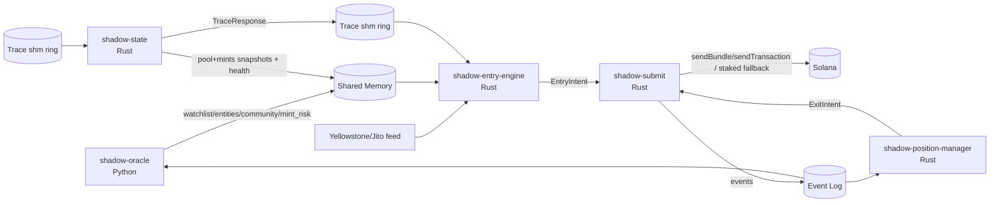

# PROJECT SHADOW ENGINE V5 — Grand Unified System Specification

**Status:** Locked engineering implementation specification (single authoritative document)  
**Supersedes:** V4.5 and all prior drafts/addenda  
**Target ecosystem:** Solana Mainnet  
**Primary venue:** Raydium V4 (first) — Pump/PumpSwap only via versioned adapters  
**Execution model:** pre-consensus ingestion → local intent reconstruction → local quote → simulation-driven compute budgeting → leader-aware submission  
**Core property:** hot path is deterministic, cache-only, and fail-closed

## How to read this document

- This document is the **fully merged** V5 specification: each requirement appears **once** in its final form.
- Where older versions proposed options, V5 states a single mandate (e.g., **schema-driven parsers; WASM forbidden**).
- Hot path = latency-critical, pre-consensus decision loop. Cold/nearline path = Oracle + enrichment services.
- Terms:
  - **Entity** = wallet cluster representing a single operator (burner-rotation aware).
  - **Target** = observed entity whose trades may be copied.
  - **Follower** = non-connected wallet that buys same mint in a defined window after a target buy.
  - **Backrun** = our transaction intended to land immediately after the target in the same block.


### Conventions

- **Normative keywords:**
  - **MUST / MUST NOT** = hard requirement for production correctness/safety.
  - **SHOULD / SHOULD NOT** = strong recommendation; deviations require explicit justification and measurement.
  - **MAY** = optional.
- **Type conventions:**
  - `Pubkey` = 32-byte Solana public key.
  - `Signature` = 64-byte Ed25519 signature.
  - Human-readable Base58 strings are permitted at logging/UI boundaries only; hot-path IPC SHOULD use binary forms.
- **Time conventions:**
  - Slot-based windows use `slot` deltas unless explicitly labeled as wall-clock.
  - `*_unix_ms` / `*_unix_ns` fields are Unix time; `deadline_*` fields are treated as strict fail-fast cutoffs.

---

## Table of contents

1. Mission, scope, and invariants  
2. Runtime topology  
3. Inter-process contracts and canonical data models  
4. Oracle domain (Python): selection, crowding, and gating (V5)  
5. State domain (`shadow-state`): fork-aware replication + global cache + dynamic layouts  
6. Entry domain (`shadow-entry-engine`): feed ingestion → routing → gating → intents  
7. Quoting, slippage, and Token-2022 math  
8. Submitter domain (`shadow-submit`): simulation, fees, leader routing, and relay fanout  
9. Position domain (`shadow-position-manager`): autonomous exits, DOA, and capital preservation  
10. On-chain MEV Router (`shadow_mev_router`): atomic verification (Phase 2 war mode)  
11. Dynamic decoupling services: destination classifier + fee telemetry  
12. GRAND UNIFIED VULNERABILITY MATRIX (33 items)
13. Observability, persistence, and replay  
14. Testing, benchmarks, and rollout gates  
15. Configuration reference (single consolidated YAML)  
16. Implementation build checklist (ordered)  
17. External references (pinned truths)

---

## 1. Mission, scope, and invariants

### 1.1 Mission

Project Shadow Engine is a low-latency Solana execution system that:

- observes a curated set of target wallets/entities on a **pre-consensus feed**,
- reconstructs intent locally (strict adapter decode or net-intent tracing),
- applies **cache-only** safety and profitability gates,
- locally quotes and forward-simulates impact for backruns,
- simulates transactions to derive compute budgets,
- and submits leader-aware via Jito and staked delivery paths.

### 1.2 Non-negotiable architectural invariants

1. **Cold path vs hot path split**
   - **Python** is permitted only for the Oracle and nearline enrichment services.
   - **Rust** is required for all pre-consensus hot path decisioning, quoting, planning, signing, and submission.

2. **No hot-path network I/O for entry decisions**
   - No blocking HTTP/RPC calls for entry gating, risk, holders, state reads, or ALT resolution.
   - Hot path reads **shared memory** snapshots and in-memory caches only.
   - (Exception class: submission sockets themselves; this is after decisioning and must be non-blocking / bounded.)

3. **Single signer authority**
   - Exactly **one** process (`shadow-submit`) holds signing keys and owns submission.
   - All other processes emit **idempotent intents** only.

4. **State is a first-class service**
   - State replication is not a library detail; it is a standalone daemon (`shadow-state`) with fork-aware rollbacks and health watchdogs.

5. **Exits are autonomous**
   - The Position Manager runs in an isolated fault domain and can liquidate even if entry logic is down.

6. **Fail-closed defaults**
   - Missing or stale cache entries → drop entry attempts.
   - Schema reload failure → keep old parsers; do not degrade hot path correctness.

7. **War mode requires atomic on-chain verification**
   - Phase 2 entries are routed through the on-chain MEV Router for atomic checks (and revert if assumptions are false).

### 1.3 Scope

**In scope (V5 core):**
- Offline/nearline Oracle: entity resolution, copy-adjusted outcomes, crowding and isolation modeling, watchlist + entity registry publishing
- Pre-consensus ingestion (Yellowstone/Jito-class)
- ALT-aware decompilation and deterministic account flattening
- Raydium V4 strict single-hop swap reconstruction
- Net-intent tracing via embedded simulation delta (Phase 2) and direct-route execution built by us
- Fork-aware state replication and local quoting (including Token-2022 fee math)
- Simulation-driven compute budgeting
- Competitive fee/tip policy with external floor telemetry and regime-shift protection
- Jito + staked transaction delivery with leader-aware routing and bounded fanout
- Autonomous Position Manager exits, DOA handling, and capital preservation invariants
- Event-sourced execution log with replayable state reconstruction

**Out of scope (for first production candidate):**
- Generic multi-hop aggregator routing built on the hot path
- Unpinned protocol decoders (no “guessing” byte layouts)
- Day-1 fully generalized DEX support across all AMMs

### 1.4 MVP sequencing (enforced)

**Phase 0 — Research + harness (before mainnet broadcast)**
- Quants must prove **strictly positive** friction-adjusted copy EV in notebooks/backtests.
- Systems must stand up shared memory schemas, event log plumbing, and fixture harnesses.

**Phase 1 — “V3.5 core” execution candidate (must ship first)**
- Raydium V4 strict single-hop `swap_base_in` only.
- Fork-aware pool+mints cache sufficient for Raydium quoting and Token-2022 invariants.
- End-to-end intent pipeline, local quote, simulation-driven compute budgeting, leader-aware submission.
- Position Manager exits + event-log replay.

**Phase 1.5 — Dynamic decoupling foundations**
- Schema-driven protocol layout hot reload (native; no WASM).
- Destination classification published nearline.
- External fee telemetry modular ingestion.

**Phase 2 — Advanced war mode (gated)**
- On-chain MEV Router mandatory for entries.
- EmbeddedSimDelta net-intent tracing enabled.
- Global LRU state cache enabled in `shadow-state`.

---

## 2. Runtime topology

The system is a multi-process architecture with strict fault-domain boundaries.

### 2.1 Processes

**Process A — `shadow-oracle` (Python, cold/nearline)**
- Offline + nearline Oracle:
  - entity resolution (burner-rotation aware),
  - copy-adjusted outcome labeling and conservative EV estimates,
  - crowding + isolation modeling (V5 ATR objective),
  - conviction baselines,
  - mint risk profiling (holders + honeypot metadata) *outside* the hot path.
- Publishes hot-path artifacts to shared memory:
  - wallet watchlist (wallet → entity_id)
  - entity registry (entity_id → state + gates + EV inputs + V5 isolation/crowding fields)
  - wallet community map (wallet → community_id) for O(1) “connectedness”
  - mint risk registry (mint → APPROVE/REJECT/UNKNOWN + freshness)

**Process B — `shadow-state` (Rust, standalone state daemon)**
- Ingests account updates and slot-status signals from a low-latency provider.
- Maintains fork-aware in-memory replicas of:
  - Raydium pool reserve accounts required for quoting
  - mint metadata required for hard invariants and Token-2022 fee math
- Maintains (Phase 2) a fork-aware **Global LRU Account Cache** for EmbeddedSimDelta tracing completeness.
- Hosts the EmbeddedSimDelta tracing worker pool (Phase 2).
- Publishes fork-safe state snapshots + health flags to shared memory.

**Process C — `shadow-entry-engine` (Rust, hot path ingestion + decision)**
- Consumes pre-consensus feed (Yellowstone/Jito-class).
- Performs:
  - signature dedupe,
  - ALT resolution + account flattening,
  - strict adapter intent extraction,
  - (optional) net-intent trace requests,
  - Online Oracle gate (cache-only),
  - cached-state quoting and sizing,
  - and emits **EntryIntent** objects to the Submitter.

**Process D — `shadow-position-manager` (Rust, lifeboat evaluator)**
- Runs continuously regardless of Entry Engine health.
- Maintains an in-memory position book (hydrated at boot from chain and reconstructed by replay).
- Evaluates stop-loss / take-profit / timeout / transfer-bypass / swarm lifeboats / DOA.
- Emits **ExitIntent** objects to the Submitter.
- Must prioritize capital preservation; emergency exits use separate fee policy.

**Process E — `shadow-submit` (Rust, single signer authority)**
- Only process holding signing keys.
- Owns:
  - blockhash caching,
  - leader schedule tracking,
  - embedded SVM simulation for compute budgeting,
  - fee policy execution,
  - parallel signing,
  - Jito + staked relay submission,
  - event log emission.
- Enforces **exit preemption**: exits always prioritized over entries.

**On-chain — `shadow_mev_router` (Rust, bare-metal `no_std`)**
- Phase 1 optional; Phase 2 mandatory for entry swaps.
- Performs atomic assertions before CPI into the DEX swap.
- **Anchor is forbidden** in war-mode builds (compute overhead target: < ~3,000 CUs).

### 2.2 High-level flow



---

## 3. Inter-process contracts and canonical data models

### 3.1 Shared memory is canonical for hot reads

All latency-critical reads use `/dev/shm` (tmpfs) with lock-free atomic commit patterns.

**Required shared-memory segments (paths configurable):**
- `/dev/shm/shadow_oracle_watchlist` — wallet → entity mapping
- `/dev/shm/shadow_oracle_entities` — entity registry (gating + EV + V5 isolation/crowding fields)
- `/dev/shm/shadow_oracle_wallet_communities` — wallet → community_id map (O(1) connectedness)
- `/dev/shm/shadow_mint_risk` — mint risk registry (APPROVE/REJECT/UNKNOWN + freshness)
- `/dev/shm/shadow_state_pools` — pool reserve snapshots (fork-aware, high churn)
- `/dev/shm/shadow_state_mints` — mint invariant cache (fork-aware)
- `/dev/shm/shadow_state_health` — state health + circuit breakers (e.g., stale-state flag)
- `/dev/shm/shadow_heartbeats` — process heartbeats + kill switch

**Cross-language writer rule (mandatory):**
Python must NOT hand-pack bytes with `struct.pack` for `/dev/shm` segments.

Allowed patterns:
- Rust-owned writer exposed to Python (PyO3) that writes the exact schema + issues atomic fences; or
- a cross-language schema/IDL with a canonical binary encoding (**FlatBuffers** recommended), where Rust remains the schema authority.
  - Python MUST NOT serialize raw bytes directly; it may only call Rust helpers or use the schema library to produce canonical bytes.

Manual packing across language boundaries is forbidden.

#### 3.1.1 Shared memory framing (seqlock)

Default framing is a seqlock header + CRC.

```text
SharedMemHeader
- seq: u64              # odd = write-in-progress, even = committed
- version: u32
- payload_len: u32
- crc32: u32
- updated_at_slot: u64
```

**Atomic update rule:**
- Writer increments `seq` to odd (write in progress)
- Writes header (except seq) + payload
- Writes CRC and `updated_at_slot`
- Writer increments `seq` to even (commit)
- Reader accepts only if:
  - `seq` is even,
  - `seq` stable across the read,
  - CRC matches payload.

#### 3.1.2 RCU / triple-buffer rule for high-churn segments

For high-frequency snapshots (especially `/dev/shm/shadow_state_pools`), seqlock contention is not allowed.

**Requirement:** pool reserve snapshots MUST publish via RCU/triple-buffer:
- writer constructs next frame in inactive buffer,
- performs a single atomic pointer swap,
- readers always read the latest committed frame without spinning.

#### 3.1.3 SPSC per-worker push channels for ultra-hot state (recommended)

The RCU/triple-buffer pattern eliminates software spin-locks but still generates hardware-level cache-line invalidation storms when multiple Entry Engine worker threads read the same atomic pointer across CPU cores, thrashing L1/L2 caches on every pointer swap.

**Recommended optimization (Phase 1.5+):**
- For the hottest segments (`shadow_state_pools`), `shadow-state` SHOULD allocate a dedicated **lockless SPSC (Single-Producer Single-Consumer) ring buffer** per pinned Entry Engine worker thread, in addition to the RCU/triple-buffer shared memory segment.
- `shadow-state` acts as the single producer, pushing **pool state diffs** (not full snapshots) into each worker's ring buffer.
- Each Entry Engine worker consumes diffs from its dedicated ring to update a **thread-local memory arena** containing the current pool state.
- Quoting (Section 7.1) then operates entirely within the worker's local cache hierarchy (L1/L2), eliminating cross-core cache invalidation.

**Implementation constraints:**
- SPSC rings SHOULD be implemented as **shared-memory-mapped** SPSC buffers (e.g., `memfd` or `/dev/shm` mappings) so separate OS processes can participate without shared address spaces.
- If `shadow-state` and `shadow-entry-engine` run as separate OS processes (the default topology), SPSC channels MUST be backed by shared-memory-mapped ring buffers with single-producer/single-consumer discipline enforced by convention.
- The RCU/triple-buffer `/dev/shm` path MUST remain as the canonical fallback. SPSC is an optimization layer; if a worker's ring overflows or falls behind, it must resync from the RCU snapshot.
- Ring capacity must be bounded (default `spsc_ring_capacity`: 4096 entries). Overflow drops the oldest unread diff and the worker resyncs from the RCU snapshot on next read.

**Scope:** this optimization applies only to pool reserve state. Mint invariant cache, health flags, and Oracle artifacts continue to use seqlock or RCU as specified in Sections 3.1.1 and 3.1.2.

### 3.2 Intent transport: idempotent commands only

Entry Engine and Position Manager do **not** sign. They emit intents:

- `EntryIntent` — request to open/increase a position
- `ExitIntent` — request to reduce/close a position

**Idempotency requirement:**
- Every intent has a deterministic `intent_id` so duplicates can be dropped by the Submitter.
- Submitter MUST reject duplicate `intent_id`s deterministically.

**Transport options:**
- preferred: shared-memory ring buffer
- allowed: unix-domain socket (UDS)
- forbidden for hot-path intent transport: Redis

### 3.3 Net-intent trace transport (Phase 2)

EmbeddedSimDelta tracing is hosted by `shadow-state`. The Entry Engine requests tracing via shared-memory rings.

**Required trace ring buffers:**
- `/dev/shm/shadow_trace_requests`
- `/dev/shm/shadow_trace_responses`

**TraceRequest (minimum)**
- `request_id: u64`
- `signature: [64]` (binary preferred)
- `slot: u64`
- `target_signer: [32]`
- `raw_versioned_tx: bytes`
- `resolved_accounts: bytes` (optional; if present must match runtime flattened ordering)
- `deadline_unix_ns: u64` (optional strict fail-fast)
- `speculative_accounts: bytes` (optional; speculative state overlay from setup tx forwarding, Section 6.6.1)

**TraceResponse (minimum)**
- `request_id: u64`
- `status: OK|UNSUPPORTED|CACHE_MISS|TIMEOUT|CU_LIMIT|ERROR`
- `net_intent: optional<NetIntent>`
- `trace_latency_micros: u32`
- `used_speculative_state: bool` (true if speculative state overlay was applied)

**Hot-path rule (Entry Engine):**
- If no response arrives within the configured deadline, treat tracing as failed and:
  - default (war mode): drop,
  - optional (diagnostics): continue without trading.

### 3.4 Canonical event log (guaranteed delivery)

To prevent position state handoff loss (entry executed but PM never learns), the system uses an append-only event log with replay.

**Required properties:**
- append-only
- durable
- replayable from offset
- consumer-group / at-least-once semantics

**Allowed implementations:**
- Redis Streams (recommended Phase 1)
- local WAL file backend (Phase 2 and outage fallback)

**Minimum event set:**
- `EntryIntentAccepted`
- `ExitIntentAccepted`
- `ExecutionSent`
- `ExecutionLanded`
- `ExecutionFailed`
- `PositionOpened`
- `PositionIncreased`
- `PositionReduced`
- `PositionClosed`
- `SwarmDetected` (`SWARM_DETECTED`)
- `StateStaleAbort` (entry dropped because `shadow-state` health is stale)
- `TraceAttempted` / `TraceSucceeded` / `TraceFailed` (Phase 2 recommended)
- `TRACE_ABORTED_TIMEOUT` / `TRACE_ABORTED_CU_LIMIT` (Phase 2)
- `REVERT_RATE_BREAKER_TRIPPED` (consecutive on-chain reverts exceeded threshold; fee bleed protection)
- `EMERGENCY_WSOL_EXHAUSTED` (atomic exit funding failed; emergency WSOL ATA empty)
- `EMERGENCY_WSOL_LOW` (emergency WSOL ATA below refill threshold)
- `LATENT_POISONING_SUSPECTED` (zero-trade attribution ingress divergence detected; inheritance aborted)
- `INHERITANCE_VALIDATED` / `INHERITANCE_VALIDATION_FAILED` (retroactive validation of `PRE_ACTIVE_INHERITED` entity)
- `SCHEMA_RELOAD_ATTEMPTED` (schema reload triggered; payload includes `protocol_id`, `candidate_schema_version`, `trigger_source`)
- `SCHEMA_RELOAD_ACCEPTED` (candidate schema promoted after all staging gates; payload includes `protocol_id`, `new_schema_version`, `previous_schema_version`, `staging_duration_ms`)
- `SCHEMA_RELOAD_REJECTED` (schema reload failed: `SIGNATURE_INVALID` | `VERSION_DOWNGRADE` | `PARSE_FAILED` | `STAGING_FAILED` | `STRUCTURAL_VALIDATION_FAILED` | `SAMPLE_VALIDATION_FAILED` | `BACKWARD_DIFF_EXCEEDED` | `CANARY_DIVERGENCE_DETECTED` | `CANARY_INSUFFICIENT_DATA`; payload includes `candidate_schema_version`, `candidate_schema_id`, and reason-specific divergence counters)
- `SCHEMA_UNSIGNED_LOADED` (schema loaded without signature; dev mode only)
- `SCHEMA_CANARY_PASSED` (candidate schema survived shadow-parse window with zero divergence; promoted)
- `SCHEMA_REVALIDATION_PASSED` (cold-start `SCHEMA_UNVALIDATED` cleared after periodic re-validation succeeded on ≥ `min_successful_samples` real pools; payload includes `protocol_id`, `schema_version`, `samples_passed`, `elapsed_since_boot_ms`)
- `STATE_SCHEMA_POISONED` (runtime schema poison detected; `state_is_healthy` set to false; requires operator intervention)

**DOA coordination requirement:**
The intent lifecycle must be represented in events so PM can track pending entries and Dump-on-Arrival states.

### 3.5 Canonical data models (stable boundaries)

The project may add fields, but the following boundaries must exist and remain stable.

#### 3.5.1 Feed boundary

```text
PreConsensusTx
- signature: str                  # Base58 string as provided by common feeds; convert to binary `Signature` immediately for hashing/IPC
- slot: u64
- target_signer: [32]
- raw_versioned_tx: bytes
- is_jitodontfront: bool
- signal_source: enum { PUBLIC_GEYSER, PRIVATE_MEMPOOL, JITO_SEARCHER_API }
```

Rule: if `is_jitodontfront == true` → drop immediately.

**`signal_source` semantics (mandatory; Section 8.8 depends on this):**
- `PUBLIC_GEYSER`: transaction was observed on a public Geyser/Yellowstone stream, shred gossip, or RPC pubsub. The target transaction is already in flight to the leader's banking thread. Jito bundle wrapping adds 10–30ms network hop + simulation penalty and will lose the race to the natively propagating target.
- `PRIVATE_MEMPOOL`: transaction was received via a private transaction feed (e.g., bloXroute private stream, MEV relay private channel) before public propagation. Temporal exclusivity may exist; Jito bundles may be viable depending on timing margin.
- `JITO_SEARCHER_API`: transaction was received via Jito's Searcher API / Bundle API as orderflow held inside Jito's block-building pipeline. The target is not yet propagating publicly; Jito bundle inclusion is the only viable path.

The feed adapter (Section 6.2) MUST tag every `PreConsensusTx` with the correct `signal_source` at ingestion time. This tag flows through the entire pipeline and is the **primary discriminator** for submission route selection (Section 8.8).

#### 3.5.2 Adapter / intent boundary

```text
IntentContext (minimum)
- program_id: Pubkey
- side: BUY|SELL
- mint_in: Pubkey
- mint_out: Pubkey
- amount_in: u64
- min_out: u64 (if present in target ix)
- pool_keys: { pool, vault_a, vault_b, ... }    # protocol-specific
- target_ix_index: u8
- target_signature: Signature
- target_slot: u64
```

#### 3.5.3 Net intent boundary (Phase 2)

```text
NetIntent
- target_signer: Pubkey
- mint_in: Pubkey
- mint_out: Pubkey
- amount_in: u64
- implied_amount_out: Option<u64>
- confidence: f32
- trace_mode: enum { EmbeddedSimDelta, TransferScan }
```

#### 3.5.4 Quote boundary

```text
Quote
- expected_out: u64
- expected_out_after_token2022_fees: u64
- min_out: u64
- price_impact_bps: u32
- slippage_bps: u32
- used_forward_sim: bool
- used_token2022_fee_math: bool
- pool_schema_version: u32          # schema version used to parse pool reserves at quote time
- mint_schema_version: optional<u32> # schema version used for mint metadata, if separate
- state_snapshot_slot: u64           # slot of the shadow-state snapshot used for quoting
```

**Causal correctness rule (mandatory):**
- `pool_schema_version` and `mint_schema_version` must be captured at **quote time** by the Entry Engine (Section 6.8), not at send time by the Submitter. This ensures the schema version that actually produced the reserve values used for the quote is recorded, even if a schema reload occurs between quoting and submission.
- `state_snapshot_slot` records which state snapshot the quote operated on, enabling replay-time correlation between quote staleness and execution outcome.

#### 3.5.5 Intent boundary (idempotent commands)

```text
EntryIntent
- intent_id: [32]      # hash(signature, slot, mint_out, amount_in, strategy_version)
- entity_id: u64
- target_signature: Signature
- target_slot: u64
- protocol: enum
- intent: IntentContext or NetIntent-derived context
- sizing: { our_amount_in: u64, max_amount_in: u64, sizing_mode: enum }
- quote: Quote
- constraints: { native_sol_reserve_floor_lamports: u64, max_tip_lamports: u64 }
- flags: { is_emergency: bool, requires_mev_router: bool, doa: bool }  # extendable

ExitIntent
- intent_id: [32]      # hash(position_id, reason, slot)
- position_id: [32]
- reason: STOP_LOSS|TAKE_PROFIT|TIMEOUT|TRANSFER_BYPASS|SWARM_DETECTED|MANUAL|DOA
- exit_mode: MARKET_DUMP|LIMIT_GUARDED
- max_retries: u8
- flags: { is_emergency: bool }
```

Rule: only `shadow-submit` signs and sends.

**Schema version pass-through rule (mandatory):**
- The `Quote` embedded in each `EntryIntent` carries `pool_schema_version`, `mint_schema_version`, and `state_snapshot_slot` as captured at quote time by the Entry Engine.
- The Submitter MUST NOT overwrite these fields. When emitting `ExecutionSent` and `ExecutionLanded` events (Section 5.6.7), the Submitter must stamp the event payload using the schema versions from the intent's embedded Quote, not by reading the current `active_schema_versions` from shared memory. This preserves causal correctness if a schema reload occurs between quoting and submission.

#### 3.5.6 Event envelope

```text
Event
- event_id: [16]      # stream offset / monotonic id
- ts_unix_ms: u64
- kind: enum
- intent_id / position_id: optional
- payload: bytes (versioned)
```

**Execution event payload extensions (mandatory; Section 5.6.7):**

`ExecutionSent` and `ExecutionLanded` payloads must include:
- `pool_schema_version: u32` — schema version used to parse pool reserves for the quote
- `mint_schema_version: optional u32` — schema version used for mint metadata, if separate

This enables replay-time correlation of any PnL anomaly or revert spike with schema changes.

---

## 4. Oracle domain (`shadow-oracle`, Python): selection, crowding, and gating (V5)

### 4.1 Oracle responsibilities

The Oracle is the **only** component allowed to perform heavy computation, large joins, and historical modeling.

It produces **cache-only** artifacts consumed by the hot path:

- **Watchlist**: wallet → entity_id (targets to subscribe to)
- **Entity registry**: entity_id → gating + conservative EV inputs + V5 isolation/crowding fields
- **Wallet communities**: wallet → community_id (for O(1) connectedness checks)
- **Mint risk registry**: mint → APPROVE/REJECT/UNKNOWN + freshness + reasons

### 4.2 Offline/nearline pipeline (required stages)

#### 4.2.1 Managed data ingestion (no indexer mandate)

- Ingest from managed datasets (BigQuery/Dune/Bitquery/custom provider dumps).
- Building a historical Solana indexer inside this repo is forbidden.
- Ingestion must be idempotent and fixture-driven (replay produces identical canonical tables).

#### 4.2.2 Copy-adjusted outcome labeling (Pillar 1)

For each candidate entity trade, label the copy outcome using conservative assumptions:

- assumed lag: `lag_slots` (default 1)
- entry slippage assumption
- fees + tip assumptions (or backfilled from telemetry)
- outcome horizons: `[30s, 5m, 30m]` with a primary horizon (default 5m)

Output (minimum):
- `p_win_lcb` (lower confidence bound win probability)
- `b_win_lcb` (lower confidence bound win size, conditional)
- profit factor, Sortino, hit rate under copy assumptions
- sample sizes and recency-weighted metrics

#### 4.2.3 Entity resolution (burner rotation aware)

V5 requires three complementary layers:

1) **Asset Transfer Graph (ATG) clustering**
- edges: funding, sweeping, timed transfers, shared counterparties
- conservative clustering (min edge weight thresholds)

2) **Behavioral clustering / filtering**
- default method: HDBSCAN on engineered features (time-of-day cyclicals, hold time, trade size logs, program sequence fingerprint, burstiness, etc.)
- purpose: separate "elite sybil rings" from retail noise

3) **Zero-trade contrastive attribution (Section 4.2.6)**
- maps fresh burner wallets with zero trading history to known entity clusters using genesis-time infrastructure fingerprints
- enables `PRE_ACTIVE_INHERITED` state for immediate hot-path eligibility

**Cold-start override rule (operational reality):**
If an entity is high signal but data sparse, the Oracle may allow a temporary "candidate" state with strict constraints; but the hot path still requires `active` or `pre_active_inherited` to fire.

#### 4.2.4 Crowding modeling (shield)

V5 retains crowding defenses as necessary constraints:

- historical crowdedness score (offline)
- runtime circuit breaker `SwarmDetected` (online; in Rust)
- DOA lifeboat exits (position manager; last resort)

But these are **not** the primary alpha engine; see 4.3–4.5.

#### 4.2.5 Conviction baseline (anomaly detection)

Compute per entity a robust “conviction anomaly score” (default: log-median MAD z-score) based on:
- trade sizes,
- timing,
- and optionally program sequence.

Publish conviction gating fields so hot path can apply a fixed rule without computing statistics.

#### 4.2.6 Zero-trade entity attribution (Contrastive Dual-Encoder)

Elite operators rotate burner wallets continuously. A fresh burner has zero trading history, making ATG clustering and behavioral profiling impossible until the wallet accumulates trades — by which time the alpha window has closed.

V5 adds a **contrastive dual-encoder** model that maps zero-trade burner wallets to known entity clusters using only genesis-time infrastructure fingerprints, enabling immediate `PRE_ACTIVE_INHERITED` eligibility on the hot path.

##### 4.2.6.1 Architecture: Asymmetric Contrastive Dual-Encoders

The model uses two asymmetric encoders aligned into a shared latent space (architecturally identical to CLIP-style contrastive alignment):

**Encoder A ("Mature Teacher"):**
- Ingests the full trading history of known entities (trade sizes, pairs, hold times, PnL distributions, community_id, program sequences).
- Maps established entities into isolated cluster centroids in a high-dimensional latent space (default 256-d).

**Encoder B ("Genesis Student"):**
- Ingests **only** the first N slots of a wallet's existence (default N=3): funding source, exact lamport amounts, setup instruction sequences.
- Produces a latent vector from genesis-time features alone.

**Training objective:**
- Train using **ATR-conditioned Supervised Contrastive (SupCon) loss** (Section 4.2.6.2) to minimize cosine distance between Encoder A and Encoder B outputs for historically linked wallet pairs (same entity, different wallets across time).
- **Hard negative mining is mandatory** (Section 4.2.6.2). Standard random negative sampling causes manifold collapse into "bot vs retail" blobs; the model must be trained against structurally similar but entity-distinct negatives.
- Training data: historical entity-resolved wallet clusters with known burner-to-entity mappings.

**Inference (live):**
- When a new wallet is funded on-chain, the Oracle passes its genesis features through Encoder B.
- The output vector is compared against Encoder A centroids for all active entities via an in-memory approximate nearest-neighbor index (HNSW recommended).
- If cosine similarity exceeds `zero_shot_similarity_threshold` (default 0.92), the wallet inherits the parent entity's identity and ATR.

##### 4.2.6.2 Hard Negative Mining and Contrastive Loss Engineering (mandatory)

Standard random negative sampling in contrastive training causes **manifold collapse**: the model learns to separate generic "bot" infrastructure from retail wallets instead of distinguishing operator-specific micro-stylometry. When two elite operators share identical Rust SDKs, Jito relayers, and CU optimization patterns, random negatives project them into the same latent coordinates. Inheriting ATR from the wrong operator — a toxic bot instead of an alpha sniper — causes systematic capital drain.

V5 mandates a **Hard Negative Mining Engine** in the offline Oracle pipeline and an **ATR-conditioned contrastive loss** that forces operator-level manifold separation.

**A. Deterministic PvP Collisions (ground-truth hard negatives)**

Same-slot, same-target competitive collisions provide mathematically guaranteed entity separation: an elite operator will not intentionally submit two competing transactions against the same atomic opportunity from different wallets, because doing so fragments capital and forces self-bidding on Jito bundles.

Required mining job:
- Scan historical blocks for instances where Wallet A and Wallet B both submitted a backrun/swap targeting the same mint in the same slot, reacting to the same target buy.
- These wallets are guaranteed distinct entities regardless of infrastructure similarity.

Hard negative triplet construction:
- **Anchor:** Wallet A (Tier-1 entity, won the block, high ATR).
- **Positive:** Wallet C (another known burner from Wallet A's entity cluster).
- **Hard Negative:** Wallet B (the competitor who collided — arrived at the same millisecond with near-identical latency-optimized infrastructure).

Signal: because both bots arrived simultaneously, their observable infrastructure exhaust is near-identical. Forcing them apart in the loss function requires the model to learn deeply hidden fingerprints (ALT flattening order, sub-lamport math, instruction packing) rather than surface-level "elite bot" features.

**B. Intra-Entity Decoys (sybil ring alpha/chaff separation)**

Elite operators deploying insider trades spin up sybil rings of 5–20 wallets simultaneously. One executes the alpha snipe; the remaining wallets buy honeypots or route to mixers as camouflage, generating intentional noise in the ATG.

Required mining job:
- From Phase 1 ATG clustering, identify wallet clusters funded by the same source in the same epoch.
- Within each cluster, identify the **alpha wallet** (highest ATR, positive PnL) vs. **decoy wallets** (negative ATR, honeypot buys, mixer routing).

Hard negative triplet construction:
- **Anchor:** Alpha wallet from the cluster (ATR = high).
- **Positive:** Another alpha wallet from the same entity's prior rotation.
- **Hard Negative:** Decoy wallets from the same cluster (ATR = negative).

Signal: alpha and decoy wallets were generated by the same deployment script at the same time — their T₀ vectors are near-identical. Forcing the model to repel alpha from decoy requires learning the operator's internal routing hierarchy (e.g., alpha wallet funded 1 slot earlier, receives marginally more SOL for priority fees).

**C. Fee-Derivative Divergence (arbitrage vs. alpha sniper separation)**

Highly optimized arbitrage/sandwich bots and Tier-1 alpha snipers produce near-identical T₀ infrastructure fingerprints (both bypass public RPCs, use bespoke ALTs, optimize CUs), but their cryptoeconomic risk profiles are orthogonal.

Separation signal (T₁ to T_N fee-payment curves):
- **Arbitrage bots:** PnL is mathematically deterministic from pool state. Jito tips are highly variable — the bot calculates exact extractable value and tips a high percentage (e.g., 0.01 to 1.5 SOL dynamically).
- **Alpha snipers:** PnL is speculative. Tips are flat or step-function (e.g., always exactly 0.05 SOL to guarantee inclusion regardless of trade size).

Required mining job:
- Compute per-wallet fee-payment curve statistics: tip variance, tip/trade-size ratio distribution, tip quantile stability.
- Pair alpha snipers (anchor) against arbitrage bots (hard negative) with matched T₀ infrastructure similarity.

Signal: forces the model to recognize that systems built to parse deterministic pool state (arb) produce subtly different T₀ exhaust than systems built to react to Yellowstone feed signals (snipe), even when both appear identically "elite."

**D. ATR-conditioned contrastive loss (mandatory; replaces vanilla InfoNCE)**

Standard InfoNCE treats all negative samples equally — pushing an elite bot away from a retail wallet applies the same gradient as pushing an elite bot away from a toxic bot with identical infrastructure. With hard negatives from A–C above, vanilla InfoNCE gradients explode because samples are too structurally similar.

Required loss function: **Supervised Contrastive Learning (SupCon)** with ATR-delta-scaled margin.

Let `ΔATR = |ATR(Wallet_A) - ATR(Wallet_B)|`.

Modify the contrastive loss so the margin penalty `m_i` for each negative pair is a monotone function of `ΔATR`:
- When `ΔATR` is large (alpha sniper vs. toxic bot): amplify the repulsion gradient (default scaling factor: `atr_gradient_scale`, configurable, default 10.0).
- When `ΔATR` is small (two comparable entities): apply standard margin.

Required config fields:
- `contrastive_loss.method: supcon_atr_conditioned` (default; `infonce_random` forbidden in production)
- `contrastive_loss.atr_gradient_scale: 10.0` (multiplier for high-ΔATR negative pairs)
- `contrastive_loss.temperature: 0.07` (SupCon temperature τ)

Fail-closed training rule: if the training pipeline cannot produce at least `min_hard_negatives_per_batch` (default 32) hard negatives from sources A–C per batch, the training run must abort rather than silently falling back to random negatives. A model trained on random negatives is worse than no model — it creates false confidence in entity attribution.

**E. Adversarial Feature Dropout (mandatory during training)**

If a dominant fraction of Tier-1 MEV bots route through a specific infrastructure provider, the model memorizes that metadata string and ignores harder mathematical features. When the operator rotates proxies, the model goes blind.

Required training discipline:
- For a configurable fraction of training batches (`feature_dropout_fraction`, default 0.30), completely mask (zero-out) the following "obvious" programmatic features:
  - `cu_limit_signature`
  - `cu_price_signature`
  - `ingress_relay_fingerprint` (when available)
- The masked batches force Encoder B to rely on deep structural execution math: instruction AST layout, lamport mantissa patterns, and temporal funding pulse characteristics.

Required config fields:
- `training.feature_dropout_fraction: 0.30`
- `training.dropped_features: [cu_limit_signature, cu_price_signature, ingress_relay_fingerprint]`

**Summary: hard negative mining pipeline is a Phase 2+ offline research deliverable.**

The mining jobs (A–C) run in the same offline BigQuery/ClickHouse pipeline as entity resolution (Section 4.2.3). They produce triplet datasets consumed by the contrastive training loop. The ATR-conditioned loss (D) and feature dropout (E) are training-loop modifications. None of these affect the hot path or runtime inference — they exclusively improve the quality of the trained model whose weights are loaded by the Oracle's ONNX runtime.

##### 4.2.6.3 Genesis Manifold features (T=0 feature engineering)

Standard graph features (sender/receiver addresses) are easily obfuscated via CEX hot wallets or mixing services. Genesis Manifold features extract **infrastructure fingerprints** that are structurally difficult to spoof without changing the operator's toolchain.

**A. Sub-lamport entropy (funding math signature)**

Automated sybil infrastructure calculates exact funding requirements: `base_rent + (N * ata_rent) + expected_priority_fees + base_trade_size`. The fractional lamport tail of the funding amount is effectively a deterministic function of the operator's internal risk constants.

Required feature:
- `lamport_mantissa`: the fractional decimal component of the funding amount in SOL (e.g., the `.04183921` portion of `10.04183921 SOL`).
- `mantissa_entropy_bits`: Shannon entropy of the mantissa digit distribution across the entity's historical funding transactions.

Signal: identical mantissa patterns across wallets funded from different sources indicate a shared operator, even when the funding source (e.g., Binance hot wallet) provides no graph signal.

**B. Execution stylometry (compiler fingerprint)**

Treat the instruction-level structure of a wallet's first non-financial transactions (funding, SOL wrapping, ATA creation) as a stylometric signal:

Required features:
- `instruction_sequence_hash`: deterministic hash of the ordered `(program_id, discriminator)` tuples in the first N transactions.
- `cu_limit_signature`: the exact `SetComputeUnitLimit` value used (retail wallets use RPC-simulated defaults; elite bots hardcode optimized bounds).
- `cu_price_signature`: the exact `SetComputeUnitPrice` value; another toolchain fingerprint.
- `instruction_packing_density`: number of instructions per transaction in setup phase.

Signal: the model embeds the **client software** the entity is using, not the wallet identity itself.

**C. Swarm-synchronous spatiotemporal topography (birthing pulse)**

Elite entities rarely spin up a single burner; they deploy **swarm rings** (5–20 wallets simultaneously) to bypass position sizing limits and evade per-wallet detection.

Required features:
- `funding_burst_count`: number of new wallets funded by the same upstream source within a configurable time window (default 500ms).
- `funding_burst_timing_variance_us`: microsecond-level variance of funding transaction arrival times within the burst.
- `post_funding_ata_sync_slots`: slot delta between funding and first ATA creation across burst members.

Signal: if a source funds 12 addresses within a 400ms staccato window and all 12 execute `CreateATA` in the immediately following slot, the timing variance and synchronicity collapse all 12 into a single cohort vector — identifying the swarm ring at birth.

**Continuous-time graph layer (recommended):**
- Implement a continuous-time graph network (CTGN) layer where inter-wallet timing is a structural edge weight, not a discretized bin. This captures sub-slot temporal correlations that slot-bucketed features miss.

##### 4.2.6.4 PRE_ACTIVE_INHERITED handoff (Oracle → hot path)

The zero-trade attribution result must be published to the hot path without violating V5 architectural invariants (fail-closed, zero RPC, cache-only gating).

**Execution sequence:**

1. **Block T₀ (genesis detection):** A `SystemProgram::Transfer` creating a new wallet hits the Geyser stream.
2. **Nearline Oracle (T₀ + ~15ms):** The Python `shadow-oracle` runs the Genesis Encoder B forward pass (via optimized ONNX runtime). Queries the in-memory HNSW index against active entity centroids.
3. **Latent match (T₀ + ~25ms):** If cosine similarity to best-match entity exceeds `zero_shot_similarity_threshold`:
   - Assign a new `entity_id` for the burner wallet.
   - Set `state = PRE_ACTIVE_INHERITED`.
   - Set `parent_entity_id` to the matched entity.
   - Inherit parent entity's ATR, profitability gates, and risk caps.
   - **Do not discount inherited ATR.** The inherited `atr_lcb_5m` is used at full value (effective `zero_shot_atr_discount = 1.0`). Rationale: ATR flows directly into Fee Policy's tip budget calculation (Section 8.5). Discounting ATR reduces the maximum Jito tip below competitive levels, causing systematic first-price auction losses on inherited entities — the very entities where speed-to-first-trade is critical. Position sizing, not tip aggression, is the correct risk lever for unvalidated inheritance.
   - Apply `zero_shot_max_position_discount` (default 0.25) to inherited `max_position_size_lamports`. This is the primary risk control for `PRE_ACTIVE_INHERITED` entities: smaller positions limit downside if inheritance is wrong, while full ATR ensures competitive inclusion.
4. **Shared memory publish (T₀ + ~26ms):** Oracle pushes the new wallet entry into `/dev/shm/shadow_oracle_watchlist` and `/dev/shm/shadow_oracle_entities` via atomic commit.
5. **Hot-path eligibility:** When the burner's first target buy arrives on the pre-consensus feed, the Rust Entry Engine reads the cache, sees `PRE_ACTIVE_INHERITED` with inherited ATR (full) and reduced position sizing, and proceeds through standard gating. Rust never distinguishes between a mature `active` entity and a `PRE_ACTIVE_INHERITED` entity beyond the reduced position caps.

**Promotion and demotion rules:**
- `PRE_ACTIVE_INHERITED` → `active`: after the burner accumulates sufficient independent trading history (configurable `min_independent_trades`, default 5) and its own computed ATR confirms the inheritance was valid.
- `PRE_ACTIVE_INHERITED` → `burned`: if the wallet's first N trades diverge from the parent entity's behavioral profile beyond `inheritance_divergence_threshold`, or if an adversarial latent poisoning check triggers (Section 4.2.6.5).
- `PRE_ACTIVE_INHERITED` entities are subject to all standard gates (predictive burn, conviction, mint risk) with no exemptions.

**Fail-closed rules:**
- If the ONNX inference fails or exceeds `max_inference_latency_ms` (default 50ms), discard the result and do not publish.
- If cosine similarity is below threshold, the wallet enters the standard `candidate` pipeline (no inheritance).
- If the HNSW index is stale or unavailable, zero-trade attribution is disabled and the Oracle falls back to ATG + behavioral clustering only.

##### 4.2.6.5 Adversarial latent poisoning defense (mandatory)

Deploying zero-trade attribution creates a novel attack surface: elite operators who discover they are being pre-identified via genesis fingerprints will attempt **vector poisoning** — spoofing their own CU limits, mimicking their exact lamport mantissa math, and funding bait wallets designed to attract copy-trades into honeypot positions.

**Defense: Latent-Feature Orthogonality Check**

The stylistic vector (how the transaction was built) must strictly align with the **physical ingress vector** (how it arrived on the network).

Because the system ingests Yellowstone pre-consensus streams, network-layer metadata is available:

Required cross-validation features:
- `ingress_relay_fingerprint`: the relay/validator path through which the funding transaction was first observed (e.g., Tokyo staked relayer vs. public RPC geographic origin).
- `propagation_latency_profile`: timing of the transaction's appearance across multiple feed endpoints (if multi-feed is configured).
- `historical_ingress_distribution`: the parent entity's historically preferred relay/validator submission pattern.

**Anomaly divergence rule:**
- If a wallet's genesis stylometry matches a Tier-1 entity (cosine similarity > threshold) BUT its physical ingress vector diverges from the entity's historical ingress distribution beyond `ingress_divergence_z_threshold` (default 3.0 standard deviations):
  - Flag `ANOMALY_DIVERGENCE`.
  - Do **not** publish `PRE_ACTIVE_INHERITED`.
  - Log the event for Oracle review.
  - Optionally emit `LATENT_POISONING_SUSPECTED` event.

**Additional defenses (recommended):**
- **Temporal honeypot detector:** if a `PRE_ACTIVE_INHERITED` wallet's first trade targets a mint with anomalously low liquidity, high concentration, or known honeypot signals (freeze authority, transfer hook), immediately revoke inheritance and burn.
- **Retroactive validation:** after the wallet's first 3 trades land, compare realized PnL and behavior against parent entity baseline. If divergence exceeds threshold, revoke `PRE_ACTIVE_INHERITED` and burn with `burn_reason = INHERITANCE_VALIDATION_FAILED`.

##### 4.2.6.6 Scope and phasing

- Zero-trade attribution is **Phase 2+** functionality. It requires:
  - a trained contrastive model (offline research deliverable),
  - an operational HNSW index maintained by the Oracle,
  - ONNX runtime integration in the Python Oracle.
- Phase 1 and Phase 1.5 continue to use ATG + behavioral clustering only.
- The `PRE_ACTIVE_INHERITED` state must be supported in the entity registry schema and hot-path gating logic from Phase 1 (schema forward compatibility), but the Oracle will not produce it until the model is validated.

### 4.3 V5 mandate: Predictive Burn (pre-trade crowding gating)

Reactive DOA exits are capital-preserving but can cause systematic bleed. V5 adds a **pre-trade** exclusion rule.

#### 4.3.1 Required metric: Swarm Latency Profile

For each entity, compute a Swarm Latency Profile on historical buys.

Definitions:
- Let `t0` be the slot of an entity’s buy signal.
- Let `F(Δ)` be the count of unique **unconnected** follower wallets that buy the same `mint_out` within slot delta `Δ` of `t0`.

Connectedness rule (must match runtime):
- unconnected iff `follower.community_id != target.community_id`.

Required profile outputs (minimum):
- `p_swarm_within_1_slot` = P( F(0)+F(1) ≥ N )
- `p_swarm_within_2_slots` = P( F(0)+F(1)+F(2) ≥ N )
- `swarm_time_to_N_p50_slots`
- `swarm_time_to_N_p90_slots`
- `swarm_trade_count` (sample size; used for confidence gating)

Follower threshold alignment:
- default `N` equals runtime `max_unconnected_followers` unless explicitly overridden.

#### 4.3.2 Predictive burn rule (watchlist exclusion)

If an entity meets the configured predictive burn trigger, it MUST be excluded from the active watchlist.

Default trigger:
- if:
  - `swarm_trade_count >= min_trade_count`, and
  - `p_swarm_within_1_slot >= threshold`,
- then:
  - set entity state to `burned` (or synonym `pre_burned`),
  - set `burn_reason = PREDICTIVE_SWARM_LATENCY`,
  - exclude from watchlist and active registry.

Fail-closed sample rule:
- if sample size is insufficient, predictive burn decision is **unknown** and the entity must not be promoted without strong isolation evidence (4.4).

#### 4.3.3 DOA bleed feedback (mandatory escalation)

Oracle must ingest the event log and maintain per-entity DOA bleed metrics:

- `doa_count_24h`
- `doa_loss_bps_p50`
- `doa_loss_bps_p90`

If DOA exceeds configured limits, entity MUST be burned regardless of historical swarm estimates.

### 4.4 V5 mandate: selection objective = Max Isolation via Alpha-to-Tip Ratio (ATR)

#### 4.4.1 Why

Max PnL targets are often the most surveilled and competitively auctioned; copy EV compresses to near zero.

#### 4.4.2 Required metric: ATR

Compute per entity:

- `ATR = ConservativeExpectedAlpha / ConservativeExpectedAuctionCost`

Where:
- ConservativeExpectedAlpha comes from copy-adjusted labels using lower bounds.
- ConservativeExpectedAuctionCost is a conservative estimate of required inclusion cost:
  - bundle mode: expected Jito tip
  - sendTransaction mode: priority fee + tip share

Cost model options (must persist choice + features):
1) Global floor model (baseline): uses the blended competitive floor from FeePolicy telemetry + fixed overhead for ATA rent + expected slippage.
2) Entity-conditioned cost model (preferred): conditions cost on:
   - swarm latency / crowding proxies,
   - follower diversity proxies,
   - “influencer-like” graph signals.

Required outputs:
- `expected_auction_cost_lamports_p50`
- `expected_auction_cost_lamports_p90`
- `atr_lcb_5m` (lower-confidence-bound ATR at the primary horizon)
- `isolation_score` (monotone function of ATR + crowding proxies)

#### 4.4.3 Selection rule (replaces any prior “maximize raw PnL” implication)

- Primary objective: **maximize `atr_lcb_5m`**, subject to safety and sample-size constraints.
- Profit Factor / Sortino / hit rate remain mandatory constraints or tie-breakers.

#### 4.4.4 Publishing implication

ATR is enforced offline by:
- who enters `active` registry, and
- who is on the watchlist.

Hot path remains cache-only; no new complexity is added to Rust.

### 4.5 V5 mandate: evasive targets + EmbeddedSimDelta are the offensive edge

The routing-program-agnostic net-intent extractor enables following entities routing through:
- Meteora DLMMs,
- Lifinity,
- multi-hop aggregators,
- obscure wrappers intended to break standard parsers.

Oracle must compute:
- `strict_copyable_fraction` (strict Raydium profile trades)
- `net_intent_required_fraction` (complex routing)
- `net_intent_supported_fraction` (traceable complex trades; from telemetry once Phase 2 is on)

Selection preference rule:
- when `prefer_net_intent_supported=true`, entities with higher `net_intent_supported_fraction` and acceptable ATR SHOULD outrank equally-ATR entities whose alpha is fully exposed in strict Raydium-only flow.

### 4.6 Oracle-published data model (entity registry)

Minimum required fields per entity:

- identity:
  - `entity_id: u64`
  - `state: enum { candidate, active, pre_active_inherited, burned, retired }`
  - `burn_reason: optional enum { HISTORICAL_CROWDEDNESS, RUNTIME_SWARM_DETECTED, PREDICTIVE_SWARM_LATENCY, DOA_ESCALATION, INHERITANCE_VALIDATION_FAILED, LATENT_POISONING_SUSPECTED, ... }`
- profitability:
  - `p_win_lcb_*`, `b_win_lcb_*`, `profit_factor_*`, `sortino_*`, `sample_sizes`, `recency`
- conviction:
  - `conviction_score`, `conviction_threshold`, optional `min_trade_size_sol`
- V5 predictive burn:
  - `p_swarm_within_1_slot`, `p_swarm_within_2_slots`,
  - `swarm_time_to_N_p50_slots`, `swarm_time_to_N_p90_slots`,
  - `swarm_trade_count`
- V5 ATR / isolation:
  - `expected_auction_cost_lamports_p50`, `expected_auction_cost_lamports_p90`
  - `atr_lcb_5m`, `isolation_score`
- evasive target preference:
  - `strict_copyable_fraction`, `net_intent_required_fraction`, `net_intent_supported_fraction`
- zero-trade attribution (Phase 2+):
  - `parent_entity_id: optional u64` (set when `state == pre_active_inherited`)
  - `zero_shot_similarity: optional f32` (cosine similarity at inheritance time)
  - `zero_shot_atr_discount: optional f32` (always 1.0; field retained for schema compatibility and override flexibility)
  - `inheritance_validated: optional bool` (true after retroactive validation passes)
- hot-path gating hints:
  - `max_position_size_lamports`, optional per-entity risk caps
  - `net_intent_mode_allowed: bool` (Phase 2)

**Compatibility rule:** new fields must be optional and default-safe for older consumers.

### 4.7 Nearline mint risk registry (required)

The Oracle (or a paired nearline MintRisk service) must evaluate mints and publish:

- `APPROVE` / `REJECT` / `UNKNOWN`
- `updated_at_slot` + `updated_at_unix_ms`
- `reason_codes` (machine-readable)
- the metrics used for the decision (at minimum):

  - `min_owner_count` (largest-holders sample)
  - `entropy_bits` (distribution entropy proxy)
  - `gini` (inequality)
  - `top1_share` and `top5_share`
  - `freeze_authority_present` (hard reject default)
  - `transfer_hook_present` (Token-2022 hard reject default)
  - `permanent_delegate_present` (Token-2022 hard reject default)
  - `interest_bearing_present` (Token-2022 hard reject default)

**Nearline-only rule (mandatory):**
- Any RPC calls like `getTokenLargestAccounts` (or equivalent holder concentration queries) MUST occur nearline only.
- Hot path consumes only the cached registry from shared memory.

Hot-path behavior:
- mint status `REJECT` → drop entry
- mint status `UNKNOWN` → configurable (default conservative drop)
- mint status `APPROVE` → continue (still subject to mint invariant cache)

---

## 5. State domain (`shadow-state`): fork-aware replication + global cache + dynamic layouts

### 5.1 Responsibilities

`shadow-state` is the canonical in-memory state service providing:

- fork-aware snapshots for quoting:
  - Raydium pool reserves and pool metadata
  - SPL/Token-2022 mint metadata and invariants
- (Phase 2) global account cache for net-intent tracing completeness
- schema-driven protocol layout decoding (hot-reloadable; native; no WASM)
- health signals:
  - slot staleness detection,
  - provider feed liveness,
  - stale-state circuit breakers exported to shared memory
- (Phase 2) EmbeddedSimDelta tracing worker pool

### 5.2 Inputs

**Required provider inputs:**
- high-frequency `AccountUpdate` stream (Geyser or equivalent)
- slot status / fork signals (processed/confirmed/rooted + fork switch notifications)

### 5.3 Fork-aware data model and rollback discipline

State must be correct under Solana micro-forks.

**Requirements:**
- updates are applied speculatively to non-rooted slots
- `shadow-state` tracks a fork DAG (or equivalent) and a rollback log
- on fork switch:
  - revert pool/mint/global-cache records to the fork ancestor state
  - publish new snapshot pointers atomically (RCU)
- only rooted slots are final

**Promotion rule (recommended / compatible with patch guidance):**
- buffer speculative updates and only publish to the “read view” when slots are `Confirmed` or `Rooted` per provider status.
- drop orphaned branches immediately on fork switch.

### 5.4 Pool reserve cache (Raydium-first)

Maintain fork-aware replicas for Raydium pool reserves required for quoting:

- vault balances for both sides
- pool config fields required for curve math
- associated token accounts and authorities if used by adapter constraints

Publish to:
- `/dev/shm/shadow_state_pools` using RCU/triple-buffer (mandatory)
- optionally: per-worker SPSC ring buffers pushing pool state diffs for L1/L2-local quoting (Section 3.1.3)

### 5.5 Mint invariant cache (SPL + Token-2022)

Maintain fork-aware mint metadata required to enforce invariants and compute effective outputs.

Minimum required fields:
- owner program (SPL Token vs Token-2022)
- decimals
- freeze authority (presence)
- mint authority (presence)
- Token-2022 extensions (as available):
  - TransferFeeConfig (basis points, max fee, epoch schedule)
  - TransferHook (presence)
  - PermanentDelegate (presence)
  - InterestBearingConfig (presence)
  - ConfidentialTransfer (presence) if detectable
  - NonTransferable (presence)

Publish to:
- `/dev/shm/shadow_state_mints` (seqlock acceptable; update frequency lower)

### 5.6 V5 mandate: schema-driven protocol layouts (dynamic decoupling) — Schema Safety Contract

Hot-swappable decoding must not require recompilation for common layout changes.

**Mandate:** schema-driven native decoding only.

- WASM parser plugins are forbidden in production.
- Layouts are described via YAML/JSON schema loaded at boot and hot-reloadable.
- Rust maps byte offsets into native structs via `bytemuck`/`zerocopy` or equivalent.

**Schema Safety Contract:** Sections 5.6.1–5.6.7 below define the complete defense-in-depth contract for schema integrity. A schema must pass every gate in sequence before it can influence quoting or execution. The gates are:

1. **Provenance** (5.6.1): cryptographic signing + version monotonicity proves who authored the schema and prevents rollback.
2. **Reload discipline** (5.6.2): production defaults enforce operator-triggered reload (`sighup`); watcher mode requires debounce + completeness checks.
3. **Static structural validation** (5.6.3): offset/length bounds, type constraints, role map completeness, and alignment checks prove internal consistency.
4. **Live-cache sample-parse validation** (5.6.4): parsing real cached account bytes proves the schema produces plausible reserves, fees, and decimals on actual on-chain data.
5. **Backward-diff validation** (5.6.5): comparing candidate and active parser outputs on the same data detects subtle field shifts that pass plausibility checks individually but differ from the correct interpretation.
6. **Shadow-parse canary rollout** (5.6.6): dual-parsing live account updates with both active and candidate schemas under real traffic proves the candidate behaves identically before promotion.
7. **Version observability** (5.6.7): active schema versions are stamped into shared memory, execution events, and structured logs so any post-promotion anomaly can be correlated with the exact schema that caused it.

Runtime defense after promotion is covered by Section 5.9.1 (runtime schema poison detection), which continuously monitors parsed output and trips `state_is_healthy = false` with `SCHEMA_POISONED` if invariants are violated post-promotion. Testing gates for schema safety are defined in Sections 14.1 (fixture tests), 14.2 (integration tests 10–13), and 14.3 (Phase 2 trace worker poisoned-schema rejection).

#### 5.6.1 Schema authenticity (mandatory)

A syntactically valid but semantically incorrect schema (wrong byte offsets, misaligned fee params, incorrect decimals) will parse successfully and produce plausible-looking but wrong pool reserves. This bypasses fail-closed protections — nothing appears missing or stale — and causes systematic bad entries/exits via silent mis-quoting.

**Fix: cryptographic signing for schema bundles.**

Each schema bundle must contain:
- `schema_version: u32` (monotonically increasing per protocol; rollback rejected)
- `protocol_id: string` (e.g., `raydium_v4`, `meteora_dlmm`)
- `schema_id: [32]` = `sha256(canonical_json(schema_without_signature))`
- `signature: [64]` = `ed25519_sign(schema_id, author_privkey)`

**Verification rule (mandatory in production):**
- `shadow-state` must verify the Ed25519 signature of every schema bundle against an **allowlisted pubkey set** before the schema is eligible for reload.
- If `schema_reload.require_signature == true` (production default), unsigned or invalid-signature schemas are rejected immediately with `SCHEMA_RELOAD_REJECTED` and `reason = SIGNATURE_INVALID`.
- If `schema_reload.require_signature == false` (development only), unsigned schemas are accepted with a warning log `SCHEMA_UNSIGNED_LOADED`.

**Key rotation support:**
- The allowlisted pubkey set may contain multiple keys.
- A schema must validate against **at least one** allowlisted pubkey.
- Key rotation is performed by adding the new pubkey to the set, re-signing schemas with the new key, and eventually removing the old pubkey.

**Version monotonicity rule:**
- `shadow-state` must reject any schema with `schema_version <= current_active_version` for the same `protocol_id`, preventing downgrade attacks.
- Exception: explicit operator override via `schema_reload.allow_downgrade = true` (default false; requires restart to take effect).

#### 5.6.2 Reload discipline (must be safe)

- parse + validate schema in staging
- verify signature against allowlisted pubkey set (if `require_signature == true`)
- verify `schema_version` is strictly greater than current active version
- publish via atomic RCU pointer swap
- on failure: keep old parsers and emit `SCHEMA_RELOAD_REJECTED` with reason code

**Production default rule (mandatory):**
- Production deployments MUST use `schema_reload.mode = sighup` (explicit operator-triggered reload).
- `mode = watcher` is permitted only in controlled development/staging environments.
- If `mode = watcher` is used, `shadow-state` must only reload after **all** of the following conditions are met:
  1. all schema files in the bundle directory are present and parseable,
  2. all have valid signatures (if `require_signature == true`),
  3. all pass staging validation (parse + struct mapping),
  4. the configurable debounce window has elapsed (`schema_reload.debounce_ms`, default 500ms).
- Partial writes (e.g., deployment orchestration mid-copy) must not trigger a reload; the debounce window and file-completeness check prevent this.

#### 5.6.3 Static structural validation (mandatory; staging gate B1)

Cryptographic signing (5.6.1) proves **who** authored a schema; it does not prove the schema is **correct**. A legitimately signed schema with a wrong byte offset will pass signature verification and produce plausible-but-wrong pool reserves, causing silent mis-quoting.

Before any signed-and-version-checked schema is promoted, `shadow-state` must apply the following static structural checks. Failure of any check rejects the schema with `SCHEMA_RELOAD_REJECTED` and `reason = STRUCTURAL_VALIDATION_FAILED`.

**Required static checks (minimum):**

1. **Offset/length bounds check**
   - For every field defined in the schema, verify: `field.offset + field.length <= declared_account_data_size`.
   - No field may overlap another field (pairwise offset+length non-intersection).

2. **Type constraint check**
   - Every field must declare a type from the supported set (`u8`, `u16`, `u32`, `u64`, `u128`, `i64`, `i128`, `bool`, `pubkey`, `[u8; N]`).
   - Field `length` must match the declared type's byte width exactly.

3. **Role map completeness check**
   - The schema must declare all roles required by the protocol adapter's `extract_intent()` and the quoter's reserve read.
   - For Raydium V4 (minimum): `coin_vault_balance`, `pc_vault_balance`, `fee_numerator`, `fee_denominator`, `status`, `coin_decimals`, `pc_decimals`.
   - Missing required roles → reject.

4. **Alignment check**
   - Multi-byte numeric fields (`u16`+) must be naturally aligned (offset divisible by type width), matching `bytemuck`/`zerocopy` requirements.
   - Misaligned fields → reject.

5. **Version monotonicity** (cross-reference 5.6.1)
   - Redundant here but enforced: `schema_version > current_active_version`.

#### 5.6.4 Live-cache sample-parse validation (mandatory; staging gate B2)

Static checks prove the schema is internally consistent but cannot detect semantic drift (e.g., the protocol silently reordered fields in a program upgrade). Sample-parse validation tests the candidate schema against **real account bytes already in the cache**.

**Algorithm:**

1. `shadow-state` selects up to `schema_reload.sample_validation.sample_size` (default 5) pool accounts for the target `protocol_id` from the current fork-safe pool reserve cache, **filtered to the active quoting pool allowlist** (see validation subset filter below).
2. For each sampled account:
   a. Parse the account data using the **candidate** schema.
   b. Apply the following invariant checks on the parsed output:
      - **Reserve non-zero:** both vault reserve fields must be > 0 (a live pool cannot have zero reserves).
      - **Reserve magnitude:** each reserve must be < `max_sane_reserve` (default `2^63`; catches offset errors that alias unrelated bytes into the reserve field).
      - **Fee sanity:** `fee_numerator / fee_denominator` must yield a fee rate in `[0, 1)` (catches swapped or offset-shifted fee fields).
      - **Decimals range:** parsed decimals must be in `[0, max_decimals]` (policy bound; configurable via `schema_reload.sample_validation.max_decimals`, default 18).
      - **Status field:** parsed status must map to a known enum variant (not a garbage byte).
   c. If any invariant fails on **any** sample → reject the schema with `SCHEMA_RELOAD_REJECTED` and `reason = SAMPLE_VALIDATION_FAILED`.

3. If zero eligible accounts are in the cache (e.g., cold start), sample validation is **skipped with a warning** (`SAMPLE_VALIDATION_SKIPPED_NO_DATA`). The schema is allowed to load but:
   - `shadow-state` MUST set `state_is_healthy = false` with `reason_code = SCHEMA_UNVALIDATED` until at least one successful sample-parse validation run has completed against ≥ `schema_reload.sample_validation.min_successful_samples` (default 3) real allowlisted pool accounts.
   - Entry Engine drops all entries while `state_is_healthy == false` (consistent with existing stale/poisoned behavior; Section 6.7).
   - Once pool data accumulates and a subsequent schema reload (or periodic re-validation trigger) passes sample-parse validation on ≥ `min_successful_samples` pools, `shadow-state` clears the `SCHEMA_UNVALIDATED` state and sets `state_is_healthy = true`.
   - This preserves fail-closed semantics on first deployment: a schema that passes only static checks (5.6.3) but has never been validated against real pool data cannot influence quoting or execution.

**Periodic re-validation while `SCHEMA_UNVALIDATED` (mandatory):**
- While `state_is_healthy == false` with `reason_code = SCHEMA_UNVALIDATED`, `shadow-state` must automatically attempt sample-parse validation (using the algorithm above) every `schema_reload.sample_validation.revalidate_interval_seconds` (default 10 seconds), starting as soon as the active quoting pool allowlist becomes non-empty.
- Each attempt selects up to `sample_size` pools from the current allowlist and runs invariant checks against the active schema's parsed output.
- If ≥ `min_successful_samples` pools pass, `shadow-state` clears `SCHEMA_UNVALIDATED`, sets `state_is_healthy = true`, and emits `SCHEMA_REVALIDATION_PASSED` with `(protocol_id, schema_version, samples_passed, elapsed_since_boot_ms)`.
- If the attempt fails (insufficient pools or invariant failure), `shadow-state` logs the failure and retries at the next interval. No operator intervention is required for retry.
- Once `state_is_healthy` transitions to `true`, periodic re-validation stops (runtime poison detection in Section 5.9.1 takes over continuous monitoring).

**Fail-closed rule:**
- Sample validation failure always rejects the candidate schema. The old parser remains active.
- Sample validation is run **after** static structural validation (5.6.3) and **before** the RCU pointer swap.

**Validation subset filter (mandatory; anti-DoS):**

An adversary can create fake pool accounts (e.g., Raydium pools with garbage data) that the Geyser firehose ingests into the pool reserve cache. If sample-parse validation selects these garbage pools, the candidate schema will fail invariant checks on adversarial data and be permanently blocked from promotion — a **schema blockade DoS**.

Required defense:
- Sample-parse validation MUST NOT select pool accounts solely based on program ownership. The selection MUST be restricted to an **active quoting pool allowlist** maintained by `shadow-state`.
- The allowlist is the intersection of: (a) pools with confirmed on-chain activity (at least one swap event observed in the cache), and (b) pools currently tracked by the Position Manager or explicitly configured in `schema_reload.sample_validation.pool_allowlist_source`.
- Default allowlist source: `tracked_pools` (pools for which the system has open positions or has recently quoted). Alternatives: `min_tvl_filter` (pools with estimated TVL above `schema_reload.sample_validation.min_tvl_lamports`, default `5_000_000_000` / ~5 SOL); `static_bootstrap` (operator-curated list of known-good pool pubkeys per protocol).
- If the allowlist contains fewer pools than `sample_size`, validate against all allowlisted pools. If the allowlist is empty, sample validation is skipped with `SAMPLE_VALIDATION_SKIPPED_NO_DATA` (consistent with cold-start behavior).
- Garbage pools created by attackers will lack TVL, trading activity, and Position Manager tracking — they cannot enter the validation subset.

**Cold-start bootstrap rule (mandatory for production):**
- On a true first deployment, `tracked_pools` is empty (no open positions, no recent quotes — entries are blocked while `SCHEMA_UNVALIDATED`), and `min_tvl_filter` may be circular if TVL estimation itself depends on parsed pool data. Neither source guarantees the allowlist becomes non-empty, creating a deadlock where `SCHEMA_UNVALIDATED` can never clear.
- Fix: when `pool_allowlist_source = static_bootstrap`, the allowlist is the intersection of `static_bootstrap_pools` (operator-curated pubkeys) and pools whose account bytes are **present in the cache** (i.e., `shadow-state` has received at least one `AccountUpdate` for the pubkey). This guarantees the allowlist can become non-empty as soon as the Geyser feed delivers data for any bootstrap pool — independent of trading activity or position state.
- Production deployments MUST configure `static_bootstrap_pools` with at least `min_successful_samples` known-liquid pool pubkeys per protocol (e.g., canonical Raydium SOL/USDC, SOL/USDT pools). An empty `static_bootstrap_pools` list with `pool_allowlist_source = static_bootstrap` is a configuration error and must be rejected at boot.
- The anti-DoS property is preserved: an attacker cannot influence a static operator-curated list.
- Recommended production configuration: `pool_allowlist_source: static_bootstrap` for cold-start safety, switching to `tracked_pools` after the system has established positions.

#### 5.6.5 Backward-diff validation against active parser (mandatory; staging gate B3)

Sample-parse validation (5.6.4) catches gross errors but cannot detect subtle field shifts where the parsed output is still within plausible bounds but differs from the correct interpretation. Backward-diff validation detects these by comparing candidate and active parser outputs on the same data.

**Algorithm:**

1. Parse the same `sample_size` pool accounts used in B2 with **both** the active (old) parser and the candidate (new) parser.
2. For each account, compute field-level diffs on all numeric output fields:
   - `reserve_diff_bps = abs(candidate.reserve - active.reserve) / active.reserve * 10000`
   - Same for fee rate, decimals, and other numeric fields.
3. Apply thresholds:
   - **Reserve divergence:** if `reserve_diff_bps > schema_reload.backward_diff.max_reserve_diff_bps` (default 0 for same-version layouts; configurable for known migrations) on **any** sample → reject with `SCHEMA_RELOAD_REJECTED` and `reason = BACKWARD_DIFF_EXCEEDED`.
   - **Fee divergence:** if the computed fee rate differs by more than `max_fee_diff_bps` (default 0) → reject.
   - **Decimals divergence:** if decimals differ on any sample → reject (decimals must never change for a live mint).

4. **Expected-change override:**
   - When a protocol genuinely changes its on-chain layout (rare), the operator must set `schema_reload.backward_diff.expect_changes = true` (via config reload or restart) to bypass backward-diff rejection for that reload cycle.
   - `expect_changes` automatically resets to `false` after one successful schema activation.
   - When `expect_changes = true`, backward-diff results are logged as warnings but do not block promotion. Sample-parse validation (B2) and static checks (B1) still apply.

5. **Cold start:** if no active parser exists (first boot), backward-diff validation is skipped (no baseline to compare against).

**Staging pipeline order (complete):**

```text
Schema candidate arrives (sighup or watcher)
  → Signature verification (5.6.1)
  → Version monotonicity check (5.6.1)
  → Static structural validation (5.6.3)
  → Live-cache sample-parse validation (5.6.4)
  → Backward-diff validation against active parser (5.6.5)
  → Shadow-parse canary window (5.6.6) [if enabled]
  → Atomic RCU pointer swap (promotion)
  → on any failure: keep old parser, emit SCHEMA_RELOAD_REJECTED with reason
```

#### 5.6.6 Shadow-parse canary rollout (mandatory in production; staging gate C1)

Staging gates B1–B3 validate the candidate schema against a static snapshot of cached accounts at reload time. They cannot detect issues that emerge only under **live update pressure** — race conditions between schema parsing and concurrent account writes, edge-case account layouts not present in the sample set, or subtle behavioral differences that compound over thousands of updates.

**Mechanism: dual-parse shadow window**

After all staging gates (5.6.1–5.6.5) pass, `shadow-state` enters a **shadow-parse window** before promoting the candidate schema:

1. **Active parser continues publishing.** The RCU read pointer remains on the active (old) parser. All downstream consumers (`shadow-entry-engine`, `shadow-position-manager`) continue reading snapshots produced by the active parser with zero interruption.

2. **Candidate parser runs in parallel.** For every `AccountUpdate` received during the shadow window whose account is in the **active quoting pool allowlist** (Section 5.6.4, validation subset filter), `shadow-state` parses the account data with **both** the active parser and the candidate parser. The candidate's parsed output is written to a **shadow structure** (separate memory allocation; never published to the RCU read pointer). Account updates for pools **not** in the allowlist are ignored by the canary tracker — this prevents adversarially created garbage pools from injecting false invariant failures that would permanently block schema upgrades (see Section 5.6.4, validation subset filter, for rationale).

3. **Divergence tracking.** For each dual-parsed update, `shadow-state` computes and accumulates:
   - `shadow_reserve_divergence_count`: number of updates where candidate and active parser produce different reserve values (beyond `shadow_canary.max_reserve_diff_bps` tolerance, default 0).
   - `shadow_invariant_failure_count`: number of updates where the candidate parser's output violates any of the sample-parse invariants (5.6.4) — reserve non-zero, magnitude bounds, fee sanity, decimals range, status enum validity.
   - `shadow_total_updates_parsed`: total account updates dual-parsed during the window.

4. **Promotion decision (at window expiry):**
   - If `shadow_invariant_failure_count == 0` AND `shadow_reserve_divergence_count == 0` AND `shadow_total_updates_parsed >= shadow_canary.min_updates` (default 50):
     - Perform atomic RCU pointer swap to promote the candidate schema.
     - Emit `SCHEMA_CANARY_PASSED` with stats.
   - If `shadow_total_updates_parsed < shadow_canary.min_updates`:
     - Extend the window up to `shadow_canary.max_window_seconds` (default 120). If still insufficient updates, reject with `SCHEMA_RELOAD_REJECTED` and `reason = CANARY_INSUFFICIENT_DATA`.
   - If any invariant failure or divergence:
     - Reject the candidate. Keep old parser. Emit `SCHEMA_RELOAD_REJECTED` with `reason = CANARY_DIVERGENCE_DETECTED` and include `(shadow_reserve_divergence_count, shadow_invariant_failure_count, shadow_total_updates_parsed)` in the event payload.

**Non-blocking rule (mandatory):**
- The shadow-parse window MUST NOT pause, delay, or degrade the active parser's snapshot publishing. Shadow parsing runs on a separate allocation and does not contend with the RCU read path.
- If shadow parsing cannot keep up with the update rate (e.g., candidate parser is slower), excess updates are dropped from shadow tracking with a counter `shadow_updates_dropped`. Dropped updates do not count as failures but are reported in metrics.

**Thread pinning rule (mandatory in production):**
- Shadow-parse worker threads MUST be pinned to dedicated CPU cores (`core_affinity`) that are **not** shared with the active parser's RCU publisher thread, Entry Engine worker threads, or any other hot-path threads.
- On NUMA systems, shadow-parse threads SHOULD be pinned to a separate NUMA node from the hot-path cores to eliminate cross-node memory coherence traffic.
- Rationale: dual-parsing during the canary window doubles the instruction cache and data cache working set for pool account parsing. Without core isolation, shadow-parse threads thrash L1/L2 caches shared with the active parser and Entry Engine workers, degrading hot-path quoting latency during schema upgrades.
- Required config: `shadow_state.schema_reload.shadow_canary.pin_cores` (list of core IDs for shadow-parse workers). Empty is acceptable only in dev/staging. Production deployments MUST configure explicit core pinning.

**Cold-start behavior:**
- On first boot (no active parser), the shadow window is skipped (there is nothing to compare against). The candidate schema is promoted directly after B1–B3 pass.

**Production enforcement:**
- Production deployments MUST use `shadow_canary.enabled = true` (default). The canary window is the final gate before schema activation.
- `shadow_canary.enabled = false` is permitted only in development/staging environments.

#### 5.6.7 Active schema version publishing (mandatory)

Schema version provenance must be observable end-to-end: from `shadow-state` through shared memory, into execution events, and into structured logs. Without explicit version stamps, correlating a PnL anomaly or revert spike with a schema change during replay is impossible.

**Shared-memory publication:**
- `/dev/shm/shadow_state_health` must include an `active_schema_versions` map: `{ protocol_id → schema_version }` for every protocol with an active parser.
- This map is updated atomically alongside the health fields whenever a schema is promoted (RCU pointer swap) or on boot.
- Readers (Entry Engine, Position Manager, observability tooling) can inspect the active schema versions without additional IPC.

**Event stamping:**
- Every `ExecutionSent` and `ExecutionLanded` event payload must include:
  - `pool_schema_version: u32` — the `schema_version` of the protocol layout used to parse pool reserves for the quote that produced this execution.
  - `mint_schema_version: optional u32` — the `schema_version` of the mint layout parser, if a separate schema was used for mint metadata (otherwise omit).
- This enables post-hoc replay analysis: given any execution, the exact schema version that produced the quote is recoverable from the event log.

**Schema reload lifecycle events:**
- `shadow-state` must emit the following events to bracket the full reload lifecycle:
  - `SCHEMA_RELOAD_ATTEMPTED` — emitted when a reload is triggered (sighup received or watcher detects change). Payload: `protocol_id`, `candidate_schema_version`, `candidate_schema_id`, `trigger_source` (`sighup` | `watcher`).
  - `SCHEMA_RELOAD_ACCEPTED` — emitted when a candidate schema passes all staging gates and is promoted. Payload: `protocol_id`, `new_schema_version`, `previous_schema_version`, `staging_duration_ms`, `canary_stats` (if canary was enabled).
  - `SCHEMA_RELOAD_REJECTED` — (already defined; extended payload): must include `candidate_schema_version` and `candidate_schema_id` in addition to existing `reason` and divergence counters.

**Structured logging:**
- All `shadow-state` log lines related to schema operations must include `protocol_id` and `schema_version` fields.
- All `shadow-entry-engine` log lines for entry decisions must include the `pool_schema_version` captured at quote time and attached to the Quote.
- All `shadow-submit` log lines for entry/exit decisions must include the `pool_schema_version` from the intent's embedded Quote (not the current active version from shared memory; see Section 3.5.5, schema version pass-through rule).

### 5.7 V5 mandate (Phase 2): Global LRU Account Cache for EmbeddedSimDelta completeness

#### 5.7.1 Problem solved

EmbeddedSimDelta requires `require_cache_complete=true` (fail closed if any required account bytes are missing).  
Raydium-only caching is insufficient for aggregator/obscure routes.

#### 5.7.2 Requirements

Implement a fork-aware, bounded, in-RAM Global LRU Account Cache:

- input: ingest the Geyser `AccountUpdate` firehose
- capacity target: top ~250,000 most active accounts in RAM (default)
  - `max_accounts` default `250000`
  - optional `max_bytes` hard cap (deployment-defined)
- activity definition: update recency/frequency (segmented LRU / TinyLFU / clock-pro all acceptable)
- record contents (minimum):
  - pubkey, slot_updated, owner, lamports, executable, rent_epoch, data_bytes
- fork correctness: participates in the same rollback discipline as pools/mints

#### 5.7.3 Pinned program + sysvar caches (mandatory)

Executable program accounts and sysvars may not show up frequently in account updates but are required for simulation:

- maintain a pinned program cache for executable accounts encountered by traces
- preload and pin sysvar accounts (Clock, Rent, etc.) at boot
- if a required program/sysvar account is missing:
  - trace must fail closed with `CACHE_MISS`
  - a background fetcher may fetch and pin missing programs out-of-band (not hot path)

### 5.8 EmbeddedSimDelta tracing service (Phase 2)

EmbeddedSimDelta tracing is hosted inside `shadow-state` to colocate with the global cache.

**Worker pool requirements:**
- dedicated worker pool separate from the account-ingest loop
- bounded queue (trace requests); overload drops with explicit status

#### 5.8.1 EmbeddedSimDelta algorithm (mandatory behavior)

When a TraceRequest is accepted:

1. Collect the set of accounts required to execute the target transaction.
2. Verify all required account bytes are present in the local fork-safe cache.
   - if any missing → `CACHE_MISS` (fail closed; no synchronous fetching)
3. Execute the **target transaction** in the embedded SVM environment (no network).
4. Record pre/post deltas for:
   - target signer lamports
   - target signer-associated token accounts (and any token accounts owned by the signer)
5. Compute net deltas:
   - identify one dominant negative delta mint (`mint_in`)
   - identify one dominant positive delta mint (`mint_out`)
6. Validate a swap-like shape:
   - exactly one primary input mint decreases and one primary output mint increases
   - no mint/burn patterns on the signer’s accounts
7. Emit `NetIntent` with:
   - `(mint_in, mint_out, amount_in)` and optional implied out
   - `confidence` score

**Fail-closed rule:** if pattern is ambiguous or cannot be validated deterministically → return `UNSUPPORTED` and do not trade.

#### 5.8.2 Fallback mode: transfer scan (diagnostics only)

A limited fallback may be enabled for diagnostics/nearline enrichment only:

- scan top-level SPL/Token-2022 transfers involving signer-owned accounts
- only emit a low-confidence `NetIntent` if unambiguous

War-mode rule:
- do not trade on low-confidence transfer-scan results.

#### 5.8.3 Sandbox limits (mandatory)

- strict CU cap default `200,000` CUs
- strict wall-clock timeout default `250 µs`
- max traced accounts default `128`

Timeout enforcement must occur inside the executor loop (no best-effort thread kills).

**Operational poisoning policy (recommended):**
- emit `TRACE_ABORTED_TIMEOUT` / `TRACE_ABORTED_CU_LIMIT`
- if an entity produces repeated aborts in a rolling window:
  - disable net-intent mode for that entity temporarily and/or burn the entity

### 5.9 Health watchdogs and stale-state circuit breaker

`shadow-state` must export a single boolean: `state_is_healthy`.

Stale-state conditions (examples; configurable):
- wall-clock time since last pool update exceeds threshold
- slot staleness exceeds `max_slot_staleness`
- provider stream disconnected beyond threshold

#### 5.9.1 Runtime schema poison detection (mandatory)

Staging validation (5.6.3–5.6.6) gates schema promotion. But a schema that passed all staging gates can still produce poisoned output at runtime if on-chain account data changes in ways that expose a latent schema error (e.g., a protocol upgrade modifies the account layout after the schema was promoted, or a corrupted account update feeds garbage bytes through a correct parser).

`shadow-state` must continuously monitor parsed output during normal operation and trip a **schema-poisoned** health failure when invariants are violated.

**Poison triggers (configurable; all enabled by default):**

1. **Reserve zero-out:** a pool account that previously had non-zero reserves decodes to zero reserves under the active schema. A single occurrence on a confirmed-slot update triggers the breaker (not a transient fork artifact).

2. **Fee params out of range:** the active schema produces a fee rate outside `[0, 1)` for any pool update.

3. **Decimals out of range or mismatch:** parsed decimals fall outside `[0, max_decimals]` (configurable via `schema_reload.runtime_poison.max_decimals`, default 18), or parsed decimals for a mint contradict the value in the mint invariant cache (Section 5.5).

4. **Quote sanity failure:** if `runtime_poison.quote_sanity_check_enabled = true`, `shadow-state` periodically (default every `quote_sanity_interval_seconds`, default 10) selects a random sample of `quote_sanity_sample_size` (default 3) cached pools and performs a test constant-product quote with a small notional (e.g., 1 SOL). If the quote produces a negative output, zero output, or output exceeding the pool's total reserves, the check fails.

**Required behavior on any poison trigger:**

- Immediately set `state_is_healthy = false`.
- Publish `reason_code = SCHEMA_POISONED` in `/dev/shm/shadow_state_health`.
- Emit `STATE_SCHEMA_POISONED` event with:
  - `protocol_id`, `schema_version`, `trigger_reason`, `affected_pool_pubkey` (if applicable), `parsed_values` (diagnostic snapshot).
- Entry Engine hard-drops all entries (consistent with existing `state_is_healthy == false` gating in Section 6.7).
- Position Manager continues running with conservative behavior (consistent with Section 9.8).

**Recovery:**
- `state_is_healthy` remains `false` until the operator reloads a corrected schema and the new schema passes all staging gates (5.6.1–5.6.6).
- Automatic recovery is forbidden: `SCHEMA_POISONED` requires explicit operator intervention (schema reload via `sighup` or restart).
- The poisoned schema version is logged; if the same `schema_version` is reloaded, it is rejected by the staging pipeline (version monotonicity prevents re-promotion of the same version).

Downstream behavior:
- Entry Engine MUST drop entries if `state_is_healthy == false`.
- Position Manager MUST continue running; exits may use last-known price snapshots with conservative behavior.

Publish:
- `/dev/shm/shadow_state_health` with:
  - `state_is_healthy: bool`
  - `last_update_slot: u64`
  - `last_update_unix_ms: u64`
  - `reason_code: enum { STALE_SLOT, STALE_WALLCLOCK, PROVIDER_DISCONNECTED, SCHEMA_POISONED, SCHEMA_UNVALIDATED }`
  - `active_schema_versions: { protocol_id: string → schema_version: u32 }` (Section 5.6.7; updated on schema promotion and at boot)

---

## 6. Entry domain (`shadow-entry-engine`): feed ingestion → routing → gating → intents

### 6.1 Responsibilities

The Entry Engine is the hot-path decision maker. It must be:

- deterministic,
- bounded in compute and memory,
- cache-only for gating/state,
- and fail-closed on ambiguity.

It consumes pre-consensus transactions, extracts copyable intents (strict or traced), applies gates, quotes, sizes, and emits `EntryIntent`.

### 6.2 Feed ingestion (pre-consensus)

- Primary: Yellowstone/Jito-class gRPC stream (transactions pre-execution)
- Optional fallback: RPC pubsub websocket (non-authoritative; liveness/coverage only)
- Optional: private mempool feeds (bloXroute, MEV relay private channels)
- Optional: Jito Searcher API / Bundle API (private orderflow held in Jito's block-building pipeline)
- Must handle reconnect/resubscribe without restart
- Must dedupe by `(signature)` (and optionally `(signature, slot)`)

**Hard drop rule:** if feed marks tx as `JitoDontFront` (or equivalent "do not copy/backrun" flag), drop immediately.

**Signal source tagging (mandatory):**
- Every `PreConsensusTx` emitted by the feed adapter MUST carry the correct `signal_source` tag (Section 3.5.1).
- The tag is determined by which feed ingested the transaction:
  - Yellowstone/Geyser gRPC, shred gossip, RPC pubsub → `PUBLIC_GEYSER`
  - bloXroute private stream, MEV relay private channel → `PRIVATE_MEMPOOL`
  - Jito Searcher API / Bundle API → `JITO_SEARCHER_API`
- If a transaction arrives on multiple feeds, the **first arrival** determines the tag and subsequent arrivals are deduped.
- The signal source tag is immutable after assignment and propagates into `IntentContext`, `EntryIntent`, and execution events for post-hoc analysis of routing effectiveness.

### 6.3 ALT resolution + deterministic account flattening

#### 6.3.1 Flattening rule (mandatory)

ALT flattening must match Solana runtime account ordering exactly:

```text
flat_accounts = static_account_keys
              + loaded_writable_alt_addresses
              + loaded_readonly_alt_addresses
```

If the engine cannot deterministically produce the exact runtime ordering, it must drop the tx.

#### 6.3.2 ALT cache behavior (mandatory)

ALT resolution must be cache-only on the hot path (consistent with invariant 1.2 #2: no hot-path network I/O for entry decisions).

Required behavior:
- lookup: in-memory cache (or shared-memory segment populated by the ALT prefetcher)
- cache key: lookup table pubkey
- cache value: full `AddressLookupTableAccount`
- positive TTL: configurable (default 300s)
- on miss: **drop the transaction** (fail closed). No synchronous RPC fallback is permitted on the hot path.

**Out-of-band ALT prefetcher (mandatory):**
- A background service (part of `shadow-state` or a standalone nearline daemon) must asynchronously watch the pre-consensus feed for ALT addresses referenced by watched signers and prefetch them via RPC before the Entry Engine needs them.
- Prefetched ALTs are written to the in-memory cache (or shared-memory segment) consumed by the Entry Engine.
- Prefetch is best-effort and asynchronous; if it cannot complete before the transaction arrives, the Entry Engine drops the tx (fail closed).
- The prefetcher must support bounded concurrency, rate limiting, and retry with backoff for RPC calls.

Required ALT cache metrics:
- hit count, miss count (miss = dropped tx)
- prefetch success/failure count
- avg prefetch latency
- cache occupancy

### 6.4 AccountMapper behavior (mandatory)

The mapper must:

1. Read the `VersionedTransaction.message`.
2. Resolve `address_table_lookups` (if present).
3. Flatten the full account list using the rule above.
4. Walk compiled instructions in-order.
5. Identify the first supported protocol program id.
6. Pass the **instruction-resolved account slice** into the adapter’s `extract_intent()`.
7. Return `(adapter_id, intent_context)`.

**Important:** `extract_intent()` must receive the instruction-specific account list, not the entire flattened tx account list.

### 6.5 Protocol adapters + strict copyable profile gate (Phase 1)

Adapters keep protocol-specific decoding and reconstruction isolated from the executioner.

Each adapter must be:
- versioned
- fixture-tested against real transactions
- pinned to official source/docs
- replaceable without changing the executioner

**Required adapter methods:**
- `extract_intent(resolved_accounts, ix_data) -> IntentContext`
- `construct_isomorphic_ix(intent_context, our_signer, our_wsol_ata, our_token_ata, our_amount_in, local_quote_min_out) -> Instruction`

#### 6.5.1 Phase 1 strict copyable profile gate (mandatory)

Drop any tx that is not confidently reconstructable as a strict, single-hop swap intent.

Examples of drop triggers:
- multi-hop aggregator routes
- unsupported CPI shapes
- unsupported discriminator/ix bytes
- unresolved accounts (ALT miss)
- unsupported token extensions for mints in/out

#### 6.5.2 Raydium V4 adapter (Phase 1 primary)

**Program IDs**
- Mainnet: `675kPX9MHTjS2zt1qfr1NYHuzeLXfQM9H24wFSUt1Mp8`
- Devnet: `DRaya7Kj3aMWQSy19kSjvmuwq9docCHofyP9kanQGaav`

**Instruction layout (verified)**
`SwapBaseIn` packs:
- `amount_in: u64`
- `minimum_amount_out: u64`
with discriminator `9`.

Adapter rules:
- decode exact instruction bytes; reject unsupported discriminator or byte length
- infer swap side from account/mint context
- never derive our `min_out` from the target’s `minimum_amount_out` (that value is only a guardrail)
- rebuild accounts using our signer and our ATAs; keep protocol-owned pool/market accounts unchanged
- return an Instruction only if all required accounts are mapped deterministically

**Account order for `swap_base_in` (verified)**
1. SPL Token program
2. AMM account
3. AMM authority
4. AMM open orders
5. AMM coin vault
6. AMM pc vault
7. Market program
8. Market
9. Market bids
10. Market asks
11. Market event queue
12. Market coin vault
13. Market pc vault
14. Market vault signer
15. User source token account
16. User destination token account
17. User wallet signer

Adapter must validate account count/layout (some variants include extra accounts); if mismatch, drop.

### 6.6 Net-intent mode (Phase 2; optional in Phase 1)

If an entity allows net-intent mode and Phase 2 is enabled:

- Entry Engine submits a TraceRequest to `shadow-state`
- waits up to `intent_tracer.request_deadline_micros`
- if TraceResponse is:
  - `OK` with confidence ≥ threshold: convert `NetIntent` into an execution plan (direct route)
  - else: fail closed (drop by default)

**Default policy (war mode):** trace failure drops the trade to avoid poisoning/ambiguity.

#### 6.6.1 Speculative state forwarding for multi-instruction targets (Phase 2; mandatory when tracing enabled)

EmbeddedSimDelta tracing fails with `CACHE_MISS` when a target's swap depends on setup instructions (ATA creation, SOL wrapping, token approvals) that execute earlier in the same transaction or in a preceding transaction within the same slot. The `shadow-state` Global LRU Cache has not yet received `AccountUpdate` messages for these intermediate state changes, causing the trace to abort on alpha-rich trades.

**Speculative state forwarder (Entry Engine side):**
- `shadow-entry-engine` must maintain a rolling **speculative transaction buffer** keyed by `(target_signer, slot)` with a bounded capacity (default 8 entries per signer per slot).
- When a non-swap transaction arrives from a watched signer (e.g., ATA creation, SOL wrap, or other setup instruction), the Entry Engine must:
  1. Run the setup transaction through a **lightweight embedded SVM instance** (separate from the `shadow-state` tracing worker pool) to compute the speculative post-state for the target signer's accounts.
  2. Store the resulting account state mutations in a **short-lived, thread-local speculative cache** keyed by `(pubkey, slot)`.
  3. Set a TTL on the speculative cache (default `speculative_state_ttl_slots`: 2 slots). Entries expire automatically.
- When the actual target swap transaction arrives from the same signer within the TTL window:
  1. The TraceRequest must include the speculative state overlay as `speculative_accounts: bytes` (appended to the request).
  2. The `shadow-state` EmbeddedSimDelta worker must **merge** speculative account state with the canonical cache before executing the trace, with speculative state taking precedence for matching pubkeys.
  3. If speculative state is present, the trace must set `used_speculative_state: true` in the TraceResponse and reduce `confidence` by a configurable penalty (default `speculative_confidence_penalty`: 0.05).

**Fail-closed rule:**
- Speculative state is best-effort. If the setup transaction simulation fails or produces ambiguous results, discard the speculative state and let the subsequent swap trace fail closed as normal (`CACHE_MISS`).
- The speculative SVM instance must be subject to the same sandbox limits as the tracing SVM (Section 5.8.3): strict CU cap and wall-clock timeout.

**Scope restriction:**
- Speculative forwarding applies only to transactions from watched signers on the active watchlist. Do not speculatively execute arbitrary transactions.

### 6.7 Online Oracle gate (cache-only)

Entry Engine must consult shared-memory caches only.

Required checks (minimum):
- entity exists and state is `active` or `pre_active_inherited`
- entity not burned (including Predictive Burn / DOA escalation / inheritance validation failure)
- conviction gate passes (if enabled)
- mint risk registry:
  - `REJECT` → drop
  - `UNKNOWN` → configurable (default conservative drop)
- mint invariant cache passes hard invariants (Section 7.5)
- `state_is_healthy == true` (hard-drop if `false` for any reason: `STALE_SLOT`, `STALE_WALLCLOCK`, `PROVIDER_DISCONNECTED`, `SCHEMA_POISONED`, or `SCHEMA_UNVALIDATED`)
- Position Manager heartbeat is fresh (entry disabled if PM stale)
- global kill switch not enabled

### 6.8 Quote + sizing planning (cache-only)

- Read pool + mint snapshots from `shadow-state` shared memory.
- Read `active_schema_versions` from `/dev/shm/shadow_state_health` and attach the relevant `pool_schema_version` and `mint_schema_version` to the Quote at quote time (Section 3.5.4, causal correctness rule). Also record `state_snapshot_slot` from the pool snapshot header.
- Compute local quote (spot or forward-sim backrun mode).
- Apply Token-2022 transfer fee math where applicable.
- Compute deterministic sizing:
  - default fixed `trade_size_lamports`
  - optional proportional sizing capped by pool depth to avoid "whale-in-a-puddle"
- Enforce native SOL reserve floor:
  - never plan entries that violate `native_sol_reserve_floor_lamports`

### 6.9 Emit EntryIntent

Entry Engine emits `EntryIntent` into the intent ring.

**Idempotency:**
- `intent_id = hash(target_signature, target_slot, mint_out, our_amount_in, strategy_version)` (or equivalent)

**No signing:**
- Entry Engine never signs transactions or touches key material.

**Bounded behavior:**
- If intent ring is full, drop entry attempts (do not block).

---

## 7. Quoting, slippage, and Token-2022 math

### 7.1 Quoter principles

- All quotes are derived from `shadow-state` snapshots (cache-only).
- Quoter must support:
  - spot quotes (primarily for exits/diagnostics),
  - backrun quotes (primary for entries): quote on the **post-target** pool state.
- Quoter must be deterministic and fixture-tested.

### 7.2 Constant-product base-in quote (Raydium V4)

Let reserves be `(x, y)` and trade fee be `fee_bps`.

1) Fee-adjusted input:

`amount_in_eff = amount_in * (1 - fee_bps / 10_000)`

2) Invariant:

`k = x * y`

3) Output:

`x' = x + amount_in_eff`  
`amount_out = y - (k / x')`

### 7.3 Forward simulation (T+1 backrun) (mandatory for entries)

If we intend to land behind the target:

1) Apply target trade to `(x, y)` to get virtual reserves `(x1, y1)`.  
2) Quote our trade against `(x1, y1)`.

This is mandatory for backruns. Do not “solve” by widening slippage.

### 7.4 Token-2022 transfer fee adjustment (mandatory when applicable)

If the output mint is Token-2022 with `TransferFeeConfig`:

`fee = min(amount_out * fee_bps / 10_000, max_fee)`  
`amount_out_after_tax = amount_out - fee`

Use `amount_out_after_tax` when computing `min_out`.

Fail-closed:
- If Token-2022 extensions are present but unsupported/unknown, treat mint as unsafe → drop (unless explicitly allowed for research mode).

### 7.5 Min-out derivation (mandatory)

`min_out = floor(amount_out_after_tax * (1 - slippage_bps / 10_000))`

### 7.6 Dynamic slippage (mandatory)

Slippage must be derived per trade from cache-only inputs:
- price impact bps,
- pool depth,
- conviction score (if enabled),
- and optional volatility proxies.

Add bounded deterministic jitter derived from `(signature, slot, mint)` to avoid a constant threshold while preserving determinism under replay.

### 7.7 Target liveness guard (Phase 1 mitigation)

Before paying any fees/tips in Phase 1, compute a fast liveness heuristic:
- abort if the target’s compute/fee parameters imply it is likely to fail.

This is a Phase 1 mitigation only; Phase 2 relies on MEV Router atomic verification.

### 7.8 Mint invariants affecting quoting

Quoter (or its caller) must consult mint invariants cache:

Hard rejects (default):
- FreezeAuthority present
- TransferHook present (Token-2022)
- PermanentDelegate present (Token-2022)
- InterestBearingConfig present (Token-2022)

Other extensions may be policy-driven; unknown extensions should fail closed.

---

## 8. Submitter domain (`shadow-submit`): simulation, fees, leader routing, and relay fanout

### 8.1 Responsibilities

`shadow-submit` is the only signer. It:

- consumes `EntryIntent` and `ExitIntent`,
- builds transactions/bundles,
- simulates to derive compute budgets,
- selects fees/tips under policy constraints,
- routes to leaders/relays,
- and emits canonical events.

### 8.2 Exit preemption (mandatory)

- Exit intents always preempt entry intents.
- Submitter must maintain separate queues and always drain exits first.
- If an exit exists for a position, any new entry increasing that position must be rejected.

### 8.3 Blockhash caching (mandatory)

- Maintain a continuously refreshed recent blockhash cache.
- Refresh on a fixed interval and on slot transitions.
- Do not block the decision loop on synchronous blockhash fetch; use cached value.

#### 8.3.1 Ghost leader blockhash expiry (mandatory for non-bundle fallback)

If a leader micro-forks or skips, a backrun transaction may propagate to a future block where the target trade is absent, exposing the signer to naked market risk. The MEV Router vault assertions (Section 10.3) provide on-chain defense, but aggressively expiring the transaction before it reaches a ghost leader is strictly cheaper than paying for a reverted transaction.

**Aggressive expiry rule (sendTransaction fallback route only):**
- When building a transaction for the `sendTransaction` fallback path (Section 8.8, non-bundle routes), `shadow-submit` must **not** use the freshest cached blockhash.
- Instead, select a blockhash from the cache that is already `blockhash_age_offset_slots` old (default ~140 slots), artificially compressing the `lastValidBlockHeight` window.
- The result: if the current leader drops the packet, the transaction becomes invalid within a small number of slots (~10), preventing a ghost leader from including it 30+ seconds later.

**Scope restriction:**
- This applies **only** to the `sendTransaction` fallback route. Jito bundle submissions have their own propagation semantics and should use the freshest available blockhash.
- If no sufficiently aged blockhash is available in the cache (e.g., cold start), fall back to the freshest blockhash and log `GHOST_LEADER_EXPIRY_UNAVAILABLE`.

### 8.4 Simulation-driven compute budgeting (mandatory)

Before sending, submitter must simulate to:

- determine compute unit limit required,
- avoid over-allocating (wasting fees),
- prevent CU exhaustion failures.

**Primary (required):** local embedded SVM simulation using account bytes already in RAM (no hot-path RPC).  
**Fallback (Phase 1 validation only):** RPC `simulateTransaction` may be used for cross-checking and must not block the decision boundary.

Because some Jito paths use `skip_preflight=true`, simulation cannot be optional in the client pipeline.

Compute budget:
- `cu_limit = min(max_cu_limit, cu_used * (1 + margin_bps))`

### 8.5 Fee policy (entries)

Fee policy converts conservative EV into a capped spend budget.

Rules:
- enforce `min_total_sol` and `max_total_sol`
- cap spend at `ev_cap_fraction * conservative_ev` (default 0.85)
- abort if competitive floor exceeds EV cap (overpriced auction)

Split between priority fee and tip:
- for sendTransaction: priority vs tip shares
- for bundles: allocate spend primarily as bundle tip, respecting minimums

#### 8.5.1 Atomic WSOL reserve repair for exits (mandatory)

When building an exit transaction, `shadow-submit` must verify that the signer has sufficient native SOL to fund the transaction's fees and tips. If it does not, async WSOL unwrapping may not complete before a multi-position emergency dump (e.g., `SWARM_DETECTED`) exhausts fee funds.

**Atomic repair rule:**
- After computing the expected priority fees and Jito tips for an `ExitIntent`, compute: `remaining = current_native_sol - expected_fees_and_tips`.
- If `remaining < native_sol_reserve_floor_lamports`, the transaction builder must dynamically prepend a `SPL Token: CloseAccount` instruction for the **emergency WSOL ATA** directly into the exit transaction, atomically funding its own execution.
- The emergency WSOL ATA is a **dedicated secondary ATA** pre-funded with emergency liquidity. It is separate from the immortal WSOL ATA mandated in Section 9.7.
- **Rule:** never close the immortal WSOL ATA via this mechanism. Only close the `emergency_wsol_ata`.
- If the emergency WSOL ATA balance is zero or insufficient, the exit must still be attempted with available native SOL and the shortfall logged as `EMERGENCY_WSOL_EXHAUSTED`.

**Fee payer minimum (Solana constraint):**
- Atomic WSOL unwrapping (`CloseAccount`) can fund in-tx transfers and tips, but the fee payer account must still hold enough lamports to cover the transaction's base fee at pre-execution validation time. The `native_sol_reserve_floor_lamports` (Section 9.6) enforces this: the floor must always be set high enough to cover at least one exit transaction's base fee, ensuring the fee payer passes Solana's pre-execution balance check even before `CloseAccount` proceeds inject additional lamports.

### 8.6 Competitive inclusion floor + regime shift protection (mandatory)

Maintain a blended competitive floor `C_floor`:

- `C_floor_internal`: quantile of our landed executions (tip-per-CU)
- `C_floor_external`: quantile of external tip stream

Combine:
- `C_floor = max(C_floor_internal, C_floor_external)` (default)

Shock handling:
- if external floor spikes beyond a multiplier (e.g., 3x), elevate immediately and emit `FEE_REGIME_SHIFT`.

### 8.7 Emergency exit fee policy (exits)

Emergency exits must not be constrained by entry EV caps.

Rules:
- exits have a separate minimum spend floor and can exceed entry caps
- exits may use a “panic tip” fraction of position notional
- exit retries are bounded; after cap, PM marks `DEAD_ASSET`

### 8.8 Signal-source-aware routing + SWQoS default (mandatory)

Solana does not have a global public mempool. When a target transaction is observed on a public Geyser/Yellowstone stream, it is already propagating natively to the leader's banking thread. Wrapping it into a Jito bundle adds 10–30ms of network hop + simulation penalty at the Block Engine; the natively propagating target will land before the bundle is even validated. The bundle is rejected as a duplicate signature. Routing must therefore be determined primarily by **how the target transaction was observed** (signal source), not solely by whether the leader is Jito-compatible.

**Primary discriminator: `signal_source` (from Section 3.5.1):**

**Case 1 — `PUBLIC_GEYSER` (target already in flight to leader):**
- Jito bundle wrapping is **forbidden** by default. The target is already racing to the leader; adding Jito Block Engine latency guarantees the bundle arrives after the target has landed natively.
- Submission route: **direct staked QUIC/TPU blast** to the current and next leader's TPU ports via SWQoS-aware staked connections.
- Fee strategy: allocate spend entirely as **priority fee** (`SetComputeUnitPrice`) to maximize scheduler ordering priority. No Jito tip instruction.
- The transaction is a standalone swap (not bundled with the target). It attempts to land in the same block, sequentially after the target, by virtue of high priority fee and fast delivery.
- Bounded retries with fee bumping per policy; strict rate limits per Section 8.9 Group B rules.

**Case 2 — `JITO_SEARCHER_API` (target held inside Jito's pipeline):**
- The target transaction is not yet propagating publicly; it is orderflow held inside Jito's block-building pipeline.
- Submission route: **Jito bundle** containing the target transaction followed by our backrun transaction, submitted to the Jito Block Engine.
- Fee strategy: allocate spend primarily as **Jito bundle tip**, respecting `min_bundle_tip_lamports`.
- This is the only scenario where Jito bundle backrunning is physically viable for copy-trading.
- If the Jito leader slot passes without bundle inclusion, the opportunity is lost (do not fall back to raw TPU blast — the target will land via Jito and our non-bundled tx would be a naked unprotected trade).

**Case 3 — `PRIVATE_MEMPOOL` (timing margin uncertain):**
- The target was received via a private feed before public propagation, but timing exclusivity is not guaranteed (the target may also be submitted publicly with a short delay).
- Submission route: **configurable** via `routing.private_mempool_strategy`:
  - `staked_blast` (default): treat as Case 1 (direct staked QUIC/TPU blast with priority fee). This is the conservative choice — it works regardless of Jito leader compatibility.
  - `jito_bundle_if_compatible`: if the current/next leader is Jito-compatible AND the estimated timing margin exceeds `routing.min_jito_timing_margin_ms` (default 15ms), attempt Jito bundle. Otherwise fall back to staked blast.
- Fee strategy: follows the selected route (priority fee for staked blast; Jito tip for bundle).

**Secondary discriminator: leader compatibility (applied within each case):**
- Within Case 1 (and Case 3 `staked_blast`), the leader schedule determines **which staked connections** to use, not whether to use Jito.
- Jito `sendTransaction` (non-bundle, tip-inclusive) MAY be used as an additional relay within Case 1 only when:
  - the leader is Jito-compatible, AND
  - the tip is already budgeted (no extra cost), AND
  - `routing.allow_jito_send_tx_on_public_signal = true` (default false).
  - Rationale: Jito `sendTransaction` (non-bundle) forwards directly to the leader's banking thread with staked priority, bypassing Block Engine simulation. It may provide marginally better inclusion on Jito leaders than raw QUIC alone. But it requires a Jito tip instruction, which is wasted if a non-Jito leader includes the tx (Dragon 1 risk; Section 8.9).

**Mandatory default:** all non-Jito paths use a **staked transaction delivery channel** (SWQoS-aware) rather than naive raw QUIC.

### 8.9 Multi-relay fanout (tip-safe) (mandatory capability)

`shadow-submit` must support broadcasting to multiple relays concurrently to reduce leader/relay blind spots.

**Idempotency base rule:**
- broadcasting the *same signed transaction bytes* to multiple endpoints is safe and idempotent on-chain.

**Route groups must be exclusive:**
- **Group A — Jito route:** includes the Jito tip transfer/instruction and is sent **only** to Jito Block Engine endpoints.
- **Group B — Non‑Jito / SWQoS route:** must be **tipless** (no Jito tip instruction) and is sent **only** to staked relays / staked transaction APIs / TPU relayers.

**Dragon 1 guard (mandatory):**
- never send a Jito‑tipped transaction to non‑Jito relays; a non‑Jito leader can include it, causing tip “donation” even when Jito did not build the block.

**Dual-variant racing (default forbidden):**
- generating and broadcasting both Group A and Group B variants for the same intent is forbidden by default (signature idempotency breaks; double-buy risk).
- enable only when Phase 2 MEV Router provides an on-chain idempotency guard keyed by `intent_id`.

Fanout activation triggers (any):
- `signal_source == PUBLIC_GEYSER` (always fan out on public signals — speed is the only edge), or
- current/next leader is non‑Jito (Group A is inapplicable), or
- congestion/competitive floors indicate elevated risk, or
- `relay_fanout.always_on=true`.

**Signal-source fanout constraint:**
- When `signal_source == JITO_SEARCHER_API`, fanout is restricted to Group A (Jito bundle endpoints only). Group B blast is forbidden because the target is not propagating publicly — a standalone non-bundled transaction would be an unprotected naked trade.
- When `signal_source == PUBLIC_GEYSER`, fanout is Group B only (staked relays / TPU). Group A bundles are forbidden per Section 8.8 Case 1.

Fanout must be bounded and rate-limited (QPS caps mandatory).

### 8.10 Parallel signing (mandatory)

To keep latency low:
- build message bytes once
- sign in parallel when multiple txs are emitted
- avoid key-material contention with batching

### 8.11 `jitodontfront` handling (mandatory)

If a target transaction contains `jitodontfront` semantics, treat it as non-copyable and skip immediately.

### 8.12 Canonical event emission (mandatory)

For each intent:
- emit acceptance, send, landed/failed, and resulting position events
- include fees/tips actually paid and CU used.

**Schema version stamping rule:**
- `ExecutionSent` and `ExecutionLanded` payloads must include `pool_schema_version` and `mint_schema_version` as specified in Section 5.6.7.
- The Submitter must source these values from the intent's embedded Quote (Section 3.5.4, causal correctness rule), not by reading the current `active_schema_versions` from shared memory. This ensures the event records the schema that **produced the quote**, not the schema that happens to be active at send time.

### 8.13 Revert-rate circuit breaker (mandatory)

Phase 2 MEV Router reverts protect principal when on-chain assumptions are false (Section 10.3), but the priority fee for the reverted transaction is still lost. Repeated reverts against the same entity or mint indicate a poisoned target or adversarial conditions and cause systematic fee bleed.

**Tracker:**
- `shadow-submit` must maintain an in-memory `consecutive_reverts` counter keyed by `(entity_id, mint)`.

**Increment rule:**
- On every `ExecutionFailed` event where the failure is an **on-chain revert** (specifically MEV Router constraint failures such as vault mismatch, mint invariant violation, or CPI error — not pre-send simulation failures), increment the counter.
- On `ExecutionLanded`, reset the counter for that `(entity_id, mint)` to zero.

**Breaker rule:**
- If `consecutive_reverts > max_consecutive_reverts` (default 3, configurable), `shadow-submit` must:
  - immediately drop all subsequent `EntryIntent`s for that `(entity_id, mint)` pair,
  - emit a `REVERT_RATE_BREAKER_TRIPPED` event containing `(entity_id, mint, consecutive_reverts, total_fees_lost_lamports)`,
  - and emit a `DOA_ESCALATION` event for the entity.

**Feedback loop:**
- The Oracle ingests `REVERT_RATE_BREAKER_TRIPPED` and `DOA_ESCALATION` events and predictively burns the entity (Section 4.3.3), permanently stopping the fee bleed.
- The breaker state resets only when the entity transitions back to `active` after Oracle re-evaluation (not automatically on cooldown).

---

## 9. Position domain (`shadow-position-manager`): autonomous exits, DOA, and capital preservation

### 9.1 Responsibilities

Position Manager (PM) is the autonomous capital-preservation agent.

It:
- reconstructs positions from the event log,
- hydrates from chain at boot,
- monitors prices via `shadow-state` snapshots,
- evaluates exit rules,
- emits `ExitIntent`,
- and never depends on Entry Engine liveness.

### 9.2 Boot-time hydration (mandatory)

On startup (or after crash/restart), PM must reconcile its persisted book against **actual on-chain balances** for the signer(s).

Requirements:
- query token account balances and WSOL/native SOL balances
- for any mint where DB says OPEN but on-chain balance is zero → mark CLOSED with reason `HYDRATED_CLOSED`
- for any mint where DB says CLOSED but on-chain balance is non-zero → restore OPEN with unknown cost basis and mark `NEEDS_REVIEW` (policy-configurable)
- emit a hydration report event with discrepancy counts

Hydration is outside hot path but is a safety gate for enabling entries.

### 9.3 Position state model (event-sourced)

PM must support replay from offset to rebuild:
- open positions
- pending entries (for DOA coordination)
- realized PnL
- exit retry counters
- terminal states

State is derived from events; PM must not rely solely on in-memory handoff.

### 9.4 Exit rules (mandatory minimum)

#### 9.4.1 Hard stop-loss

- default: `stop_loss_pct` (e.g., 25% drawdown from entry)
- triggers emergency `ExitIntent STOP_LOSS`

#### 9.4.2 Take-profit ratchet / trailing stop (supported)

If enabled, PM may ratchet a trailing stop floor as unrealized PnL increases.

Example policy (configurable):
- once +50% is reached, set trailing stop at +20%
- once +100% is reached, set trailing stop at +50%

Policy must be deterministic and bounded.

#### 9.4.3 Timeout

- after `max_hold_seconds`
- triggers `ExitIntent TIMEOUT`

#### 9.4.4 Transfer-bypass (when enabled)

If transfer destination suggests imminent CEX deposit / unknown sink risk:

- trigger `ExitIntent TRANSFER_BYPASS` according to policy
- policy is whitelist-driven:
  - if destination owner is on safe-program allowlist → hold
  - else if destination class is `CEX_DEPOSIT` or `UNKNOWN` → dump
- classification is nearline and cached (Section 11)

#### 9.4.5 SwarmDetected + Dump-on-Arrival (DOA)

Runtime circuit breaker detects a bot swarm following a target buy.

- system emits `SwarmDetected` event with:
  - entity_id, mint, slot, follower count, follower window
- PM policy:
  - if swarm detected before our entry lands: mark as DOA-risk; if entry lands → dump immediately
  - if swarm detected after entry lands: dump immediately

V5 note:
- DOA remains a last resort; Oracle must reduce DOA frequency via Predictive Burn and ATR selection.

#### 9.4.6 DOA TTL-backed mint sink (mandatory)

The `pending_entries` map in Section 9.4.5 creates an event-ordering race condition: if `SwarmDetected` arrives before `ExecutionSent` (or before Event Log delivery of the intent lifecycle events), the PM has no record of the pending entry and silently ignores the swarm alert. When `ExecutionLanded` arrives later, the PM does not retroactively check for missed swarm events, leaving the position unprotected.

**Fix: decouple DOA state from the pending_entries map.**

PM must maintain an independent **`doa_mints_sink`**: a TTL-backed cache keyed solely by **mint address** (not by `intent_id` or `position_id`).

**Write path (on SwarmDetected):**
- When `SwarmDetected(mint)` arrives on the event log, PM **unconditionally** writes `DOA=true` to the `doa_mints_sink` for that mint, regardless of whether the PM currently has a pending entry, open position, or no knowledge of the mint at all.
- TTL default: `doa_sink_ttl_seconds` (default 5 seconds). Entries expire automatically after TTL.

**Read path (on position arrival):**
- When `ExecutionLanded(mint)` or `PositionOpened(mint)` arrives, PM checks the `doa_mints_sink` **before** any other exit evaluation.
- If `doa_mints_sink[mint] == DOA`, PM must immediately emit an emergency `ExitIntent DOA` for that position.
- The DOA flag in the sink is consumed (cleared) only after the exit is successfully submitted or the position reaches a terminal state (`CLOSED` or `DEAD_ASSET`).

**Consistency rules:**
- The `doa_mints_sink` operates independently of the `pending_entries` map. Both may coexist; the sink is the authoritative safety net.
- On PM restart, the sink is empty (TTL-based, volatile). This is acceptable because boot-time hydration (Section 9.2) reconciles actual chain state, and any swarm conditions will be re-detected in subsequent slots.
- The sink must be bounded in size (default max 1000 entries) to prevent memory growth from pathological swarm storms.

### 9.5 Exit retry policy and DEAD_ASSET terminal state

- PM enforces `max_exit_retries` (e.g., 3)
- if exceeded:
  - mark `DEAD_ASSET`
  - stop retrying to prevent fee bleed
  - emit terminal event

### 9.6 Native SOL reserve floor (mandatory)

PM and Submitter enforce:
- `native_sol_reserve_floor_lamports` reserved for fees/tips/exits.

Rules:
- entries cannot violate reserve floor
- if SOL falls below floor:
  - unwrap WSOL and/or reduce positions to restore SOL
  - suspend new entries until restored

**Atomic exit funding (cross-reference Section 8.5.1):**
- Async reserve repair (unwrap WSOL → native SOL) is insufficient under multi-position emergency dumps because multiple exits may be queued simultaneously and exhaust native SOL before the async repair completes.
- The Submitter must support **atomic inline WSOL unwrapping** by prepending a `CloseAccount` for the `emergency_wsol_ata` directly into exit transactions when native SOL is insufficient (see Section 8.5.1).
- PM must monitor the `emergency_wsol_ata` balance and emit `EMERGENCY_WSOL_LOW` when it drops below a configurable refill threshold, triggering an out-of-band refill from the immortal WSOL ATA or from position exits.

### 9.7 ATA lifecycle and WSOL policy

- ATA creation is idempotent (SPL vs Token-2022 aware).
- close ATA on full exit when configured.
- **Exception:** never close the core WSOL ATA (keep one permanent WSOL ATA per signer).
- **Emergency WSOL ATA:** maintain a dedicated secondary WSOL ATA (`emergency_wsol_ata`) pre-funded with emergency liquidity for atomic exit funding (Section 8.5.1). This ATA may be closed atomically within exit transactions when native SOL is insufficient, and must be refilled out-of-band when depleted.

### 9.8 Stale-state behavior

PM reads prices from shared-memory snapshots.

If `shadow-state` health is stale:
- PM continues running and may:
  - tighten stops,
  - refuse new non-emergency exits requiring precise quoting,
  - but must still attempt emergency liquidation when risk demands.

---

## 10. On-chain MEV Router (`shadow_mev_router`): atomic verification (Phase 2 war mode)

### 10.1 Goal

Prevent paying for (or landing) trades when critical on-chain assumptions are false by enforcing atomic assertions **on-chain**.

Mitigates:
- target trade reverted but we still buy,
- pool state changed mid-block beyond modeled bounds,
- mint honeypot controls missed off-chain,
- signature/idempotency risks under multi-route broadcasting (when enabled).

### 10.2 Implementation constraints

- Must be implemented in **bare-metal `no_std` Rust**.
- Anchor is forbidden.
- Router overhead target: **< ~3,000 CUs** for routing + checks (exclusive of inner swap).

### 10.3 Primary instruction: `guarded_swap`

`guarded_swap` performs assertions then CPIs into the DEX swap instruction.

**Inputs (example; deterministic layout required):**
- `expected_vault_in: u64`
- `expected_vault_out: u64`
- `tolerance_bps: u16`
- `min_out: u64`
- `route: enum { RaydiumV4SwapBaseIn, ... }`
- `inner_swap_data: bytes` (optional; only if adapter passes raw protocol data)

**Accounts (superset; route-dependent):**
- token program (Tokenkeg or Token-2022)
- Raydium program id
- pool + vault accounts for reserve checks
- user source ATA, user dest ATA
- user signer
- any other DEX accounts required for the CPI

**On-chain checks (minimum required):**
1. **Vault reserve assertion**
   - Verify vault balances are within tolerance of expected post-target state:
     - `abs(actual - expected) <= expected * tolerance_bps / 10000`
2. **Mint invariants**
   - FreezeAuthority absent
   - TransferHook absent (Token-2022)
   - (optional) PermanentDelegate absent, InterestBearingConfig absent, if included in policy
3. If checks pass, CPI into the DEX swap.
4. If any check fails, return an error so the transaction reverts.

### 10.4 Integration rules

- In Phase 2 war mode, **all entry swaps** must route through `guarded_swap`.
- Entry Engine must compute `expected_vault_*` from the same forward-simulation model used by the quoter.
- Router is for atomic verification + CPI; it is not a general router/aggregator.

### 10.5 Idempotency guard (optional; required for dual-variant racing)

Dual-variant racing (broadcasting multiple variants of the same intent) is forbidden by default.

If enabled, it must be protected by an on-chain idempotency guard, such as:
- a PDA keyed by `(intent_id)` that can be “consumed” once, or
- a nonce record updated atomically.

If guard is absent, dual-variant racing must remain disabled.

### 10.6 Tests (mandatory)

- Unit tests with a local validator:
  - pass case: vaults match expected → CPI succeeds
  - fail case: vault mismatch → aborts
  - fail case: FreezeAuthority present → aborts
  - fail case: TransferHook present → aborts
- Integration test:
  - Entry Engine builds a router-routed tx; simulation and on-chain results match expected invariant behavior.

---

## 11. Dynamic decoupling services: destination classifier + fee telemetry

V5 requires two nearline services that prevent “ecosystem rot” from decaying EV over time:

1) destination classification (to reduce false-positive transfer-bypass dumps), and  
2) modular fee telemetry (to survive auction regime shifts and provider migration).

### 11.1 DestinationClassifier (nearline; required when transfer-bypass enabled)

**Problem:** static CEX/vault lists rot; new lockers and routing changes cause false positives.

**Mandate:** destination classification must be a nearline service that continuously learns and publishes an updated registry to shared memory.

Responsibilities:
- ingest “unknown destination” observations from PM TransferBypass events and Oracle enrichment jobs
- classify destinations into:
  - `CEX_DEPOSIT`, `VAULT/LOCKER`, `STAKING`, `KNOWN_DEFI_PROGRAM`, `EOA`, `UNKNOWN`
- publish:
  - `destination_registry` (address → class, confidence, last_seen)
  - `safe_program_owner_allowlist`
  - `cex_denylist`

**Hot-path rule:** PM and Entry Engine consume only cached registries; classification queries must not block.

Default policy:
- if destination is `CEX_DEPOSIT` or `UNKNOWN` and not owned by a safe allowlisted program → dump
- if destination is `STAKING`/`VAULT/LOCKER`/`KNOWN_DEFI_PROGRAM` → hold

Staleness rule:
- if registry is stale/unavailable, PM uses conservative defaults and emits `DESTINATION_CLASSIFIER_STALE`.

### 11.2 Fee telemetry (submitter side; required)

**Problem:** hardwiring to a single “tip stream” format is brittle; clearing price signals move; auctions regime-shift.

**Mandate:** external fee floor telemetry must be modular and feed a stable internal contract consumed by FeePolicy.

Define a `FeeTelemetrySource` trait that yields `FeeFloorSample`:

- slot
- optional leader pubkey
- optional cu price floor
- optional bundle tip floor
- observed time
- source id

Implementations may include:
- Jito websocket/tip stream
- provider mempool API
- staked relay inclusion telemetry
- local receipts

FeePolicy must blend internal landed history and external samples using:
- `C_floor = max(C_floor_internal, C_floor_external)` (default)
- regime-shift shock detection (e.g., 3x)

**Hot-path rule:** submitter reads blended floor from RAM; telemetry ingestion is asynchronous.

---

## 12. GRAND UNIFIED VULNERABILITY MATRIX (33 items)

This matrix is mandatory. Each item below maps to explicit requirements in this V5 document.

### Pillar 1: Distributed topology & IPC (split-brain war)

1. **Submitter authority paradox**  
   Fix: single signer authority in `shadow-submit`. Entry/PM emit intents only. Exits preempt entries.

2. **Position state handoff drops**  
   Fix: canonical event log (Redis Streams or WAL). PM reconstructs by replay.

3. **IPC latency & SPOF trap**  
   Fix: shared memory canonical for hot reads; CRC/seq; Redis optional for control-plane only.

4. **Lifeboat state sync dependency**  
   Fix: standalone `shadow-state` publishes snapshots to both Entry and PM.

### Pillar 2: State reality & latency (physics war)

5. **Micro-fork ghost state corruption**  
   Fix: fork-aware rollbacks (slot root tracking + rollback buffer) inside `shadow-state`.

6. **Hot-path RPC trap**  
   Fix: zero hot-path network I/O for gating/risk; heavy checks are nearline and cached.

7. **Position Manager cold-start amnesia**  
   Fix: boot-time on-chain hydration and event-log replay; chain truth overrides local DB.

### Pillar 3: Adversarial MEV (PvP war)

8. **Pre-consensus ghost trades**  
   Fix: target liveness guard (Phase 1); Phase 2 uses MEV Router atomic verification.

9. **Lack of on-chain atomic verification**  
   Fix: MEV Router verifies post-target assumptions and reverts if false (Phase 2 mandatory in war mode).

10. **Deterministic slippage sandwiching**  
   Fix: dynamic slippage with bounded deterministic jitter.

11. **T+1 backrun pricing paradox**  
   Fix: forward-simulate target impact and quote on post-target virtual reserves.

12. **Stake-weighted QUIC drops**  
   Fix: fallback routes via staked provider/relayer; raw QUIC optional only for trusted stake-weighted peering.

### Pillar 4: SVM asset mechanics (smart contract war)

13. **Incomplete ATA/WSOL lifecycle**  
   Fix: idempotent ATA create (SPL vs Token-2022) + explicit WSOL wrap/unwrap lifecycle; keep immortal WSOL ATA.

14. **Naive instruction selection**  
   Fix: strict copyable profile gate (Phase 1); net-intent tracing is explicit and fail-closed (Phase 2).

15. **Contract-level honeypots**  
   (FreezeAuthority / TransferHook / InterestBearingConfig / PermanentDelegate)  
   Fix: cached mint invariants; hard reject if present.

16. **Token-2022 tax trap**  
   Fix: apply TransferFeeConfig (incl. max fee) to expected_out before slippage/min_out.

17. **Pump.fun curve completion revert**  
   Fix: compute curve capacity and abort near completion threshold (when Pump adapter exists).

18. **Whale-in-a-puddle sizing**  
   Fix: proportional sizing relative to pool depth and caps.

### Pillar 5: Capital preservation (bleed war)

19. **Native SOL fee starvation**
   Fix: strict SOL reserve floor; reserve repair via WSOL unwrap; entry sizing cannot touch reserve. Emergency exits use atomic inline WSOL unwrap from dedicated `emergency_wsol_ata` to self-fund (Section 8.5.1).

20. **Zombie exit death spiral**
   Fix: max exit retries then `DEAD_ASSET` terminal state.

21. **ATA rent bleed**
   Fix: close empty token ATA on full exit (token-program correct) except immortal WSOL ATA.

22. **Transfer-bypass false positive**
   Fix: destination classification (CEX/unknown sink = dump; staking/locker/vault = hold) with whitelist-driven safe program owners.

23. **MEV Router revert fee bleed**
   Fix: revert-rate circuit breaker (Section 8.13) tracks consecutive on-chain reverts per `(entity_id, mint)` and drops entries after threshold; escalates to Oracle for predictive burn.

24. **Ghost leader propagation trap**
   Fix: aggressive blockhash expiry (Section 8.3.1) compresses `lastValidBlockHeight` window on non-bundle routes so stale backruns expire before ghost leaders can include them.

25. **Multi-exit fee starvation race**
   Fix: atomic WSOL reserve repair (Section 8.5.1) prepends `CloseAccount` for `emergency_wsol_ata` into exit transactions, ensuring each exit self-funds even when multiple emergency exits drain native SOL concurrently.

26. **EmbeddedSimDelta setup-tx cache miss**
   Fix: speculative state forwarding (Section 6.6.1) runs target setup transactions through a lightweight embedded SVM to produce speculative post-state, which is overlaid onto the canonical cache for the subsequent swap trace. Eliminates `CACHE_MISS` aborts on multi-instruction target flows.

27. **Pool state cross-core cache thrashing**
   Fix: optional SPSC per-worker push channels (Section 3.1.3) push pool state diffs directly into each Entry Engine worker's thread-local arena, eliminating cross-core L1/L2 invalidation from RCU pointer swaps.

28. **DOA event-ordering race condition**
   Fix: TTL-backed `doa_mints_sink` (Section 9.4.6) unconditionally records `SwarmDetected` by mint regardless of PM's knowledge of pending entries. Position arrival checks the sink before any other evaluation, closing the race window between `SwarmDetected` and `ExecutionLanded`.

29. **Adversarial latent poisoning (zero-trade attribution attack surface)**
   Fix: latent-feature orthogonality check (Section 4.2.6.5) cross-validates genesis stylometry against physical ingress vector (relay fingerprint, propagation latency). Divergence beyond `ingress_divergence_z_threshold` aborts inheritance and flags `LATENT_POISONING_SUSPECTED`. Retroactive validation after first N trades revokes `PRE_ACTIVE_INHERITED` if behavior diverges from parent entity baseline.

30. **Silent schema poisoning (plausible-but-wrong protocol layouts)**
   Fix: cryptographic schema signing (Section 5.6.1) requires Ed25519 signature verification against an allowlisted pubkey set before schema reload. Version monotonicity prevents downgrade attacks. Production default enforces `sighup` reload mode (Section 5.6.2) to prevent partial-write auto-reload. Unsigned schemas rejected in production; watcher mode requires full bundle presence, valid signatures, and debounce before activation. Three-layer staging validation (Sections 5.6.3–5.6.5) catches plausible-but-wrong schemas that pass signing: static structural checks reject malformed field layouts, live-cache sample-parse validation rejects schemas that produce implausible reserves/fees/decimals on real pool data, and backward-diff validation against the active parser rejects schemas that silently change parsed output. Shadow-parse canary rollout (Section 5.6.6) dual-parses live account updates with both active and candidate schemas for a configurable window, rejecting candidates that produce any divergence under real traffic before promotion. Runtime schema poison detection (Section 5.9.1) continuously monitors parsed output post-promotion and trips `state_is_healthy = false` with `SCHEMA_POISONED` if reserves zero-out, fees go out of range, decimals mismatch, or quote sanity checks fail — requiring explicit operator intervention to recover.

31. **Adversarial canary DoS (schema blockade via garbage pools)**
   Fix: validation subset filter (Section 5.6.4) restricts sample-parse and canary validation to an active quoting pool allowlist — pools with confirmed on-chain activity, meaningful TVL, or Position Manager tracking. Garbage pools created by adversaries lack the TVL and trading history to enter the validation subset, rendering the attack useless. The same allowlist gate applies to the shadow-parse canary window (Section 5.6.6), preventing adversarial `AccountUpdate` injections from triggering false `CANARY_DIVERGENCE_DETECTED` rejections.

32. **Inheritance tip starvation (ATR discount causes systematic auction losses)**
   Fix: `PRE_ACTIVE_INHERITED` entities inherit full ATR with no discount (Section 4.2.6.4). ATR flows directly into Fee Policy tip budgets (Section 8.5); discounting ATR reduces the maximum Jito tip below competitive levels and causes systematic first-price auction losses on the highest-value zero-trade attributed entities. Position sizing — not tip aggression — is the correct risk lever: `zero_shot_max_position_discount` (default 0.25) aggressively limits downside exposure while full ATR ensures competitive inclusion.

33. **Canary cache thrashing (shadow-parse degrades hot-path quoting latency)**
   Fix: mandatory thread pinning for shadow-parse worker threads (Section 5.6.6). Shadow-parse threads must be pinned to dedicated CPU cores (`core_affinity`) not shared with the active parser's RCU publisher, Entry Engine workers, or any hot-path threads. On NUMA systems, shadow-parse threads should be pinned to a separate NUMA node. Without isolation, dual-parsing during the canary window doubles the instruction/data cache working set on hot-path cores, thrashing L1/L2 caches and degrading quoting latency during schema upgrades.

---

## 13. Observability, persistence, and replay

### 13.1 Process heartbeats + kill switch

`/dev/shm/shadow_heartbeats` must contain:
- per-process heartbeat timestamp (unix ms)
- last known slot processed (if applicable)
- global kill switch boolean

Hot-path behavior:
- if kill switch enabled → drop entries and prioritize exits only.

### 13.2 Structured logging

All processes must emit structured logs with:
- signature, slot, entity_id
- intent_id / position_id
- decision reasons for drops (single enum per drop to enable analytics)
- fee/tip amounts
- CU used and CU limit
- route chosen (bundle vs tx; relay type)
- `pool_schema_version` (`shadow-entry-engine`: captured at quote time; `shadow-submit`: sourced from intent's embedded Quote per Section 3.5.5)
- `protocol_id`, `schema_version` (all schema-related log lines from `shadow-state`)

### 13.3 Metrics

Minimum metrics:
- feed lag (slots)
- intent throughput and drop counts
- trace success/failure rates + reasons (Phase 2)
- cache health (stale-state events)
- landed rate (entries/exits)
- revert rate per entity/mint and cumulative priority fees lost to reverts
- DOA count and DOA loss bps
- profit factor drift and ATR drift (Oracle metrics)
- emergency WSOL ATA balance and refill events
- speculative state forwarding hit/miss rate and confidence penalty frequency (Phase 2)
- DOA mint sink occupancy and TTL-expiry counts
- SPSC ring buffer overflow/resync counts per worker (when enabled)
- zero-trade attribution: inference count, match rate, avg cosine similarity, poisoning-suspected count, inheritance validation pass/fail rate (Phase 2+)
- schema reload: attempted count, accepted count, rejected count by reason (`SIGNATURE_INVALID`, `VERSION_DOWNGRADE`, `PARSE_FAILED`, `STAGING_FAILED`, `STRUCTURAL_VALIDATION_FAILED`, `SAMPLE_VALIDATION_FAILED`, `BACKWARD_DIFF_EXCEEDED`, `CANARY_DIVERGENCE_DETECTED`, `CANARY_INSUFFICIENT_DATA`), active schema versions per protocol (exported as labeled gauge: `protocol_id` → `schema_version`), staging duration histogram (ms)
- schema staging validation: sample-parse pass/fail count, backward-diff pass/fail count, sample-validation-skipped-no-data count, max observed reserve_diff_bps and fee_diff_bps per reload attempt
- schema canary: shadow window active (bool), shadow_total_updates_parsed, shadow_reserve_divergence_count, shadow_invariant_failure_count, shadow_updates_dropped, canary pass/fail count, canary window duration observed
- runtime schema poison: poison trigger count by reason (`RESERVE_ZERO_OUT`, `FEE_OUT_OF_RANGE`, `DECIMALS_MISMATCH`, `QUOTE_SANITY_FAILURE`), time-since-last-poison-event, currently poisoned (bool), quote sanity check pass/fail count
- cold-start re-validation: currently unvalidated (bool), re-validation attempt count, re-validation pass/fail count, time-since-boot while unvalidated

### 13.4 Replayability

- Event log must support replay from any offset.
- PM must be able to reconstruct full position state from:
  - event log + boot hydration,
  - without requiring Entry Engine state.

Oracle must ingest events for:
- DOA escalation (Predictive Burn feedback)
- trace telemetry (evasive target preference)

---

## 14. Testing, benchmarks, and rollout gates

### 14.1 Deterministic fixture testing (mandatory)

- Record fixtures for:
  - Raydium V4 swap_base_in decode and reconstruction
  - ALT flattening ordering
  - Token-2022 TransferFeeConfig adjustments
  - fork switch scenarios (account updates + slot status transitions)
- Tests must assert deterministic outputs:
  - same input fixture → identical intent/quote/tx bytes

**Schema layout fixture tests (mandatory):**
- **Known-good schema parse:** a fixture containing raw pool account bytes + the correct schema must parse into exact expected reserve values, fee rate, and decimals. This is the golden-path regression test for the schema-driven parser.
- **Off-by-N offset schema rejection:** a schema identical to the known-good fixture except with one reserve field offset shifted by N bytes (e.g., +8) must fail static structural validation (5.6.3) or sample-parse validation (5.6.4) — the fixture must prove that the staging pipeline catches the error before promotion.
- **Swapped vault fields schema rejection:** a schema where `coin_vault_balance` and `pc_vault_balance` field offsets are swapped must fail backward-diff validation (5.6.5) when compared against an active parser that uses the correct offsets — the fixture must prove that the diff check detects the semantic error even though both parsed values are individually plausible.

### 14.2 Core integration tests (mandatory)

1. **Event log replay**
   - PM reconstructs positions exactly after restart.
2. **Exit preemption**
   - ExitIntent always processed before any EntryIntent.
3. **Stale-state circuit breaker**
   - When `shadow-state` health is stale, Entry Engine drops entries (and logs reason).
4. **Native SOL reserve floor**
   - Entry planning never violates reserve floor; reserve repair works.
5. **Transfer-bypass classification**
   - Classifier updates can flip PM decision from DUMP→HOLD without redeploy.
6. **Atomic WSOL exit funding**
   - When native SOL is insufficient for in-tx tip/transfer spend, submitter prepends `CloseAccount` for `emergency_wsol_ata` and the exit transaction succeeds atomically.
   - When `emergency_wsol_ata` is empty, exit is still attempted with available SOL and `EMERGENCY_WSOL_EXHAUSTED` is emitted.
   - Fee payer always holds enough lamports for the base transaction fee (enforced by `native_sol_reserve_floor_lamports`).
7. **Revert-rate circuit breaker**
   - After `max_consecutive_reverts` on-chain reverts for the same `(entity_id, mint)`, submitter drops subsequent entries and emits `REVERT_RATE_BREAKER_TRIPPED` + `DOA_ESCALATION`.
   - Counter resets on `ExecutionLanded`.
8. **Ghost leader blockhash expiry**
   - On `sendTransaction` fallback route, transaction uses an aged blockhash (~140 slots old) so `lastValidBlockHeight` expires within ~10 slots.
   - On Jito bundle route, freshest blockhash is used (no artificial aging).
9. **DOA TTL-backed mint sink**
   - `SwarmDetected` arriving before `ExecutionSent` still triggers DOA dump when `ExecutionLanded` arrives.
   - Sink entries expire after `doa_sink_ttl_seconds` and do not accumulate unboundedly.
   - On PM restart, sink is empty; boot-time hydration reconciles chain state independently.
10. **Schema signing enforcement**
    - With `require_signature=true`, an unsigned schema bundle is rejected with `SCHEMA_RELOAD_REJECTED` reason `SIGNATURE_INVALID`; old parser remains active.
    - A schema signed with a key not in `allowed_pubkeys` is rejected.
    - A schema with `schema_version <= current_active_version` is rejected with reason `VERSION_DOWNGRADE`.
    - With `require_signature=false`, unsigned schemas load with `SCHEMA_UNSIGNED_LOADED` warning.
11. **Schema staging validation (sample-parse + backward-diff)**
    - A signed, version-valid schema with a wrong byte offset (reserve field shifted by 8 bytes) is rejected by sample-parse validation with `SAMPLE_VALIDATION_FAILED`; old parser remains active and quoting is unaffected.
    - A schema that produces reserves exceeding `max_sane_reserve` on any cached pool account is rejected.
    - A schema whose parsed fee rate falls outside `[0, 1)` on any sample is rejected.
    - A schema that produces different reserve values than the active parser on the same account bytes is rejected by backward-diff with `BACKWARD_DIFF_EXCEEDED` (when `expect_changes=false`).
    - When `expect_changes=true`, backward-diff divergence is logged as a warning but does not block promotion; `expect_changes` auto-resets to `false` after activation.
    - On cold start (no cached pools), sample validation is skipped with `SAMPLE_VALIDATION_SKIPPED_NO_DATA` and the schema loads; backward-diff is also skipped (no active parser).
12. **Schema canary shadow-parse window**
    - During the shadow window, the active parser's snapshot publishing is uninterrupted; downstream consumers (`shadow-entry-engine`) see no pause or stale data.
    - A candidate schema that produces a divergent reserve value on any live `AccountUpdate` during the shadow window is rejected with `CANARY_DIVERGENCE_DETECTED`; active parser remains live.
    - A candidate schema that produces an invariant violation (e.g., zero reserve, out-of-range decimals) during the shadow window is rejected.
    - If insufficient updates arrive within `max_window_seconds`, the candidate is rejected with `CANARY_INSUFFICIENT_DATA`.
    - A candidate that survives the full window with zero divergence and ≥ `min_updates` is promoted via atomic RCU pointer swap and `SCHEMA_CANARY_PASSED` is emitted.
    - On cold start (no active parser), the canary window is skipped and the candidate is promoted after B1–B3 pass.
13. **Runtime schema poison detection**
    - When a pool account that previously had non-zero reserves decodes to zero reserves on a confirmed-slot update, `state_is_healthy` is set to `false` with `reason_code = SCHEMA_POISONED` and `STATE_SCHEMA_POISONED` is emitted; Entry Engine hard-drops all entries.
    - When the active schema produces a fee rate outside `[0, 1)` for any pool update, the poison breaker trips.
    - When parsed decimals contradict the mint invariant cache, the poison breaker trips.
    - When `quote_sanity_check_enabled = true` and a test quote produces negative/zero/impossible output, the poison breaker trips.
    - `state_is_healthy` remains `false` until the operator reloads a corrected schema via `sighup`; automatic recovery is forbidden.
    - Position Manager continues running with conservative behavior while `state_is_healthy == false`.
14. **Cold-start `SCHEMA_UNVALIDATED` safety state**
    - On cold start with no cached pool accounts, schema loads with `SAMPLE_VALIDATION_SKIPPED_NO_DATA`; `state_is_healthy` is immediately `false` with `reason_code = SCHEMA_UNVALIDATED`.
    - Entry Engine hard-drops all entries while `state_is_healthy == false` with `SCHEMA_UNVALIDATED` (consistent with all other `state_is_healthy == false` reasons).
    - Periodic re-validation runs automatically every `revalidate_interval_seconds` once the pool allowlist becomes non-empty.
    - With `pool_allowlist_source = static_bootstrap`, the allowlist becomes non-empty as soon as `shadow-state` receives an `AccountUpdate` for any pubkey in `static_bootstrap_pools`. Re-validation then succeeds if ≥ `min_successful_samples` bootstrap pools pass sample-parse validation.
    - `state_is_healthy` flips to `true` only after ≥ `min_successful_samples` real allowlisted pools pass sample-parse validation; `SCHEMA_REVALIDATION_PASSED` is emitted.
    - Before re-validation passes, no entries are permitted regardless of other gate results.
    - An empty `static_bootstrap_pools` list with `pool_allowlist_source = static_bootstrap` is rejected at boot (configuration error).

### 14.3 Phase 2 tracing tests (mandatory when enabled)

1. **Trace sandbox timeout**
   - Crafted compute-heavy tx aborts with `TIMEOUT` within `max_trace_wallclock_micros` and does not stall hot path.
2. **Trace sandbox CU cap**
   - Crafted CPI-heavy tx aborts with `CU_LIMIT` within `max_trace_cu`.
3. **Global cache hit-rate benchmark**
   - With global cache enabled, replay aggregator-routed tx corpus and report:
     - cache completeness rate
     - trace success rate at confidence ≥ threshold
     - latency distribution
4. **WASM veto static check**
   - CI fails if `shadow-state` includes a WASM runtime dependency in production flags.
5. **Speculative state forwarding**
   - Target sends ATA-creation setup tx followed by swap tx in the same slot; speculative state forwarder converts what would be a `CACHE_MISS` into a successful trace with `used_speculative_state=true` and reduced confidence.
   - If setup tx simulation fails, speculative state is discarded and the swap trace fails closed with `CACHE_MISS` as normal.
   - Speculative cache entries expire after `speculative_state_ttl_slots` and are not used for stale slots.
6. **SPSC ring buffer overflow resync**
   - When a worker's SPSC ring overflows (producer outruns consumer), the worker resyncs from the RCU/triple-buffer snapshot and resumes consuming diffs.
   - Quoting results from SPSC-fed thread-local arenas match RCU-snapshot quoting results to within deterministic precision.
7. **Trace worker refuses execution under poisoned schema**
   - When `state_is_healthy == false` with `reason_code = SCHEMA_POISONED`, the EmbeddedSimDelta tracing worker pool must reject all incoming `TraceRequest`s with status `ERROR` (not `CACHE_MISS` or `TIMEOUT`). This prevents tracing on corrupted pool state that could produce poisoned `NetIntent` outputs.
   - Entry Engine receives the `ERROR` status and drops the trade (consistent with fail-closed policy).

### 14.4 V5 Oracle tests (mandatory)

1. **Predictive Burn fixture**
   - Entities exceeding `p_swarm_within_1_slot` threshold are burned and excluded.
2. **DOA escalation**
   - Repeated DOA exits burn entity even if historical estimates inconclusive.
3. **ATR ranking**
   - Higher ATR entity outranks lower ATR when alpha comparable.
4. **Evasive target preference**
   - When enabled, higher `net_intent_supported_fraction` preferred under equal ATR.
5. **Zero-trade contrastive attribution (Phase 2+)**
   - Given a historical burner wallet with known entity mapping, Encoder B (genesis features only) produces a latent vector with cosine similarity > `zero_shot_similarity_threshold` to Encoder A centroid of the correct entity.
   - Wallet with genesis features from a different entity does NOT match (cosine similarity below threshold).
   - `PRE_ACTIVE_INHERITED` entity inherits full ATR (`atr_lcb_5m` unchanged) and heavily reduced `max_position_size_lamports` (`max_position_size_lamports * zero_shot_max_position_discount`).
6. **Adversarial latent poisoning defense (Phase 2+)**
   - Wallet with matching stylometry but divergent ingress relay fingerprint triggers `LATENT_POISONING_SUSPECTED` and does NOT receive `PRE_ACTIVE_INHERITED`.
   - `PRE_ACTIVE_INHERITED` entity whose first N trades diverge from parent entity baseline is burned with `INHERITANCE_VALIDATION_FAILED`.
7. **Birthing pulse swarm ring detection**
   - N wallets funded from the same source within the burst timing window are collapsed into a single cohort entity by the continuous-time graph layer.
8. **Hard negative manifold separation (Phase 2+)**
   - Two wallets from deterministic PvP collisions (same-slot, same-target) that share near-identical T₀ infrastructure features are projected into distinct regions of the latent space after training with hard negatives. Cosine similarity between their Encoder B outputs must be below `zero_shot_similarity_threshold`.
   - A model trained with `infonce_random` (random negatives only) fails this test — the two wallets collapse into the same latent coordinates. A model trained with `supcon_atr_conditioned` and hard negatives from Section 4.2.6.2 passes.
   - Adversarial feature dropout: with `cu_limit_signature` and `cu_price_signature` masked, the model still separates known entities with > 0.85 cosine similarity to their correct centroid, proving reliance on deep structural features rather than surface CU parameters.

### 14.5 Rollout gates (mandatory)

- 48-hour dry run with:
  - persistence enabled,
  - determinism tests passing,
  - no hot-path RPC dependencies,
  - bounded queue health (no unbounded growth),
  - stale-state circuit breaker validated.
- No funded wallet until:
  - friction-adjusted backtester demonstrates positive EV under realistic tips/slippage/fees,
  - and Phase 1 engineering gates pass.

---

## 15. Configuration reference (single consolidated YAML)

This is a consolidated example. All keys are optional unless explicitly marked mandatory in the specification; however, defaults should be set explicitly in production.

```yaml
cluster: mainnet

# Phase control: 1 = Raydium core, 2 = war mode (MEV router + tracing)
phase: 1

oracle:
  horizons_seconds: [30, 300, 1800]      # 30s, 5m, 30m
  primary_horizon_seconds: 300

  copy_model:
    lag_slots: 1
    entry_slippage_bps: 150
    fees_sol: 0.000005
    tip_sol_assumption: 0.0005

  entity_resolution:
    min_funding_lamports: 100000000
    max_funding_to_first_buy_seconds: 3600
    min_edge_weight: 0.8

    atg:
      method: louvain
      k_core_min: 3
      hop_limit_for_connectedness: 2    # offline-only audit parameter (online uses community_id O(1))

    behavioral_filter:
      enabled: true
      method: hdbscan
      feature_engineering:
        time_of_day_cyclical: true
        scaling: robust_iqr
      hdbscan:
        min_cluster_size: 5
        min_samples: 2
      # Deprecated config fields kept for backward parsing
      kmeans_k: 2
      outlier_distance_z: 3.0
      feature_set:
        - time_of_day_sin_cos
        - time_of_day_entropy
        - hold_time_median_seconds
        - trade_size_log_median
        - program_sequence_fingerprint
        - inter_trade_burstiness

    # Zero-trade contrastive attribution (Section 4.2.6; Phase 2+)
    zero_trade_attribution:
      enabled: false                          # Phase 2+ feature
      model:
        encoder_dim: 256                      # latent space dimensionality
        onnx_model_path: ./models/genesis_encoder_b.onnx
        max_inference_latency_ms: 50          # fail-closed if exceeded
      matching:
        zero_shot_similarity_threshold: 0.92  # cosine similarity threshold for inheritance
        hnsw_ef_search: 200                   # HNSW search parameter
        hnsw_m: 32                            # HNSW construction parameter
      inheritance:
        zero_shot_atr_discount: 1.0           # 1.0 = inherit full ATR (no discount); ATR drives tip budget — discounting causes systematic auction losses
        zero_shot_max_position_discount: 0.25 # aggressive position size reduction is the primary risk control for unvalidated inheritance
        min_independent_trades: 5             # trades before promotion to active
        inheritance_divergence_threshold: 0.30 # behavioral divergence threshold for burn
      genesis_features:
        genesis_slots: 3                      # first N slots to observe
        funding_burst_window_ms: 500          # time window for birthing pulse detection
      adversarial_defense:
        ingress_divergence_z_threshold: 3.0   # std devs for ingress anomaly detection
        retroactive_validation_trades: 3      # trades before retroactive validation
      training:                                    # Hard negative mining + loss (Section 4.2.6.2)
        contrastive_loss_method: supcon_atr_conditioned  # supcon_atr_conditioned | infonce_random (infonce_random forbidden in production)
        atr_gradient_scale: 10.0                   # repulsion gradient multiplier for high-ΔATR pairs
        temperature: 0.07                          # SupCon temperature τ
        min_hard_negatives_per_batch: 32           # abort training if hard negatives insufficient
        feature_dropout_fraction: 0.30             # fraction of batches with obvious features masked
        dropped_features:                          # features zeroed during dropout batches
          - cu_limit_signature
          - cu_price_signature
          - ingress_relay_fingerprint

  crowdedness:
    # Historical + online circuit breaker (shield)
    follower_slots: [0, 1]
    baseline_window_slots: 50
    burned_percentile: 0.85

    circuit_breaker:
      follower_window_slots: 2
      max_unconnected_followers: 12
      burn_cooldown_hours: 24
      connectedness_mode: community_id
      emit_swarm_detected_event: true
      on_trigger: notify_pm_immediate_dump

    # V5: predictive burn (pre-trade gating)
    predictive_burn:
      enabled: true
      min_trade_count: 20
      follower_threshold_N: 12
      p_swarm_within_1_slot_threshold: 0.50
      lookback_days: 14
      doa_escalation:
        enabled: true
        doa_count_24h_threshold: 10
        doa_loss_bps_p50_threshold: 200

  conviction:
    method: log_median_mad
    threshold: 3.0
    min_trade_size_sol: 0.25

  scoring:
    min_trades: 10
    min_profit_factor_5m: 3.0
    min_sortino_5m: 1.0
    bayes_alpha: 2.0
    bayes_beta: 2.0
    recency_half_life_hours: 24

    # V5: objective is isolation (ATR), not raw PnL
    objective: max_atr_lcb
    atr:
      enabled: true
      min_atr_lcb_5m: 1.25
      cost_model: entity_conditioned      # global_floor | entity_conditioned
      use_p90_cost_for_conservatism: true

  evasive_targets:
    enabled: true
    prefer_net_intent_supported: true
    min_net_intent_supported_fraction: 0.20

targets:
  refresh_interval_seconds: 300
  max_wallets: 5000

stream:
  provider: yellowstone
  endpoint: your-yellowstone-endpoint:443
  use_deshred: true
  ping_interval_seconds: 5
  reconnect_base_seconds: 0.5
  max_queue: 4096

fallback_ws:
  enabled: true
  endpoint: wss://your-rpc-pubsub-endpoint

alt_cache:
  backend: memory
  ttl_seconds: 300
  prefetcher:
    enabled: true
    max_concurrent_fetches: 8
    rpc_timeout_ms: 100
    retry_backoff_ms: 50
    max_retries: 2

execution:
  dry_run: true
  send_route: auto
  trade_size_lamports: 250000000
  native_sol_reserve_floor_lamports: 250000000

  quote_max_slot_staleness: 2
  blockhash_refresh_ms: 250
  abort_if_jitodontfront: true

  # Phase 2: net intent routing behavior
  net_intent:
    enabled: false
    default_action_on_trace_failure: drop     # drop | diagnostic_only

quoter:
  mode: backrun
  forward_simulate_target: true
  slippage_bps: 1500
  jitter:
    enabled: true
    max_jitter_bps: 100

pump:
  abort_if_completion_within_pct: 0.05

shadow_state:
  enabled: true
  source: geyser_account_updates
  max_slot_staleness: 2

  # Health watchdog
  stale_wallclock_ms: 250

  # Dynamic protocol schemas (native; no WASM)
  protocol_schemas_path: ./protocol_schemas
  schema_reload:
    enabled: true
    mode: sighup                   # sighup | watcher (sighup mandatory for production)
    debounce_ms: 500               # watcher mode only; ignored for sighup
    require_signature: true        # production default; false only for dev/staging
    allow_downgrade: false         # reject schema_version <= current; requires restart to override
    allowed_pubkeys:               # Ed25519 pubkeys authorized to sign schema bundles
      - "BASE58_ENCODED_PUBKEY_1"
      # - "BASE58_ENCODED_PUBKEY_2"  # add for key rotation
    sample_validation:                     # staging gate B2 (Section 5.6.4)
      sample_size: 5                       # pool accounts to parse with candidate schema
      max_sane_reserve: 9223372036854775807  # 2^63 - 1; reject reserves above this
      min_successful_samples: 3             # min real allowlisted pools for cold-start validation (Section 5.6.4)
      max_decimals: 18                     # upper bound for decimals range check (default 18)
      revalidate_interval_seconds: 10      # periodic re-validation while SCHEMA_UNVALIDATED (Section 5.6.4)
      pool_allowlist_source: static_bootstrap  # tracked_pools | min_tvl_filter | static_bootstrap (anti-DoS: Section 5.6.4)
      min_tvl_lamports: 5000000000         # ~5 SOL; used when pool_allowlist_source = min_tvl_filter
      static_bootstrap_pools:              # REQUIRED when pool_allowlist_source = static_bootstrap; set real pool pubkeys per protocol
        - "RAYDIUM_SOL_USDC_POOL_PUBKEY"        # replace with real Raydium SOL/USDC pool pubkey
        - "RAYDIUM_SOL_USDT_POOL_PUBKEY"        # replace with real Raydium SOL/USDT pool pubkey
    backward_diff:                         # staging gate B3 (Section 5.6.5)
      max_reserve_diff_bps: 0             # 0 = exact match required (same-version layouts)
      max_fee_diff_bps: 0                 # 0 = exact match required
      expect_changes: false               # set true for known protocol migrations; auto-resets
    shadow_canary:                         # staging gate C1 (Section 5.6.6)
      enabled: true                        # mandatory in production; false only for dev/staging
      window_seconds: 30                   # default shadow-parse window duration
      max_window_seconds: 120              # max extension if min_updates not reached
      min_updates: 50                      # minimum dual-parsed updates before promotion
      max_reserve_diff_bps: 0              # divergence tolerance (0 = exact match)
      pin_cores: [10, 11]                   # CPU core IDs for shadow-parse workers (REPLACE; MUST be isolated from hot-path cores in production)
    runtime_poison:                        # runtime schema poison detection (Section 5.9.1)
      enabled: true                        # continuously monitor parsed output for invariant violations
      max_decimals: 18                     # upper bound for decimals range check (default 18; must match sample_validation.max_decimals)
      quote_sanity_check_enabled: true     # periodic test quote on random cached pools
      quote_sanity_interval_seconds: 10    # interval between sanity check rounds
      quote_sanity_sample_size: 3          # pools sampled per round

  # Phase 2: global cache for EmbeddedSimDelta completeness
  state_cache:
    global:
      enabled: false               # Phase 2 feature
      max_accounts: 250000
      max_bytes: 0                 # 0 = no explicit byte cap; deployment should set this
      pin_executable_programs: true
      pin_sysvars: true

  # SPSC per-worker push channels (Section 3.1.3)
  spsc:
    enabled: false                         # Phase 1.5+ optimization; RCU fallback always active
    spsc_ring_capacity: 4096               # entries per worker ring; overflow triggers RCU resync
    worker_count: 4                        # must match pinned Entry Engine worker threads

intent_tracer:
  enabled: false                   # Phase 2 feature
  mode: embedded_sim_delta         # embedded_sim_delta | transfer_scan | disabled
  require_cache_complete: true
  confidence_threshold: 0.90

  sandbox:
    max_trace_cu: 200000
    max_trace_wallclock_micros: 250

  request_deadline_micros: 300
  max_tx_accounts_traced: 128

  # Speculative state forwarding (Section 6.6.1)
  speculative_state:
    enabled: true                          # only active when intent_tracer.enabled=true
    speculative_state_ttl_slots: 2         # slots before speculative cache entries expire
    speculative_confidence_penalty: 0.05   # confidence reduction when speculative state used
    max_speculative_buffer_per_signer: 8   # max setup txs buffered per (signer, slot)

trace_ipc:
  requests_path: /dev/shm/shadow_trace_requests
  responses_path: /dev/shm/shadow_trace_responses

position_manager:
  enabled: true
  run_mode: process
  unwrap_wsol_if_below_floor: true

  # Atomic WSOL reserve repair (Section 8.5.1 / 9.6)
  emergency_wsol_ata:
    enabled: true
    refill_threshold_lamports: 50000000  # 0.05 SOL — emit EMERGENCY_WSOL_LOW when below
    target_balance_lamports: 250000000   # 0.25 SOL — target refill amount

  stop_loss_pct: 0.25
  max_hold_seconds: 1800
  take_profit_enabled: true
  transfer_bypass_enabled: true
  poll_interval_ms: 200
  max_exit_retries: 3
  close_ata_on_full_exit: true

  # DOA TTL-backed mint sink (Section 9.4.6)
  doa_mint_sink:
    enabled: true
    doa_sink_ttl_seconds: 5              # TTL for DOA flags in the mint sink
    doa_sink_max_entries: 1000           # bounded size to prevent memory growth

  transfer_bypass:
    default_action: dump
    destination_registry_path: /dev/shm/shadow_destination_registry
    cex_denylist_path: ./data/cex_addresses.json
    safe_program_owner_allowlist_path: ./data/safe_program_owners.json

submitter:
  leader_aware: true
  direct_tpu_enabled: true
  direct_tpu_mode: staked_provider
  max_direct_tpu_retries: 3
  direct_tpu_backoff_ms: 10
  global_send_rate_limit_qps: 200

  # Ghost leader expiry (Section 8.3.1)
  blockhash_age_offset_slots: 140        # for sendTransaction fallback only; 0 = disabled
  blockhash_cache_depth: 150             # retain at least this many recent blockhashes

  # Revert-rate circuit breaker (Section 8.13)
  revert_breaker:
    enabled: true
    max_consecutive_reverts: 3
    escalate_to_oracle: true             # emit DOA_ESCALATION on trip

  relay_fanout:
    enabled: true
    always_on: false
    max_relays: 3
    relays: ["jito", "staked_provider", "bloxroute"]

  simulation:
    embedded_enabled: true
    margin_bps: 1000
    max_cu_limit: 1400000

  fees:
    min_total_sol: 0.0005
    max_total_sol: 0.0050
    ev_cap_fraction: 0.85
    send_tx_priority_share: 0.70
    send_tx_jito_share: 0.30
    min_bundle_tip_lamports: 1000

    emergency_exit:
      enabled: true
      min_total_sol: 0.001
      panic_tip_fraction_of_notional: 0.02

    competitive_floor:
      enabled: true
      quantile: 0.75
      shock_multiplier: 3.0

      window_size: 500
      warm_start_tip_per_cu_lamports: 0.0

      external_tip_stream:
        enabled: true
        source: jito_tip_stream
        window_size: 2000
        quantile: 0.75

      blend_mode: max
      weighted_alpha: 0.50

  aggression:
    w_min: 0.5
    w_max: 2.0
    conviction_scale: 0.25

destination_classifier:
  enabled: true
  publish_path: /dev/shm/shadow_destination_registry
  refresh_interval_seconds: 300

event_log:
  backend: redis_streams
  redis_url: redis://127.0.0.1:6379
  stream_name: shadow_events
  consumer_group: shadow_consumers
  wal_fallback_path: ./data/shadow_events.wal

risk:
  min_owner_count: 5
  min_entropy_bits: 1.5
  max_gini: 0.85
  max_top1_share: 0.50
  max_top5_share: 0.90
```

---

## 16. Implementation build checklist (ordered)

This section is an ordered build plan aligned to V5 Phase sequencing.

### 16.1 Phase 0 — research + harness

- [ ] Implement friction-adjusted backtester (Python notebooks) with:
  - copy lag modeling, slippage, fees, tips
  - conservative EV output and confidence bounds
  - ATR computation prototype (alpha-to-auction-cost)
  - predictive burn swarm-latency computation
- [ ] Initialize Rust workspace with shared crates:
  - `types`, `shared_mem`, `event_log`, `feed`, `alts`, `protocols`, `quoter`, `leader`, `submitter`
- [ ] Define shared-memory schemas + atomic commit patterns:
  - watchlist, entity registry, wallet communities
  - mint risk registry
  - pool snapshots (RCU/triple-buffer)
  - mint invariant snapshots
  - state health + heartbeats + kill switch
- [ ] Implement event log API:
  - Redis Streams backend
  - WAL fallback backend (optional early; mandatory before funded)

### 16.2 Phase 1 — Raydium core

- [ ] `shadow-state`:
  - fork-aware account ingest + rollback buffer
  - pool reserve snapshots + mint invariant cache
  - stale-state watchdog and health publish
  - schema-driven protocol layouts (native; hot reload)
- [ ] `shadow-entry-engine`:
  - feed adapter (Yellowstone)
  - signature dedupe
  - ALT cache (cache-only; fail closed on miss) + out-of-band ALT prefetcher + v0 flattening fixtures
  - Raydium V4 adapter strict intent extraction
  - Online Oracle gate (cache-only)
  - quote + sizing + native SOL reserve enforcement
  - emit EntryIntent
- [ ] `shadow-submit`:
  - single signer authority
  - blockhash caching
  - embedded simulation for compute budgeting
  - fee policy + competitive floor blending
  - leader-aware routing and staked fallback
  - bounded relay fanout
  - canonical event emission
- [ ] `shadow-position-manager`:
  - event-log replay + boot hydration
  - stop-loss + timeout + take-profit (optional)
  - DOA handling + swarm lifeboat exits
  - transfer-bypass support (consumes classifier registry)
  - max exit retries + DEAD_ASSET terminal state

### 16.3 Phase 1.5 — dynamic decoupling services

- [ ] DestinationClassifier nearline service:
  - publish destination registry + allowlist/denylist
  - PM decision flips without redeploy
- [ ] Fee telemetry modular ingestion:
  - implement `FeeTelemetrySource` for Jito tip stream
  - regime shift detection

### 16.4 Phase 2 — war mode

- [ ] Enable global LRU account cache in `shadow-state` (fork-aware)
- [ ] Implement EmbeddedSimDelta tracer in `shadow-state`:
  - trace request/response rings
  - strict CU + wall-clock sandbox
- [ ] Implement on-chain `shadow_mev_router`:
  - bare-metal `no_std` Rust
  - `guarded_swap` with vault/mint assertions
- [ ] Wire Entry swaps through MEV Router
- [ ] Add trace telemetry ingestion to Oracle and enable evasive-target preference.

---

## 17. External references (pinned truths)

Engineers should pin commits/versions for any protocol layout assumptions.

- Solana RPC websocket methods: https://solana.com/docs/rpc/websocket  
- Solana `logsSubscribe`: https://solana.com/docs/rpc/websocket/logssubscribe  
- Yellowstone gRPC proto (`geyser.proto`): https://raw.githubusercontent.com/rpcpool/yellowstone-grpc/master/yellowstone-grpc-proto/proto/geyser.proto  
- Solana `simulateTransaction`: https://solana.com/docs/rpc/http/simulatetransaction  
- Jito low latency tx send (tips): https://docs.jito.wtf/lowlatencytxnsend/  
- Solana versioned transactions: https://solana.com/developers/guides/advanced/versions  
- Raydium AMM instruction definitions: https://raw.githubusercontent.com/raydium-io/raydium-amm/master/program/src/instruction.rs  
- Pump public docs: https://github.com/pump-fun/pump-public-docs  
- Solana stake-weighted QoS: https://solana.com/developers/guides/advanced/stake-weighted-qos  

---
