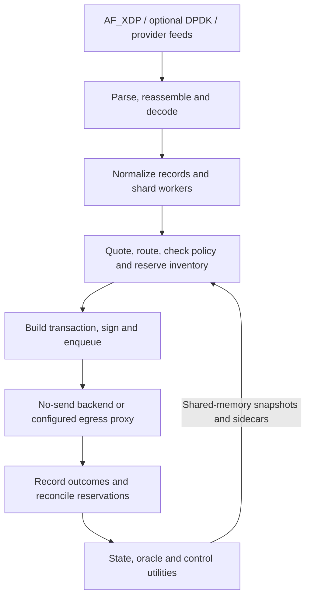

# Shadow Engine / Guerrila

**Shadow Engine is a Solana execution and market-research platform written primarily in Rust. Guerrila is its V6.4 operating profile and the main project directory in this repository.**

The project investigates how quickly observed swaps, liquidity changes, and market impulses can become executable opportunities. It combines transaction ingestion, market-state reconstruction, quoting, execution policy, inventory management, transaction construction, and result reconciliation. The aim is to measure whether an apparent opportunity survives transaction costs, timing, account readiness, and execution constraints.

The [Guerrila specification](Guerrila/Guerrila%20Document%20History/V6.4-Guerrila.md) defines a cost-conscious, small-treasury experimental profile for commodity bare-metal hardware. Its design emphasizes private execution lanes, controlled infrastructure costs, deterministic worker behavior, and bounded inventory exposure. Later research broadens the opportunity search from immediate backruns to recurring market impulses and additional strategy families.

This repository contains the eleven-crate engine workspace, the Shadow Console dashboard, a small on-chain vault-balance guard, host setup and validation tools, and the engine's quality-control reports and historical documentation. The separate `Guerrila/research/` branch is excluded from this repository.

The checked-in reference configuration uses **`observe_only` with `no_send_backend: true` and zero live rollout caps**. Begin with source review, compilation, static configuration validation, and synthetic inputs. Running a deployed engine requires a provisioned host and locally supplied configuration, credentials, and state.

## Contents

- [What the project explores](#what-the-project-explores)
- [Architecture](#architecture)
- [Components](#components)
- [Project status](#project-status)
- [Repository map](#repository-map)
- [Getting started](#getting-started)
- [Shadow Console](#shadow-console)
- [Configuration and host operation](#configuration-and-host-operation)
- [Testing and validation](#testing-and-validation)
- [Research and evidence](#research-and-evidence)
- [Documentation guide](#documentation-guide)
- [Snapshot and credentials](#snapshot-and-credentials)

## What the project explores

Shadow separates **finding an interesting market** from **proving a candidate can execute**. Its habitat-discovery work selects pools and market conditions worth investigating; strategy-specific checks then evaluate quotes, freshness, inventory, policy, fees, and available routes.

The source and research documents cover several strategy families:

| Strategy family | Research question |
| --- | --- |
| Direct arbitrage | Can a fresh price discrepancy produce a usable trade with available inventory and valid quotes? |
| Backrun | Can a candidate follow a specific target transaction while that target is still fresh enough? |
| Post-shock and continuation | Does a market impulse create a repeatable short-lived continuation or recovery opportunity? |
| Rebalancing | Can inventory restoration be justified by both execution mechanics and the portfolio's ownership rules? |
| Housekeeping and saved-loss analysis | Does an action create realized value, improve inventory, or merely avoid a modeled loss? |

These families have different readiness requirements and experimental histories. A detected signal, positive modeled value, successful simulation, no-send acceptance, landed transaction, and realized profit are separate results throughout the project's evidence.

## Architecture

Guerrila keeps the latency-sensitive worker focused on decoding, quoting, admission checks, reservation, transaction construction, signing, and enqueueing. State hydration, provider sessions, oracle updates, and reconciliation are handled by utility components and proxies. Fixed-layout shared-memory snapshots and single-producer/single-consumer rings connect the components.

AF_XDP and DPDK are native packet-processing paths; provider feeds supply transaction/account updates over gRPC. Ingestion turns incoming Solana ledger fragments and transactions into records workers can evaluate. State hydration keeps pool, token, and address-lookup-table data available for quoting and transaction construction.



This diagram describes the component flow. Which sources, strategies, and egress routes are available depends on build features, configuration, current state, and rollout gates.

The main Rust ingest/state adapters include **Raydium V4, Raydium CPMM, Raydium CLMM, Meteora DAMM v2, and PumpSwap / Pump.fun AMM**. Decoder support alone does not establish that a venue or strategy is ready for live execution.

Execution checks include state and target freshness, source quality, numeric quotes and minimum outputs, route compatibility, lane health, fee/tip economics, inventory reservations, position limits, and rollout admission. Reconciliation consumes local failures, egress results, bundle status, and on-chain signature evidence away from the worker hot path.

## Components

The Rust workspace is defined in [Guerrila/Cargo.toml](Guerrila/Cargo.toml).

| Component | Responsibility |
| --- | --- |
| [`shadow-tier0`](Guerrila/crates/shadow-tier0/) | Main runtime, worker orchestration, ingress/egress integration, configuration checks, and probes. |
| [`shadow-core`](Guerrila/crates/shadow-core/) | Quotes, projections, routing, policy, transaction assembly, inventory fences, admission, and reconciliation. |
| [`shadow-ipc`](Guerrila/crates/shadow-ipc/) | Memory-mapped segments, fixed-layout rings, records, snapshots, and sidecars. |
| [`shadow-state`](Guerrila/crates/shadow-state/) | Account subscriptions, RPC bootstrap, pool/mint/lookup-table hydration, and quote-state publication. |
| [`shadow-ingest`](Guerrila/crates/shadow-ingest/) | Shred/transaction parsing, reassembly, venue decoding, account resolution, worker routing, and corpus tools. |
| [`shadow-oracle`](Guerrila/crates/shadow-oracle/) | Tip lookup tables, competition adjustments, observe-only scoring, and telemetry. |
| [`shadow-control`](Guerrila/crates/shadow-control/) | Flight-recorder analysis, parser drift/blindness detection, manifest repair/quarantine, and rollout reports. |
| [`shadow-egress-jito`](Guerrila/crates/shadow-egress-jito/) | Jito, Helius Sender, and public-RPC adapters behind route selection and health checks. |
| [`shadow-harmonic`](Guerrila/crates/shadow-harmonic/) | Regional Harmonic sessions, lane validation, result recording, and failure handling. |
| [`shadow-egress-tpu`](Guerrila/crates/shadow-egress-tpu/) | TPU/QUIC transport and diagnostic tools for profiles that enable this route. |
| [`shadow-ingest-replay`](Guerrila/crates/shadow-ingest-replay/) | Experimental replay CLI scaffolding; input-to-decoder integration remains unfinished. |
| [`Shadow Guard`](Guerrila/programs/shadow-guard/) | Separate Solana program checking two supplied token vault balances against caller-provided bounds. |
| [`Shadow Console`](Guerrila/frontend/) | Localhost dashboard with SSH-backed status, artifacts, and allowlisted diagnostics. |

Shadow Guard supports SPL Token / Token-2022 vault amount checks. It is a small execution constraint; it does not independently verify strategy profitability or simulate an entire transaction. Its Cargo project is a separate workspace.

## Project status

This is a combined engineering and research snapshot with implemented runtime components, experimental tools, historical deployment evidence, and unfinished work.

- **Default posture:** the reference [configuration](Guerrila/config.guerrila.yaml) is observe-only/no-send. Public scouting and public-RPC execution are disabled; executable private bundle routes are blocked in its reference routing setup.
- **Runtime provisioning:** signer files, provider access, deployed guard/vault identifiers, lookup tables, shared-memory state, and host-specific paths must be supplied locally. Several checked-in values are placeholders.
- **Console:** a localhost prototype for status and diagnostics. Its run endpoints are blocked; live information requires access to a configured SSH host.
- **Replay:** the standalone `shadow-ingest-replay` entry point currently checks its input arguments and constructs an empty reassembler. Use the corpus and G4 tooling as separate research tools rather than assuming this CLI performs a complete captured-input replay.
- **Evidence:** older memos contain simulations, benchmarks, failed experiments, bounded live milestones, and changed operating doctrine. Their dates and run artifacts matter when interpreting a claim.

The source and the configuration selected for a run determine behavior. A historical checklist marked complete is not a general deployment or profitability guarantee.

## Repository map

| Path | Contents |
| --- | --- |
| [`Guerrila/`](Guerrila/) | Main working project: engine source, reference configuration, documentation, tools, and evidence. |
| [`Guerrila/crates/`](Guerrila/crates/) | Eleven-member Rust workspace. |
| [`Guerrila/programs/shadow-guard/`](Guerrila/programs/shadow-guard/) | Guard program and program tests. |
| [`Guerrila/frontend/`](Guerrila/frontend/) | Shadow Console server, UI, and frontend documentation. |
| [`Guerrila/g1-host-pack/`](Guerrila/g1-host-pack/) | Host build/deployment scripts, configuration variants, runbooks, and validation results. |
| [`Guerrila/SH/`](Guerrila/SH/) | Solana host and validator preparation, audits, and recovery material. |
| [`Guerrila/g12-qc/`](Guerrila/g12-qc/) | Quality-control reports, candidate analyses, and execution-readiness evidence. |
| [`Guerrila/continuation/`](Guerrila/continuation/) | Continuation studies, watchlists, and related research. |
| [`Guerrila/Research Vault/`](Guerrila/Research%20Vault/) | Broader statistical-intelligence and multi-chain research proposals. |
| [`backup/Guerrila/`](backup/Guerrila/) | Earlier project source, documents, and evidence. |
| [`archive/latitude15/`](archive/latitude15/) | Historical project material recovered from the host backup. |

Start development in `Guerrila/`. Treat `backup/` and `archive/` as historical reference rather than alternate current source roots.

## Getting started

### Prerequisites

- Git and Git LFS. The repository includes large research assets and long archived paths.
- Rust and Cargo compatible with the checked-in **version 4 lockfile** and its resolved dependencies. The workspace declares edition 2021 and `rust-version = "1.75"`; that declaration alone does not establish compatibility of all locked dependencies with Rust 1.75.
- Linux for the native engine environment; WSL can be useful for builds and source review. Actual AF_XDP/DPDK operation needs a native Linux host with suitable kernel/NIC support.
- Native build dependencies described in the host runbooks: a C/C++ toolchain, `clang`, `llvm`, `pkg-config`, `cmake`, `libelf-dev`, `libbpf-dev`, `libssl-dev`, and `protobuf-compiler`. The optional `dpdk` feature additionally needs a discoverable `libdpdk` installation.
- Node.js, npm, and an SSH client for the Console. Python, Node, and other tool dependencies vary between research subprojects.

The engine commands below use a Bash/Linux shell. They compile or inspect source and configuration; host runtime bring-up is covered separately in the deployment runbooks.

### Clone

Clone with LFS enabled:

```bash
git lfs install
git clone -c core.longpaths=true https://github.com/sellify00/guerrila.git
cd guerrila
git lfs pull
```

The clone configuration preserves long archived paths on Windows. Allow several gigabytes of local storage for the complete snapshot and datasets.

For source review without downloading LFS asset contents immediately:

```bash
GIT_LFS_SKIP_SMUDGE=1 git clone -c core.longpaths=true https://github.com/sellify00/guerrila.git
```

That option leaves pointer files in place of LFS assets. Run `git lfs pull` inside that clone when the datasets are needed; ordinary Git-tracked research files are still part of the clone.

### Build and check the reference configuration

From the repository root:

```bash
cd Guerrila
cargo build --locked --profile release-guerrila \
  -p shadow-tier0 -p shadow-harmonic -p shadow-oracle -p shadow-state

target/release-guerrila/shadow-tier0 \
  --check-config config.guerrila.yaml
```

`release-guerrila` inherits the workspace's optimized release settings. `--check-config` parses YAML and checks static profile rules, then exits without starting worker threads. It does not prove provider connectivity, shared-memory freshness, signer readiness, guard deployment, or runtime acceptance.

### Generate synthetic research inputs

From `Guerrila/`:

```bash
cargo run --locked -p shadow-ingest --bin build_g4_corpus -- \
  --source synthetic --out-dir /tmp/shadow-g4-corpus
```

This creates deterministic baseline, FEC loss/recovery, reorder, and sustained-load scenario JSON files without opening transport. The synthetic payloads are fixtures, not valid market transactions. Additional `g4-shred-replay`, `g4-ingress-seal`, and probe binaries are available under `shadow-tier0`; inspect their help and the relevant host procedure before connecting them to a datapath.

## Shadow Console

The Console is a Node server and browser UI for inspecting a configured engine host. From `Guerrila/`, install its dependencies and run the syntax checks:

```bash
cd frontend
npm ci
npm run check

SHADOW_CONSOLE_HOST=user@your-engine-host \
SHADOW_CONSOLE_KEY=/path/outside/repo/id_ed25519 \
npm start
```

Replace the host and key path with your own local SSH configuration. Open **http://127.0.0.1:8787**. `SHADOW_CONSOLE_PORT` changes the port.

The server binds to localhost, collects SSH-backed status/artifacts, and exposes allowlisted diagnostics. It does not provide arbitrary shell execution or enabled engine-launch controls. Without a reachable configured host, live status and diagnostics cannot populate. See the [frontend README](Guerrila/frontend/README.md) for UI details and optional review tools.

## Configuration and host operation

[config.guerrila.yaml](Guerrila/config.guerrila.yaml) defines sources, state publication, execution paths, risk limits, rollout gates, routing, and strategy settings. Create a resolved local deployment configuration for your own environment rather than treating archived host paths and identifiers as portable values.

Use [.env.example](Guerrila/.env.example) as an inventory of some local values, not as a universal configuration loader. The main configuration parser directly deserializes YAML; `.env` is not automatically loaded everywhere. The state loader expands selected endpoint/token fields, while host wrappers perform additional setup. Check the loader or wrapper for each process before relying on `${VAR}` expansion.

Runtime setup includes provider endpoints, account and leader-state publications, shared-memory paths, credential/signing paths, tip lookup tables, valid guard/vault identifiers, and an explicitly selected rollout posture. Native packet capture additionally requires host-specific NIC queues, BPF/XDP setup, memory preparation, and packet-ownership/cleanup procedures.

The [G1 runbook](Guerrila/g1-host-pack/G1_RUNBOOK.md) covers engine host preparation and validation. The [SH runbook](Guerrila/SH/SH_RUNBOOK.md) covers validator/host preparation, health checks, and recovery. Their hardware, interface names, service names, and addresses describe particular historical hosts; adapt them to your environment before running their procedures.

No-send describes transaction submission behavior. A host script can still change NIC/BPF state, start services, connect to providers, or write artifacts during a no-send run. Use the documented bounded bring-up and handback procedures when working on an actual host.

## Testing and validation

From `Guerrila/`, the workspace and separate guard tests are:

```bash
cargo test --locked --workspace
cargo test --locked --manifest-path programs/shadow-guard/Cargo.toml
```

For a focused change, select the relevant package, for example `cargo test --locked -p shadow-ingest`. Console syntax checks use `npm run check` from `Guerrila/frontend/`.

The repository also contains host seals, ingress/latency probes, no-send funnels, rollout gate reports, and reconciled run artifacts. These assess different properties: a unit test or static config check is distinct from hardware validation, source freshness, no-send transport acceptance, or live reconciliation. `shadow-control` includes offline gate-report evaluation as well as its shared-memory/archive-driven control loop.

## Research and evidence

The engine's included evidence is organized under [g12-qc](Guerrila/g12-qc/), [g1-host-pack](Guerrila/g1-host-pack/), [continuation](Guerrila/continuation/), and the historical documentation and archives. These contain candidate analyses, source/transport proofs, execution-readiness reports, continuation studies, and host-validation artifacts.

The [multi-chain research proposal](Guerrila/Research%20Vault/Shadow_Engine_MultiChain_Speed_Research_Proposal.md) and [statistical-intelligence checklist](Guerrila/Research%20Vault/shadow_statistical_intelligence_checklist.md) describe future directions for Shadow Engine. They are proposals and backlog material, rather than a claim that separate multi-chain implementations are included here.

Read a result together with its configuration, input provenance, timestamp, assumptions, and terminal outcome. A modeled expected-value field is not realized PnL; a constructed or simulated transaction is not proof that it landed. The separate `Guerrila/research/` branch and any corresponding historical copies are intentionally excluded.

## Documentation guide

| Document | Start here for |
| --- | --- |
| [End-to-end pipeline](Guerrila/Shadow-e2e-pipeline.md) | Ingest/source roles, strategy flow, execution rules, and evidence terminology. |
| [Monetization strategy](Guerrila/shadow_monetization_strategy_UPDATED.md) | Strategy economics, readiness distinctions, and conversion blockers. |
| [Guerrila handoff memo](Guerrila/Shadow_Engine_V6.4_Guerrila_Handoff_Status_Memo_CURRENT_SPEED_MONETIZATION_UPDATE.md) | Dated implementation updates and historical run context. |
| [G1 runbook](Guerrila/g1-host-pack/G1_RUNBOOK.md) | Engine host setup, kernel-bypass bring-up, validation, and recovery. |
| [SH runbook](Guerrila/SH/SH_RUNBOOK.md) | Solana host/validator preparation and operational lessons. |
| [Console README](Guerrila/frontend/README.md) | Dashboard setup and optional UI tooling. |
| [Guerrila document history](Guerrila/Guerrila%20Document%20History/) | V6.4 specifications and earlier checklists. |
| [Shadow Engine document history](Guerrila/Shadow%20Engine%20Document%20History/) | Earlier system specifications and architecture evolution. |

Several documents accumulated updates over time. Use their dated evidence together with current source/configuration when resolving differences between a design target and implemented behavior.

## Snapshot and credentials

This repository contains a filtered snapshot of the Shadow Engine / Guerrila files available on **3 October 2026**, including local project changes and relevant historical material. Its published history starts from a clean snapshot that excludes the separate `Guerrila/research/` branch.

Private keys, local credential files, full-machine images, dependency installations, and build caches are omitted. Credential literals found in included files were replaced with redacted placeholders. Historical documents may reference modules or artifacts outside the export. Supply your own credentials locally and keep signer/SSH keys outside the repository.

Large selected research assets use **Git LFS**. Identical assets shared by current and historical snapshots are stored once by content hash. The original project folders and full host backups remain separate from this repository.
